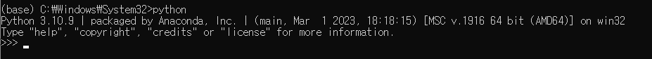
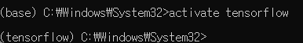
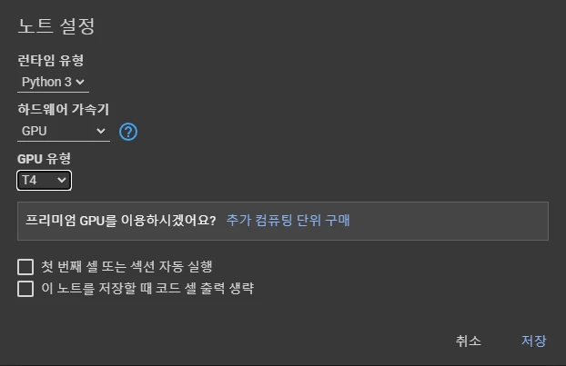

# 실습을 위한 Tensorflow와 Jupyter Notebook, Colab 설치

작성일 2023-07-13
{ .post-date }

## TensorFlow 설치

- 먼저 Python 3.5 버젼 이상을 설치해야 함.
- 가상환경 : Anaconda 설치(윈도우 버젼)

1\. anaconda prompt를 관리자 권한으로 켠 뒤, pip 업그레이드

python -m pip install --upgrade pip

2\. Conda 환경 만들기

conda create -n tensorflow python=3.x



⇒ 현재 3.10.9가 설치되어 있으므로 3.10으로 설치한다.

3\. TensorFlow 설치하기

activate tensorflow

⇒ 이렇게 하면 프롬프트가 ‘tensorflow’로 바뀌게 된다.



이 상태에서 아래와 같이 입력한다.

pip install tensorflow

⇒ 설치가 완료되면 환경 세팅 끝.

4\. 확인하려면 Python을 입력해보자. # 파이썬 터미널을 열어준다.

그 다음, 아래와 같이 입력해보자.

```python
import tensorflow as tf
hello = tf.constant('Hello, TensorFlow!')
sess = tf.Session()
print(sess.run(hello))
# Hello, TensorFlow!

a = tf.constant(10)
b = tf.constant(32)
print(sess.run(a+b))
# 42
```

⇒ Python은 Interpreter 언어이기 때문에 한 번에 한 줄씩 입력하면서 실행이 된다.

(그런데, 이 코드대로 쳐보니 두 가지 문제가 발생함.)

**문제 1 : 2023-07-13 13:08:42.792142: I tensorflow/core/platform/cpu_feature_guard.cc:182] This TensorFlow binary is optimized to use available CPU instructions in performance-critical operations. To enable the following instructions: SSE SSE2 SSE3 SSE4.1 SSE4.2 AVX AVX2 FMA, in other operations, rebuild TensorFlow with the appropriate compiler flags.**

요약하자면, 연산이 더 빨라질 수 있는 고성능 CPU instruction을 사용하라는 경고 문구인데, 대처법은 두 개가 있다. 첫 번째는 무시하는 것, 두 번째는 CPU instruction을 바꿔서 다시 컴파일 하는 것이다. 이번에는 전자를 사용했다.

[파이썬 텐서플로우(TensorFlow) 메시지 : Your CPU supports instructions that this TensorFlow binary was not com..](https://m.blog.naver.com/complusblog/221237740617)

**문제 2 : model tensorflow has no attribute session**

TensorFlow에 Session()이라는 attribute가 없다는 문제. 찾아보니, 이건 TensorFlow 1에서 사용하는 코드라고 한다. 버젼 2에서는 다른 방식으로 사용한다. (Session()을 사용하지 않음.)

출력을 하려면, tf로 변수를 만들고 나서 아래와 같이 입력하면 된다.

tf.print(hello)

[파이썬 텐서플로우 에러해결 :: AttributeError: module 'tensorflow' has no attribute 'Session' / RuntimeError: The Session graph is empty.  Add operations to the graph before calling run().](https://kongnamool.tistory.com/20)

- conda env list : anaconda에 설치된 가상 환경 확인 가능

    - 다른 명령어로는 conda info --envs

---

## Jupyter Notebook 설치

1\. Conda 가상환경을 켠 상태에서 다음과 같이 입력한다.

conda install jupyter notebook

2\. 주피터 노트북을 실행한다

jupyter notebook

---

## Colab 활용

[http://colab.research.google.com](http://colab.research.google.com/) 에 접속하여 파일 &gt; 새 python3 노트

- GPU 사용하기 : 런타임 유형을 변경한다.

런타임 &gt; 런타임 유형 변경 &gt; 하드웨어 가속기 설정 - GPU 명령으로 GPU 사양 확인



- 구글 드라이브 연동


- test_colab 폴더 생성 및 확인

```python
from google.colab import drive
drive.mount('/content/drive')
```

⇒ 연동된 내 구글 계정 드라이브 내에서 현재 프로젝트를 /content/drive에 mount 시킨다.

- test_colab 폴더 생성 및 확인

```shell
!mkdir -p '/content/drive/My Drive/test_colab'
!ls -Fcal '/content/drive/My Drive/test_colab'
```

/content/drive 내에서 My Drive 디렉터리를 만들고, test_colab 디렉터리 생성. 이후에 제대로 생성됐는지 확인.

- 위 폴더에 df.csv 파일 만들어서 행렬을 저장

```python
import numpy as np
import pandas as pd

df = pd.DataFrame(np.random.rand(10,5))
df.to_csv('/content/drive/My Drive/test_colab/df.csv')
```

⇒ 저장된 .csv 파일
