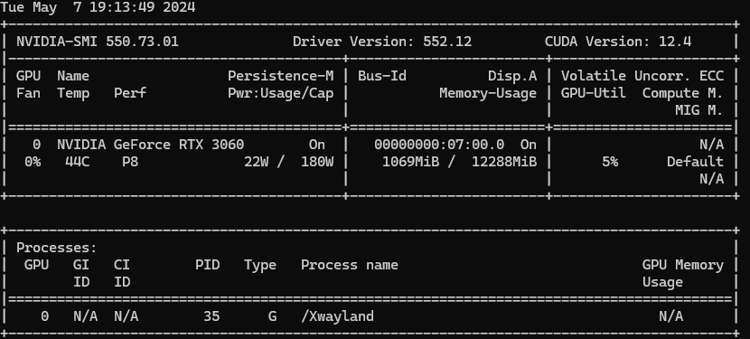
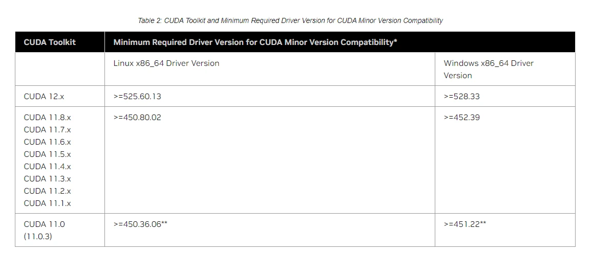
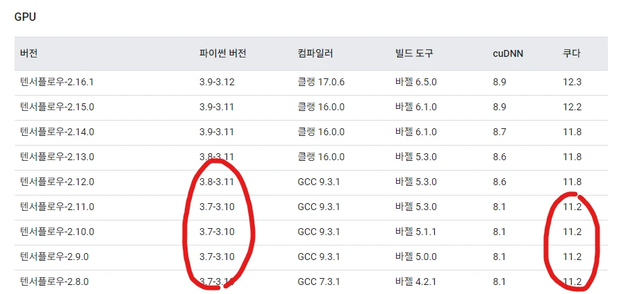
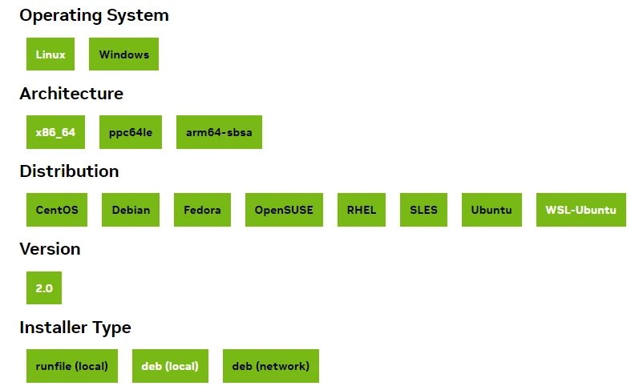
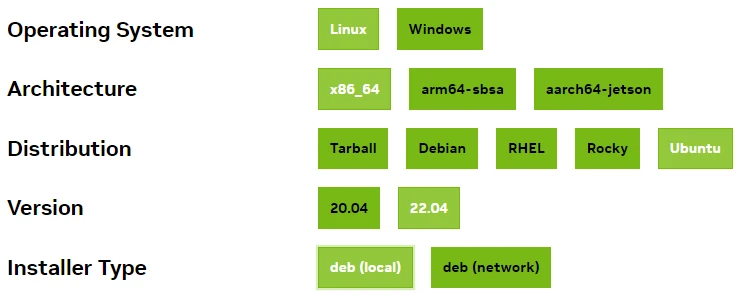

# WSL2 Tensorflow PyTorch CUDA

1. WSL2에 mini-conda 설치
2. nvidia-smi로 버젼 확인



- **그래픽카드와 호환되는 CUDA 버젼 확인**

[CUDA](https://en.wikipedia.org/wiki/CUDA#GPUs_supported)

**RTX 3060**: 버젼 8.6(Ampere), CUDA 11.1~11.4와 호환됨.

- **CUDA와 호환되는 Driver 버젼 확인**

[CUDA 12.4 Update 1 Release Notes](https://docs.nvidia.com/cuda/cuda-toolkit-release-notes/index.html)



- **텐서플로우 버젼 확인**

[소스에서 빌드  |  TensorFlow](https://www.tensorflow.org/install/source?hl=ko)



~~⇒ CUDA 버젼이 11.1~11.4이므로, 11.2를 지원하는 tensorflow-2.11.0을 사용하면 될 것 같다.~~

~~이때, 파이썬 버젼은 3.7\~3.10이다.~~

3.11.4로 설치 (CUDA 12.2 이용)

> Python 3.10.0 설치 완료

- **CUDA 설치**

[CUDA Toolkit Archive](https://developer.nvidia.com/cuda-toolkit-archive)

CUDA 11.2를 다운로드 받는다.



**Installation Instructions:**

---

```bash
wget https://developer.download.nvidia.com/compute/cuda/repos/wsl-ubuntu/x86_64/cuda-wsl-ubuntu.pin
sudo mv cuda-wsl-ubuntu.pin /etc/apt/preferences.d/cuda-repository-pin-600
wget https://developer.download.nvidia.com/compute/cuda/12.2.2/local_installers/cuda-repo-wsl-ubuntu-12-2-local_12.2.2-1_amd64.deb
sudo dpkg -i cuda-repo-wsl-ubuntu-12-2-local_12.2.2-1_amd64.deb
sudo cp /var/cuda-repo-wsl-ubuntu-12-2-local/cuda-*-keyring.gpg /usr/share/keyrings/
sudo apt-get update
sudo apt-get -y install cuda
```

---

⇒ 순서대로 실행하면 된다.

- **cuDNN 설치**

[NVIDIA CUDA Deep Neural Network (cuDNN)](https://developer.nvidia.com/cudnn)



```bash
wget https://developer.download.nvidia.com/compute/cudnn/9.1.1/local_installers/cudnn-local-repo-ubuntu2204-9.1.1_1.0-1_amd64.deb
sudo dpkg -i cudnn-local-repo-ubuntu2204-9.1.1_1.0-1_amd64.deb
sudo cp /var/cudnn-local-repo-ubuntu2204-9.1.1/cudnn-*-keyring.gpg /usr/share/keyrings/
sudo apt-get update
sudo apt-get -y install cudnn
```
