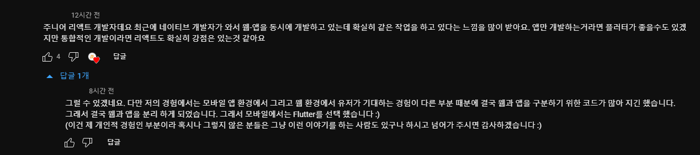

# Flutter vs React Native

작성일 2023-02-13 · 최종 수정일 2024-09-19
{ .post-date }

[https://www.youtube.com/watch?v=Z9cCjrbTW50](https://www.youtube.com/watch?v=Z9cCjrbTW50)

두 프레임워크는 모두 훌륭하며, 독립적인 장점과 단점을 가지고 있다.

에어비앤비의 경우, 리액트 네이티브로 이주했지만 얼마 후 이슈에 부딪혀 순수 네이티브로 돌아갔다. 그렇다고 리액트 네이티브가 안좋은 것일까? 그렇지는 않다. 단지, 리액트 네이티브가 에어비앤비의 상황에 맞지 않았을 뿐이다.

이 영상은 대부분 ‘트레이드 오프’(trade-off)에 대해 다루며, 절대적인 답은 없다. 중요한 것은 프로젝트의 요구 사항을 정확히 파악하고 무엇을 필요로 하느냐이다.

- 리액트

    - 자바스크립트, 그리고 리액트이다.

    리액트, 자바스크립트, CSS의 규칙이 적용된다. 그러므로 리액트 네이티브를 배우는 것은 쉽다.

    즉, 프론트엔드 개발자를 리액트 네이티브 개발에 참여시키기 매우 쉬우므로,

    활용할 수 있는 인재의 풀이 늘어난다는 것이 장점이 된다.

    ⇒ 플러터의 경우, Dart는 어렵지는 않은 언어이고, Java, C#이랑 비슷하지만 생소한 언어를 배워야 한다는 한계가 있으며, 인재 풀이 작다.

- 플러터

    - 플러터는 완전한 기능을 갖춘 큰 프레임워크를 사용하는 느낌을 받을 수 있다.

    반면, 리액트 네이티브는 다소 미니멀하게 느껴질 수 있다.

    기본적으로 플러터는 탐색(navigation), 번역, 다크모드, 테마, 애니메이션, 상태 관리 등이 탑재되어 있고, 더 나아가 다양한 컴포넌트까지 제공된다.

    추가로, 필요한 기능을 찾지 못한다면 플러터 개발 팀이 관리하는 라우팅, 카메라 액세스, 파일 선택, 지도, 웹 뷰, 앱 구매 등을 다양한 패키지에서 찾을 수도 있다. (pub.dev)

    리액트 네이티브는 위와 같은 기능을 제공하지 않으며, 이를 위해서는 서드파티 패키지를 설치하거나 직접 코드를 짜야 한다.

    그러므로 플러터는 리액트 네이티브보다는 서드 파티 의존성이 적다는 데서 강점이 있다.

    이는 일종의 Centralization의 강점으로, 공식 Documentation, Youtube 등에서 동일한 소스를 기반으로 정보를 얻을 수 있다. 하지만 이는 동시에 단점으로도 작용하는데, 만약 구글에서 플러터 팀을 해고한다면 더 이상 공식적으로 지원되는 플러터를 사용할 수 없게 될 것이다.

    플러터의 가장 큰 단점은 바로 ‘**리액트 네이티브의 CodePush**’이다. 리액트 네이티브는 앱 스토어에 출시한 앱을 업데이트 할 때, 큰 어려움 없이 JS를 다운로드 받도록 하여 업데이트를 할 수 있다. 즉, 몇 분 안에 버그를 수정하고 업데이트 할 수 있는 것이다.

    플러터는 이런 기능이 없다. 플러터는 실제로 실행중인 코드를 네이티브 바이너리로 컴파일하기 때문에 이를 업데이트 하려면 실제로 유저가 실행 중인 바이너리를 교체해야 한다. 즉, 앱을 다시 컴파일 한 후에 앱 스토어에 다시 제출해야 한다.

    추가로, 플러터는 모든 화면에서 실행할 수 있는 앱/게임을 개발할 수 있도록 지원하는 것이 목표인데, 이 점이 단점이 될 수도 있다. 왜냐면 그렇게 필요해지는 모든 공식 API들을 관리하지 못할 수도 있기 때문이다.

---

- 그렇다면 언제 어떤 것을 사용해야 하는가?

    - 만약 스타트업이 백엔드, 프론트엔드에서 JS를 사용하고 있고 이미 리액트 개발자가 있다면 리액트 네이티브를 탐색하는 것도 좋은 방법이다.
    - 백엔드가 Java로 개발되어 있고 개발자들이 모두 객체 지향에 익숙하다면 Flutter를 선택하는 것이 좋을 것이다.
    - 다만 어떤 것을 선택하던지, 둘다 교차 플랫폼 프레임워크이기 때문에 어느 쪽은 선택하던, 문제에 직면하게 될 것이다.
    - Flutter + Firebase가 작은 앱 개발자에게는 최상의 조건이다.
    - 개발을 진행하기에 앞서서, 개발하게 될 기능에는 어떠한 것이 있는지 정리해보고, 어떤 프레임워크가 가장 많은 기능을 지원하고, 패키지를 갖고 있고, 업데이트를 얼마나 잘 해주는지 잘 확인해보자.

---

- 노마드 코더에서 제공하는 무료 강의

[왕초보를 위한 React Native 101 - 노마드 코더 Nomad Coders](https://nomadcoders.co/react-native-for-beginners)

[Flutter 로 웹툰 앱 만들기 - 노마드 코더 Nomad Coders](https://nomadcoders.co/flutter-for-beginners/lobby?utm_source=free_course&utm_campaign=flutter-for-beginners&utm_medium=site)

