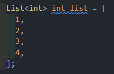

# Dart 4: Data types

## Basic Data Types

String

bool

int

double

dart에서 각각의 데이터 타입은 모두 class이다.

dart에서는 특별하게 num이라는 data type이 있는데, 이는 integer가 될 수도 있고, double이 될 수도 있다. integer와 double은 모두 num 이라는 class를 상속받는다.

## List

```dart
var numbers = [1, 2, 3, 4];
List<int> numbers2 = [1, 2, 3, 4];
```

dart에서 List가 강력한 이유는 collection if와 collection for를 지원하기 때문이다. 

Tip : 가장 마지막 원소에서 ,를 붙이고 세미콜론을 붙이면 이와 같이 여러 줄로 포매팅 된다.



- collection if : if를 이용하여 존재할 수도 있고 존재하지 않을 수도 있는 원소를 나눠서 List에 저장할 수 있다.

```dart
var giveMeFive = true;
var numbers = [
	1,
	2,
	3,
	4,
	if (giveMeFive) 5,
];
```

이는 사실 아래와 같은 내용이다.

```dart
var numbers = [
	1,
	2,
	3,
	4,
];
numbers.add(5);
```

## String Interpolation

string interpolation은 text에 변수를 추가하는 방법이다. flutter에서는 굉장히 유용하게 사용된다.

```dart
var name = 'nico';
var greeting = 'Hello everyone, my name is ${name}, nice to meet you!';
var greeting2 = 'Hello everyone, my name is $name, nice to meet you!';

print(greeting);
print(greeting2);
```

변수가 이미 존재할 때는 위와 같은 방법을 사용할 수 있다. 만약 계산을 실행할 경우, 방법이 약간 달라진다.

```dart
var age = 10;
var greeting = 'My age is ${age + 14}';
print(greeting);
```

연산을 수행해서 변수를 만들 때는 위와 같이 curly bracket을 이용할 수 있다.

## Collection for

```dart
var oldFriends = ['nico', 'lynn'];
var newFriends = [
  'lewis',
  'ralph',
  'darren',
  for (var friend in oldFriends) "name : $friend"
];

  print(newFriends);
```

이와 같은 방법으로 List 내부에서 for 문을 통해 iteration을 만들고, 변수를 간편하게 조작하여 List에 추가할 수 있다.

- collection if/collection for는 굉장히 좋은 기능이다. UI 인터페이스를 만들 때, 특히 collection if는 네비게이션 바나 메뉴를 만들 때 user가 로그인을 했는지 안했는지 나타내는 버튼을 추가하고 싶을 때 활용하기 좋다. collection for 역시 굉장히 좋은 기능인데, 코드를 굉장히 많이 줄여준다.

## Maps

JS의 Object와 같은 역할을 한다.

```dart
var player = {
    'name': 'nico',
    'xp': 19.99,
    'superpower': false,
  };
```

이 스니펫에서 map의 자료형은 map&lt;String, Object&gt; 이와 같이 생성되는데, 여기서 Object라는 것은 내가 원하는 모든 것을 다 넣을 수 있다는 것이다.

추가로, Map의 자료형은 컴파일러가 자동으로 정해주기도 하지만, Generic을 설정해서 원하는 대로 바꿀 수 있다.

```dart
Map<int, bool> player2 = {
    1: true,
    2: false,
    3: true,
  };
```

## Sets

```dart
var nums = {
    1,
    2,
    3,
    4,
  };

  Set<int> nums_int = {
    1,
    2,
    3,
    4,
  };
```

set은 포함하고 있는 요소들이 유니크하므로, 같은 데이터가 들어가지 못한다.

```dart
nums.add(1);
nums.add(1);
nums.add(1);
print(nums);
```
