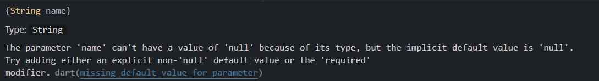

# Dart 5: Functions

## Arrow Function

```dart
void sayHello(String name) => "Hello $name nice to meet you!";

num plus(num a, num b) => a + b;
```

arrow function은 return value를 한 줄에 써서 바로 return 한다. 여기서 num은 int도 전달받을 수 있고 double도 전달받을 수 있다.

## Named Parameters

Named Parameter는 flutter에서 자주 사용되는 개념 중 하나이다. 

```dart
String sayHelloInfo(String name, int age, String country) {
  return "Hello $name, you are $age, and you come from $country";
}

void main() {

	print(sayHelloInfo('nico', 19, 'cuba'));
}
```

그런데, 이와 같이 작성하게 되면 sayHelloInfo에 들어갈 인자가 무엇인지 잊어버릴 수도 있다. 그리고 읽었을 때 바로 이해가 가지 않는다. 이럴 경우 named argument를 이용하면 좀 더 편하게 이용할 수 있다. named argument를 이용하면 순서를 기억해서 인자를 지정하지 않아도 되며, 이름으로 인자를 지정해줄 수 있다.

```dart
String sayHelloInfo(String name, int age, String country) {
  return "Hello $name, you are $age, and you come from $country";
}

void main() {
  sayHello("정동교");
  print(sayHelloArrow("potato"));

  print(sayHelloInfo(
    age: 12,
    country: 'cuba',
    name: 'nico'
  ));
}
```

하지만 이렇게만 작성하면 에러가 발생하게 되는데, 그 이유는 sayHelloInfo가 named argument를 지원하지 않기 때문이다. 이 기능을 지원하려면 함수의 parameter에 중괄호를 전체적으로 추가해주면 된다. (parameter를 Highlight 한 다음, 중괄호 { 키 누르기)

```dart
String sayHelloInfo({String name, int age, String country}) {
  return "Hello $name, you are $age, and you come from $country";
}
```

이렇게 작성하면 named argument를 사용할 수 있다. 하지만, dart는 null safety를 고려하여 에러 메시지를 띄우게 된다. 



이럴 경우에는 해결 방법이 두 가지 있다. 첫 번째는 default value를 지정해주는 것이다.

```dart
String sayHelloInfo({
  String name = 'anon', 
  age = 99, 
  String country = 'Wakanda',
}) {
  return "Hello $name, you are $age, and you come from $country";
}
```

다른 방법은 required modifier를 사용하는 것이다. named parameter가 required라고 써주는 것이다.

```dart
String sayHelloInfo({
  required String name, 
  required int age, 
  required String country}) {
  return "Hello $name, you are $age, and you come from $country";
}
```

required를 지정하면 이 함수가 반드시 required 인자가 전달되어야만 컴파일 된다고 설정할 수 있게 된다.

## Optional Positional Parameters

만약, named argument를 적용하고 싶지 않은데 country는 required 하지 않게 하려면 어떻게 해야 할까? 다음과 같이 코드를 작성해주면 된다.

```dart
String hello(
  String name, 
  int age, 
  [String? country = 'cuba']
) => 'Hello $name, you are $age years old and come from country $country';

void main() {

	print(hello('nico', 12));
}
```

이렇게 되면 마지막 argument를 보내지 않고도 함수를 실행할 수 있게 된다. (String?에 쓰인 ?는 country가 전달될 수도, 아닐 수도 있다는 것을 나타낸다. 즉, 해당 인자가 nullable 이라고 명시하는 역할을 한다. 이 때 default value를 부여하면 좋다.)

## Operator(??, ?=)

특별한 operator를 사용하기 위해서 먼저 간단한 코드를 작성해본다.

```dart
String capitalizeName(String name) => name.toUpperCase();
```

이렇게 작성하면, 전달한 String을 대문자로 만들어서 return하는 함수가 된다. 하지만 만약, 이 함수가 null도 받을 수 있도록 하고 싶다면 어떻게 해야할까?

```dart
String capitalizeName(String? name) => name.toUpperCase();
```

이와 같이 변수 타입에 ?를 붙여주면, null이 될 수도 있다고 표시할 수 있다. 하지만, 이렇게만 하면 null로 값이 전달될 때 null에 참조를 하게 되므로, null safety에 걸리게 된다. 이렇게 될 경우 첫 번째 해결 방법은 아래와 같다.

```dart
String capitalizeName(String? name) {
	if (name != null) {
		return name.toUpperCase();
	}

	return 'ANON';
}
```

이 방법을 줄여서 하려면, 이와 같이 삼항연산자를 쓸 수도 있다.

```dart
String capitalizeName(String? name) => 
	name != null ? name.toUpperCase() : 'ANON';
```

이 코드는 name이 null이 아니라면 toUpperCase()를 적용하여 return하고, null이라면 ANON을 return하는 코드이다.

위의 코드를 QQ operator를 사용하면 더욱 간단하게 줄일 수 있다. QQ는 ??로 표현하며, 만약 좌항이 null이면 우항을 return하는 역할을 한다. 따라서, 코드는 아래와 같이 표현될 수 있다.

```dart
String capitalizeName(String? name) =>
	name?.toUpperCase() ?? 'ANON';
```

(null이 될 수 있는 변수의 경우는 ?를 붙여서 사용한다.)

- QQ Equal Operator

```dart
String? name;
name ??= 'nico';
```

nullable 변수 name을 만들고, 만약 name이 null이라면 새로운 값을 할당해주는 역할을 하는 연산자가 바로 QQ Equal Operator이다.

## Typedef

typedef는 자료형에 alias를 붙일 수 있게 해준다. 

```dart
List<int> reverseListOfNumbers(List<int> list) {
  var reversed = list.reversed; // reversed를 사용하면 list가 iterable이 된다.
  return reversed.toList(); // 그러므로, toList()를 이용하여 list화 한 뒤에 return한다.
}
```

함수 reverseListOfNumbers는 전달받은 List&lt;int&gt;를 뒤집어서 전달해주는 역할을 한다. 이 때, List&lt;int&gt;의 자료형을 줄여서 표현할 수 있게 하는 것이 Typedef이다.

```dart
typedef ListOfInts = List<int>;

ListOfInts reverseListOfNumbers(ListOfInts list) {
  var reversed = list.reversed; // reversed를 사용하면 list가 iterable이 된다.
  return reversed.toList(); // 그러므로, toList()를 이용하여 list화 한 뒤에 return한다.
}

void main() {
	var result = reverseListOfNumbers([1, 2, 3]);
	print(result);
}
```

그런데, 우리가 Map에 대하여 Typedef를 지정하고 싶을 때도 있을 것이다. 다음 함수를 예로 확인해보자.

```dart
String sayHi(Map<String, String> userInfo) {
	return "Hi ${userInfo['name']}";
}
```

이 경우에, Map에 typedef를 적용하여 userInfo라고 만들어보자.

```dart
typedef UserInfo = Map<String, String>;

String sayHi(UserInfo userInfo) {
	return "Hi ${userInfo['name']}";
}
```

이렇게도 동작할 수 있지만, 사실 이 코드는 Data Class로 대체할 수 있다.

- 궁금증 : 만약, ‘name’이라는 key가 정의되지 않았다면?

⇒ null이 출력된다.
