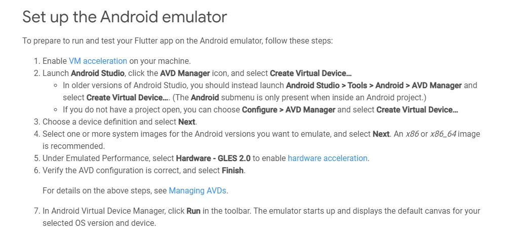

# 2.0 Installation

- Windows PowerShell에서 flutter doctor를 통해 현재 문제 상황 확인 가능.

## 1. Windows 버젼 확인 불가

→ flutter channel master 로 해결.

## 2. Android Studio 관련 문제

가이드라인에 맞게 VM을 새롭게 만들었으나 여전히 문제 발생.

android toolchain - develop for android devices (android sdk version 33.0.0)

이에 따라 검색해본 결과, Android Studio SDK Manager에서 설정이 필요했음.

[flutter doctor --android-licenses 문제 해결하기](https://www.androidhuman.com/2021-06-02-flutter_android_license_noclassdeffound)

해당 블로그의 내용을 따라서 해결.

1) Android SDK Command-line Tools 설치

2) 자바 버젼 오류 발생, OpenJDK 11 설치로 해결.

[java 버전에러 (java.lang.UnsupportedClassVersionError)](https://program-error-review.tistory.com/51)

[윈도우11 환경변수 추가 및 변경 삭제 설정방법](https://jab-guyver.co.kr/2354)

3) flutter doctor --android-licenses
