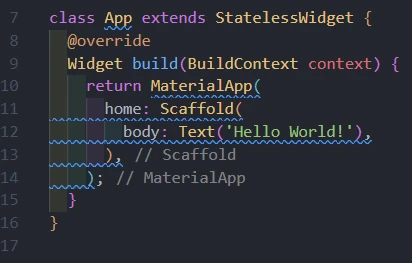

# 2.3 Hello World

- runApp

runApp은 Widget type의 argument를 전달받는다. Widget이란 레고 블럭이라고 볼 수 있다. 우리는 Widget을 레고 블럭처럼 합쳐 사용할 수 있다. 무료로 제공되는 공식 Widget도 많으며, 필요할 때 마다 다운받아서 사용하면 된다. Widget의 종류는 매우 많으며, 필요할 때마다 찾아서 사용하면 된다.

프로그래밍의 관점에서 본다면, Widget을 만든다는 건 그냥 class를 만드는 것이다. 

```dart
import 'package:flutter/material.dart';

void main() {
  runApp(App());
}

class App {
  
}
```

여기서 App을 Widget으로 만들기 위해서는 flutter SDK에 있는 3 개의 core Widget 중에 하나를 extend 해야 한다. 그 중에서 가장 간단한 형태인 StatelessWidget을 상속받으면, build 메서드를 구현해야 하며, build 메서드가 return하는 값을 화면 상에 UI로 보여주게 된다. (override 필요)

```dart
import 'package:flutter/material.dart';

void main() {
  runApp(App());
}

class App extends StatelessWidget {

  @override
  Widget build(BuildContext context) {
    // TODO: implement build
    throw UnimplementedError();
  }

}
```

우리는 지금 또 다른 Widget을 return하는 Widget을 만들고 있다. 이렇게 반환되는 Widget은 runApp에 전달될 것이므로, 결국 이 Widget이 root Widget이라는 것이다. 앱의 root Widget은 두 개의 옵션 중 하나를 return해야 한다. 

1) material 앱을 return한다. (구글의 디자인 시스템)

2) cupertino 앱을 return한다. (애플의 디자인 시스템)

즉, 여기서는 MaterialApp을 return하거나, CupertinoApp을 return하는 것이다. 이건 우리가 어떤 family 스타일을 사용할지를 플러터에게 말해주는 것이다. (앱이 어떻게 보일 지)

그런데 여기서 의문이 하나 생긴다. 우리는 우리만의 디자인과 UI를 갖는 앱을 만들건데 구글이나 iOS 스타일의 UI를 사용하지 않을려면 어떻게 해야할까? 결론은 둘 중 하나는 선택해줘야 한다. 기본  UI 설정과 같은 재료들을 설정하고 나서 추후에 바꿔주어야 한다.

플러터는 구글이 만들었기 때문에 materialApp이 cupertinoApp보다는 더 보기 좋을 것이다. 그러므로 대부분 materialApp을 선택한다.

MaterialApp의 property에는 home이라는 것이 있어서 constructor에 전달해줄 수 있는데, 여기에 데이터를 입력해서 출력해볼 수 있다.

```dart
import 'package:flutter/material.dart';

void main() {
  runApp(App());
}

class App extends StatelessWidget {
  @override
  Widget build(BuildContext context) {
    return MaterialApp(
      home: Text('Hello world!'),
    );
  }
}
```

플러터 개발의 규칙 중 하나는 바로 화면이 scaffold라고 하는 것을 가져야 한다는 것이다. scaffold란, 비계(작업 발판)를 말한다. scaffold는 navigation bar를 구현할 수 있게 해주고, bottom tab bar나 상단 버튼, 화면 중앙 정렬 등의 기능을 해준다. 

Scaffold 또한 하나의 클래스인데, 이는 생성자로 body라는 인자를 받게 된다. (물론, body 또한 하나의 Widget이다.) 



하나의 클래스에 대한 작성이 끝났을 때 끝에 ,를 붙여주게 되면, 자동으로 formatting이 될 뿐만 아니라 주석으로 라인의 끝을 알려주기도 한다.

Scaffold에는 appBar를 지정할 수도 있는데, 그 안에 title: 이라고 써주고, 또 다른 Widget을 지정한다.

```dart
import 'package:flutter/material.dart';

void main() {
  runApp(App());
}

class App extends StatelessWidget {
  @override
  Widget build(BuildContext context) {
    return MaterialApp(
      home: Scaffold(
        appBar: AppBar(
          title: Text('Hello Flutter!'),
        ),
        body: Text('Hello World!'),
      ),
    );
  }
}
```

여기서 Hello World를 중앙으로 옮기려면, 또 다른 Widget을 사용해야 한다. Center Widget은,  child Widget을 중앙으로 옮기는 역할을 한다.

```dart
import 'package:flutter/material.dart';

void main() {
  runApp(App());
}

class App extends StatelessWidget {
  @override
  Widget build(BuildContext context) {
    return MaterialApp(
      home: Scaffold(
        appBar: AppBar(
          title: Text('Hello Flutter!'),
          centerTitle: true,
        ),
        body: Center(child: Text('Hello, World!'),
        ),
      ),
    );
  }
}
```

title에서 중앙을 맞추려면 centerTitle option을 true로 설정해주면 된다.
