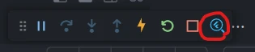
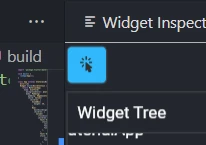
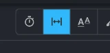

# 3.1 Developer Tools

작성일 2023-02-28 · 최종 수정일 2023-03-04
{ .post-date }

- UI 디자인을 할 때 서로를 위 아래에 놓고 싶을 때는 Column을 쓰고, 서로를 옆에 놓고 싶을 때는 Row를 쓴다.
- Column과 Row는 Alignment를 가지고 있다. 내부의 item들을 움직이는 방식을 가지고 있다.
- Row와 Column은 MainAxis(수평, 가로)와 CrossAxis(수직, 세로)를 가지고 있다.
- Sizedbox : 크기가 있는 빈 박스를 만든다.
- Color(0xFFxxxxxx) : 이를 통해 색상 지정 가능.

혹은 fromARGB(255, R, G, B)를 통해서 색상을 지정해줄 수도 있다. 첫 value는 항상 255여야 한다.

Color.fromRGBO(R, G, B, Opacity)도 사용 가능하다. (Opacity : 0 ~ 1.0)

- Layout이 헷갈린다면 Developer Tools를 쓰면 된다.

이를 통해 App의 Widget Tree를 탐색할 수 있다. MainAxis 등을 바꾸면 바뀐 미리보기를 볼 수 있다.

이 버튼을 클릭하면 애뮬레이터에서 원하는 부분을 직접 고르고 선택할 수도 있다.

이 버튼을 활성화하면 애뮬레이터에서 가이드라인을 모두 보여준다.
