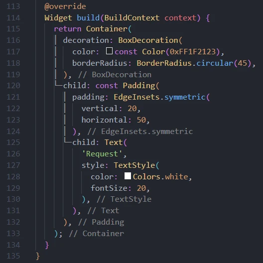

# 3.5 Reusable Widgets

- Error Lens 설치

Error의 내용을 출력해서 자세히 알려준다.

- 두 버튼을 만들 때, 각각의 버튼이 서로 거리를 두고 떨어져 있어야 한다. 그렇기 때문에 두 버튼을 담고 있는 Row에서 mainAxisAlignment를 spaceBetween으로 설정해주면 된다.
- 비슷한 기능을 하는 Widget을 Reusable하게 만들어보자.

Container를 선택한 후, 전구(code action)를 누르면 Extract Widget을 선택할 수 있다. 이를 통해 Widget을 추출할 수 있다.

## Error

[The name 'MyApp' isn't a class. Try correcting the name to match an existing class. flutter](https://stackoverflow.com/questions/69527724/the-name-myapp-isnt-a-class-try-correcting-the-name-to-match-an-existing-cla)

- widget_test.dart에서 생긴 오류. runApp()에서 동작되는 클래스의 이름과 pumpWidget에 입력된 App의 이름이 다르기 때문에 오류가 발생했다.
- Class의 형식을 한 번에 생성할 수도 있다.
- 세미콜론을 끝에 찍으면 자동 정렬이 된다.
- final : late init, 값을 나중에 전달받는 역할.
- required : 인자를 전달받을 때 반드시 전달하도록 설정하는 것.
- Key : Key란, 위젯 트리에서 위젯이 움직일 때마다 현재 상태를 보존하는 역할을 한다. Key는 주로 Element가 Widget을 식별하는 데 사용한다. 위젯이 위젯트리에서 위치를 변경해도 key의 정보는 그대로 남아있기 때문에, 리스트의 컬렉션이 수정될 때 스크롤 위치를 기억하거나 상태를 기억해야 할 때 key가 유용하게 사용된다. 결론적으로, 위젯트리에서 상태를 보존하고 싶은 곳에 key를 사용하자.

⇒ Key는 업데이트되는 위젯의 하위에 StatefulWidget이 위치할 때 사용된다. 만약 컬렉션에 포함된 모든 위젯 서브트리가 Stateless라면 Key가 필요하지 않다. 플러터에서 Key를 사용해야 하는 상황에 대한 기술적인 내용은 이게 전부이다. 왜 Key를 써야하는지에 대한 좀 더 자세한 설명은 아래 자료에 있다.

[https://nsinc.tistory.com/214](https://nsinc.tistory.com/214)

[https://www.youtube.com/watch?v=kn0EOS-ZiIc](https://www.youtube.com/watch?v=kn0EOS-ZiIc)

[https://stackoverflow.com/questions/52056035/myhomepagekey-key-this-title-superkey-key-in-flutter-what-would-b](https://stackoverflow.com/questions/52056035/myhomepagekey-key-this-title-superkey-key-in-flutter-what-would-b)

[https://medium.com/flutter/keys-what-are-they-good-for-13cb51742e7d](https://medium.com/flutter/keys-what-are-they-good-for-13cb51742e7d)

- 특정 Widget 내에서 runtime에 값이 결정되는 값이 있다면, 해당 Widget은 const가 되지 못한다.
