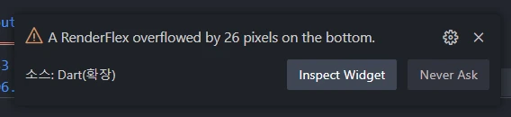

# 3.8 Reusable Cards

작성일 2023-02-28 · 최종 수정일 2023-03-04
{ .post-date }

- CurrencyCard Class를 만들고, 기존 main.dart에서 Card를 생성한 Container 코드를 가져와 복사해서 붙여넣는다. 이 때, 필요한 것은 크게 name, code, amount, icon 정도이므로 이 변수들을 final 변수로 생성한 후, code action으로 생성자를 자동으로 만들어줄 수 있다.
- 삼항 연산자를 이용하여 간단하게 색상을 선택 가능

⇒ isInverted ? Colors.white : Color(0xFF……)

- 만약 Widget이 화면의 크기를 넘어간다면, overflowed error가 발생한다. 

박스 크기를 변경시키면서 이 문제를 해결해보자.  
⇒ 만약 화면이 overflow된다면, 유저가 스크롤을 통해 이동할 수 있도록 해보자.

(Padding을 Widget인 SingleChildScrollView로 감싸 스크롤이 가능하도록 만들자.)

- 각각의 카드가 다른 카드를 덮고 있으므로, Widget으로 감싼 후 offset을 주자.
