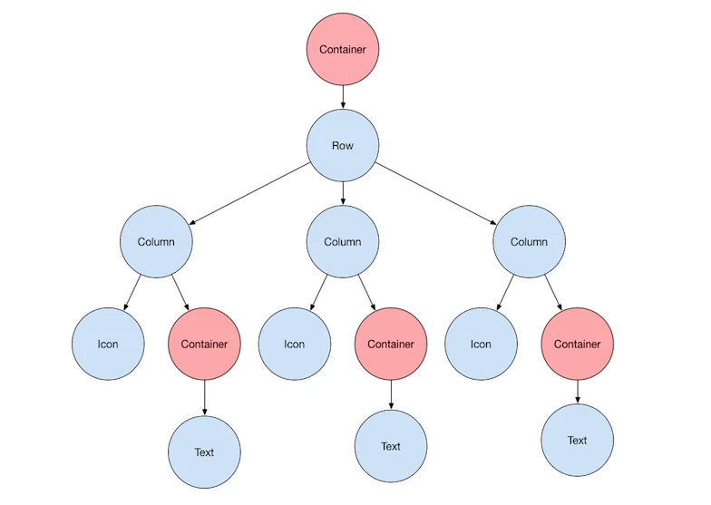

# 4.3 BuildContext

작성일 2023-03-01 · 최종 수정일 2023-03-04
{ .post-date }

- 이전에 만든 앱에서 Text를 Extract Widget으로 추출하자. → MyLargeTitle
- 플러터는 앱의 모든 스타일을 한 곳에서 지정할 수 있는 기능을 제공한다.

색상, 크기, 글자 굵기 등, 한 곳에 복사하고 이 색상 변수를 사용하면 된다.

- MaterialApp에서 theme을 사용하자.

theme: ThemeData

⇒ ThemeData → textTheme

우리는 theme을 만들었으며, 이는 애플리케이션 위젯의 state에 있다. 그리고 이 애플리케이션 위젯의 state는 MyLargeTitle이라는 자식을 가지고 있다. 

```dart
@override
  Widget build(BuildContext context) {
    return MaterialApp(
      theme: ThemeData(
        textTheme: const TextTheme(
          titleLarge: TextStyle(
            color: Colors.red,
          ),
        ),
      ),
      home: const Scaffold(
        backgroundColor: Color(0xFFF4EDDB),
        body: Center(
          child: Column(
            mainAxisAlignment: MainAxisAlignment.center,
            children: [
              MyLargeTitle(),
            ],
          ),
        ),
      ),
    );
  }
}
```

MyLargeTitle은 별도의 위젯이며, State와는 서로 다른 클래스이다. 다음으로 할 것은 theme에 접근하는 것이다. StatelessWidget인 MyLargeTitle에서 theme의 값에 접근하는 것을 원한다. 이 말은 우리가 부모 요소와 대화할 수 있기를 원한다는 것이고, 여기서 부모 요소는 AppState이며, AppState는 titleLarge의 색깔을 알고있다.

이걸 하기 위해서 우리는 BuildContext를 이용해야 한다. 하지만 이걸 이해하려면 먼저 Widget Tree에 대해 얘기해야 한다.



첫 번째는 Root이며, Root는 우리 앱에서는 App 클래스를 의미한다. App 클래스는 수많은 자식 클래스를 가지게 되며, 그 자식 클래스도 또다른 자식 클래스를 가지면서 Widget tree가 구성된다. 이 때, Text “My Large Title”이 자신의 부모 클래스인 MyLargeTitle 요소에 접근하려는 것이다. 이 때 Build Context가 사용된다. 

context란, Text 이전에 있는 모든 상위 요소들에 대한 정보이다. context는 MyLargeTitle Text의 부모 요소들의 모든 정보를 담고 있다. 즉, MaterialApp의 모든 정보를 담고 있다는 것이다.

즉, context는 Widget Tree의 모든 요소를 담고 있으므로 먼 요소에 접근하기 쉽다.

```dart
class MyLargeTitle extends StatelessWidget {
  const MyLargeTitle({
    super.key,
  });

  @override
  Widget build(BuildContext context) {
    return Text(
      'My Large Title',
      style: TextStyle(
        fontSize: 30,
        color: Theme.of(context).textTheme.titleLarge?.color,
// ?를 써서 값이 있을 경우 사용하라고 지정하거나, !를 통해 값이 있다고 지정해줄 수 있다.
      ),
    );
  }
}
```
