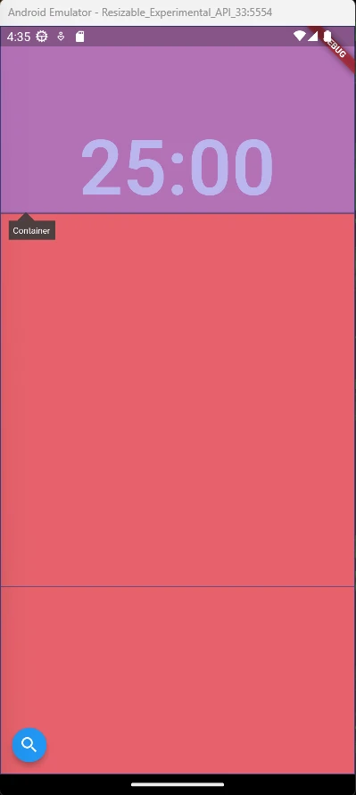

# 5.0 User Interface

- MaterialApp의 home은 Scaffold를 return해야 함. (비계)
- ColorScheme
- Flexible : UI를 비율에 기반해서 더 유연하게 만들 수 있도록 해준다.

Flexible 간의 비율을 정해서 서로 간의 크기를 지정할 수 있다.

```dart
import 'package:flutter/material.dart';

class HomeScreen extends StatefulWidget {
  const HomeScreen({super.key});

  @override
  State<HomeScreen> createState() => _HomeScreenState();
}

class _HomeScreenState extends State<HomeScreen> {
  @override
  Widget build(BuildContext context) {
    return Scaffold(
      body: Column(
        children: [
          Flexible(
            flex: 1,
            child: Container(
              decoration: const BoxDecoration(
                color: Colors.red,
              ),
            ),
          ),
          Flexible(
            flex: 2,
            child: Container(
              decoration: const BoxDecoration(
                color: Colors.green,
              ),
            ),
          ),
          Flexible(
            flex: 1,
            child: Container(
              decoration: const BoxDecoration(
                color: Colors.blue,
              ),
            ),
          ),
        ],
      ),
    );
  }
}
```

- Container의 alignment property

컨테이너에 들어있는 요소들의 정렬 방향을 선택해줄 수 있음.



- onPressed에 null을 넣으면 color 지정이 되지 않는 오류가 존재. () {}로 람다 함수를 넣어줘도 되는 것으로 보인다.
- 단순히 Container만 사용하면 우리가 원하는 만큼의 크기가 지정되지 않을 수 있다. 이럴 경우, Container를 Row로 감싼 후, Expanded라는 Widget을 사용해주면 된다.

```dart
import 'package:flutter/material.dart';

class HomeScreen extends StatefulWidget {
  const HomeScreen({super.key});

  @override
  State<HomeScreen> createState() => _HomeScreenState();
}

class _HomeScreenState extends State<HomeScreen> {
  @override
  Widget build(BuildContext context) {
    return Scaffold(
      // ignore: deprecated_member_use
      backgroundColor: Theme.of(context).backgroundColor,
      body: Column(
        children: [
          Flexible(
            flex: 1,
            child: Container(
              alignment: Alignment.bottomCenter,
              child: Text(
                '25:00',
                style: TextStyle(
                    color: Theme.of(context).cardColor,
                    fontSize: 89,
                    fontWeight: FontWeight.w600),
              ),
            ),
          ),
          Flexible(
            flex: 3,
            child: Center(
              child: IconButton(
                iconSize: 120,
                color: Theme.of(context).cardColor,
                onPressed: () {},
                icon: const Icon(Icons.play_circle_outline),
              ),
            ),
          ),
          Flexible(
            flex: 1,
            child: Row(
              children: [
                Expanded(
                  child: Container(
                    decoration: BoxDecoration(
                      // ignore: deprecated_member_use
                      color: Theme.of(context).cardColor,
                    ),
                    child: Column(
                      mainAxisAlignment: MainAxisAlignment.center,
                      children: [
                        Text(
                          'Pomodoros',
                          style: TextStyle(
                            fontSize: 20,
                            // ignore: deprecated_member_use
                            color: Theme.of(context).textTheme.headline1?.color,
                          ),
                        ),
                        Text(
                          '0',
                          style: TextStyle(
                            fontSize: 58,
                            // ignore: deprecated_member_use
                            color: Theme.of(context).textTheme.headline1?.color,
                          ),
                        ),
                      ],
                    ),
                  ),
                ),
              ],
            ),
          ),
        ],
      ),
    );
  }
}
```
