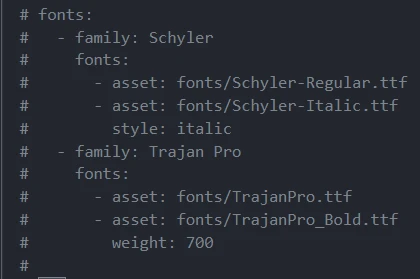
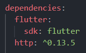
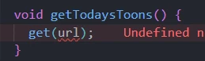
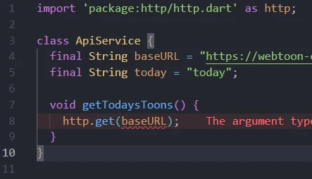

# 6.2 Data Fetching

작성일 2023-03-01 · 최종 수정일 2023-03-04
{ .post-date }

- URL에 요청을 보내기 위해서는 http라는 패키지를 먼저 설치해야 된다. Flutter나 Dart 패키지를 찾고 싶으면 pub.dev로 가면 된다. 마치 Node.js의 npm이나 Python의 PyPI와 비슷한 개념이다.

    여기다가 http라고 검색하면 된다. 설치 방법은 커맨드를 입력하거나, pubspec.yaml 파일에 파일을 붙여넣으면 된다. pubspec은 프로젝트에 대한 정보와 설정이 담긴 파일이다. 

    예를 들어 우리 프로젝트에 폰트를 설치하고 싶으면 pubspec.yaml에 추가할 수 있다.

    

    이 부분에 추가한다.

    - http dependency 추가

    

    혹은 terminal에 입력해서 설치하면 된다.



http를 설치하면 get을 사용할 수 있지만, 이름이 어떤 것을 의미하는지 정확히 파악하기가 힘들다. 이에 따라 import하는 부분에 namespace를 지정해주자.



```dart
import 'package:http/http.dart' as http;

class ApiService {
  final String baseURL = "https://webtoon-crawler.nomadcoders.workers.dev";
  final String today = "today";

  void getTodaysToons() {
    final url = Uri.parse('$baseURL/$today');
    http.get(url);
  }
}
```

- get 메서드는 Future&lt;Response&gt;를 반환한다. 이 것은 미래의 반환받을 값의 타입을 알려준다.

API 요청은 시간이 걸리는 작업이므로, 우리는 요청이 처리될 때까지 기다려야 한다. 즉, API 요청이 처리돼서 응답을 반환할 때까지 기다리는거다. 이를 async programming이라고 한다.

프로그램이 side effect(부작용)을 기다리게 하는 것인데, 우리는 Dart 한테 http.get(url)을 기다리라고 설정해줄 것이다. 이를 위해 http.get(url) 앞에 await 이라고 써주면 되는데, await은 asynchronous function 안에서만 사용될 수 있다.

```dart
void getTodaysToons() async {
    final url = Uri.parse('$baseURL/$today');
    await http.get(url);
  }
```

async function 내에서 Future를 await으로 받아줄 수 있다.

```dart
import 'package:http/http.dart' as http;

class ApiService {
  final String baseURL = "https://webtoon-crawler.nomadcoders.workers.dev";
  final String today = "today";

  void getTodaysToons() async {
    final url = Uri.parse('$baseURL/$today');
    final response = await http.get(url);

    try {
      if (response.statusCode == 200) {
        print(response.body);
        return;
      }

      throw Error();
    } catch (err) {
      print(err);
    }
  }
}
```
