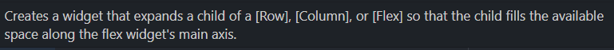

# 6.8 Webtoon Card

- ListView를 사용할 때, ListView를 return하는 부분이 너무 길어서 보기 싫다면 extract method로 추출해서 만들어줄 수 있다. 
- 웹툰의 이미지를 출력하기 위하여 Column을 만들어주는데, 이 때 SizedBox를 만들어주게 되면 ListView에 제한없는 높이 값이 넘어오기 때문에 오류가 발생하게 된다. 이 경우에, ListView에 제한된 높이를 줘야 한다. 그러기 위해서 makeList를 Expanded로 감싼다.

- 현재 레이아웃 시스템은 ListView가 얼마나 큰지 모르기 때문에, Expanded를 이용한다. Expanded는 Row, Column, Flex에 사용되어 남는 공간을 채우는 역할을 한다.

    

- Flutter 자체에서 Image 기능을 지원하는데, Image.network를 이용하면 URL로 이미지를 가져올 수 있다. 이미지의 크기를 조정하고 싶다면, 이미지를 Container 안에 넣어서 크기를 조정할 수 있다.
- Container를 사용하면 decoration 옵션을 사용해 데코레이션을 할 수 있다. 웹툰 썸네일을 장식하기 위해 Container에서 decoration을 사용하고, borderRadius를 circular로 지정한다. 그런데, 이렇게만 하면 적용이 되지 않는데, 그 이유는 clipBehavior가 적용되지 않았기 때문이다. clipBehavior는 자식의 부모 영역 침범을 제어하는 방법이다.
