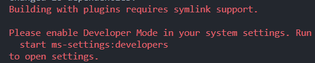
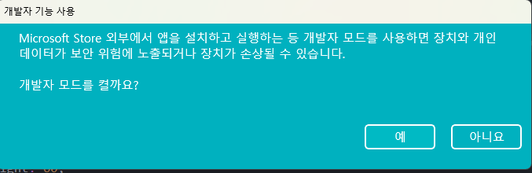

# 6.17 Favorites

- Shared_preferences를 이용하면 핸드폰 저장소에 데이터를 담을 수 있다.

shared_preferences는 다음과 같이 설치할 수 있다.

(On terminal : flutter pub add shared_preferences)

이렇게 했을 때, 다음과 같은 메시지가 뜬다.

Window의 개발자 모드를 켜야 다운로드 받을 수 있다는 뜻으로, ms-settings:developers를 terminal에 입력해서 개발자 모드를 켜주자.

- shared preferences의 동작 방식

    - Obtain shared preferences

    final prefs = await SharedPreferences.getInstance();

    - Save an integer value to ‘counter’ key

    await prefs.setInt(’counter’, 10);

    - Save an boolean value to ‘repeat’ key

    await prefs.setBool(’repeat’, true);

    - Save an double value to ‘decimal’ key

    await prefs.setDouble(’decimal’, 1.5);

    - Save an String value to ‘action’ key

    await prefs.setString(’action’, ‘Start’);

    - Save an list of string to ‘items’ key.

    await prefs.setStringList(’items’, &lt;String&gt;[’Earth’, ‘Moon’, ‘Sun’]);

    - Try reading data from the ‘counter’ key. If it doesn't exist, returns null.

    final int? counter = prefs.getInt(’counter’);

    …

    final bool? repeat = prefs.getBool(’repeat’);

    final double? decimal = prefs.getDouble(’decimal’);

    final String? action = prefs.getString(’action’);

    final List&lt;String&gt;? items = prefs.getStringList(’items’);
