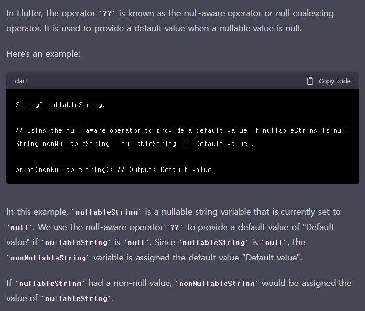

# Null Safety

- 현재는 Null Safety를 지원하는 Dependencies를 사용하게 된다.
    1. 모든 변수는 null이 될 수 없으며, non-nullable 변수에는 null 값을 할당할 수 없다.  
        ⇒ 그렇지 않으면 NullReferenceException이 발생할 수 있음.
    2. non-nullable 변수를 위한 null check가 필요 없어짐.
    3. Class 내의 변수(non-nullable instance field)는 반드시 선언과 동시에 초기화를 시켜야 함.

- ?? operator : null인 변수의 초기값을 결정하는 역할을 한다.

