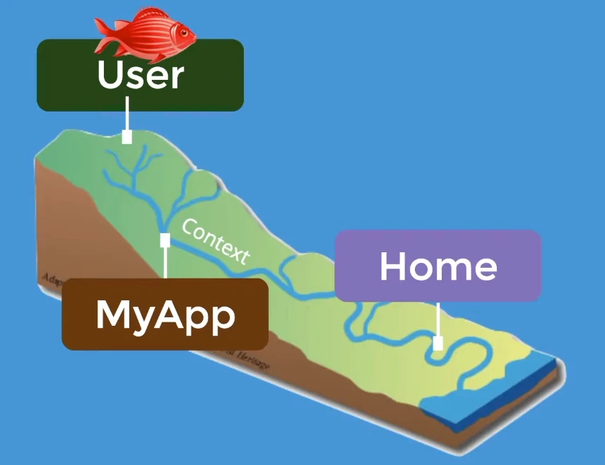

# Learn App Code 1. What is Flutter Provider?

[Flutter Provider Simply Explained](https://www.youtube.com/watch?v=K2ampPUTfIQ&list=PLgG0-B2KlM1sr3MRmqaV2tVKJf_7Zk7f3&index=1)

- Provider는 마치 낚시와도 같다.

```dart
final user = Provider.of<User>(context);
```

위의 문장에서 `user`는 높은 곳에서 낮은 곳으로 흘러내려가는 물고기와도 같다.

`Provider.of<User>`는 물고기를 낚고 있는 낚시꾼이다.

그리고 `context`는 물고기가 헤엄치는 강을 의미한다.

즉, widget tree의 상단에서 부터 하단으로 데이터가 전달되는 context의 흐름 속에서, 데이터를 지켜보고 있던 `Provider.of<T>`이 원하는 데이터를 복사해서 가져올 수 있도록 해주는 것이 Provider의 역할이라고 보면 되겠다. 아래 그림을 보면 이해가 빠를 것이다.


Context라는 흐름(강) 속에서, 수많은 데이터들(물고기)이 흐르고 있다. 이 속에서, User라는 Type의 데이터가 필요한 Widget(낚시꾼)이 User 데이터(물고기)를 복사해서 가져오고 있다.

---

```dart
Provider(
	create: (_) => User(),
	child: MyApp()
)
```

이와 같은 방식을 통해서 데이터의 흐름을 만들어낼 수 있다.



User라는 데이터 type을 하류로 흘려보내는 Provider가 존재하고, MyApp widget을 이 Provider로 감싸고 있다. 그렇다면, Widget Tree에서 MyApp widget의 하단에 존재하는 모든 widget은 User라는 type의 데이터를 전달받을 수 있고, Provider.of&lt;User&gt;를 통해서 데이터를 언제든지 꺼내올 수 있다는 것이다.

```dart
Provider(
	create: (_) => User(),
	child: MyApp()
)

// MyApp widget
Widget build(BuildContext context) {
	return MaterialApp(
		routes: <String, WidgetBuilder> {
			'/': (context) => Home();
		},
	)
}

// Home widget
Widget build(BuildContext context) {
	final user = Provider.of<User>(context);
}
```

---

- widget은 Provider가 흘려보내는 데이터를 복사해서 가져가기 때문에, 여러 개의 widget이 Provider.of&lt;T&gt;를 통해서 데이터를 전달받을 수 있다.

```dart
Provider(
	create: (_) => User(),
	child: MyApp()
)

// MyApp widget
Widget build(BuildContext context) {
	return MaterialApp(
		routes: <String, WidgetBuilder> {
			'/': (context) => Home();
			'/settings': (context) => Settings();
		},
	)
}

// Home widget
Widget build(BuildContext context) {
	final user = Provider.of<User>(context);
}

// Settings widget
Widget build(BuildContext context) {
	final user = Provider.of<User>(context);
}
```

⇒ 코드 스니펫 예시처럼, User 데이터는 Home() widget과 Settings() widget 모두에 전달될 수 있다.

> Provider를 이용하면, 데이터는 항상 Widget Tree의 하류로 흘러간다. Provider가 감싸지 않은 영역. 즉, Provider의 바깥에서 Provider.of&lt;T&gt;를 통해 데이터를 얻어올 수는 없다.
