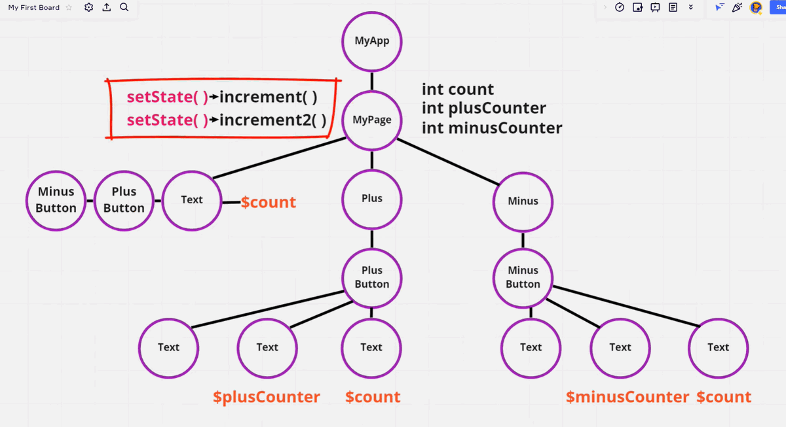

# State Management(Provider)

[플러터(Flutter) 조금 매운맛 Provider 입문 1: Provider와 State management](https://www.youtube.com/watch?v=-3iD7f3e_SU&list=PLQt_pzi-LLfoOpp3b-pnnLXgYpiFEftLB&index=33)

- State란? 어떤 형태이든 앱의 화면 즉, UI에 변화가 생기도록 영향을 미치는 데이터를 말한다. 데이터의 종류는 크게 두 개가 있다.
    1. 앱 수준의 데이터 : 서버와 연동해서 사용자 인증을 한다든지, 또는 서버에 저장된 정보를 끌어와서 화면에 보여주는 등 앱의 화면에 변화를 일으키는 모든 데이터를 말한다.
    2. 위젯 수준의 데이터 : 예를 들어, 빈 체크박스를 터치하면 체크 표시가 생기게 되고, 이 상태를 위젯 차원에서 해결해서 화면에 변화가 생기게 하는 데이터를 말한다.

그렇다면 이런 데이터들을 왜 관리하게 될까? 효율성을 위해서이다. 플러터는 앱의 state가 바뀌면 hot reload를 통해서 위젯 트리를 리빌드하게 됩니다. 

이 위젯 트리는 increment(), increment2() 메서드의 실행 결과를 하단부 위젯까지 내려보내기 위해서 상위 위젯인 MyPage 위젯 내에 모든 변수들과 메서드를 선언하고 있다. 그래서 이 두 메서드가 호출될 때마다 setState 메서드 역시 호출되므로, MyPage 위젯에 있는 모든 위젯이 지속적으로 리빌드된다. 즉, 리빌드가 필요하지 않은 위젯까지 다시 리빌드를 진행하므로 지극히 비효율적인 코드가 된다.

플러터에서는 state가 변해서 UI를 다시 그려야 하는 경우 기본적으로 setState를 사용한다. setState의 가장 중요한 기능은 위젯 라이프 사이클에 빌드 메서드를 호출해서 UI를 렌더링 하게 만드는 것이다. 

사실 이는 변화된 state를 UI에 반영하는 가장 확실하고 간단한 방법이긴 하지만, 굳이 데이터가 변할 필요가 없는 것들을 변하게 하기 때문에 다른 것들은 억지로 Constructor를 통해서 데이터를 전달받아야 한다. 만약 현재 위젯 트리보다 더 많은 위젯 트리가 존재한다고 하고, 그 중 Leaf node 하나를 변경하기 위해서 setState를 호출한다고 하면 이 과정은 상당히 비효율적인 작업이 되어 Performance에도 영향을 미치게 될 것이다.

- setState의 문제점
    1. 비효율성
    2. 동시에 다른 위젯의 state를 업데이트 시켜주지는 못함

- State Management의 정의
    1. 위젯이 쉽게 데이터에 접근할 수 있는 방법
    2. 변화된 데이터에 맞추어서 UI를 다시 그려주는 기능이 뒤따라야 한다.

이 두 가지 방법이 정확히 포함되어 있어야 State Management라고 정의할 수 있는 것이다.

---

- Provider.of&lt;Salmon&gt;(context)

Provider.of : 생선을 흘려보내는 남자

&lt;Salmon&gt; : 흘려보낼 생선의 종류

(context) : 수로

수로와 연결이 된 매운탕 집에 한해서만 수로를 통해 생선을 전달해줄 수 있다. 여기서 생선은 Widget이라고 할 수 있다.

이 변수를 final fish 라는 변수에 넣어보자. 이 때 fish는 언제든지 복제가 가능해서 필요할 때마다 불러서 전달되어질 수 있는 데이터가 되는 것이다. 또한 여기서 중요한 점은 Provider 역시 하나의 위젯이라는 점이다. 그래서 위젯 트리 상에서 일반 위젯과 똑같은 특성을 가지게 된다.

Provider에서 사용되는 of는 주어진 context를 거슬러 올라가면서 가장 가까이에 있는 원하는 타입의 인스턴스를 찾아서 반환하라는 의미이다.

---

- 특정한 위젯만 리빌드하려면, 변화가 필요한 특정 위젯만 변화에 귀를 기울이고 있으면 될 것이다. 즉, 이런 위젯들에만 변화가 생겼다고 알려주면 될 것이다.
- 데이터의 정의를 담은 클래스에 with ChangeNotifier를 선언하여 Mixin을 적용할 수 있다.

⇒ 이는 상속과는 어떠한 차이가 있는가?

- 상속과 mixin의 차이점은 관계라는 측면에서의 결속력의 차이이다. 상속은 친족의 관계처럼 결속력이 강력한 반면, mixin은 필요에 따라서 단순한 특정 기능을 추가하고 싶을 때 사용할 수 있다.  
    (Dart는 다중 상속을 허용하지 않지만, mixin은 계속 사용할 수 있다.)
- FishModel에 ChangeNotifier를 mixin했는데, 이는 FishModel에서 ChangeNotifier를 활용하기 위해서이다.

FishModel 클래스 내에 있는 데이터가 변했을 때 어떻게 이와 관련되어 있는 다른 위젯들에게 자동으로 이 사실을 알려주고 UI를 리빌드 시켜줄까? 이다. 즉, 이 기능을 구현하기 위해서 ChangeNotifier 클래스가 필요하다.

ChangeNotifier 내에 있는 notifyListeners를 실행하면, 데이터가 변경될 때마다 Listener들에게 notify를 해줄 수 있다.

ChangeNotifier는 addListener 메서드도 가지고 있는데, 이를 통해서 필요한 위젯 내에서 콜백 메서드를 등록하면 된다. 또한, ChangeNotifier는 removeNotifier 메서드도 있는데, addListener는 자동으로 dispose가 되지 않기 때문에 매번 removeListener를 사용해서 필요 없는 addListener를 dispose 시켜주어야 한다. 더욱이 addListener는 Listener 들에게 데이터가 변경되었다는 사실을 알려줄 수는 있지만 UI를 변경시켜줄 수는 없다.

- ChangeNotifier의 한계
    1. 매번 수동으로 addListener를 등록해 주어야 함.
    2. 수동으로 addListener를 제거시켜 주어야 함.
    3. FishModel 인스턴스를 매번 생성자를 통해서 전달해야 함.
    4. UI 리빌드도 수동으로 해결해야 함.

- ChangeNotifierProvider의 장점
    1. 모든 위젯들이 listen 할 수 있는 ChangeNotifier 인스턴스 생성.
    2. 자동으로 필요 없는 ChangeNotifier 제거
    3. Provider.of를 통해서 위젯들이 쉽게 ChangeNotifier 인스턴스에 접근할 수 있게 해준다.
    4. 필요시 UI를 리빌드 시켜줄 수 있음.
    5. 굳이 UI를 리빌드 할 필요가 없는 위젯을 위해서 listen : false 라는 기능을 제공한다.

---

- MultiProvider

가령 두 개의 다른 타입의 ChangeNotifierProvider가 존재하고, 한 위젯에서 이 두 개 모두에 접근이 필요할 때 사용하는 방법이다.

기존에 ChangeNotifierProvider로 감쌌던 MaterialApp을 MultiProvider가 감싸도록 변경하고, providers 데이터를 넘겨주자. 그리고 이 안에 ChangeNotifierProvider를 나열해주면 된다.
