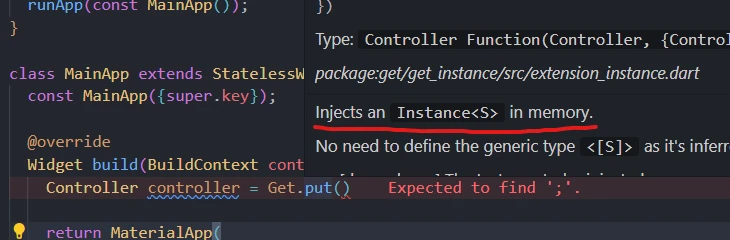
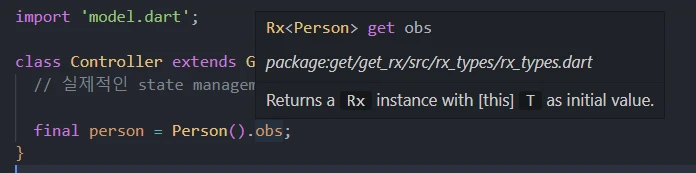

# State Management(GetX)

- GetX
    1. 가벼움
    2. 간단함
    3. 사용하기 편함
    4. 중독성

왜 GetX가 필요하고 우리는 왜 이것에 관심을 갖는 것일까?

1. State Management : State Management를 아주 간편하게 할 수 있다.
2. 코드의 간결성 : Navigator.push를 사용하여 페이지 전환을 구현했었지만, GetX를 이용하면 이를 아주 간단하게 바꿀 수 있다.

<!-- -->

- 여기서는 1번, State Management를 다룬다.

1) Simple State Manager with GetBuilder

2) Reactive State Manager

⇒ GetX에는 두 종류의 state 관리자가 있다.

---

## Simple State Manager with GetBuilder

ChangeNotifierProvider와 매우 유사한 기능을 한다.

- Dependency injection : 외부에서 Class 내부에 선언된 프로퍼티와 메서드에 접근할 수 있도록 instance를 생성하는 과정.



외부에서 사용할 수 있도록 Controller 인스턴스를 메모리에 등록시킨다.

- GetBuilder : state가 변할 때마다 변한 state를 화면에 다시 그려주는 역할을 한다. 그리고 builder라는 required 인자를 갖고 있으며, 어떤 타입의 데이터를 사용할지 모르기 때문에 데이터의 타입도 알려주어야 한다.
- controller class 내부에서 update라는 메서드를 이용하면 변화가 생겼다고 전달해줄 수 있다.
- 장점 : Stateless Widget 처럼 비용이 많이 들지 않아 메모리를 아낄 수 있지만, 
- 단점 : 데이터를 업데이트 하려면 일일이 update 메서드를 불러와서 작업을 해주어야 한다.
- Process

GetX 패키지 설치

Controller 클래스 생성

State Management를 하기 위해 Controller에 GetXController 상속

State 변화를 UI에 반영하기 위해 update 메서드를 호출

Controller 클래스 내에 있는 데이터를 불러오기 위해 D.I 실시  
⇒ 이 때 Get.put 을 사용한다.

GetBuilder 위젯을 불러오고 이 안에서 state가 반영되기를 원하는 위젯을 그려준다.

controller.property 또는 Get.find&lt;T&gt; 사용을 통해 데이터 접근

---

## Reactive state manager

1. GetX
2. Obx

<!-- -->

- What is the “Reactive?” : Reactive 프로그래밍에서 가장 중요한 것은 변화를 바로바로 반영하는 것이다. Observable을 통해 관찰을 하므로, Reactive state manager는 state를 바로바로 반영해 주는 매니저라고 볼 수 있다.

    이 때, 바로바로 라는 단어는 시간차를 갖고 있다는 것을 말한다. 그러므로 Reactive는 async하게 동작한다.

- 그러므로 state가 지속적으로 변하는 경우에 Reactive를 사용하는 것이 좋으며, 즉 GetX, Obx를 사용한다는 것은 Stream 데이터를 사용한다는 의미로 생각할 수도 있다.
- GetBuilder는 마치 setState를 사용하는 것처럼 직접 update 메서드를 호출해서 UI를 업데이트 시켜주어야 하고, 대신 추가적인 데이터나 Stream을 생성하지 않기 때문에 가볍게 사용할 수 있다.
- Reactive State Manager는 자동으로 UI를 업데이트 하므로 따로 수동적으로 업데이트 하지 않아도 된다. Stream 데이터를 다루기 때문에 GetBuilder보다는 조금 더 무겁다고 할 수 있지만, 그렇다고 너무 많이 잡아먹지는 않는다.
- Rx : ReactiveX의 줄임말. 어떤 데이터의 흐름을 ‘관찰’하는 데에 포커스를 둔다. 그래서 Rx는 data의 stream을 Observable이라고 한다.
- Observable이 있다면 Observer도 있을 것이다. 
- 이처럼 데이터의 발생을 하나의 이벤트로 본다면 다른 일을 하다가 이벤트가 발생했을 때만 데이터를 처리하면 된다.
- 이는 Dart의 Stream과 매우 유사하지만, 차이점은 있다.
- 바로 Functional Reactive Programming(FRP) 라는 데서 차이가 있다.
- Rx는 Dart Stream이 제공하지 않는 API를 사용해서 프로그래밍에 유용하게 사용할 수 있다.
- MVC 패턴 
    1. 패턴이란? : 코딩을 하면서 공통적이면서도 일반적인 문제 상황을 마주치게 되는데, 이런 상황을 해결하는 방법을 Pattern 이라고 한다.
    2. 디자인 패턴 : 설계상에서 발생하는 문제를 해결하는 방법
    3. MVC :  
        M = Model, 모델은 데이터를 관리하는 역할도 한다. 그래서 앱이 사용할 데이터를 정의하고 수정하거나 삭제하는 데이터의 가공 역할까지도 한다.  
        V = View, 사용자에게 보여지는 UI를 관리하는 역할을 한다.  
        C = Controller, 일반적으로 Model과 View는 각각 독립적으로 일을 하게 되는데, 중간에서 이어주는 역할을 하는 것이 Controller이다.

- 모델이 가진 데이터를 뷰로 전달해서 화면에 출력, 뷰에서 사용자 이벤트, 즉, floatingAction 버튼 클릭이 발생하면 이에 따라서 컨트롤러에서 모델의 데이터를 변경하고 UI를 업데이트 시켜준다.  
    ⇒ 그리고 이 과정에서 State Management가 이루어진다.
- State Management 만을 이용하려면 GetMaterialApp을 반환하지 않고 MaterialApp을 반환해도 된다(용량이 줄어듦). 하지만, 이번 예제에서는 GetMaterialApp을 반환한다. 



- Rx에서는 데이터 스트림을 관찰할 수 있는 것을 Observable이라고 부르는데, Reactive state manager 방식에서는 GetX와 Obx를 사용해서 observable을 listen 한다.

    이렇게 person을 Observable로 만들어주게 되면, 메서드 내에서 person. 을 통해 여러가지 API를 사용할 수 있게 되는데, person.update를 사용해보자. (여기서 사용하는 update는 이전 방식에서 사용했던 update와는 다른 메서드이다.) 이는 state의 현재 밸류값을 가져오도록 해준다.

    ```dart
    import 'package:get/get.dart';

    import 'model.dart';

    class Controller extends GetxController {
      // 실제적인 state management가 여기서 이루어짐

      final person = Person().obs;

      void updateInfo() {
        // 이전에 사용했던 GetBuilder를 리빌드시키는
        // update와는 다른 메서드이다.
        person.update((val) {
          val?.age++;
          val?.name = 'Coding Chef';
        });
      }
    }
    ```

    View에서 이 Observable을 listen하고 있다가 이벤트가 발생하면 자동으로 UI를 업데이트 시켜보도록 한다.

- Model View Controller를 모두 만들었으니, 서로 연결시켜주는 작업을 해본다. 제일 먼저 해야할 일은 뷰에서 컨트롤러 인스턴스를 생성하는 것이다. D.I를 통해 필요할 때 언제라도 데이터를 가져올 수 있도록 하는 과정이다.

    final Controller controller = Get.put(Controller());

- Reactive State Manager의 작동 흐름

    floatingAction 버튼을 터치하는 이벤트가 발생하면, 컨트롤러에 있는 updateInfo 메서드가 호출되고, 그러면 그 즉시 state. 즉, person observable의 데이터가 변하게 된다. 이 때 observable을 listen하고 있는 GetX나 Obx는 이것을 감지하고 즉시 텍스트 위젯을 다시 그려서 변화된 state를 반영하게 된다.

- GetX도 init이라는 인자를 갖는다. 이 곳에 Controller 인스턴스를 전달해주고, Get.find&lt;Controller&gt;().person().property 를 통해 person의 property에 접근할 수 있다.
- Obx : Observable(obs)의 변화를 listen 한다. Controller 인스턴스가 미리 다른 곳에 initialize 되어 있어야 한다.
- GetX : Observable(obs)의 변화를 listen 한다. 자체적으로 Controller 인스턴스를 initialize 할 수 있다. Obx보다 다양한 기능을 내장하고 있어서 좀 더 무겁지만, 우려할 정도로 메모리를 많이 차지하지는 않는다.
- GetBuilder : Observable(obs)의 변화를 listen 하지는 않는다. 수동으로 UI를 리빌드 해야하기에 반드시 update 메서드를 호출해야 한다. 자체적으로 Controller 인스턴스를 initialize 할 수 있다.
