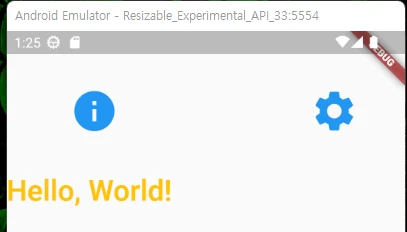
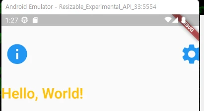

# Flutter 팁

작성일 2023-03-06 · 최종 수정일 2023-03-12
{ .post-date }

## spaceBetween(아이콘 간격 띄우기)

- 두 개의 IconButton을 양쪽으로 정렬하기 위하여 사용

<!-- -->

1. padding으로 EdgeInsets.symmetric을 주고, Row에서 mainAxisAlignment로 center를 준 다음, 그 안에 SizedBox로 사이 간격을 벌려줬다.

    

2. spaceBetween 이용 (오류)

    

    MainAxisAlignment를 spaceBetween으로 바꿨는데, 이렇게 화면을 삐져나간다. space 정렬은 총 세 개가 있다.

---

1. spaceEvenly

    양 쪽에 같은 간격만큼 공간을 두는 정렬 방식.

2. spaceAround

    각 위젯끼리 공간을 두며, 양 끝에 절반 크기만큼 여백을 둔다. (spaceEvenly와 차이점)

3. spaceBetween

    각 위젯간에 공간을 두고, 끝 쪽으로 정렬.

## resizeToAvoidBottomInset

[Bottom overflowed by x pixels when showing keyboard](https://stackoverflow.com/questions/67571423/bottom-overflowed-by-x-pixels-when-showing-keyboard)

- AlertDialog를 사용할 때, TextField로 입력을 받으면 키보드가 올라온다. 이 때, bottom pixel이 overflow되는 오류가 발생했다.
- 이를 Scaffold에서 resizeToAvoidBottomInset을 false로 바꾸면 해결할 수 있다.
- 다른 방법으로는, Scaffold의 body를 SingleChildScrollView로 감싸는 방법이 있다. 이렇게 하면 유저가 AlertDialog를 보는 도중에 Scroll을 할 수 있게 되므로 좀 더 나은 UX를 제공할 수 있다.

## How to use AlertDialog as a Stateful Widget

[[Flutter] Dialog 안에서 체크박스를 사용하려면](https://changjoopark.medium.com/flutter-dialog-안에서-체크박스를-사용하려면-d14258165d58)

Flutter에서 제공하는 Dialog는 StatelessWidget이므로, setState를 사용해도 적용되지 않는다. 따라서 새로운 위젯을 만들지 않고 사용하려면 StatefulBuilder를 사용해서 Stateful Widget으로서 동작하도록 만들어주어야 한다. (혹은 StatefulWidget을 사용하면 된다.)

## IconButton의 Padding 문제

- IconButton을 만들고 정렬을 하면, Icon이 Padding을 over해서 받게되는 현상이 나타난다.

[[Flutter] IconButton 위젯의 패딩 없애는 방법](https://terry1213.github.io/flutter/flutter-iconbutton-padding/)

이를 IconButton의 EdgeInsets.zero를 통해 해결할 수 있는데, 이렇게 설정하면 과도하게 Padding이 받아지는 현상을 해결할 수 있다.

## setting custom skin on Android Emulator

custom으로 device를 만들면 해상도를 설정할 수 있게 되는데, 이 경우 custom skin을 적용시켜야 한다. 현재는 Galaxy A31을 타겟으로 개발하고 있기 때문에, 해당 디바이스에 맞추어 AVD를 생성했다.

[[에뮬레이터 스킨] Android studio emulator skin samsung devices](https://istorage.tistory.com/39)
