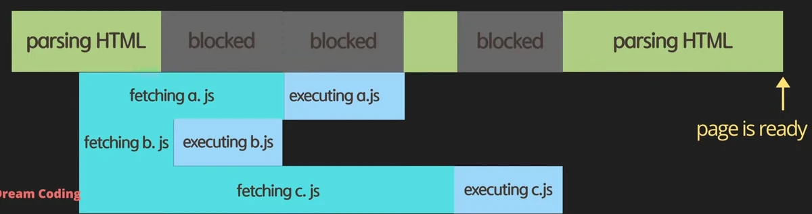
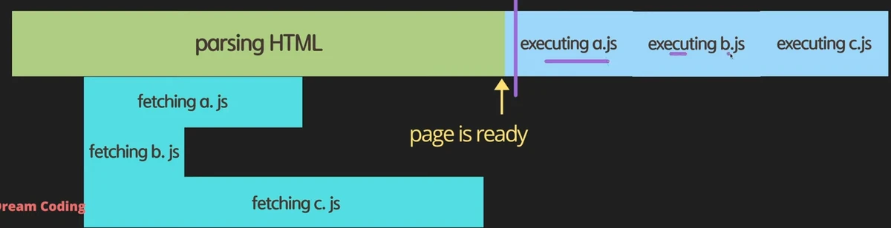

# 드림코딩 2: async defer

작성일 2022-12-22
{ .post-date }

development tool은 유용하게 이용할 수 있다.

console에서는, javascript API를 이용할 수도 있다.

```javascript
console.log("Hello!") // 출력 가능
alert("alert!") // 경고 출력 가능
```

Sources 탭에서는 break를 걸어서 디버깅을 할 수도 있다.

Network 탭에서는 어떤 데이터를 주고 받는지 확인할 수 있다.

&gt;&gt;(더보기) 에서는 성능, 메모리 등을 확인할 수도 있다.

> 자바스크립트 공식 사이트(documentation)  
>   
> ecma-international.org  
> 불친절하게 정리되어 있다. 그래서, 많은 프론트 엔드 개발자들이 developer.mozilla.org를 주로 이용한다.

---

## async vs defer

사용자에게 페이지가 보여지는 순서는 어떻게 결정될까?

1)

```html
<!DOCTYPE html>
<html lang="en">
<head>
    <meta charset="UTF-8">
    <title>Document</title>
    <script src="main.js"></script>
</head>
<body>
    
</body>
</html>
```

브라우저는 html 파일을 다운로드 받았을 때, html 파일을 한 줄 한 줄씩 parsing해서 분석한다. 이 과정에서 분석된 것을 css와 병합해서 DOM요소로 변환한다. 그런데, 그 과정에서 script를 만나면 잠시 parsing을 멈추고, .js를 다운로드 한다. .js의 다운로드가 끝나면, 다시 html 파일을 parsing하면서 분석한다.

⇒ 단점 : 만약 .js 파일이 사이즈가 매우 크고, 인터넷이 굉장히 느리다면 사용자에게 웹페이지가 보여주는데 많은 시간이 걸린다.

2)

```html
<!DOCTYPE html>
<html lang="en">
<head>
    <meta charset="UTF-8">
    <title>Document</title>
</head>
<body>
    <div></div>
    <script src="main.js"></script>
</body>
</html>
```

다른 방법으로는, script의 위치를 head가 아닌, body의 맨 아래쪽에 위치시킬 수 있다. 이렇게 하면 먼저 웹페이지의 parsing을 다 끝낸 후, 사용자에게 웹페이지를 보여준 다음에 .js를 받아올 수도 있다.

⇒ 단점 : 만약 웹페이지가 자바스크립트 코드에 의존적인 코드로 구성되어 있다면, 원하는 동작을 실행할 때까지 준비시간이 많이 소요된다.

3) async

```html
<!DOCTYPE html>
<html lang="en">
<head>
    <meta charset="UTF-8">
    <meta http-equiv="X-UA-Compatible" content="IE=edge">
    <meta name="viewport" content="width=device-width, initial-scale=1.0">
    <title>Document</title>
    <script async src="main.js"></script>
</head>
<body>
    <div></div>
</body>
</html>
```

다른 방법으로는, async를 이용하는 방법이 있다. async는 그 자체로 boolean type의 속성값이기 때문에, 선언하는 것만으로 true로 설정되어 async option을 사용할 수 있다. async option을 true로 설정하면, 브라우저가 html 파일을 받아서 parsing을 하다가 async를 만나게 되면, html 파일과 같이 병렬로 다운로드를 진행한다. 그러던 도중, .js 파일의 다운로드가 끝나면 실행한 후, 다시 html 파일 parsing을 시작한다.

⇒ 다운로드를 병렬로 진행하기 때문에 다운로드 시간을 절약할 수 있다. 하지만, .js가 html이 모두 parsing되기 전에 실행되기 때문에 querySelector를 이용하여 DOM요소를 조작한다고 하면 조작하려고 하는 시점에 원하는 html요소가 정의되어있지 않을 수도 있기 때문에 위험성이 있다. 또한, .js의 다운로드가 끝나면 html의 parsing이 끝나기 전에 잠시 block을 하고 다운로드를 진행하므로, 사용자가 웹페이지를 보는데 걸리는 시간은 여전히 많이 소요된다고 생각할 수 있다.

4) defer

```html
<!DOCTYPE html>
<html lang="en">
<head>
    <meta charset="UTF-8">
    <title>Document</title>
    <script defer src="main.js"></script>
</head>
<body>
    <div></div>
</body>
</html>
```

다른 방법으로는 defer가 있다. html 파일을 parsing하다가 defer를 만나게 되면 우선 다운로드를 html과 병렬적으로 진행하고, html의 parsing이 끝나면 일괄적으로 .js를 실행하는 방식이다.

⇒ 일반적으로 가장 좋다고 판단되는 옵션이다. parsing하는 동안 필요한 javascript 자원을 다 다운로드 받아놓고 사용자에게 웹페이지를 보여준 다음에 javascript를 실행한다.

- async에 관하여



async 옵션을 주면, script를 불러오는 순서에 관계없이, 먼저 다운로드가 끝나는 javascript 자원을 실행한다. 그런데 만약 javascript 코드가 순서에 의존성을 갖는 코드라면 문제가 발생할 수 있다.

- defer에 관하여



이와 다르게 defer 옵션은 우리가 정의한 순서가 지켜지기 때문에, 순서에 의존적인 코드를 이용할 때는 이 특성을 고려해야 한다.

---

## ‘use strict’

typescript를 사용할 때는, 이 옵션을 사용하지 않아도 되지만 vanila javascript를 사용할 때는 use strict 옵션을 사용하는 것이 좋다. why?  
⇒ 자바스크립트는 엄청난 유연성(flexibility)을 가지는 언어지만, 이는 다시 말하면 위험성을 가진다고 판단할 수도 있는 것이다. ‘use strict’는 ECMAScript 5에 선언되어 있는 내용이다. 이를 선언하게 되면 더 이상 비상식적인 코딩을 할 수 없게 된다. (error 검사를 좀 더 엄격하게 함) 추가로, use strict 옵션을 사용하면 자바스크립트 엔진이 코드를 검사하는데 좀 더 효율적으로 동작할 수 있다.
