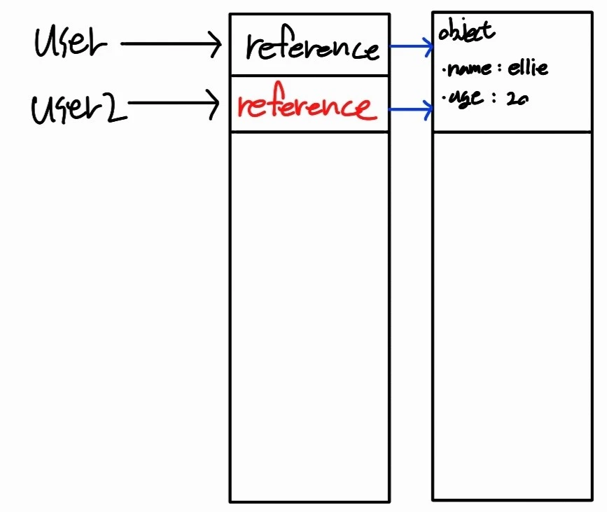

# 드림코딩 7: object

작성일 2022-12-24
{ .post-date }

## Literal Properties

- primitive type : 가장 기본적인 자료형으로, primitive type 변수에는 하나의 값만 담을 수 있다.

```javascript
'use strict';

const name = 'ellie';
const age = 4;

print(name, age);

function print(name, age) {
    console.log(name);
    console.log(age);
}
```

코드를 위와 같이 작성하게 되면, 만약에 이후에 address, full name 등을 추가하게 되면 추가해야되는 인자가 매우 많아지고, logical 하게 group으로 묶어서 관리하기가 힘들어질 것이다.

그래서, object로 묶어서 그룹으로 관리해주면 좀 더 직관적이고 논리적으로 그룹화해서 변수를 관리할 수 있다는 이점이 있다.

```javascript
const ellie = { name : 'ellie', age : 4 };

object_print(ellie);

function object_print(person) {
    console.log(person.name);
    console.log(person.age);
}
```

따라서 위와 같이 코드를 작성해서, 조금 더 관리하기 편하게 한다.

- object를 만드는 방법

```javascript
const obj1 = {}; // curly bracket, object literal syntax
const obj2 = new Object(); // object constructor syntax

ellie.hasJob = true;
delete ellie.hasJob;
```

위와 같이 선언하지 않더라도, 이전에 사용했던 방법처럼 생성과 동시에 값을 할당할 수도 있다.

자바스크립트는 Dynamically type 언어이기 때문에, 추후에 object안에 새로운 데이터를 추가할 수도 있다. 예를 들어, ellie.hasJob = true 와 같이 데이터를 추가할 수도 있다. 그런데, 이와 같이 동적으로 데이터를 추가하는 것은 빠르게 코딩을 할 수는 있지만 나중에 프로젝트의 규모가 커지면 여러가지 오류를 발생시킬 수 있으므로, 최대한 지양하는 것이 좋다.

그리고, 생성한 property를 삭제할 수도 있다. delete ellie.hasJob; 이라고 하면 된다. 

---

## Computed Properties(계산된 프로퍼티)

- object는 key, value의 쌍이다.

```javascript
console.log(ellie.name);
console.log(ellie['name']);
```

object는 property에 . 을 통해서 접근할 수 있고, 그게 아니라면 배열처럼 접근할 수 있다. 중요한 것은, property는 string 타입으로 key를 전달해주어야 한다.

> 그렇다면, 1) literal property와 2) computed property는 언제 어떻게 사용해야 하는가?

1) literal property는 코드 상에서 명시적으로 필요한 property가 있을 때 값을 가져오고자 사용한다.

2) computed property는 runtime 상에서 어떤 key가 필요한지 결정될 때 사용한다.

```javascript
function printValue(obj, key) {
    console.log(obj.key); // object 안에 key가 포함되어 있는지 확인.
    // 이 경우에 computed property 사용.
    console.log(obj[key]);
}

printValue(ellie, 'name');
```

---

- Property value shorthand

똑같은 구조를 갖는 object를 여러개 생성하려면, 어떻게 해야할까? 아래의 예제같은 경우, makePerson이라는 함수를 만들어서 object에 들어갈 value를 parameter로 전달받고 object를 생성해서 return해주면 될 것이다. 그런데, 자바스크립트에는 Property value shorthand라는 기능이 있어서 object를 생성할 때 key와 value의 이름이 같다면, key를 생략하고 value만 적어주면 저절로 생성되는 기능이 있다. (value가 변수로 지정될 때)

```javascript
// Property value shorthand
const person1 = { name: 'bob', age : 2};
const person2 = { name: 'steve', age : 3};
const person3 = { name: 'dave', age : 4};

function makePerson(name, age) {
    return {
        // name: name,
        // age: age,
        name,
        age,
    };
}

...

// 실제 사용
const person4 = makePerson('ellie', 30);
console.log(person4);
```

위의 예제에서 사용된 makePerson함수는 마치 class의 template과 비슷하다고 볼 수 있는데, 자바스크립트에 클래스가 추가되기 이전에는 이와 같은 방법으로 object를 생성했다. 이와 같이 다른 계산을 수행하지 않고 순수하게 object를 생성하는 함수는, 이름의 첫글자를 대문자로 작성하고 안에는 this라는 command를 명시해준다.

```javascript
const person5 = new Person('jdk', 24);

// Constructor function
function Person(name, age) {
    // this = {};
    this.name = name;
    this.age = age;
    // return this;
}
```

⇒ 이렇게 작성하면 자바스크립트 엔진에서 자동적으로 해석하여 function Person을 object를 만들어내는 함수로 인식하게 된다.

이를 Constructor function이라고 하고, 함수의 내부를 보면 두 줄이 생략된 것으로 볼 수 있다.

---

- in operator : 해당하는 object안에 key가 있는지 없는지 체크하는 연산자

```javascript
// in operator
console.log('name' in ellie);
console.log('age' in ellie);
console.log('hello' in ellie);
```

---

- for..in vs for..of

반복문의 형태로 key in object 를 사용하게 되면, key라는 이름으로 반복문 내에서 모든 key를 순차적으로 반환받을 수 있게 된다. (객체의 프로퍼티 키 열거 전용)

```javascript
// let key;

// for..in vs for..of
for (const key in ellie) {
    console.log(key);
}
```

코드를 작성하다가 자꾸 key가 뭔지 확인할 수가 없다고 해서 찾아봤는데, 이것도 다른 반복문과 마찬가지로 똑같은 반복문이므로, key라는 변수가 선언되어야 하는데 let 또는 const로 선언해주지 않아서 그랬던 것이다. 위의 스니펫처럼 let으로 선언을 해주던가 const로 선언해주면 된다.

for..of는 iteratable한 (array, list 등…) 데이터 타입에서 안에 있는 값을 할당해서 반복적으로 출력할 수 있는 방법이다.

```javascript
const array = [1, 2, 4, 5];

for (let i = 0; i < array.length; i++) {
    console.log(array[i]);
}

for (value of array) {
    console.log(value);
}
```

첫 번째 예시는 가장 기본적인 방법이고, 아래처럼 value of array를 사용하면 array 내의 모든 value 값이 value에 할당되어서 출력할 수 있게 된다.

---

- cloning

```javascript
// cloning
const user = { name: 'ellie', age: '20'};
const user2 = user;
```

이 상황에서 변수 user는 메모리 상에 reference를 가지고 있으며, 이 reference는 실제 값을 갖는 object를 가리키고 있다. 그리고 user2의 변수는 user2 = user;를 사용했으므로, 동일한 값을 갖게 된다는 것이다. 그런데 중요한 것은, user2도 user1과 마찬가지로 메모리 상에 reference를 갖게 되는데, 이 reference는 이전에 user의 reference가 가리키고 있던 그 object를 그대로 `똑같이` 가리키게 된다.



```javascript
user2.name = 'coder';
console.log(user);
```

이 상황에서 user2의 name을 바꾸게 되면, 당연하게도 user, user2가 가리키고 있는 object가 같으니까 같이 값이 바뀌게 될 것이다.

그렇다면, object를 복사하는 것은 어떻게 하는 것인가?

```javascript
// old way
const user3 = {};
for (const key in user) {
    user3[key] = user[key];
}

console.clear();
console.log(user3);
```

과거에는 이와 같이 빈 object를 하나 생성했다가, manual하게 하나씩 다 복사해주었다. 모든 object는 Object라는 클래스를 상속해서 구현된다고 했는데, 그렇기 때문에 Object 클래스의 메서드인 assign을 사용해서 복사할 수도 있다.

```javascript
// Object.assign(dest, source);
const user4 = {};
Object.assign(user4, user);
console.log(user4);

// or

const user5 = Object.assign({}, user);
console.log(user5);
```

또한, assign 메서드는 generic을 사용하여 overloading되어 있으므로 아래와 같은 예시도 가능하다.

```javascript
const fruit1 = { color : 'red' };
const fruit2 = { color: 'blue', size:'big' };
const mixed = Object.assign({}, fruit1, fruit2);

console.log(mixed.color);
console.log(mixed.size);
```

assign은 여러 개의 object를 전달해서 새로운 object를 생성할 수 있으므로, 위와 같은 방법으로도 새로운 object를 복사할 수 있다. 그런데, fruit1과 fruit2가 동일한 key를 가지고 있다. 이 경우에는 나중에 적용되는 것이 값으로 할당된다. 즉, mixed.color를 하면 blue가 나오게 된다.
