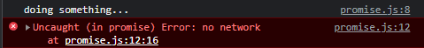
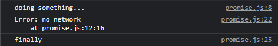
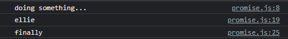
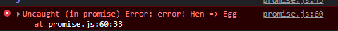
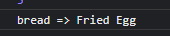

# 드림코딩 12: Promise

- promise : 자바스크립트에서 지원되는 비동기를 간편하게 처리할 수 있도록 도와주는 오브젝트이다. 프로미스는 정해진, 장시간의 기능을 수행하고나서도 정상적으로 동작이 되면 성공적으로 처리된 값을 전달해주고, 예상치 못한 문제가 발생했다면 에러를 전달한다.
- Promise의 포인트 2 가지.

1) state : 현재 무거운 작업을 수행 중인지, 성공했는지, 실패했는지.

2) producer와 consumer.  
⇒ 원하는 데이터를 제공하는 사람 producer, 데이터를 소비하는 사람 consumer

## Promise의 state

state: pending → fulfilled or rejected

Producer vs Consumer

Promise는 하나의 Object이기 때문에, const promise = new Promise(); 이와 같이 생성한다.

```text
var Promise: PromiseConstructor
new <any>(executor: (resolve: (value: any) => void, reject: (reason?: any) => void) => void) => Promise<any>
Creates a new Promise.

@param executor
A callback used to initialize the promise. This callback is passed two arguments: a resolve callback used to resolve the promise with a value or the result of another promise, and a reject callback used to reject the promise with a provided reason or error.
```

Promise는 인자로 executor라는 콜백 함수를 전달받는다. executor는 또 다시 두 개의 콜백을 전달받는데, 기능을 정상적으로 수행해서 마지막에 최종 데이터를 전달하는 resolve 콜백 함수와 기능을 수행하다가 중간에 문제가 생기면 수행할 reject라는 두 개의 콜백을 추가로 전달 받는다.

```javascript
const promise = new Promise((resolve, reject) => {
    // doing some heavy work... (network, read files)
});
```

새로운 프로미스가 만들어질 때는 우리가 전달한 executor라는 함수가 바로 실행된다.

```javascript
// 1. Producer
const promise = new Promise((resolve, reject) => {
    // doing some heavy work... (network, read files)
    console.log('doing something...');

    setTimeout(() => {
        resolve('ellie'); // 네트워크에서 받아온 데이터가 ellie라고 가정.
    }, 2000); // 네트워크 통신 가정
});
```

현재는 서버와의 통신이 이루어지지 않으므로, 서버와 통신하는 과정이 setTimeout으로 이루어진다고 가정하고 2000초의 delay 이후에 통신이 정상적으로 된 상황을 가정해 setTimeout을 실행한다.

```javascript
// 2. Consumer : then, catch, finally
promise.then((value) => {
    console.log(value); // ellie가 출력됨.
})
```

then은, promise가 정상적으로 수행돼서 resolve라는 callback 함수로 전달된 parameter를 전달받아서 (위의 코드에서는) value로 가져와 사용할 수 있다.

그런데, 우리가 만약 네트워크 통신을 하다가 실패하면 reject를 실행한다.

```javascript
// 1. Producer
const promise = new Promise((resolve, reject) => {
    // doing some heavy work... (network, read files)
    console.log('doing something...');

    setTimeout(() => {
        reject(new Error());
    }, 2000); // 네트워크 통신 가정
});
```

Error는 자바스크립트에서 제공하는 object 중의 하나이다. error는 무언가 에러가 발생했다는 것을 알려주는 역할을 한다. error에는, 어떤 에러가 발생했는지 명시해주어야 한다.



그런데, 이렇게만 작성하면 Uncaught라고 뜬다. 이는, 우리가 resolve를 처리해주는 .then만 추가해주었기 때문에 error handling이 원활하게 되지 않았기 때문이다. 이 경우에는 .catch를 추가해서 에러를 추가적으로 잡아주어야 한다.

```javascript
// 2. Consumer : then, catch, finally
promise.then((value) => { // resolve를 처리하는 부분
    console.log(value);
})
.catch((error) => { // reject를 처리하는 부분
    console.log(error);
});
```

.then은 똑같은 promise를 return하기 때문에, 다시 .catch를 호출할 수 있게 된다. (`chaining`) array를 다룰 때 여러 API를 이어서 사용한 것과 같은 방식이다.

- finally : 성공과 실패 여부에 상관없이 무조건 실행된다.

```javascript
// 2. Consumer : then, catch, finally
promise
    .then((value) => {
        console.log(value);
    })
    .catch((error) => {
        console.log(error);
    })
    .finally(() => {
        console.log('finally');
    });
```



⇒ reject인 경우에 finally가 수행된 모습



⇒ resolve인 경우에 finally가 수행된 모습

---

- Promise Chaining

then은 값을 바로 전달할 수도 있고, promise를 전달할 수도 있다. 즉, 값을 바로 전달해도 되고, 또 다른 비동기 작업을 전달해도 된다는 것이다.

```javascript
// Promise Chaining
const fetchNumber = new Promise((resolve, reject) => {
    setTimeout(() => resolve(1), 1000);
});

console.log('check here');

fetchNumber
.then(num => num * 2)
.then(num => num * 3)
.then(num => {
    return new Promise((resolve, reject) => {
        setTimeout(() => resolve(num-1), 1000);
    });
})
.then(num => console.log(num));

console.log('check here 2');
```

2초 뒤에 지정된 값인 5가 출력되고, promise.then은 resolve가 수행되어야 수행된다. (check here log가 먼저 나오게 됨)

---

- Error Handling

```javascript
// error handling
const getHen = () => 
    new Promise((resolve, reject) => {
        setTimeout(() => resolve('Hen'), 1000);
    });

const getEgg = (hen) =>
    new Promise((resolve, reject) => {
        setTimeout(() => resolve(`${hen} => Egg`), 1000);
    });

const cook = (egg) => 
    new Promise((resolve, reject) => {
        setTimeout(() => resolve(`${egg} => Fried Egg`), 1000);
    });

getHen()
.then(hen => getEgg(hen))
.then(egg => cook(egg))
.then(meal => console.log(meal));
```

함수를 만드는데, 이 함수는 promise를 return하는 세 개의 함수이다. 실행은 위와 같이 하게 되는데, .then에서는 resolve로 넘어온 인자의 이름을 마음대로 지정할 수 있다.

```javascript
getHen() //
.then(getEgg)
.then(cook)
.then(console.log);
```

만약, promise를 통해 then으로 전달받은 인자를 바로 다른 함수의 인자로 넣어준다면, 위 처럼 일부 생략이 가능하다.

---

그런데 만약, 이 과정에서 네트워크 에러가 발생해서 어떠한 오류가 발생한다고 해보자. 그러면 어떻게 해야될까?



⇒ 이전 경우와 마찬가지로, error catch를 하지 않았으므로 오류가 발생한다.

```javascript
getHen() //
.then(getEgg)
.then(cook)
.then(console.log)
.catch(console.log);
```

이럴 때는, .catch를 마지막에 붙여줌으로써 error catching이 가능하다. 그런데 만약, 중간에 문제가 생긴다면 받아오지 못한 재료를 이용해서 요리를 이어가도록 error handling을 하고 싶다면 이렇게 해야 한다.

```javascript
getHen() //
.then(getEgg)
.catch(error => {
    return 'bread';
})
.then(cook)
.then(console.log)
.catch(console.log);
```



이렇게 하면, 우리가 암탉과 계란을 받아오는 것에는 실패하지만, 빵을 통해서 promise chaining을 이어갈 수 있다.

---

- callback 지옥 예제를 promise로 간단화하기
- My code

```javascript
'use strict';

// Callback Hell Example
class UserStorage {
    loginUser(id, password, onSuccess, onError) {
        setTimeout(() => {
            if (
                (id === 'ellie' && password === 'dream') ||
                (id === 'coder' && password === 'academy')
            ) {
                onSuccess(id);
            } else {
                onError(new Error('not found'));
            }
        }, 2000);
    }
    
    getRoles(user, onSuccess, onError) {
        setTimeout(() => {
            if (user === 'ellie') {
                onSuccess({ name: 'ellie', role: 'admin'});
            } else {
                onError(new Error('no access'));
            }
        }, 1000);
    }
}

const userStorage = new UserStorage();
const id = prompt('enter your id');
const password = prompt('enter your password');

const promise = new Promise((resolve, reject) => {
    userStorage.loginUser(id, password, resolve, reject);
});

promise //
.then(user => {
    return new Promise((resolve, reject) => {
        userStorage.getRoles(user, resolve, reject);
    })
})
.then(console.log)
.catch(console.log);
```

promise chaining을 이용.

- ellie’s code

```javascript
'use strict';

// Callback Hell Example
class UserStorage {
    loginUser(id, password) {
        return new Promise((resolve, reject) => {
            setTimeout(() => {
                if (
                    (id === 'ellie' && password === 'dream') ||
                    (id === 'coder' && password === 'academy')
                ) {
                    resolve(id);
                } else {
                    reject(new Error('not found'));
                }
            }, 2000);
        });
    }
    
    getRoles(user) {
        return new Promise((resolve, reject) => {
            setTimeout(() => {
                if (user === 'ellie') {
                    resolve({ name: 'ellie', role: 'admin'});
                } else {
                    reject(new Error('no access'));
                }
            }, 1000);
        });
    }
}

// 1. ID, PW를 입력받아오고, 이를 서버에게 보냄. => 로그인
// 2. 역할을 받아옴

const userStorage = new UserStorage();
const id = prompt('enter your id');
const password = prompt('enter your password');

userStorage.loginUser(id, password)
.then(userStorage.getRoles)
.then(user => {
    alert(`Hello ${user.name}, you have a ${user.role} role...`);
})
.catch(console.log)
```

서버(여기서는 class)에서 promise를 return하게 만들고, 이를 promise chaining으로 이어가면서 비동기적으로 동작을 수행하도록 만듦. class 자체에서 promise를 return하도록 만들면, 따로 onSuccess와 onError 함수를 지정해주지 않고, 그냥 promise를 return하면 됨.
