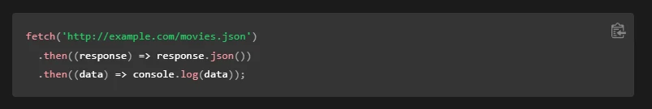

# 생활코딩: Promise

- Synchronous/Asynchronous

javascript에서 비동기 작업은 어떤 작업이 언제 끝날지 예측하기 어렵거나 주가 되는 작업이 아닐 때 주로 사용한다. 서버와 웹브라우저가 통신할 때는 작업이 언제 끝날지 예측하기 어렵기 때문에 비동기 작업을 사용한다.

## fetch (Promise)



- jsonplaceholder.typicode.com

서버를 마련할 때 사용하기 쉬움.

```javascript
console.log(1);
fetch('https://jsonplaceholder.typicode.com/posts')
	.then(res => res.json())
	.then(res => console.log(JSON.stringify(res)));
console.log(3);
```

⇒ fetch 자체도 Promise를 return하기 때문에, 비동기적으로 동작한다.

그러므로, .then으로 이어지는 코드 구조는 보기 싫기는 하지만 Promise&lt;response&gt;를 return하기 때문에 비동기적으로 동작하는 것이라고 보면 된다.

```javascript
var fetched = fetch('https://jsonplaceholder.typicode.com/posts');
	console.log('fetched', fetched);

// fetch가 return한 Promise는 아래 두 개의 메서드를 사용할 수 있다.
// .then은 fetch를 통한 결과가 성공했을 때, .then이 호출되도록 약속되어 있다.
// 그리고 결과값이 있다면 콜백함수의 첫 번째 argument로 전달받을 수 있다.
	fetched.then(function(result) {
		console.log('result', result);
	});

// .catch는 fetch를 통한 결과가 실패했을 때 .catch가 호출된다.
// 그리고 콜백함수의 첫 번째 argument로 실패한 이유를 전달받을 수 있다.
// URL을 일부로 틀림으로써 .catch가 실행되는 경우를 확인해볼 수 있음.
	fetched.catch(function(reason) {
		console.log('reason', reason);
	});
```

- Promise Chaining

```javascript
var fetched = fetch('https://jsonplaceholder.typicode.com/posts')
        .then(res => {
            console.log('response', res.json());
        })
        .catch(reason => {
            console.log('reason', reason);
        })
```

그리고, res.json()은 사실 Promise를 return한다. 그러므로 아래와 같은 것들이 가능하다.

```javascript
var fetched = fetch('https://jsonplaceholder.typicode.com/posts')
        .then(res => {
            console.log('response', res.json().then(function(data) {
                console.log(data);
            }));
        })
        .catch(reason => {
            console.log('reason', reason);
        })
```

```javascript
var fetched = fetch('https://jsonplaceholder.typicode.com/posts')
        .then(res => res.json())
        .then(res => console.log(res))
        .catch(reason => {
            console.log('reason', reason);
        })
```
