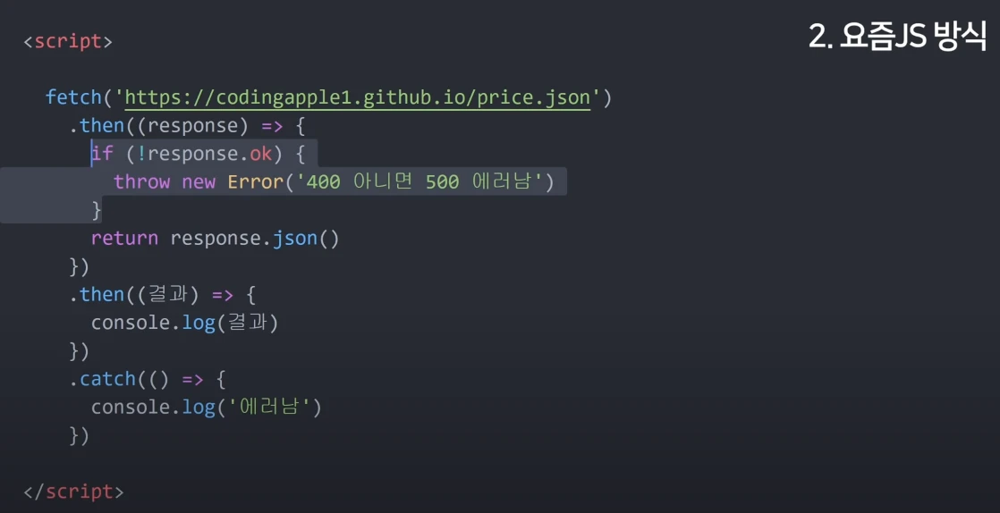

# AJAX

작성일 2023-07-23
{ .post-date }

AJAX(Asynchronous Javascript And XML) : 서버와 비동기적으로 데이터를 주고받는 자바스크립트 기술을 의미한다.

AJAX는 새로고침없이 서버에게 GET요청을 할 수 있는 기술이다.



⇒ 요즘은 API 통신 과정에서 생긴 오류 잡을때 거의 이렇게 함.

- CORS 에러

예를 들자면, naver.com에서 개발하고 있는데 kakao.com으로 요청을 보낼 수 없다. 이런 보안 이슈 관련 문제이다.

집에서 개발할 때는 header에 Access-Control-Allow-Origin: “*”을 추가해 주거나, 서버에서 설정을 추가하면 된다.

```javascript
var cors = require('cors')
app.use(cors()) // cors 관련 정책 끄기
// 이렇게 하면 모든 URL에서 API를 사용할 수 있다.
```
