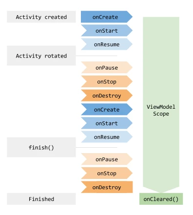
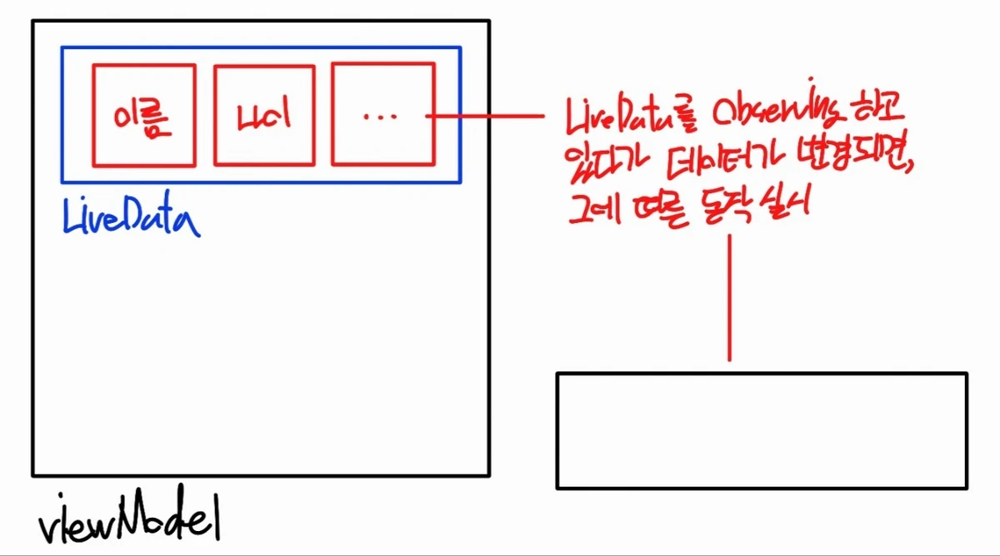

# JetPack > viewModel & LiveData

작성일 2022-09-24
{ .post-date }

## `viewModel`

- `viewModel`이란, 기존의 생명주기와는 관계 없이 생명주기를 유지해주는 또 다른 생명주기이다.



- 일반적인 생명주기는 위의 그림과 같이 다양한 주기를 갖지만, viewModel은 그에 관계없이 view가 계속해서 살아남을 수 있도록 생명주기를 제공해준다. 예를 들어, 안드로이드 화면을 회전시킬 때, 생명주기가 다시 시작되므로 기존의 생명주기에 따르면 view를 다시 그려줘야 했지만, viewModel을 사용하면 view가 계속해서 유지될 수 있다.

---

## `LiveData`

- LiveData란, viewModel이 갖고 있는 데이터로서 viewModel이 갖고 있는 변수를 알려준다. Activity나 Fragment에 알려준다고 보면 된다. (즉, 데이터가 LiveData에 살아있다는 의미)

    LiveData는 데이터의 변경을 지속적으로 관찰한다. (일종의 `Observer Pattern`)

    → `Observer Pattern`을 이용하면, 데이터가 변경되는 것을 비동기적으로 관찰할 수 있음.

---



→ viewModel과 LiveData의 동작

---

## `MVVM`

→ Model - View - ViewModel Pattern

---

- gradle

```groovy
def lifecycle_version = "2.6.0-alpha01"

// ViewModel
implementation("androidx.lifecycle:lifecycle-viewmodel-ktx:$lifecycle_version")

// LiveData
implementation("androidx.lifecycle:lifecycle-livedata-ktx:$lifecycle_version")
```

→ Gradle은 이와 같이 추가해준다. (업데이트에 따라 변경 가능)

---

## `viewModel & LiveData 사용 예시`

→ `MyNumberViewModel.kt`

```kotlin
package com.noob_gallon.viewmodellivedata

import android.util.Log
import androidx.lifecycle.LiveData
import androidx.lifecycle.MutableLiveData
import androidx.lifecycle.ViewModel

enum class ActionType {
    PLUS, MINUS
}

class MyNumberViewModel : ViewModel() {

    private val _currentValue = MutableLiveData<Int>()

    val currentValue :LiveData<Int>
        get() = _currentValue

    init {
        _currentValue.value= 0
    }

    fun updateValue(actionType: ActionType, input: Int) {
        when (actionType) {
            ActionType.PLUS -> {
                _currentValue.value = _currentValue.value?.plus(input)
            }
            ActionType.MINUS -> {
                _currentValue.value = _currentValue.value?.minus(input)
            }
        }
    }
}
```

- viewModel Class를 선언한 후, `ViewModel()`을 상속해준다.
- Kotlin Convention에 따라, LiveData를 ViewModel에 선언할 때
    private val `_currentValue` = … 와 같이 언더스코어(_)를 붙여서 변수를 선언한다.
    LiveData는 값을 변경할 수 있는 `1) Mutable LiveData`와 값을 변경할 수 없는 
    `2) Live Data`로 나뉜다. 여기서는 값을 변경해주기 위해 MutableLiveData&lt;Int&gt;로 선언한다.
- _currentValue는 private val 이므로 Activity에서 참조할 수 없다. 따라서 _currentValue의 값을 얻을 수 있는 `getter`를 만들어준다.  currentValue를 참조하면, _currentValue의 값을 LiveData(Immutable)의 형태로 전달해준다.
- init을 이용하여 실제 LiveData의 초기값을 설정해준다.
- LiveData의 값을 변경할 수 있는 `updateValue` 함수를 만들어준다. 이 때, enum class를 만들어서 어떤 동작을 실시할지 구분해준다. (더하기와 빼기를 구현할 예정)

→ MainActivity.kt

```kotlin
package com.noob_gallon.viewmodellivedata

import androidx.appcompat.app.AppCompatActivity
import android.os.Bundle
import android.util.Log
import android.view.View
import androidx.lifecycle.Observer
import androidx.lifecycle.ViewModelProvider
import androidx.lifecycle.get
import com.noob_gallon.viewmodellivedata.databinding.ActivityMainBinding

class MainActivity : AppCompatActivity(), View.OnClickListener {

    private var mBinding: ActivityMainBinding? = null
    private val binding get() = mBinding!!

    lateinit var myNumberViewModel: MyNumberViewModel

    override fun onCreate(savedInstanceState: Bundle?) {
        super.onCreate(savedInstanceState)
        mBinding = ActivityMainBinding.inflate(layoutInflater)
        setContentView(binding.root)

        myNumberViewModel = ViewModelProvider(this)[MyNumberViewModel::class.java]

		myNumberViewModel.currentValue.observe(this, Observer {
            binding.numberTextView.text = it.toString()
        })

        binding.plusButton.setOnClickListener(this)
        binding.minusButton.setOnClickListener(this)
    }

    // 클릭
    override fun onClick(p0: View?) {
        val userInput = binding.userInputEditText.text.toString().toInt()

        when(p0) {
            binding.plusButton -> {
                myNumberViewModel.updateValue(actionType = ActionType.PLUS, userInput)
            }
            binding.minusButton -> {
                myNumberViewModel.updateValue(actionType = ActionType.MINUS, userInput)
            }
        }
    }
}
```

- lateinit var myNumberViewModel: MyNumberViewModel를 늦은 초기화 전역 변수로 선언하여 추후에 viewModel의 객체로 사용한다.
- viewModel 객체는 `ViewModelProvider`를 통해 초기화할 수 있다.
- 이후 myNumberViewModel.currentValue.observe(this, Observer { … })를 통해서
    MainActivity가 MyNumberViewModel.kt에 있는 LiveData _currentValue를 Observe할 수 있도록 만들어 준다. (값이 변경되면 비동기적으로 알림을 전해줌)
- MainActivity가 View.onClickListener를 상속하여 onClick Listener를 override하도록 만든다.
    이 때, override된 `onClick` function의 argument `p0`는, 선택된 view를 의미하므로, view를 이용해 각각 다른 OnClickListener를 구성한다. (actionType은 viewModel에서 구성했던 enum class)

→ 이와 같이 구성하면, Activity 생명주기와 분리된 `Live Data`를 `viewModel`을 통해 구현할 수 있다.
