# Agent

## Agent

- 에이전트(Agent)

    - 사용자로부터 위임받은 일을 **자율적으로 수행**하는 시스템(S/W)

        해야될 일만 정해주고 나머지는 자율적으로, 알아서 판단해서 수행하는 시스템.  
        프로그램의 경우 예외 상황을 갖지만, 에이전트는 자율적으로 판단한다.

        이 과정에서 예상치 못한 상황이 발생하거나, 좋은 결과가 발생하기도 한다.

    - 최근에는 강화학습이 대표적인 에이전트로서 사용된다.

    - 인공지능을 만들 때는 최신 기술 뿐만 아니라 과거의 전통적인 시스템도 녹여서 모델에 녹여내어야 한다. (계산, 이미지 처리 등이 모두 담겨져 있음.) ⇒ 기존의 학문을 이해해야 좀 더 좋은 모델을 만들 수 있음.
    - **주어진 환경 내**에서 센서를 통해 주변 환경과 상황을 인지하면, 에이전트가 스스로 결정을 내리고 제어를 하는 것이 에이전트의 동작이다. (Sensing → Actuation)

    - 종류

        - 소프트웨어 에이전트

            - 채팅봇 : Siri, Tay

        - 물리적 에이전트 : Robot(Tesla Autonomous Driving Car)
        - 반응형 에이전트 : 단순한 입력에 대해서 정해진 반응
        - 숙고형 에이전트
        - 학습 에이전트

- 탐색

    - 문제의 답이 될 수 있는 것들의 집합을 공간으로 간주하고, 문제에 대한 최적의 해를 찾기 위해 공간을 체계적으로 찾아 보는 것.

    - 무정보 탐색(정해진 순서 내에서 다 뒤지는것)

        - 너비 우선 탐색(BFS)
        - 깊이 우선 탐색(DFS)

    - **휴리스틱 탐색**(휴리스틱이라는 function을 둬서 특정 조건을 만족하는 것만 탐색)

        - 언덕오르기, 내려가기 탐색

            휴리스틱으로 검사하고 갈 방향을 결정하는 방식.

        - 최선 우선 탐색
        - A* 알고리즘

    - 게임 트리 탐색

        - min-max 알고리즘
        - a-B 가지치기(pruning)
        - 몬테카를로 트리 탐색

- 지식표현(knowledge representation)

    - 문제 해결에 이용하거나, 심층적 추론을 할 수 있도록 지식을 효과적으로 표현하는 방법

    - 종류

        - if-then 규칙(rule) : production system
        - 프레임(frame) : 여러 개의 요소를 틀 안에 집어넣는 것. 예를 들어 크기, 소리, 색깔 등 여러 데이터를 프레임으로 만들어서 데이터를 표현한다.
        - 의미망(semantic net) :  데이터들 간의 관계를 표현하는 방법
        - 논리(logic) : 명제논리(propositional logic), 술어논리(predicate logic)
        - 확률적 표현(확률 그래프 모델)
        - 온톨로지 기술 언어 : RDF, OWL

- 추론(inference) : 내가 얻은 지식을 표현해 주는 방법.

    - 가정이나 전제로부터 결론을 이끌어 내는 것. 이미 만들어진 모델에서 답을 얻는 것(모델을 사용하는 것)은 **추론**이고, 만들어 가는 과정(학습하는 것)은 **학습**이다.

    - 규칙 기반 시스템의 추론

        - 전향추론(forward inference)
        - 후향추론(backward inference)

    - 확률 모델의 추론

        - 분포 : 여러 종류의 분포가 있다. 추론은 이산 수학을 사용하면 단순해진다.

            - 관심 대상의 확률 또는 확률분포를 결정하는 것
            - 베이즈 정리 및 P(A|B) = P(B|A)P(A)/P(B)

            - **주변화**(marginalization) 등을 이용.

                한가지 변수에 대한 확률값을 측정하기 위해 변수를 모두 적분하여 제거하는 과정.  
                (적분 또는 총합)

            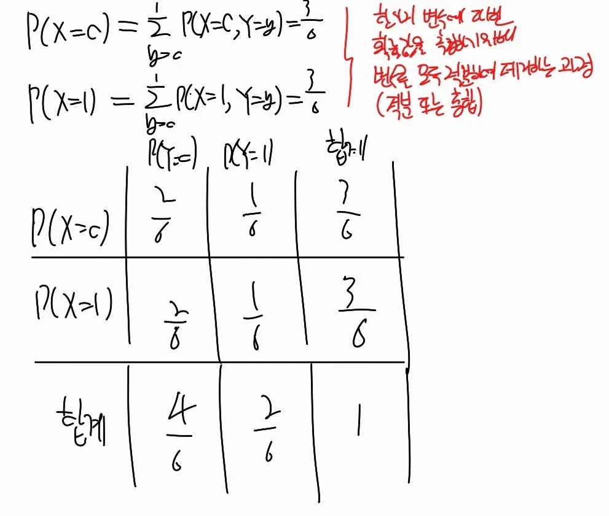

        ⇒ 인공지능에서는 확률을 많이 다룬다.

- 기계 학습

    - **경험을 통해서 나중에 유사하거나 같은 일**(task)을 더 효율적으로 처리할 수 있도록 시스템의 구조나 파라미터를 바꾸는 것.

        ex) 고양이를 판단하라. (Rule Based도 가능)

    - 종류

        - **지도학습**

        입력과 대응하는 출력을 데이터로 제공하고, 대응관계의 함수 찾기

        - **비지도학습**

        데이터만 주어진 상태에서 유사한 것들을 서로 묶어 군집을 찾거나 확률분포 표현.  
        ⇒ 답은 없지만 구분은 가능한 것. 답이 없는 문제들만 데이터들로 부터 패턴을 추출한다.

        ⇒ 군집화, 밀도 추정, 토픽 모델링 등이 가능함.

        - **강화학습**(reinforcement learning)

        상황 별 행동에 따른 시스템의 보상 값만을 이용하여 시스템에 대한 바람직한 행동 정책을 찾기. 에이전트 이용

        ⇒ 문제에 대한 직접적인 답을 주지는 않지만, 경험을 통해 기대 보상이 최대가 되는 정책 (policy)을 찾는 것.

- 계획 수립

    - 현재 상태에서 목표하는 상태에 도달하기 위해 수행해야 할 일련의 행동 순서를 결정.
    - 작업 수행 절차 계획
    - 로봇의 움직임 계획

- 패턴인식(pattern recognition)

    - 데이터에 있는 패턴이나 규칙성을 찾는 것
    - 문자 인식
    - 음성 인식
    - 영상 인식
    - 텍스트 패턴 인식
    - 센서 신호 인식(레이다, 라이다, 소나 등)
    - 이상치 탐지

    ⇒ 응용의 영역

## 주요 응용 분야

- 자연어 처리(Natural Language Processing)

    사람이 사용하는 일반 언어로 작성된 문서를 처리하고 이해하는 분야

    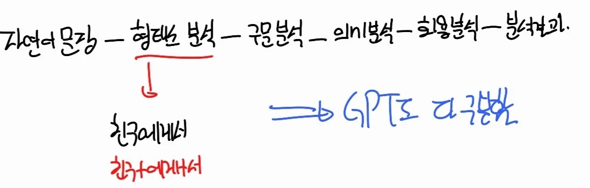

    - 형태소 분석, 구문 분석, 품사 태깅, 의미 분석
    - 언어 모델, 주제어 추출, 개체명 인식
    - 문서 요약
    - 기계 번역(machine translation)
    - 질의 응답

    ⇒ 이러한 기반 기술을 이용하고, 언어가 표현하는 것이 결국은 &lt;지식&gt;이라는 것을 종합적으로 이용한 생성형 학습모델 LLM이다.

- 컴퓨터 비전(computer vision)

    컴퓨터를 이용하여 시각 기능을 갖는 기계장치를 만들려는 분야

- 음성 인식

    가장 편한 Interface

- 로보틱스

    로봇에 관련된 기술 분야로서 기계공학, 센서공학, 마이크로 일렉트로닉스, 인공지능 기술 등을 종합적으로 활용 ⇒ 머지않아 Quantum Jump를 하게 될 것.

    - 지능 로봇 : 인공지능 기술을 활용하는 로봇

---

## Intelligent Agent

- 인간의 능력을 부분적으로든 전반적이든 대신할 수 있는 시스템.
- Agents and Environments
- Rationality
- PEAS(Performance measure, Environment, Actuators, Sensors) ⇒ 정의
- Environment types
- Agent types
- Agent : 센서를 통해 정해진 환경을 인지하는 것. 그리고 Actuate를 통해서 환경 상에서 Acting하는 것을 말한다. 순수 S/W가 될 수도 있고, H/W가 결합한 것이 될 수도 있다.

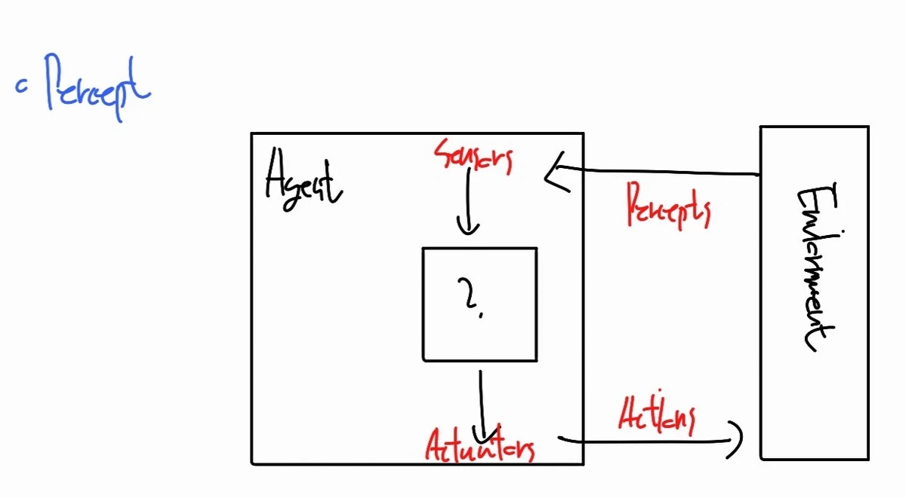

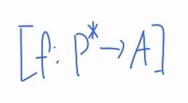

⇒ Agent Function : Percept한 것을 Actions로 Mapping(사상)하는 과정에 있는 것을 Agent Function 이라고 한다.

- Agent의 예시 : 두 개의 방에서 청소를 하는 로봇 청소기. 두 개의 방(A, B)을 돌아다닐 수 있고, 더러울 경우 먼지를 흡입하거나 가만히 있는다.

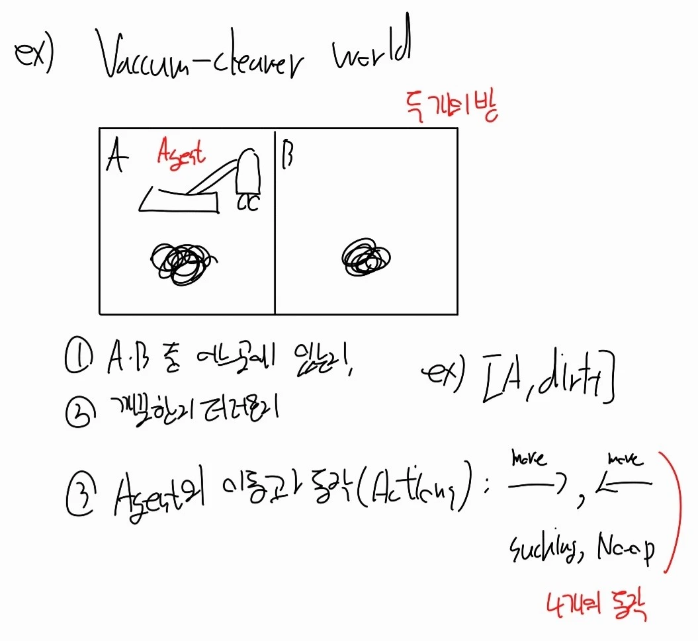

- Vacuum-cleaner’s action mapping

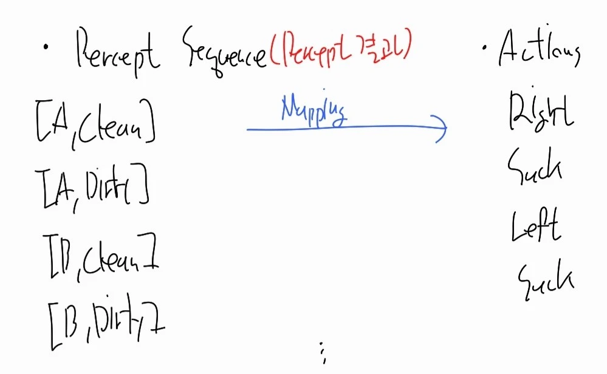

⇒ Agent가 특정 환경에서 할 수 있는 동작들을 특정 Actions에 Mapping할 수 있다. (Percept Sequence, Percept의 결과.) 

이 과정에서 단순화 할 수 있는 경우에는 동작을 최대한 간결하게 나누게 되는데, 이를 **Simple Reflex Agent**라고 한다.

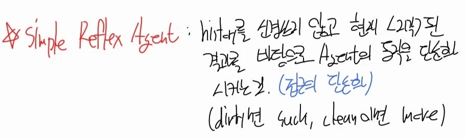

- Agent Program

### Performance Measure (성과측정)

- 옳은 일은 Agent 행동의 결과를 고려해서 판단한다.

    - Agent가 어떠한 Actuate를 했을 때 그 행동으로 나오는 최종 결과로 옳고 그름을 판단함.

- Agent는 자신이 처한 환경에서 받아들인 지각열(History, Sequence)에 따라 일련의 동작을 수행한다.

    - Agent는 자신이 존재하는 환경에서 특정 정보나 상태 등의 Sequence를 입력받고, 이를 바탕으로 일련의 동작을 수행한다.

- 그런 동작들의 순차열(Sequence of actions), 즉 동작열에 의해 환경은 일련의 상태들을 거치게 되는 것이다.

    - Agent의 지각열에 따라 동작열이 나타나고, 이에 따라 환경의 상태가 변화함을 의미. 즉, Agent는 주변 환경의 상태에 따라서 지각하고 그 지각을 바탕으로 동작하며, 이 동작을 통해 환경의 상태를 옳은 상태로 변화시키고자 한다.

- **그러한 상태들이 바람직하다면(Desirable), Agent의 행위는 옳은 것**이다.

- 성과 측정을 위한 “**바람직한 상태**”는 Agent의 상태가 아니라 환경(Environment)의 상태이다. 즉, Agent가 스스로의 성과를 평가하여 그 결과로 “성공” 여부를 판단한다면, Agent의 어떤 경우든 스스로 완벽하다고 속임으로써 합리성을 얻을 수도 있다.

    - 따라서 Agent에게 전달된 지각열에 따른 동작열이 환경의 상태에 따라 결정되기 때문에 동작열이 불러오는 결과들이 실제로 원하는 동작이 될지는 모른다는 것

        - Agent가 계속해서 쓰레기가 있는 장소 A/B를 계속해서 왔다갔다 하고 있다면 그것 자체로는 아무런 가치가 없지만 Agent는 스스로 무엇을 하고 있다고 착각할 수도 있다. (**얼마나 왔다갔다 했는지를 성과측정 평가요소로 넣으면 안됨.**)
        - Agent가 깨끗한 장소 A/B를 왔다갔다 해봤는데 쓰레기가 없어서 아무것도 하지 않고 있다. 이전의 Rule에 따르면 장소 A/B를 왔다갔다 하게 되는데, 쓰레기가 없기 때문에 실질적으로는 동작하지 않고 있는 것이다. (**쓰레기를 얼마나 빨아들였는지를 성과측정 평가요소로 넣으면 안됨.**)

        > 이러한 상황에서, Agent가 잘못된 평가 기준을 가지게 된다면 장소 A/B를 움직이지 않고 한 장소에만 있거나 자신이 가지고 있던 쓰레기를 내뱉고 계속해서 다시 빨아들이는 식으로 동작할 수도 있음.  
        > ⇒ 즉, Agent는 스스로의 동작에 대해서 평가를 하면 안된다. Agent는 반드시 환경의 상태에 따라서 성과측정을 할 수 있어야 한다.

    - 진공청소기 Agent의 경우 아래 요소들을 종합적으로 판단해서 성과측정을 해야 함.

        - Amount of dirt cleaned up
        - Amount of time taken
        - Amount of electricity consumed
        - Amount of noise generated
        - etc.

### 성과측정 예시

- 진공청소기의 성과측정을 8시간의 작동기간 동안 진공청소기가 빨아들인 먼지의 양으로 측정하는 것은 올바른 것일까?
- 합리적인 Agent는 앞의 성과를 그대로 받아들여야 한다.

- 성과측정치를 최대로 올리기 위해서 다음의 동작을 지속할 수 있다.

    - 먼지를 빨아들이고, 다시 모든 먼지를 바닥에 쏟아 붓는다.
    - 이 과정을 계속 반복한다.
    - 이러한 반복이 주어진 시간 내에 계속되면 성과측정치는 최대화 가능하다.

- 이것은 Agent의 상태를 기준으로 측정하였기 때문이다.

⇒ B로 이동하고 돌아오는데 Energy를 소모하지 않음. 

- 반면, 환경의 상태가 바람직함을 기준으로 생각해 본다면…

- 성과측정치를 최대로 올리기 위해 다음의 동작을 제시할 수 있다.

    - 바닥을 다 치우면 점수를 부여한다.
    - 단위 시간마다 바닥이 깨끗한지를 측정하여 점수를 추가
    - 소비 전기와 소음발생 정도에 따라 감점 부여

    > 성과측정 방법을 설계할 때는 Agent가 어떻게 행동해야 하는지를 기준으로 하기 보다, 환경이 실제로 어떻게 변하는 것이 바람직한지를 기준으로 삼는게 낫다.

- 바닥이 깨끗한 정도를 나타내기 위해 &lt;**평균 청결도**&gt;를 이용한다면…

    - 작동기간 내내 평범한 성과를 보인 Agent
    - 작업을 빠른 시간 내에 수행하고 오랫동안 쉰 Agent

    ⇒ 둘 다 같은 평균청결도를 보인다면 어떻게 평가할 것인가? 이런 것을 평가하는 기준을 만들어야 한다.

### Rational Agent(합리적인 에이전트)

- 각각의 가능한 지각열(Percept Sequence)에 대해, Rational Agent는 자신의 지각열과 에이전트가 가지고 있는 지식이 제공하는 증거에 기초해서 성과 측정치(Performance Measure)를 극대화 할만한 동작을 선택해야 한다.

- 진공청소기 Agent

    - 사각형이 더러우면 치우고, 그렇지 않으면 다른 사각형으로 이동하는 간단한 진공청소기 Agent 예시를 다시 생각해보자.
    - 앞서 표현한대로, 성과측정 방식이 무엇인지 알려진 환경이 무엇인지, Agent가 가진 Sensor와 Actuator가 무엇인지 등을 알아야 한다.

    ⇒ 이런 상황과 정보들이 주어져야 합리적인지 판단가능하다.

    - 주어진 상황이 달라지면 Agent가 비합리적이 될 수도 있다.
    - 예를 들어, 일반적인 상황에서 Agent는 한 쪽의 사각형의 모든 먼지를 치운 후에 불필요하게 사각형을 계속 이동할 수 있다.
    - 만약 성과측정시, 좌우 이동마다 감점(혹은 벌점)을 주게 되면, Agent는 상당히 낮은 성과를 낼 수도 있다. 이런 상황이면 양쪽 사각형이 한번 깨끗해 진 후에는 아무 일도 하지 않는 Agent가 더 나은 Agent가 될 수도 있다.
    - 사각형이 다시 더러워지는지, 환경 정보를 쉽게 파악 가능한지 등을 알 수 있을 필요가 있다.

    ⇒ **설계의 중요성**

- Rationality is distinct from omniscience(전지전능함)

    - 합리성은 기대성과를 극대화하는 것이고, 완벽함은 실제성과를 극대화하는 것이다.
    - 합리성과 완벽함은 같은 것이 아니다.

- 향후의 지각들을 수정하기 위한 동작들을 수행하는 것은, 합리성의 중요한 부분이다.

    > 향후의 지각들을 수정하기 위한 동작이라는 것은, 결국 지각을 수정하기 위해 어떠한 동작을 하게 된다는 것이다. 지각을 수정하는 이유는 무엇일까? 성과측정을 극대화하기 위해서 수집하거나 파악해야 하는 정보/상황들을 얻기 위해서일 것이고, 그러한 변화를 위해서 Agent는 일련의 동작(동작열)을 수행해야 한다.  
    >   
    > ⇒ Exploration(탐험)도 정보수집의 예이다.

- 합리적인 Agent는 자율적(Autonomous)이어야 한다. 부분적인, 또는 부정확한 사전 지식을 학습을 통해 보완할 수 있어야 한다.

    > 그렇기 때문에 지각(들어오는 정보들)이 수정되어야 할 수도 있고, 이에 따라 새로운 동작이 실행될 수 있는 것임.

### PEAS

- Agent를 설계할 때는 항상 과제 환경(Task Environment)을 최대한 완전하게 서술해야 한다.

- 과제환경은 PEAS 서술이라고 부르기도 한다.

    - Performance Measure
    - Environment
    - Actuators
    - Sensors

- 택시 운전기사 예시

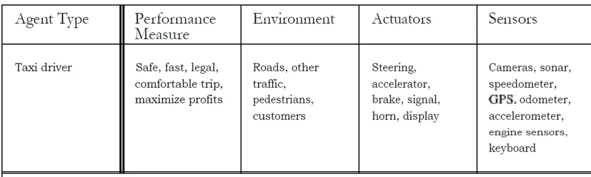

⇒ 이런 요소들을 바탕으로 성과를 최대화할 수 있는 방향을 고민해 보아야 한다.

- **Medical Diagnosis System** (의료 진단 시스템)

    - Performance Measure : Healthy Patient, Minimize Costs, Lawsuits(법적 문제)
    - Environment : Patient, Hospital, Staff
    - Actuators : Screen Display (Questions, Tests, Diagnoses, Treatments)
    - Sensors : Keyboard (Entry of symptoms, Findings, Patient’s Answers)

- **Part-picking Robot** (부품분류)

    - Performance Measure : Percentage of parts in correct bins
    - Environment : Conveyor belt with parts, bins
    - Actuators : Jointed arm and hand
    - Sensors : Camera, joint angle sensors

- **Interactive English Tutor**

    - Performance Measure : Maximize student’s score on test
    - Environment : Set of students
    - Actuators : Screen display (Exercises, Suggestions, Corrections)
    - Sensors : Keyboard

- **Robot Soccer Player**

    - Performance Measure : Winning game, goals
    - Environment : Field, ball, Own team, Other team, Own body
    - Actuators : Devices for locomotion(운동) and kicking
    - Sensors : Camera, Touch sensors, Accelerometers, Orientations sensors, wheel/joint encoders

### Environment Types

인공지능이 활동해야 하는 과제 환경은 다음과 같이 다양하다.

- **Fully Observable** (vs. Partially Observable)

    - 완전관찰가능 / 부분관찰가능 (혹은 관찰 불가능)
    - An agent’s sensors give it access to the complete state of the environment at each point in time. ⇒ Agent의 센서는 각 시점에서 환경의 전체 상태에 대한 접근을 제공해야 한다.
    - 진공청소기가 현재 사각형의 내의 먼지만 감지하거나 다른 사각형 내의 먼지도 관찰하거나, 이런 것들을 구분해서 생각할 수 있다.

- **Deterministic** (vs. stochastic)

    - 결정론적 / 확률론적
    - 환경의 다음 상태가 전적으로 현재 상태와 Agent가 수행한 동작으로만 결정된다면 결정적, 그렇지 않으면 확률론적이다.
    - 완전관찰가능하고 결정론적인 환경에서는 불확실성이 없다. (모든 것이 통제되기 때문)
    - 택시주행은 확률론적 / 진공청소기는 둘 다 가능하다.

- **Episodic** (vs. sequential)

    - 일화적(순간순간마다 일을 하는가, Atomic한 경험) / 순차적

    - The agent’s experience is divided into atomic “episodes” (each episode consists of the agent perceiving and then performing a single action), and the choice of action in each episode depends only on the episode itself.

        - 각 일화에서 Agent는 하나의 지각을 받아 하나의 동작을 수행
        - 일화적 환경은 그 다음 일화가 이전 일화들에서 취한 행동에 의존하지 않음
        - 일화적 환경은 조립 라인에서 결함이 있는 부품을 찾거나 분류하는 Agent는 현재 부품만 보고 결정하지, 이전 부품을 고려하지 않는다.
        - 일화적 환경은 현재 결정이 이전의 결정과 무관하다.

    - 순차적 환경에서는 현재 결정이 이후의 모든 결정에 영향을 줄 수 있다. (LSTM)

        - 택시와 체스 같은 경우는 순차적 환경

- **Static** (vs. dynamic)

    - Agent가 다음 행동을 고민하는 동안 환경이 변할 수 있으면 dynamic(동적 환경)이라고 한다.

    - 정적 환경에서는 다음 동작을 결정하는 동안 계속해서 환경을 살펴볼 필요가 없는 것으로 보인다.

- **Discrete** (vs. continuous) : A limited number of distinct, clearly defined percepts and actions

    - 체스는 이산적, 택시는 연속적

- **Single Agent** (vs. multiagent) : An agent operating by itself in an environment

- **known** (vs. unknown)

    - 환경이 알려져 있는 경우, 알려져 있지 않은 경우

- 과제 환경의 예와 특성

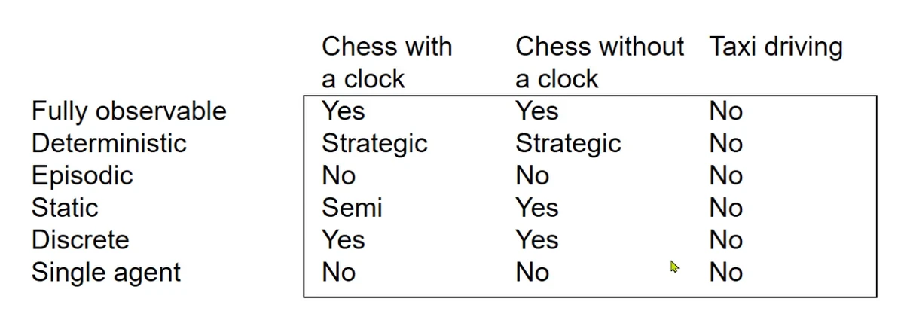

⇒ 현실 세계는 Taxi Driving의 특성과 같다.

- **Agent functions and programs**

    - An agent is completely specified by the agent function mapping percept sequences to actions ⇒ Agent는 특정 지각열에 대한 동작에 매핑되는 agent function으로 구체화된다.

- **Agent Types**

    - **Simple reflex agents**

        - 항상 현재 지각에 근거해서 동작을 선택한다.

        - 진공청소기 Agent의 경우, 청소기의 현재 위치와 먼지 유무 여부만으로 결정으로 내리므로 단순 반사 Agent이다.

            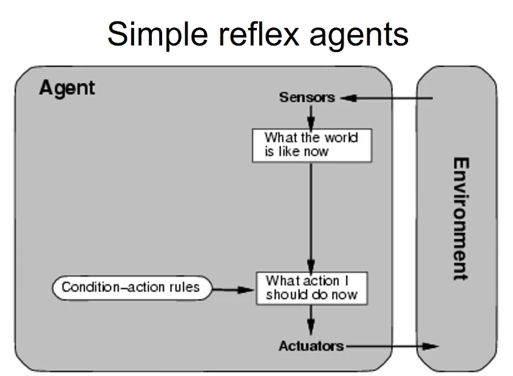

        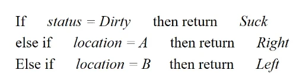

    - **Model-based reflex agents**

        - 효과적인 부분 관찰 가능성을 처리하는 방법
        - 모델을 세우고 계속 관찰을 유지하는 것

        - 드라이버 Agent는 카메라의 이전 프레임과 현재 프레임을 비교해서 브레이크 등의 On, Off 상태를 판단할 수 있고, 좌우 차선의 차와의 거리를 이전과 비교해서 추월 가능성을 판단할 수 있다.

            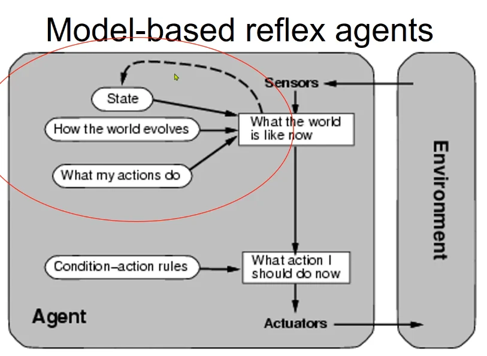

        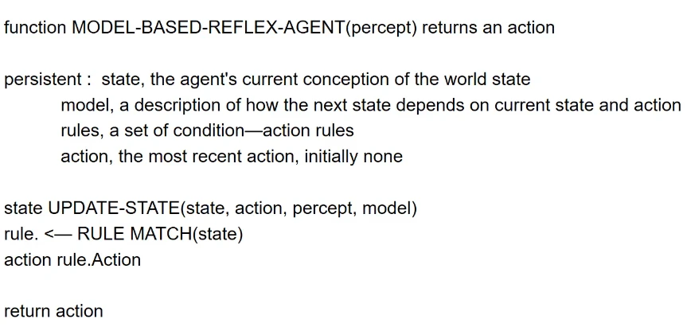

        내부 모델을 이용해서 현재 상태를 계속 추적, 동작 선택은 반사 Agent 모델과 동

    - **Goal-based agents**

        - 현재 환경에 대해 지속적으로 관찰해서 안다는 것만으로 다음 할 일을 정하기에 충분하지 않을 수 있다.
        - 교차로에서 좌회전 할 것이냐, 우회전 할 것이냐는 상황에 따라 판단하는 것이 아니라 Goal에 의해 결정하는 것이다.

        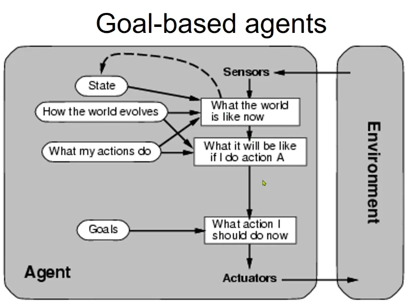

    - **Utility-based agents**

        - 택시가 목적지에 도달하는 여러 방법 중에 좀 더 우월한 방법과 열등한 방법이 구분될 수 있으며, Utility-Function(효용 함수)으로 성과 측정을 할 수 있다.
        - Utility는 유용함의 정도를 의미

        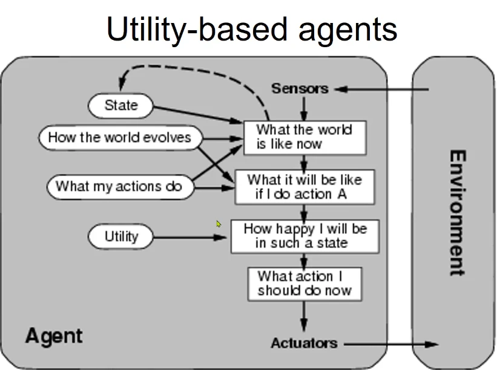

    - Learning agents

    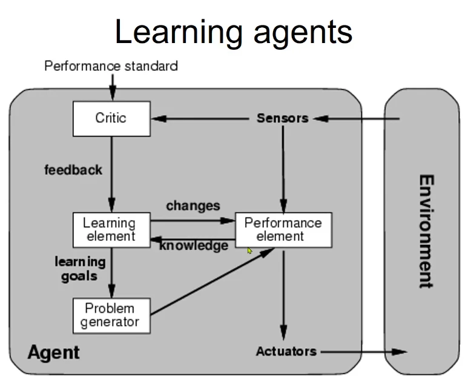

     결과를 바탕으로 학습하며 반복할 때 더 나은 동작을 하는 Agent
