# 탐색

## [탐색(Searching)]

> 컴퓨터가 문제를 자율적으로 해결하기 위해 해(Solution) 혹은 해에 이르기 위한 경로를 찾아가는 과정을 말한다.

탐색은 인공지능적 문제해결에서 주요한 수단

해를 찾는 과정의 효율성과 찾은 해의 적합성까지 판단

인공지능 시스템에서 적용할 규칙을 선택하는 제어 시스템의 행위는 일종의 탐색 과정

- 문제 해결 : 인간의 지적 문제를 해결하고자 탐색을 사용한다.

    - 1+2와 같은 간단한 문제는 인공지능적인 문제가 아님

---

### &lt;탐색 기법&gt;

#### 직접적 기법

- 문제의 해(Solution)를 찾고자 순차적으로 수행하는 프로그래밍
- 초기 상태가 다르면 프로그램 수정이 필요하다.
- 인공지능적 방법이 아님(거의 모든 기존 프로그램에 의한 문제 해결방식)

⇒ 알고리즘에서 다루는 것

#### 인공지능적 해법

- **문제 상태**와 요구하는 **목표 상태**만으로 컴퓨터가 문제를 해결하는 것
- 목표를 정하고 그 목표를 달성하기 위해 행동한다.

⇒ 인공지능에서 다루는 것

#### 하노이 타워

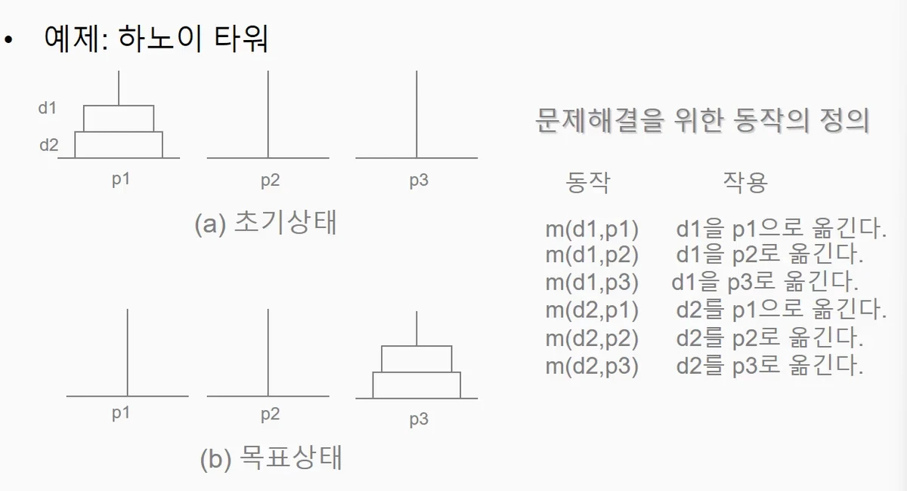

#### 탐색에 의한 문제 해결

- 문제의 해에 도달하기 위한 탐색과정을 직접 수행함으로써 보다 포괄적이며 자동화된 해결방안
- 문제해결 과정 중에 지적 판단이 요구되는 경우, 탐색 기법이 유용하다.

- 완벽한 의미의 지능적 기계보다는 인간의 지능이 어느 정도 개입하는 시스템 개발이 아직은 보다 현실적이다. ⇒ 부분적으로 탐색 후 결과를 이어붙여서 지적 판단에 개입함.

    - 그러나, 데이터 수집이 쉬워지고 그 양이 방대하며
    - 그 데이터를 가공할 기법과 H/W의 발전이 극적으로 이루어짐.
    - 지능적 S/W의 발전이 그 위에서 진행되고 있어
    - Quantum Jump의 시기가 도래하고 있다고 볼 수 있음.

⇒ 대표적인 예로 Tesla를 들 수 있음. Tesla와 Google의 접근법에는 차이가 있었는데, Google은 전기자동차+자율자동차를 개발하며, 데이터 수집을 위해서 자동차를 시험 주행을 시켰다. Tesla는 실제로 전기자동차를 팔았고, 이것을 통해서 데이터를 수집했다. Google과 달리 Tesla는 실제로 자동차를 팔았기 때문에 Google 보다 더 많은 양의 데이터를 얻을 수 있었고, 이것을 바탕으로 알고리즘과 운영 시스템을 개선할 수 있었다. 

---

### &lt;Problem-solving agents&gt;

> 탐색도 결국 특정한 일을 수행하는 Agent의 관점으로 볼 수 있다.

#### Example : Romania

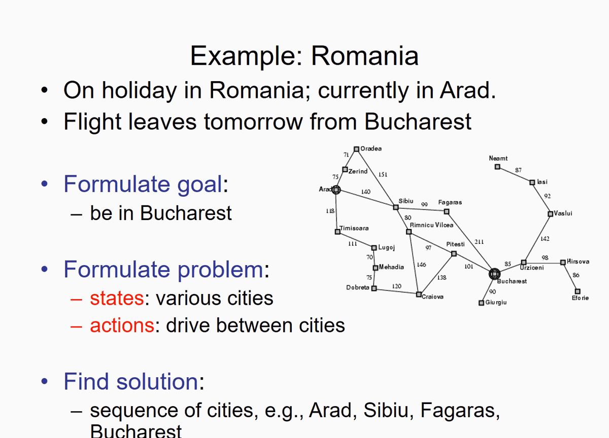

- 이 문제를 인공지능 관점에서 **휴리스틱 개념**을 도입해 생각해보자. (일반적 탐색 알고리즘 X)

- Formulate Problem

    - states : various cities
    - actions : drive between cities

- Find Solution

    - sequence of cities

#### 상태 공간(State Space)

- **상태** : 문제의 풀이 과정 중의 고유한 요소 (상황)
- 상태의 집합을 **상태 공간**이라고 한다.

- 상태 공간의 도입은 **문제의 형식화에 유리**하다.   
    ⇒ 트리 구조(단계별로 과정을 표현할 수 있는 거니까, 당연히 형식화에 유리한 것이 맞음.)

    - 초기 상태 := ((d1, d2) () ())
    - 목표 상태 := (() () (d1, d2))
    - 초기 상태에 연산자(규칙)를 적용하여 상태 공간에 상태를 추가하고, 이를 통해 목표 상태를 얻어가는 것이 문제 해결 과정이다.

- Root 노드에서 Target 노드까지 도달하는 과정

    - 트리의 크기가 문제 해결의 효율성과 관련(트리가 크면 탐색이 오래 걸림)

- **트리에서의 노드의 재생성은 문제를 야기**한다. ⇒ 그래프 구조로 바꿀 수도 있음.

    - 이렇게 되면 탐색의 효율이 저하되고, 무한 루프에 빠질 가능성도 있음.

- **상태 공간 트리**의 예시

> 상태의 집합인 상태 공간을 트리로서 표현한 것. 분기를 나눠서 나올 수 있는 경우에 대해 계속해서 자식 노드로 분기를 나누는 것이라고 생각할 수 있다.

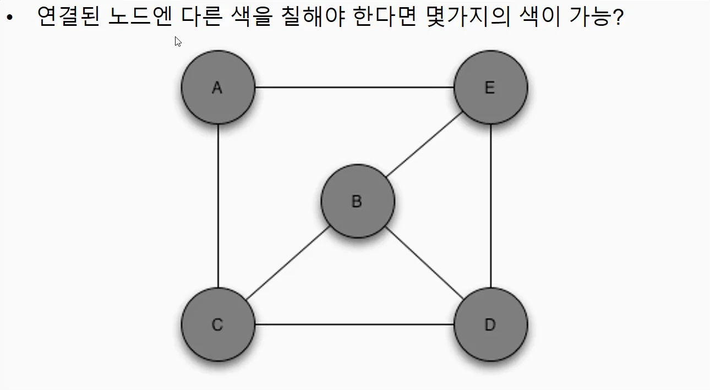

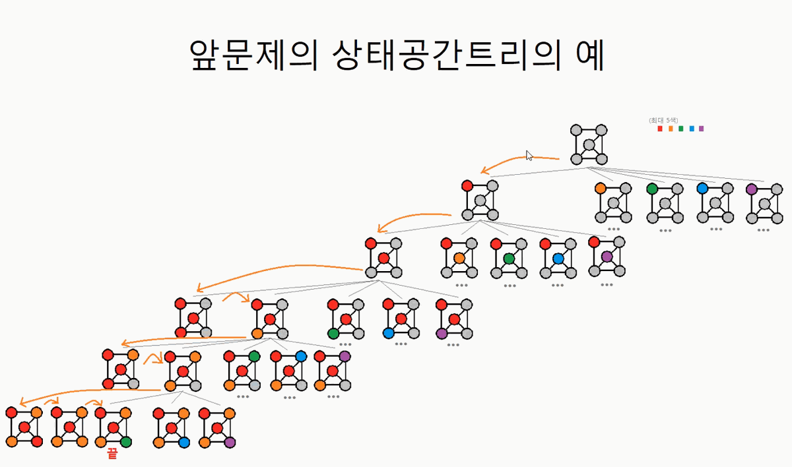

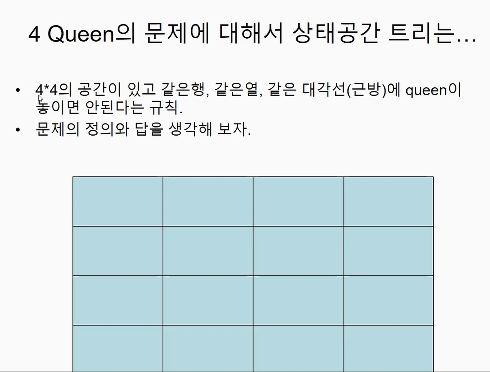

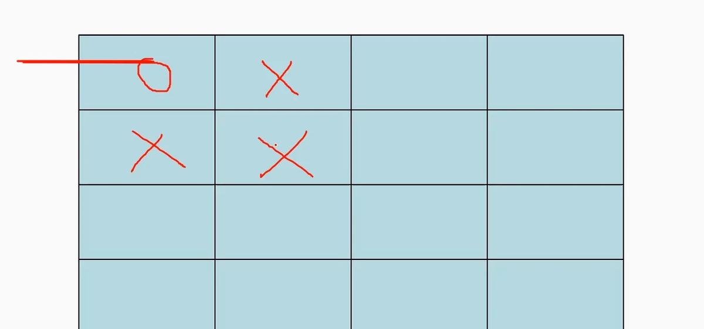

- 선택의 예시. (같은 행, 같은 열, 같은 대각선은 모두 안됨) 

    - 이 경우에 놓을 수 있는 경우를 상태 공간 트리로 표현해 보자.

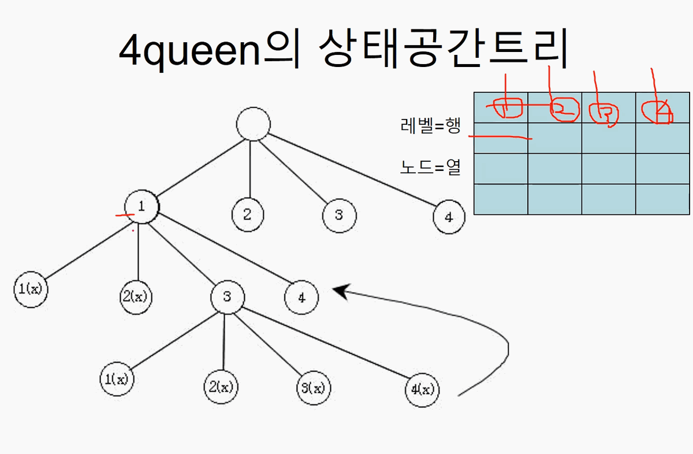

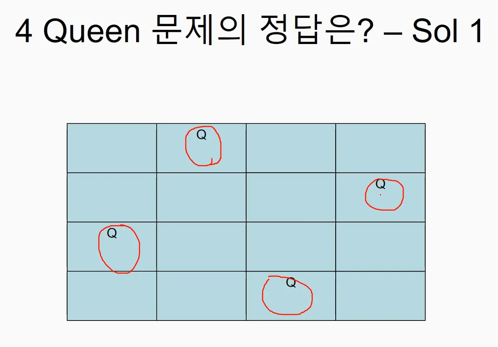

---

### &lt;Single-state problem formulation&gt;

> Single-state problem에서 사용되는 notation들을 알아보자.

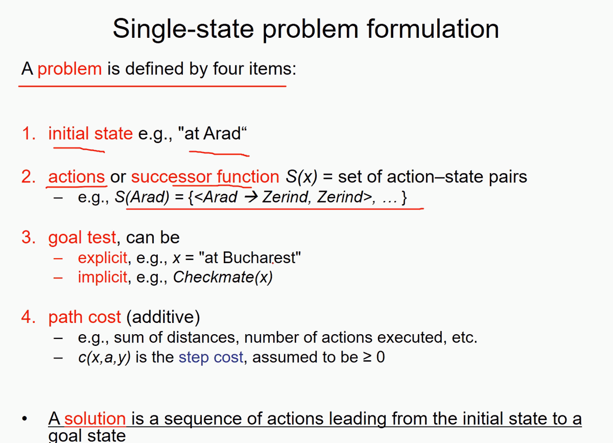

1. Initial State
2. Actions or Successor Function
3. Goal Test
4. Pathcost (Additive)

⇒ Solution은 initial state부터 goal state까지 가는 action들의 sequence이다.

#### Vacuum world state space graph

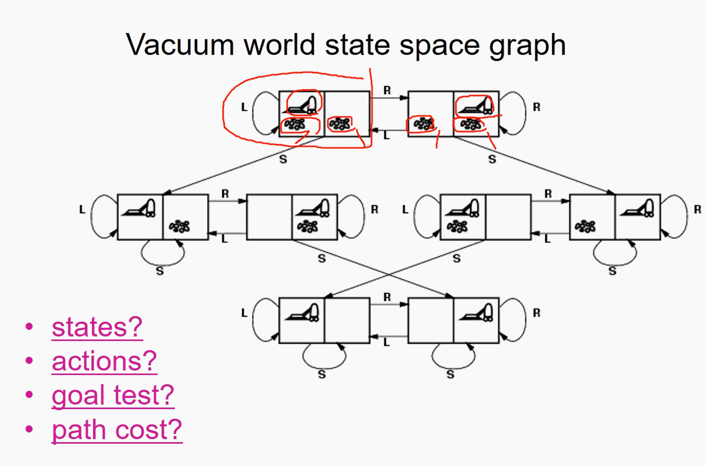

state space graph는 action을 기반으로 state에서의 transition을 나타낸다. 따라서, 특정 노드에서 다른 할 일이 있는 상태에서 대기를 하게 되면, cost의 낭비가 된다. (예를 들어 최상단 왼쪽 노드의 경우, 오른쪽으로 이동하거나 쓰레기를 흡입하는 것이 의미있는 동작이 되는데, 여기서 왼쪽으로 이동하는 Action은 상태를 유지하는 것이므로 cost를 낭비하는 것이 된다.)

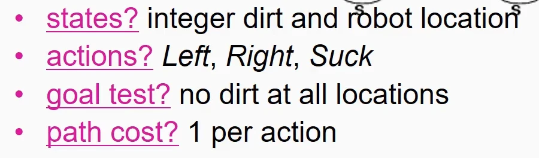

- states : 먼지의 존재 유무/로봇의 위치
- actions : 왼쪽으로 이동, 오른쪽으로 이동, 먼지흡입
- goal test : 모든 위치에 먼지가 없는 상태
- path cost : action 하나당 1점을 준다.

⇒ 이런 방식처럼, 모든 경우에 대해서 state space graph를 표현할 수 있음.

#### Example : The 8-puzzle

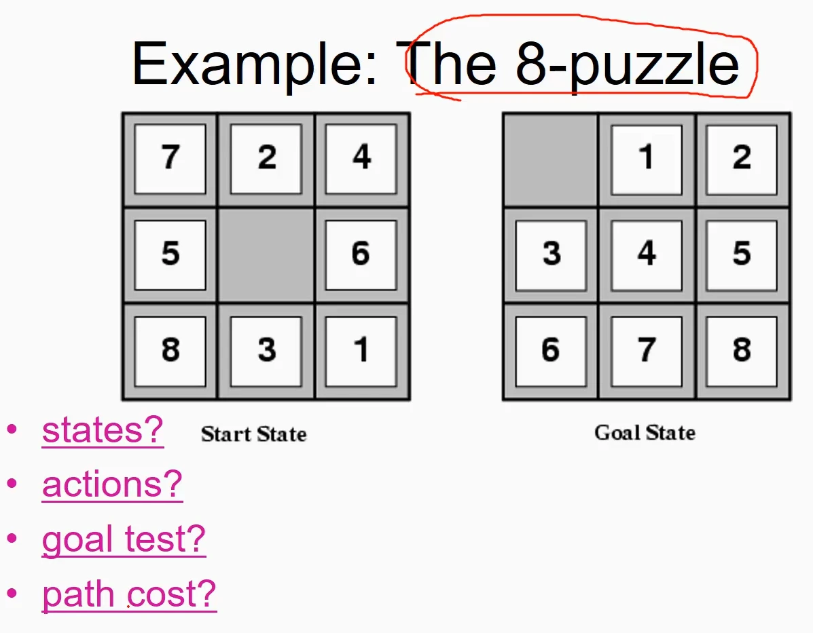

- Start State에서 Goal State로 만들기 위해, 어떤 과정을 거쳐 하는가? 결국 변할 수 있는 경우의 수는 제한적이기 때문에, State로 나타낼 수 있을 것이다.
- states : 각 번호가 위치한 모양이 states (location of tiles)
- actions : Blank를 어디로 보낼 것인가? (move blank left, right, up, down)
- goal test : 9개의 tile이 Goal State와 같다면 Goal이라고 판단 가능 (given)
- path cost : 1 per move

#### Example : Robotic Assembly

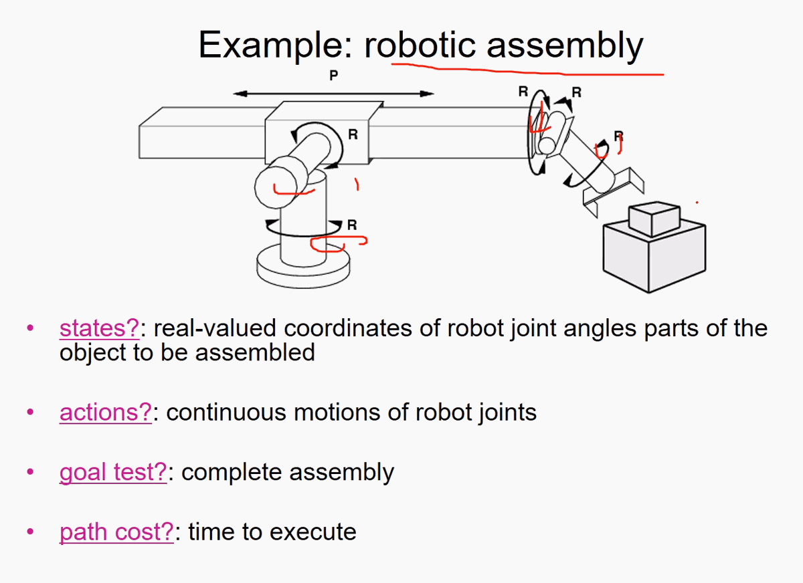

- path cost는 설정하기 나름임. 여기서는 물체를 모두 조립하는 데(이동시키는 데) 걸리는 시간.

    - 각 joint에서 누적 각도의 최소화로 잡을 수도 있음.

- 이렇게 모든 것을 정의해 놓으면, state를 만들고 현재 상태에서 goal까지 가는 목표를 찾을 수 있게 된다.

> 실제 현장에서는, 사람이 특정 동작을 조작하고 그 과정을 로봇이 기록한다. 목표가 달성되면, 로봇이 기록한 것을 바탕으로 목표까지 도달하는데 있었던 과정 중 불필요한 과정이 있었는지 파악한다. (예를 들어, Vacuum world에서 제자리에서 로봇이 돌았다던지…) 이러한 최적화 과정을 **Compile**이라고 하며, 그렇게 나온 결과를 바탕을 기록해 사용한다.

---

### &lt;탐색기법으로 Solution 찾기&gt;

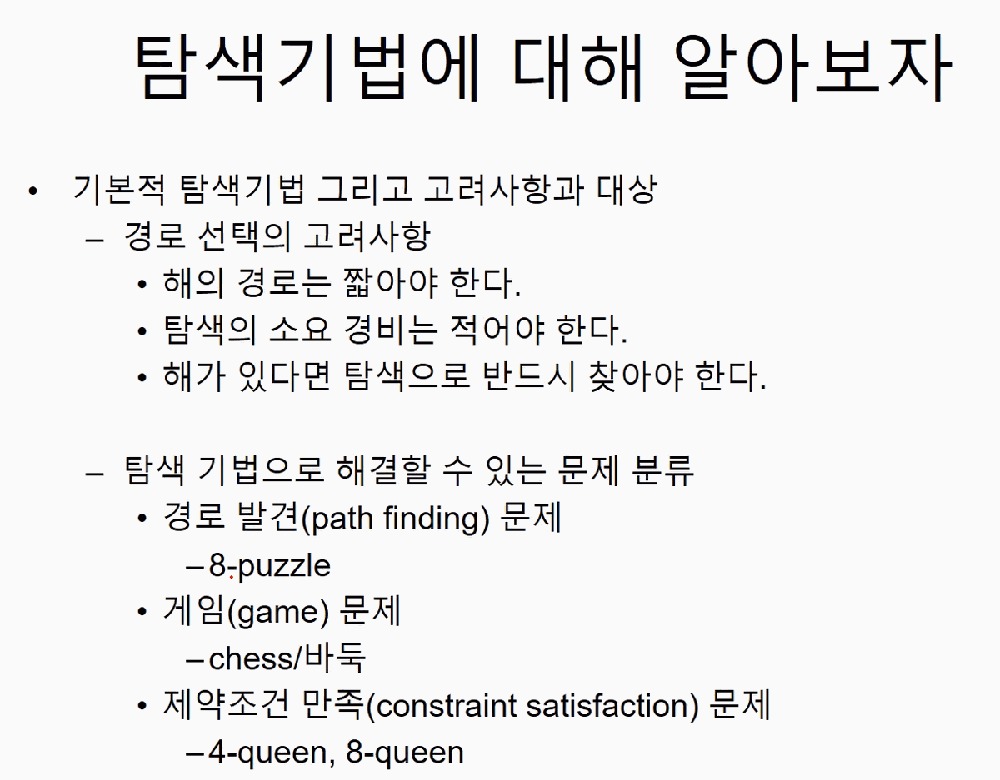

- 해의 경로는 최대한 짧아야 한다.
- 탐색에 소요되는 Cost는 적어야 한다.
- 해가 있다면, 탐색으로 반드시 찾을 수 있어야 한다.

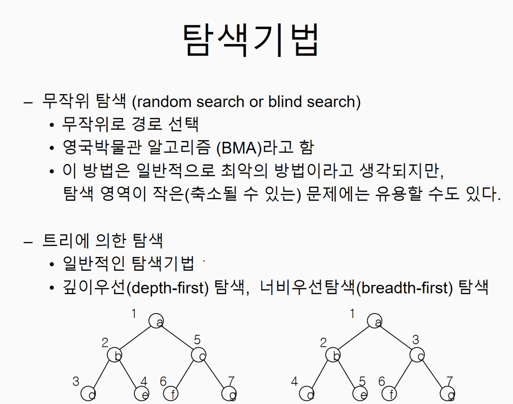

- **무작위 탐색**

아무런 조건 없이 무작위로 탐색하는 것

#### DFS(Depth-First-Search)

- 탐색 트리의 수직 방향으로 점차 깊은 곳까지 목표 노드를 찾아 탐색해 나가는 기법
- **Backtracking**을 사용한다.

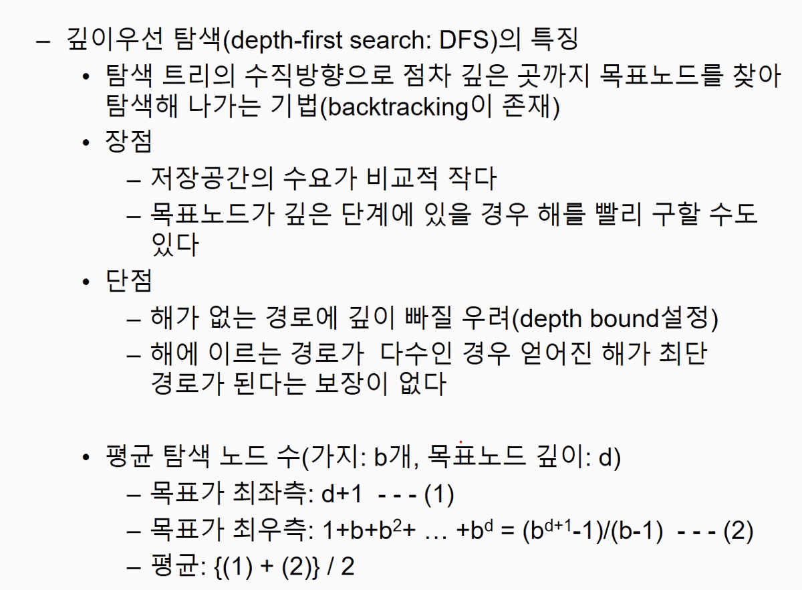

#### BFS(Breadth-First-Search)

- 탐색 트리의 루트 노드로부터 목표 노드를 만날 때까지 단계별로 횡방향 탐색을 진행하는 방식

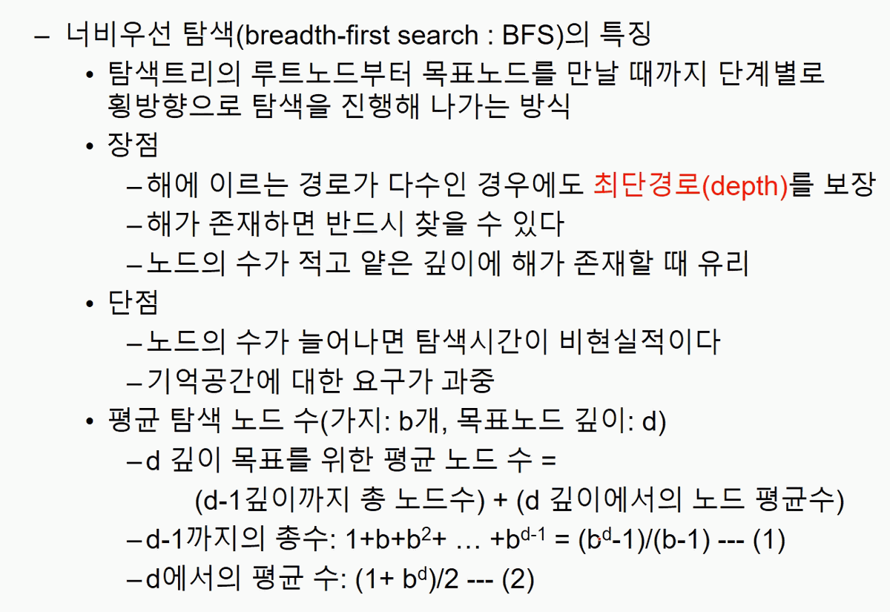
