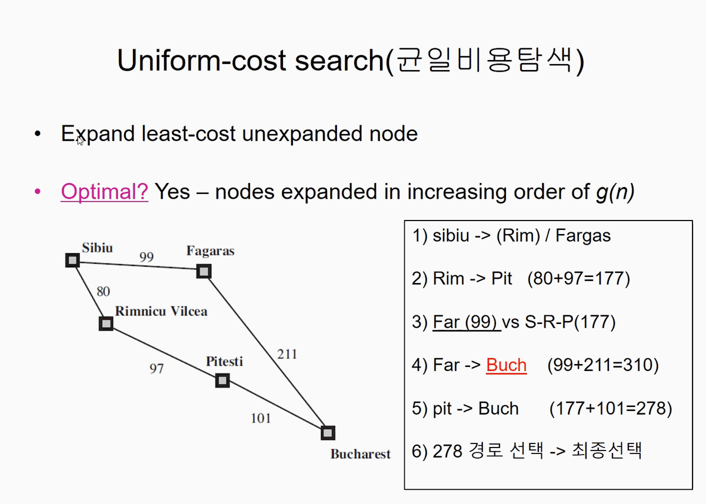
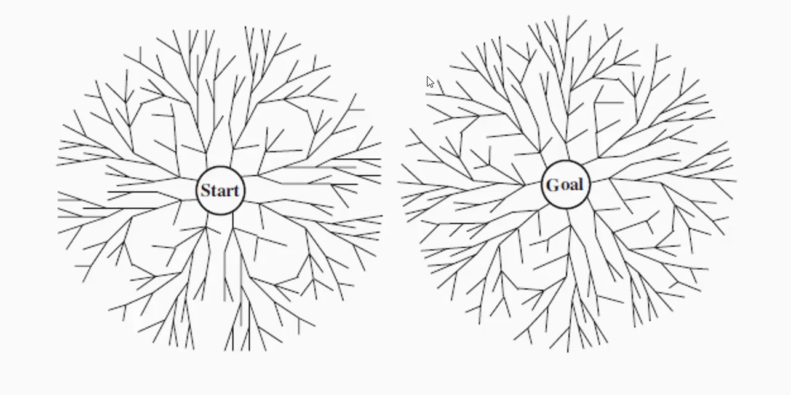
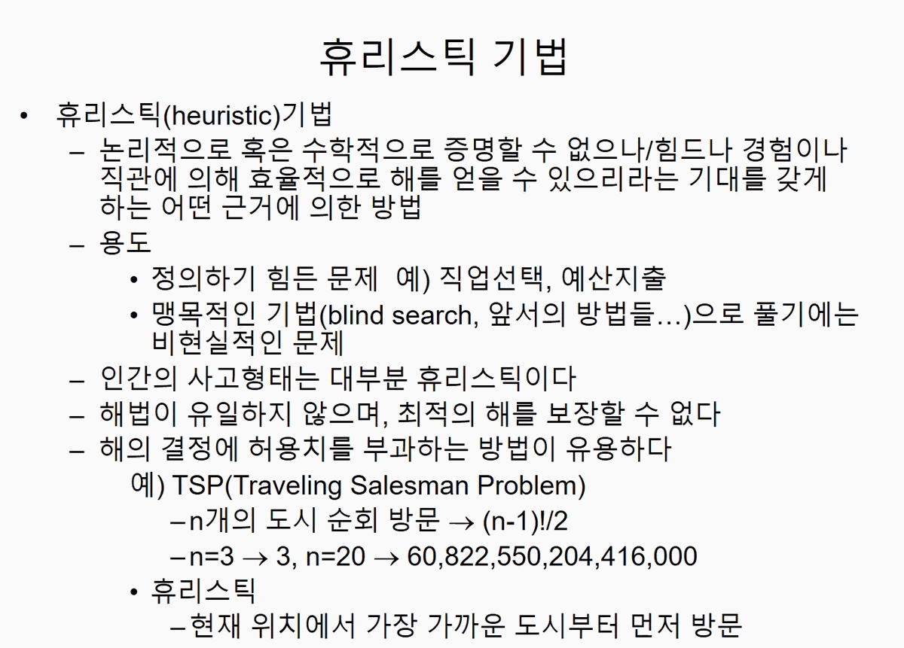
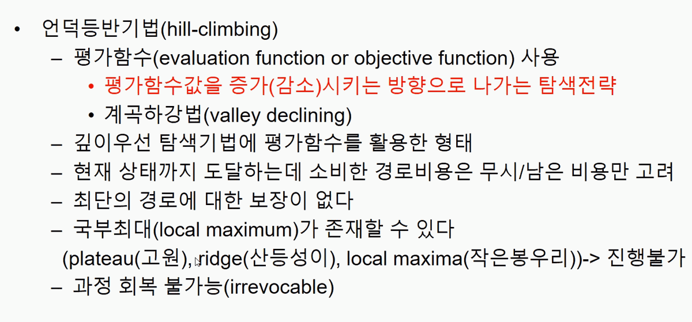
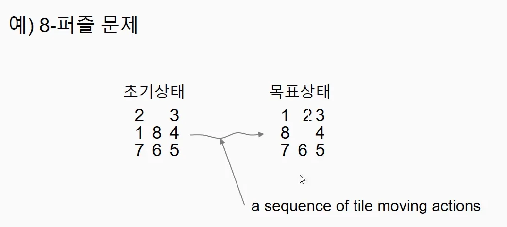
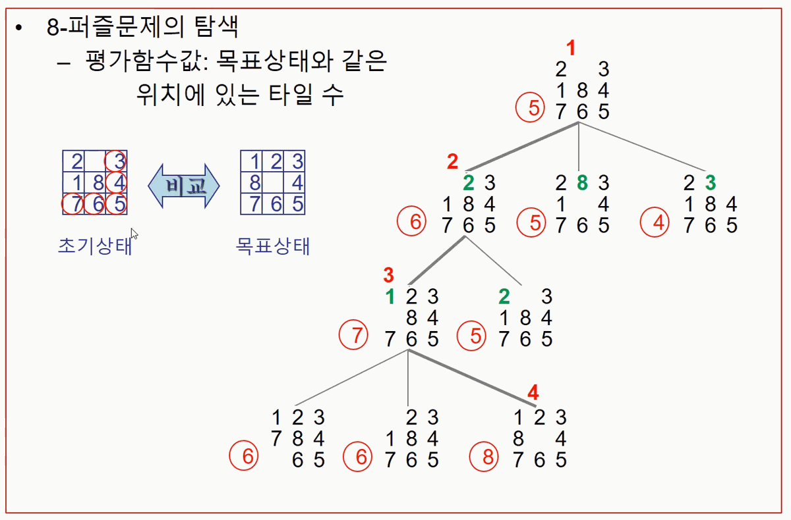
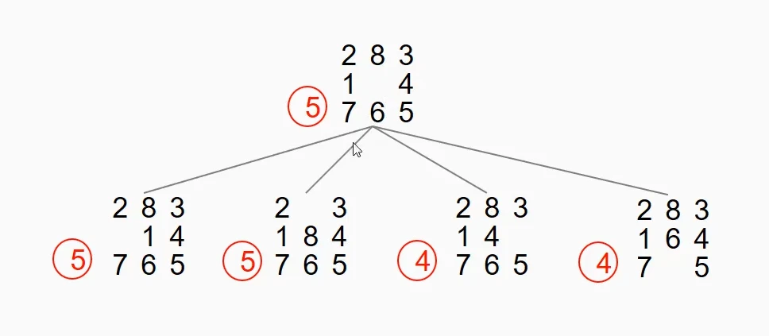
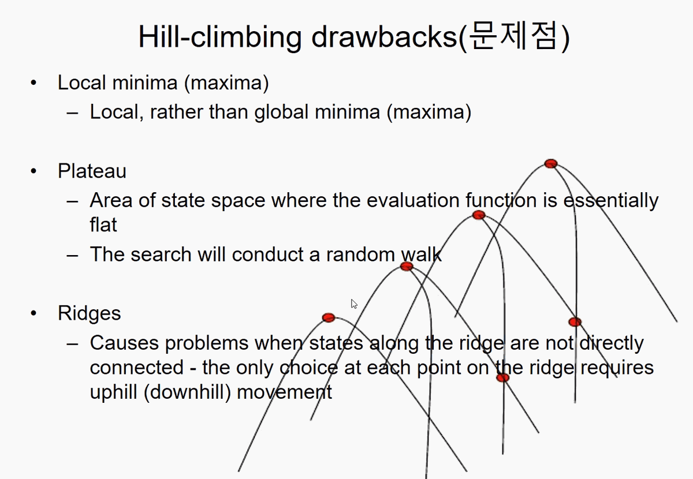

# 탐색에서의 Heuristic(Uniform-Cost Search)

작성일 2023-10-09 · 최종 수정일 2023-12-09
{ .post-date }

## [휴리스틱을 이용한 인공지능에서의 탐색]

---

### &lt;균일비용탐색&gt;

> 확장하지 않은 노드 중에, least-cost를 가지는 node를 확장해 나가는 방식이다.

⇒ 앞서 나왔던 Romania 지도의 일부

> 항상 출발 지점으로부터의 cost 값이 작은 노드를 확장하는 것!  

- Sibiu가 출발점이고 Bucharest가 도착점이라고 해보자. 이 구간에서 균일비용탐색을 적용해 Path를 찾아보자.

- 처음에는 갈 수 있는 길이 Rimnicu Vilcea(Rim) 또는 Fagaras(Far)이다.

    - 두 노드 중에서 cost가 작은 쪽으로 확장하므로, Rim으로 가게 된다.

- 이후, Rim에서 갈 수 있는 곳은 Pit밖에 없으므로 Pit으로 확장해야 한다.

- Sibiu → Rim → Pit까지 가는 Path의 Cost는 177이고, Sibiu → Fagaras는 99이므로 Far까지의 Path가 더 cost가 낮다. (*이걸 하는 이유는, 이전에 알고 있던 Path인 Sibiu → Far의 path인 99보다 Sibiu→ Rim → Pit의 cost가 높아졌기 때문에 한 번 조사해보는 것으로 생각된다.*)

    - 그렇다면 만약에 Pitesti가 도착점이었다면? 그래도 Path 자체의 cost는 Fagaras로 가는 쪽이 더 낮고, Fagaras 이후에 Pitesti까지 가는 cost가 작은 길이 있을 수도 있기 때문에 무조건 비교를 해봐야 한다.

- Far → Buch는 310. 이 경우, Sibiu → Rim → Pit이 cost가 더 낮기 때문에 길을 다시 찾아본다.
- Pit → Buch는 101이고, 결과적으로 Sibiu → Rim → Pit → Buch는 278이 된다.
- 따라서 선택되는 길은 Sibiu → Rim → Pit → Buch이다. (최종 선택)

---

### &lt;탐색의 방향&gt;

#### 전향추론

- **초기상태**에서 **목표상태**로 탐색

#### 후향추론

- **목표상태**에서 **초기상태**로 탐색

⇒ 주어진 문제의 성격에 따라 좌우된다.

- 시작 상태의 단순성과 복잡성 비교

#### 양방향 검색(Bidirectional)

⇒ 양 쪽에서 동시에 경로를 찾는 것.

---

### &lt;휴리스틱(Heuristic)기법&gt;

> 논리적으로 혹은 수학적으로 증명할 수 없으나, 경험이나 직관에 의해 효율적으로 해를 얻을 수 있으리라는 기대를 갖게 하는 어떤 근거에 의한 방법

⇒ 정확한 Solution을 얻을 수 있는 방법인지는 모르나, 그런 방법일 것이라고 기대를 갖게 하는 방법

- 용도

    - 정의하기 힘든 문제 : ex) 직업 선택, 예산 지출
    - 맹목적인 기법(Blind Search 등)으로 풀기에는 비현실적인 문제

- 인간의 사고 형태는 대부분 휴리스틱이다.
- 해법이 유일하지 않으며, 최적의 해는 보장할 수 없다.

- 해의 결정에 허용치를 부과하는 방법이 유용하다.   
    (*어느정도 허용되는 범위 내에서 값을 선택하는 방법을 정한다. ex: 가까운 도시부터 먼저 방문*)

    - ex) TSP(Traveling Salesman Problem)

        - 휴리스틱 : 현재 위치에서 가장 가까운 도시부터 먼저 방문하기

#### 언덕등반기법(Hill-Climbing)

> DFS에서, 휴리스틱 정보가 좋은 노드부터 탐색하는 기법.  
> 이때 휴리스틱 정보란, 사람이 유용할 것이라고 판단한 정보이다.

- 평가함수 사용

    - 평가함수값을 증가/감소 시키는 방향으로 나가는 탐색 전략이다.
    - 계곡하강법(Valley Declining)

- **DFS**에 **평가함수를 활용한 상태** ⇒ 들어가는 순서를 평가함수값에 따라 결정

- 현재 상태까지 도달하는데 **소비한 경로비용은 무시**하고, **남은 비용만 고려**한다.

    - 소비한 경로비용을 무시하므로, 항상 최단 경로를 보장할 수는 없음.

- 최단 경로에 대한 보장이 없다.

    - DFS를 사용하면 당연히 최단 경로 보장 불가능.

- 국부최대(Local Maximum)가 존재할 수 있다.
- 과정 회복 불가능(**irrevocable, Backtracking이 불가능**)

#### 8-Puzzle Problem (언덕등반기법)

- 언덕등반기법은 평가함수법을 적용하며, 각 노드에 적용하여 같은 레벨에서 평가함수값이 가장 높은 방향으로 확장한다.

    - 이런 방식으로 선택하면 위와 같은 결과가 나온다. (1→2→3→4)

#### 언덕등반기법의 실패 (Plateau, Ridge, Local maximum)

⇒ 가능한 state를 표현해보니, 현재 자신보다 나아지지 않거나 더 나빠지게 되는 경우가 있다. 이런 경우, 나아갔을 때 현재보다 좋아진다는 보장이 없으므로 이전으로 **Backtracking**하게 될 수 있다.

이를 **Plateau(고원)**, **Ridge(산등성이, 능선)**, **Local maximum(작은 봉우리)** 등으로 표현한다.

- **Plateau** : 높은 곳에 있는 평지. 새로운 state로 진행돼도 평가함수값이 그대로인 곳으로 보인다.
- **Ridge** : 능선. 새로운 state로 진행돼도 평가함수값이 감소하는 곳으로 보인다.
- **Local maximum** : 작은 봉우리. 주변 state들 중에서 평가함수값이 가장 큰 곳으로 보인다.

#### Hill-climbing drawbacks(문제점)

- Local maximum, Plateau, Ridges와 같은 문제에 봉착하게 되면, Random re-start와 같은 방법을 도입하여 현재 상태를 벗어나게 하기도 한다. ⇒ 다만 이것도 성공을 보장할 수는 없다.
