# 다양한 탐색 기법

작성일 2023-10-09 · 최종 수정일 2023-12-09
{ .post-date }

## &lt;(탐욕적)최고우선탐색(Greedy best-first)&gt;

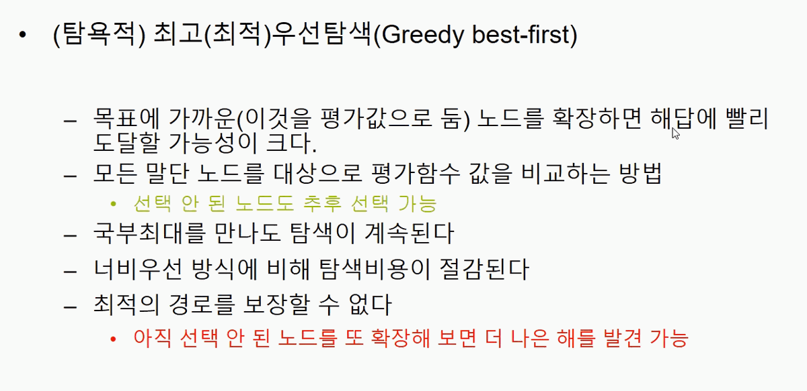

- 목표에 가까운 노드를 확장하면 해답에 빨리 도달할 가능성이 크다.

    - 목표와 가까운지를 평가하는 평가함수값을 구하기 위해 평가함수 설정이 필요하다.

- 모든 말단 노드를 대상으로 평가함수값을 비교하는 방법

    - 선택 안된 노드도 추후 선택 가능 ⇒ 지속적인 확장

- 국부 최대를 만나도 탐색이 계속된다. (뒤쪽도 보기 때문이다.)
- 너비우선 방식에 비해 탐색비용이 절감된다.

- 최적의 경로를 보장할 수 없다.

    - 아직 선택 안된 노드를 또 확장해 보면 더 나은 해를 발견할 수 있음.

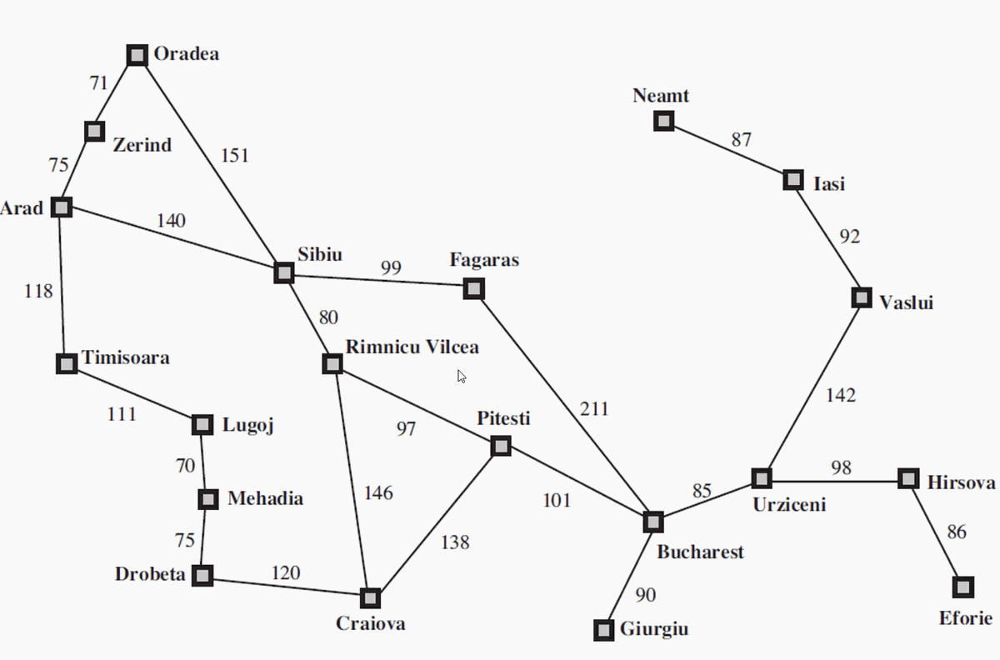

- **평가값** : **각 도시에서부터 Bucharest까지의 직선 거리**. (실제 장애물 같은건 고려하지 않음.)

    - 직선 거리가 작다는 것은, Goal State에 가까워지고 있다는 의미이므로, 그걸 선택한다.
    - 나중에 가서 장애물 때문에 막히면, 그때가서 돌아간다.

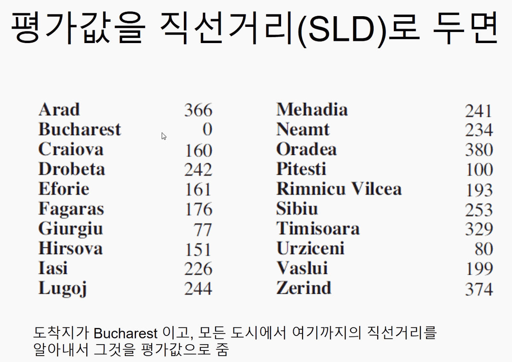

- 이 값을 이용해 Greedy best-first를 시도해보자.

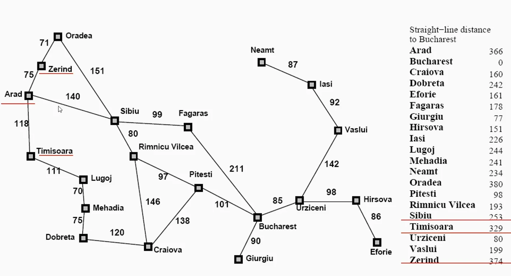

- Arad에서 이동할 수 있는 도시는 세 개이다. (Zerind, Sibiu, Timisoara)

    - 만약, Edge의 Weight만 고려한다면 Zerind를 선택하겠지만, 직선거리 Heuristic 정보를 고려한다면 직선 거리는 Sibiu가 가장 짧으므로, Sibiu를 선택한다.

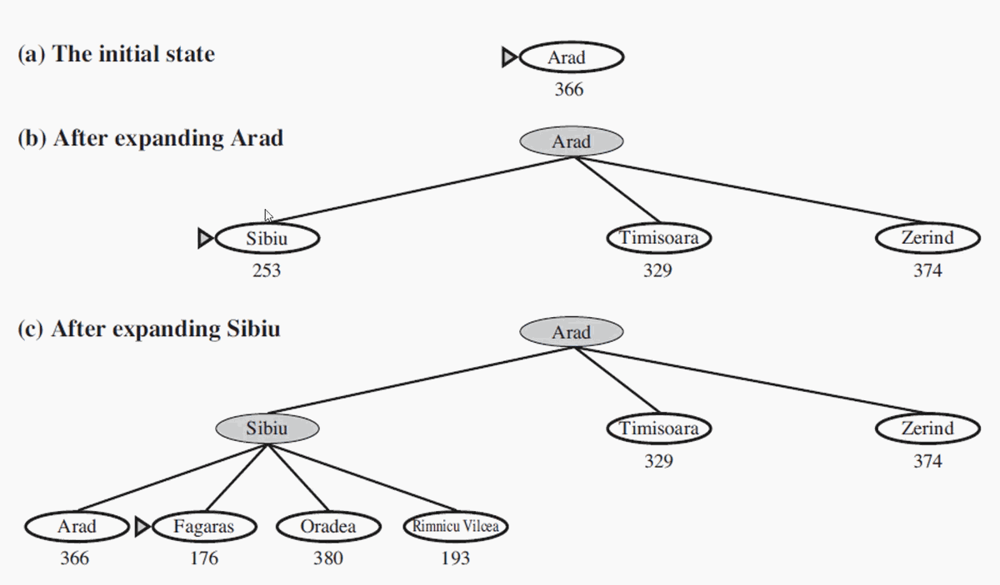

- Sibiu를 선택하고, Sibiu와 연결된 네 개의 노드에 대해서 다시 직선 거리를 파악한다.

    - 직선 거리가 가장 짧은 것이 Fagaras이므로, Fagaras를 선택한다.

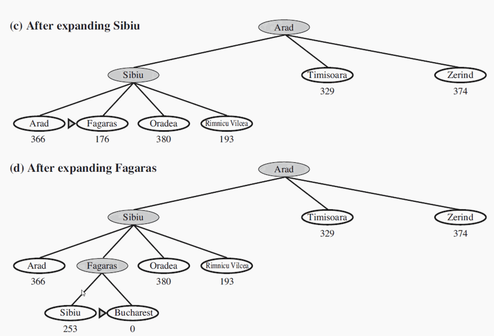

- Fagaras에서 다시 한 번 노드들에 대해서 Bucharest까지의 직선 거리를 고려하면, 직선 거리가 0인 Bucharest가 존재하고, 이를 통해 Goal State인 Bucharest로 이동할 수 있게 된다.

> 이 경우는 전통적인 방식이 아니라 직선거리라는 Heuristic을 준 것이다. 이것이 통하면 좋은 결과를 얻을 수도 있지만, Cycle을 돌게 될 수도 있다.

---

## &lt;Best-fit Search&gt;

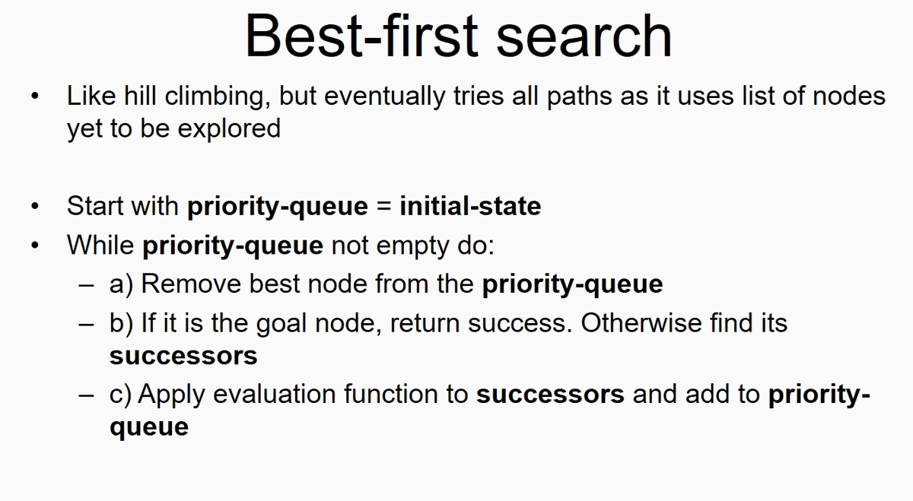

- 우선순위큐를 사용하며, 이 큐에 initial-state를 추가한다.

- while loop을 돌리며, 우선순위큐가 비어있지 않다면 loop을 진행한다.

    - 우선순위 큐에서 최우선 노드를 비운다.
    - 만약 비운 노드가 Goal 노드라면, node를 담은 array를 반환한다. 그렇지 않으면 비운 노드의 **successors**를 찾는다. (successor는 한 노드에서 취할 수 있는 action)
    - **successors**에 **evaluation function**을 적용하고, 우선순위 큐에 추가한다.

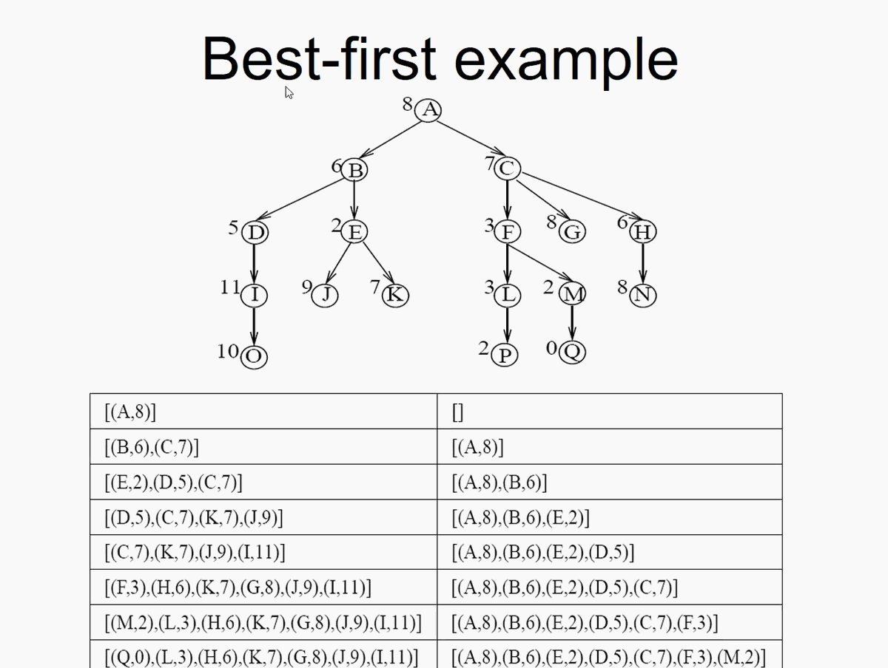

- Best-First는 갈 수 있는 것들을 나열하고, 그 중에서 Best를 확정하는 것이다. 나머지는 없애는게 아니라 남아있는 것이다.
- 시작점은 A이며, 여기서 어떻게 확정되는지 본다.

-  A를 큐에서 제거하고, 방문 목록에 추가한다.

    - A에서 확장될 수 있는 B, C를 우선순위 큐에 추가한다.

        - B, C를 평가값이 더 좋은 것을 기준으로 오름차순 정렬한다.

    - 여기서 평가값이 더 좋은 B로 확장한다.

- B를 우선순위 큐에서 제거하고, 방문 목록에 추가한다.

    - B에서 확장될 수 있는 D, E를 우선순위 큐에 추가한다.

        - D, E를 평가값이 더 좋은 것을 기준으로 오름차순 정렬한다.

    - 여기서 평가값이 더 좋은 E로 확장한다.

- E를 우선순위 큐에서 제거하고, 방문 목록에 추가한다.

    - E에서 확장될 수 있는 J, K를 우선순위 큐에 추가한다.

        - J, K를 평가값이 더 좋은 것을 기준으로 오름차순 정렬한다.

    - K, J의 평가값이 가장 좋지 않으므로, 평가값이 더 좋은 D로 확장한다.

⇒ 이런 식으로 반복한다. 모든 노드를 방문할 수 있으며, 특정 노드로 갈 때 평가값이 합이 가장 작은 Path를 찾을 수 있다.

### 평가 기준

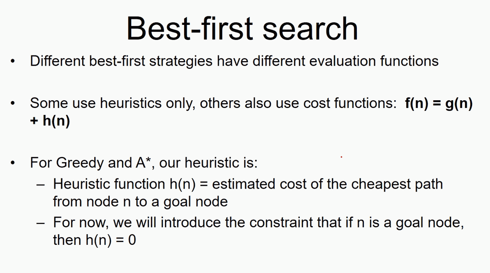

- 일부는 휴리스틱만 사용할 수도 있고, cost function도 추가로 사용할 수도 있다.

    $$
    f(n)=g(n)+h(n)
    $$

    g(n)은 지나온 값, h(n)은 휴리스틱 값

- Greedy and A\*

    - Heuristic function h(n) : 노드 n에서 goal node까지 가는데 가장 cost가 낮은 경로
    - 만약 h(n)에서 n이 goal node라면, h(n) = 0이다.

---

## &lt;Greedy best-first search에서의 평가&gt;

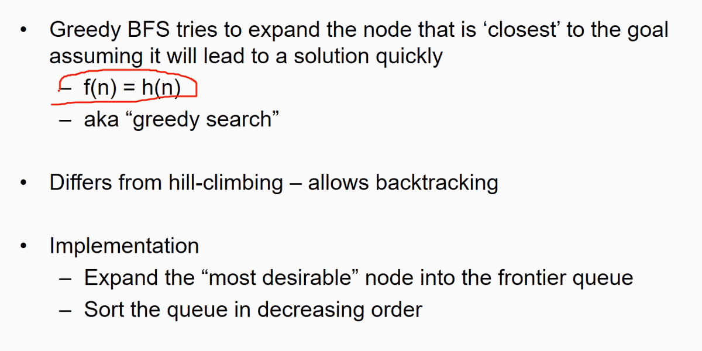

- **Greedy BFS**에서는 goal node로 갈 수 있는 길을 최대한 신속하게 찾기 위해서 경로를 확장해 나갔다.
- Greedy Search는 이전의 값들을 고려하지 않고, 현재 상태에서 최선의 선택을 하는 것이다.

- 이전에 진행한 예제에서는 f(n) = h(n)이었다.

    - 이런 것을 그냥 **greedy search** 라고 부르기도 한다.
    - heuristic function을 통해서 가장 유망한 노드를 선택해 나가는 방법.

- 언덕등반기법과는 다르게 Backtracking을 허용한다.

    - 현재 경로가 해결책으로 이어지지 않는 경우에 대비하고자 탐색 경로를 보관한다.

---

## &lt;A 알고리즘&gt;

> 최적의 경로 : 초기노드에서 목표 노드까지의 최단 경로 중, 임의의 노드 N에서의 평가 함수를 정의

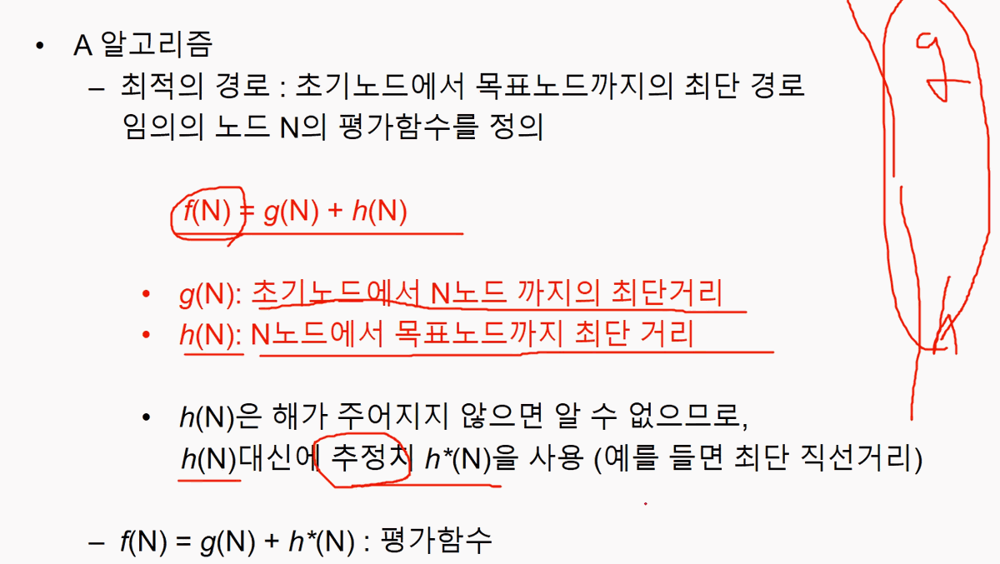

$$
f(N) = g(N)+h(N)
$$

- g(N) : 초기 노드에서 N노드까지의 최단 거리
- h(N) : N노드에서 목표 노드까지의 최단 거리

- h(N)은 해가 주어지지 않으면 알 수 없으므로, h(N) 대신에 추정치 h\*(N)을 사용한다.

    - 왜냐면, g(N)까지는 직접 찾아오면서 알아낸 것이지만, h(N)은 아직 탐색하지 못했기 때문에, 가보지 않으면 미리 예측할 수는 없다. 그러므로 **추정치를 사용함**.
    - ex) 최단 직선거리

$$
f(N) = g(N) + h^{*}(N)
$$

⇒ 평가함수

## &lt;A\* 알고리즘&gt;

> 완벽한 A 알고리즘은 아니지만, A 알고리즘에 가까운 알고리즘이다.

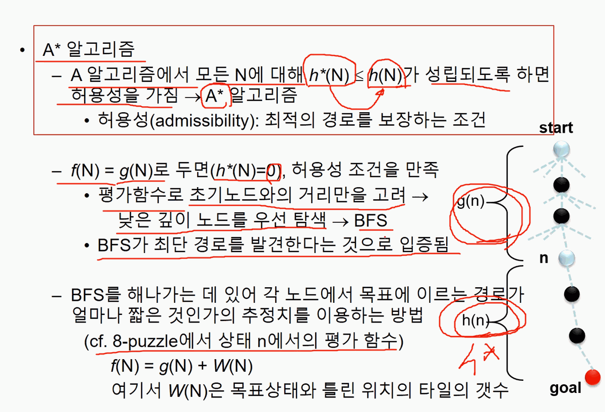

- h\*(N)을 이용해서 h(N)에 근접하는 값을 얻을 수 있도록 한다.

    - **h\*(N) ≤ h(N)은 h(N)의 평가함수값이 더 좋다는 것을 의미**하는 것으로 보인다.

- f(N) = g(N)으로 두면, (h\*(N) = 0) ⇒ 허용성 조건을 만족한다.

    - 평가함수로 초기노드에서 노드 N까지의 거리만을 고려한다는 것.  
        그러므로 낮은 깊이 노드를 우선 탐색한다. ⇒ BFS
    - BFS가 최단 경로를 발견한다는 것으로 입증됨

- BFS를 해나가는 데 있어, 각 노드에서 목표에 이르는 경로가 얼마나 짧은 것인가의 추정치를 이용하는 방법이다.

    (cf. 8-puzzle에서 상태 N에서의 평가 함수)

    $$
    f(N) = g(N) + W(N)
    $$

    여기서 W(N)은 목표 상태와 틀린 위치의 타일 개수

### A\* 알고리즘을 적용한 Rumania Problem

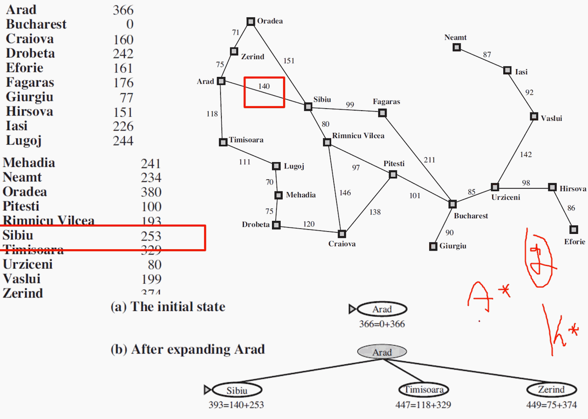

- g(N) : 지나온 거리
- h(N) : 남은 거리

- 시작점 : Arad

    - g(N) = 0, h\*(N) = 366 ⇒ Bucharest까지 가는 Heuristic 값은 366
    - 따라서 366 = 0 + 366

- 확장 가능한 점은 Sibiu, Timisoara, Zerind가 있다.

    - Sibiu

        - 393(f(N)) = 140(g(N)) + 253(h\*(N))

    - Timisoara

        - 447(f(N)) = 118(g(N)) + 329(h\*(N))

    - Zerind

        - 449(f(N)) = 75(g(N)) + 374(h\*(N))

⇒ 이 중에서 평가함수값이 가장 작은 것은 Sibiu이다.

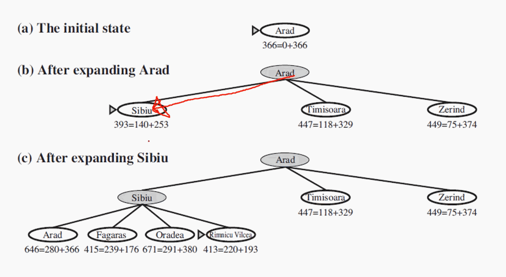

- 이제 또, Sibiu에서 확장 가능한 노드들에 대해서 평가함수값을 구해서 가장 작은 곳으로 간다.

$$
f(N) = g(N) + h^*(N)
$$

⇒ g(N)은 지나온 값이다. (그 노드로 갔다고 가정하고 구하는 것)

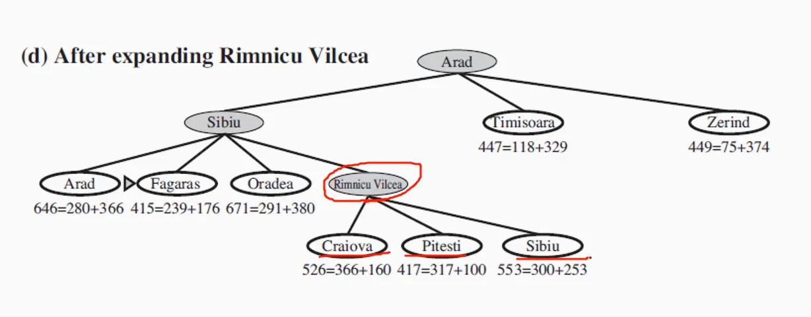

⇒ Rim에서 또 확장하기

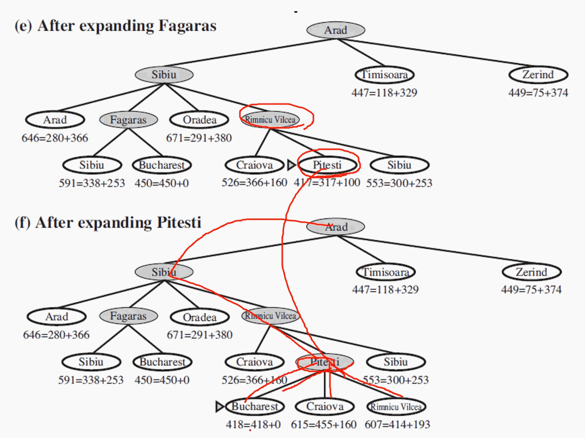

⇒ Bucharest가 나왔다고 끝이 아니라, Craiova, Rimnicu Vilcea도 f(N)을 구해보아야 한다. f(N)이 Goal State Node보다 작을 수도 있기 때문이다.

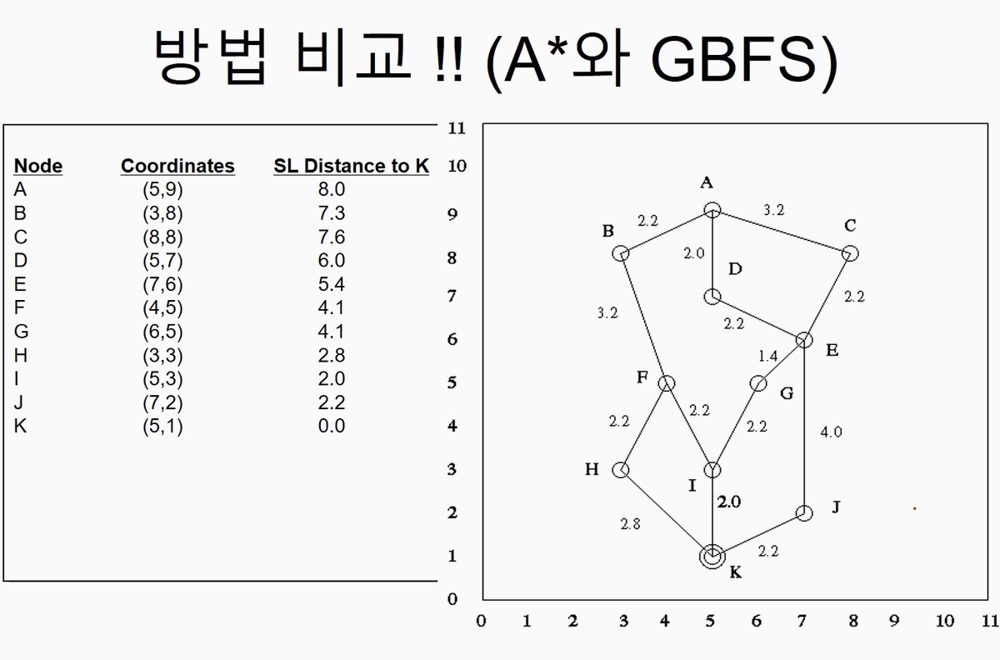

⇒ A\*와 Greedy Best First를 비교해보기 이때, A\*를 계산하기 위해서는 좌표를 바탕으로 계산할 수 있어야 한다.

### A\*로 해결하기

- A에서 갈 수 있는 노드는 B, C, D이다.

- B

    - f(N) = 2.2(g(N)) + 7.3(h\*(N))

- C

    - f(N) = 3.2(g(N)) + 7.3(h\*(N))

- D

    - f(N) = 2.0(g(N)) + 6.0(h\*(N))

⇒ 이런 식으로 구해나가면 된다…

> A→D→E→G→I→K

### Greedy Best First Search로 해결하기

> A→D→E→J→K

---

## &lt;게임트리 탐색&gt;

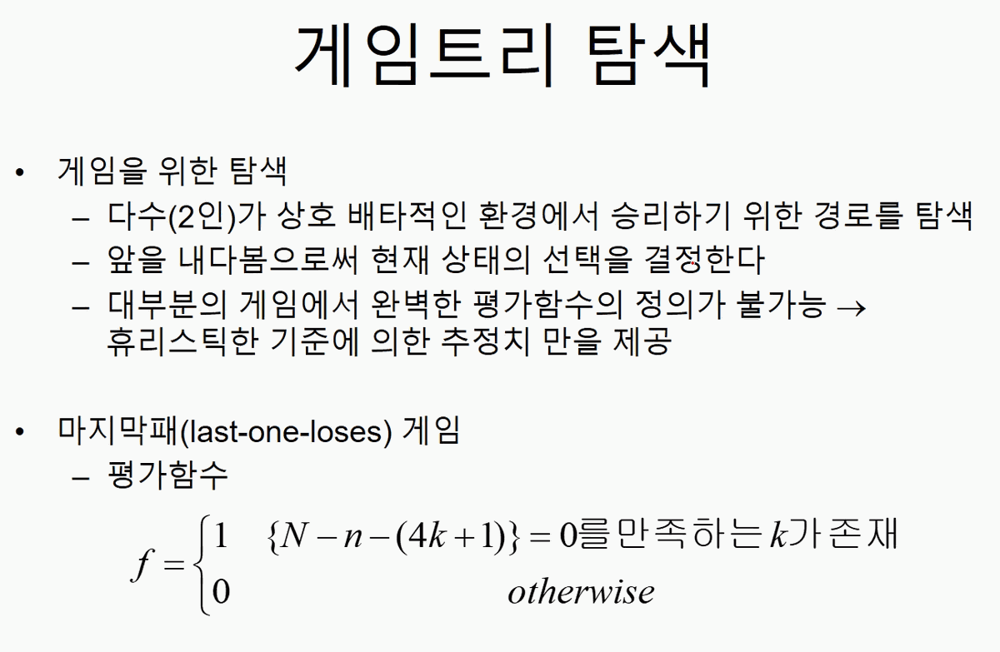

### 최소최대(minmax) 탐색법

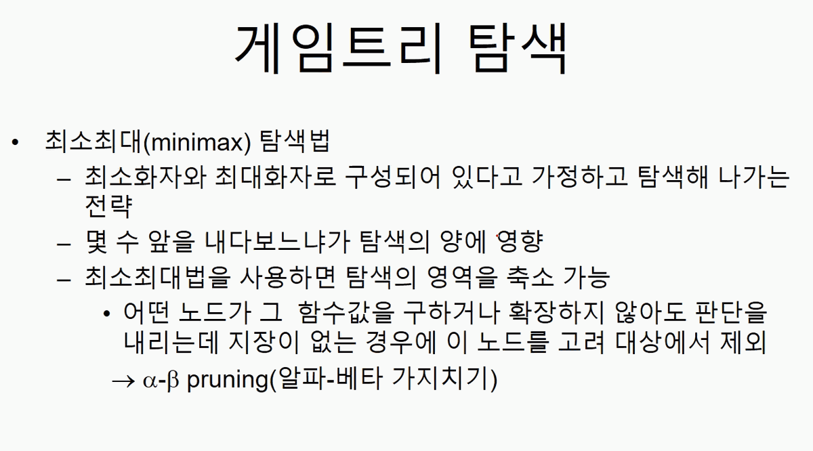

- 어떤 노드가 함수값을 구하거나 확장하지 않아도 판단을 내리는데 지장이 없다면, 그 노드를 고려 대상에서 제외하는 방식 ⇒ **Pruning**(가지치기)

### 제약조건만족 문제(Constraint Satisfaction P)

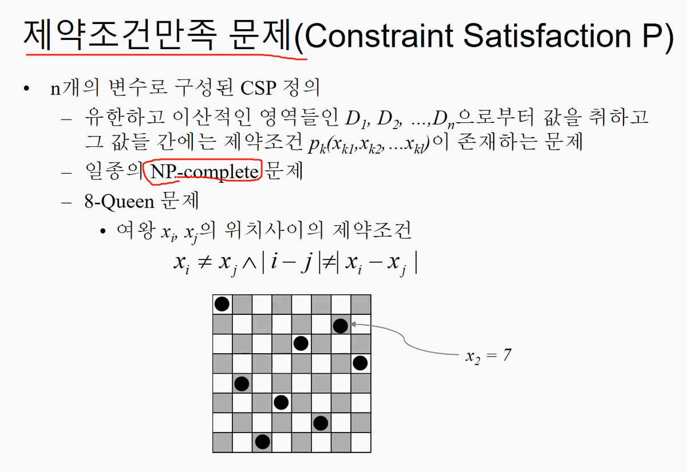

### 탐색기법의 활용

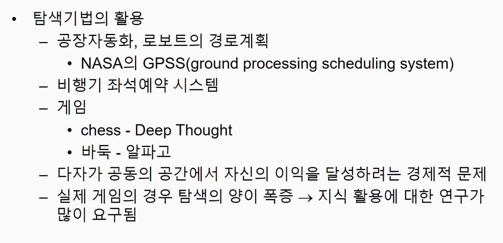
