# 지식표현과 추론

작성일 2023-10-12 · 최종 수정일 2023-12-09
{ .post-date }

## [지식 표현]

> 지식 표현을 확장하면, 추론을 할 수 있다.

---

## &lt;데이터의 표현 단계&gt;

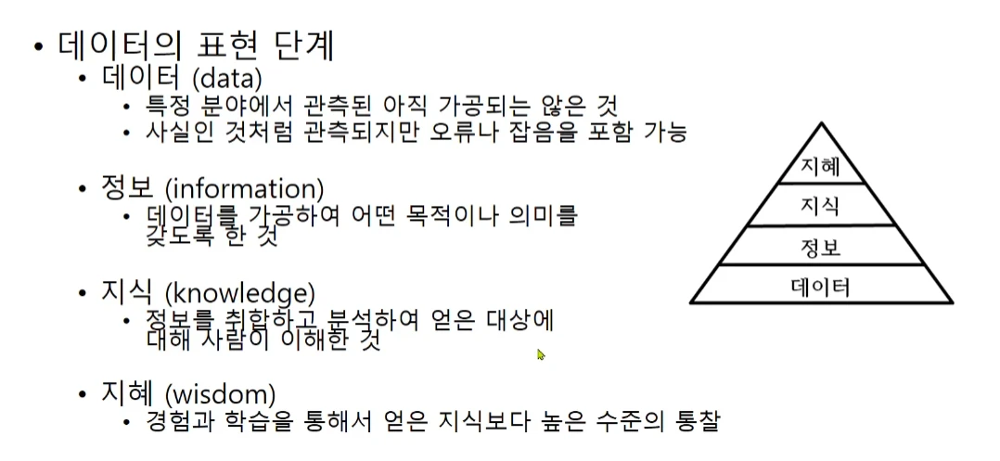

- **데이터**

    - 특정 분야에서 관측되었으나, 아직 가공되지 않은 것.
    - 사실인 것처럼 관측되지만, 아직 정제되지 않아 오류나 잡음을 포함할 수 있음.

- **정보**

    - 데이터를 가공하여 어떤 목적이나 의미를 갖도록 한 것.

- **지식**

    - 정보를 취합하고 분석하여 얻은 대상에 대해 사람이 이해한 것.

        ⇒ 정형화 된 것.

- **지혜**

    - 경험과 학습을 통해서 얻은 지식보다 높은 수준의 통찰

프로그램에서 정형화되어 사용할 수 있는 것들에는 **지식**이라는 표현을 쓰고, 그 수준을 넘어 높은 수준의 통찰, 인공지능이 지능적으로 가질 수 있는 것들은 **지혜**라고 말한다.

## &lt;지식의 정의와 지식의 종류&gt;

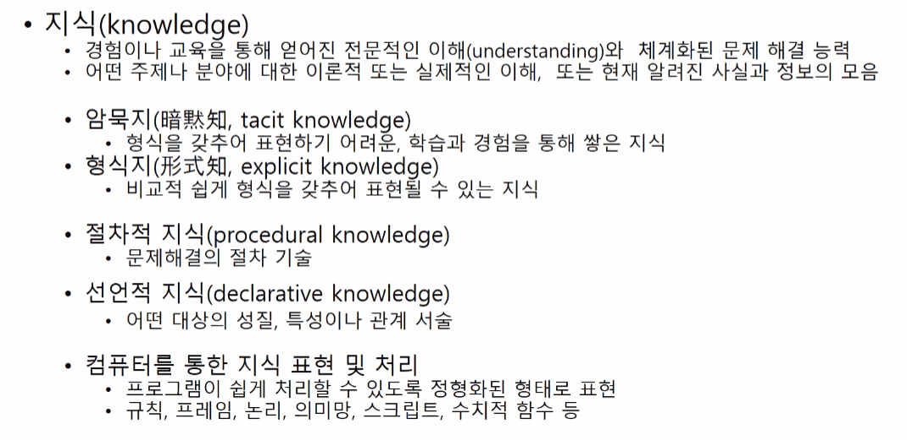

- **지식** 

    - 경험이나 교육을 통해 얻어진 전문적인 이해와 체계화된 문제 해결 능력.  
        (사람이 정보를 분석하여 유용하게 사용할 수 있도록 체화한 상태로 보인다.)
    - 어떤 주제나 분야에 대한 이론적, 또는 실제적인 이해, 또는 현재 알려진 사실과 정보의 모음

- **암묵지**

    - 형식을 갖추어 표현하기 어려운, 학습과 경험을 통해 쌓은 지식

- **형식지**

    - 비교적 쉽게 형식을 갖추어 표현될 수 있는 지식

- **절차적 지식**(procedural knowledge)

    - 문제 해결의 절차 기술

- **선언적 지식**

    - 어떤 대상의 성질, 특성이나 관계 서술

- **컴퓨터를 통한 지식 표현 및 처리**

    - 프로그램이 쉽게 처리할 수 있도록 정형화된 형태로 표현
    - 규칙, 프레임, 논리, 의미망, 스크립트, 수치적 함수 

---

## &lt;규칙&gt;

### 규칙이란?

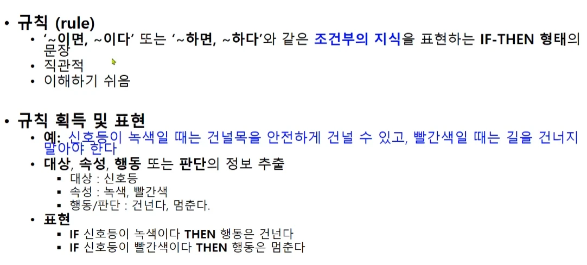

- ~이면 ~이다. 또는 ~하면 ~하다와 같은 **조건부의 지식을 표현**하는 IF-THEN 형태의 문장.

    - 직관적이다.
    - 이해하기 쉽다.

- **규칙 획득 및 표현**

    - ex. 신호등이 녹색일 때는 건널목을 안전하게 건널 수 있고, 빨간색일 때는 길을 건너지 말아야 한다.

        - 대상 : 신호등
        - 속성 : 녹색, 빨간색
        - 행동/판단 : 건넌다, 멈춘다.

    - 표현(AND를 이어붙일 수도 있다.)

        - IF ⇒ 신호등이 **녹색**이다. THEN ⇒ 행동은 **건넌다.**
        - IF ⇒ 신호등이 **빨간색**이다. THEN ⇒ 행동은 **멈춘다.**

        이처럼 규칙을 표현하면, **규칙의 결과로 행동**을 할 수도 있고, **규칙의 결과를 저장**할 수도 있다. 조건에 AND가 붙으면서 여러 개의 조건을 표현할 수도 있기 때문에 저장이 필요할 수도 있다.

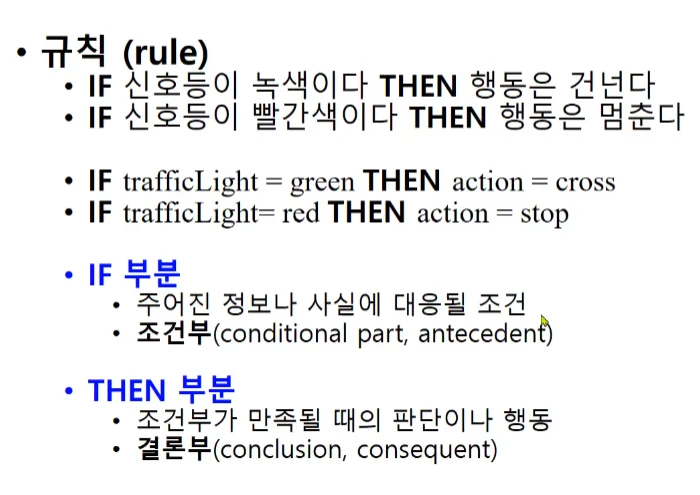

- **IF 부분**(조건부)

    - 주어진 정보나 사실에 대응될 조건

- **THEN 부분**(결론부)

    - 조건부가 만족될 때의 판단이나 행동

> 이렇게 규칙을 가지고 무언가를 계속해서 만들어내는 것을 **Production System**이라고 한다.  
>   
> (왜냐면, 조건을 판단하고 그것의 결과로 행동/판단을 만들거나, 조건에 따른 결과를 저장하고 새로운 조건과 연결지어 판단함으로써 계속해서 무언가를 만들어내기 때문이다.)

### 규칙의 구성요소

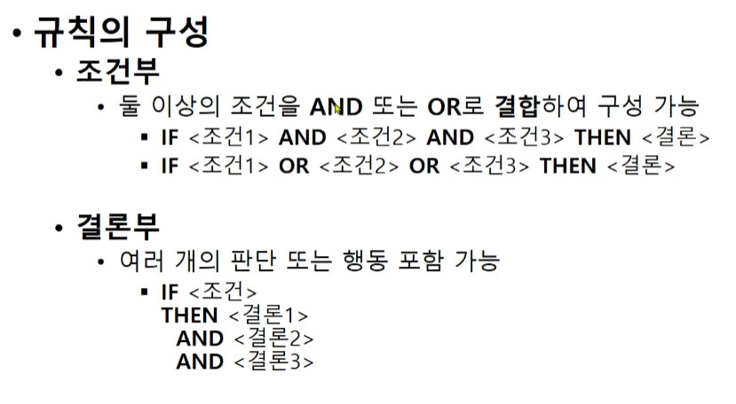

- **조건부**

    - 조건은 저장될 수 있으므로, 결합되어 사용될 수 있다.
    - 즉, 여러 개의 조건이 하나의 결론을 불러낼 수 있다. (AND, OR)

- **결론부**

    - 하나의 조건이 여러 개의 판단이나 행동을 포함할 수 있다.

### 규칙을 통한 지식 표현

> 규칙을 통해서 표현될 수 있는 지식은 어떤 것들이 있을까?

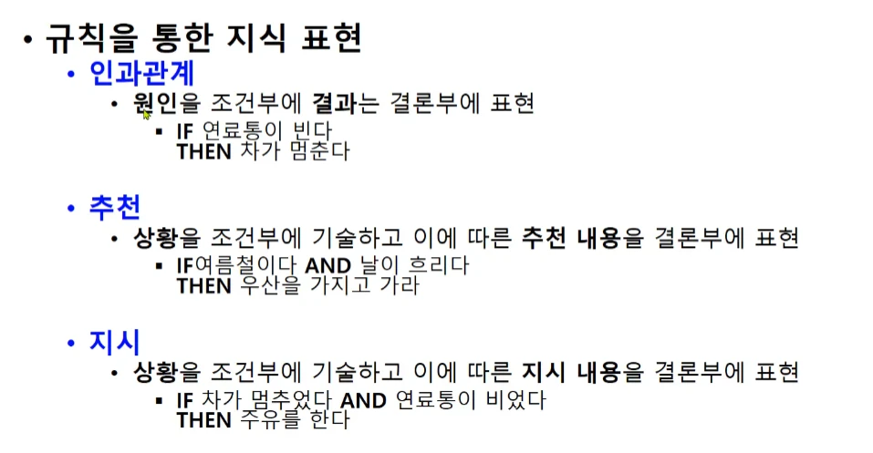

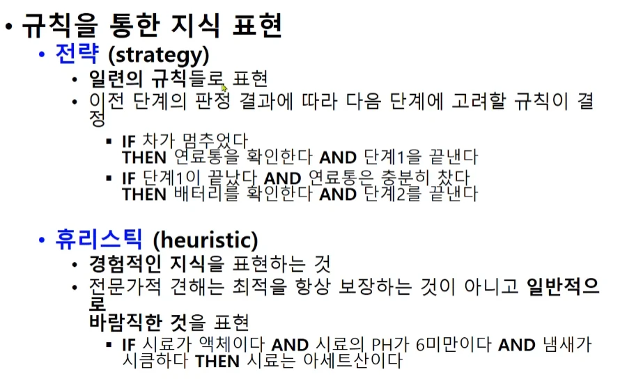

- **인과관계**

    - **원인을 조건부**에, **결과는 결론부**에 표현한다면 그 Production System은 ‘**인과관계**’이다.

        > **IF** 연료통이 빈다  
        > **THEN** 차가 멈춘다

- **추천**

    - **상황**을 조건부에 기술하고, 이에 따른 **추천 내용을 결론부에 표현**하면 ‘**추천**’이다.

        > **IF** 여름이다 **AND** 날이 흐리다  
        > **THEN** 우산을 가지고 가라

- **지시**

    - **상황을 조건부에 기술**하고, 이에 따른 **지시 내용을 결론부에 표현**하면 ‘**지시**’이다.

        > **IF** 차가 멈추었다 **AND** 연료통이 비었다  
        > **THEN** 주유를 한다

- **전략**

    - **일련의 규칙들**로 표현되며,

    - **이전 단계의 판정 결과**에 따라 **다음 단계에 고려할 규칙이 결정**

        > **IF** 차가 멈추었다  
        > **THEN** 연료통을 확인한다 **AND** 단계 1을 끝낸다  
        >   
        > (단계1 하는 중…)  
        >   
        > **IF** 단계1이 끝났다 **AND** 연료통이 충분히 찼다  
        > **THEN** 배터리를 확인한다 **AND** 단계 2를 끝낸다.  
        >   
        > (단계 2 하는 중…)

        ⇒ 예를 들어 자동차가 수리를 받으러 정비소에 들어왔다면, 그 차를 수리하기 위해 거쳐야 하는 일련의 과정이 있을 것이다. 다만 이런 것들은 몇몇 조건들을 거쳐 단계별로 거쳐가야 하기 때문에, **전략**으로 표현될 수 있다.  
        ⇒ 또한 비행기에서는 모든 상황에 대해 대처하는 매뉴얼이 상세하게 기록되어 있는데, 위의 예시와 같이 단계별로 대처하는 과정이 정해져있을 때 전략이라고 할 수 있다.

        > 전략(Strategy)을 코드로 만들면, Recommendation과 Instruction을 같이 할 수 있다.  

- **휴리스틱(Heuristic)**

    - **경험적인 지식**을 표현하는 것

    - 전문가적 견해는 최적을 항상 보장하는 것이 아니고, **일반적으로 바람직한 것을 표현**

        > **IF** 시료가 액체이다 **AND** 시료의 PH가 6미만이다 **AND** 냄새가 시큼하다  
        > **THEN** 시료는 아세트산이다

        ⇒ 경험적인 내용을 바탕으로 규칙을 표현한 것. 항상 최적의 결과는 아니고 일반적으로 바람직한 결과를 불러옴. 

> 이와 같이 규칙을 가지고 인과관계, 추천, 지시, 전략, 휴리스틱 Production System을 만들어 낼 수 있다.

---

## &lt;프레임&gt;

### 프레임이란?

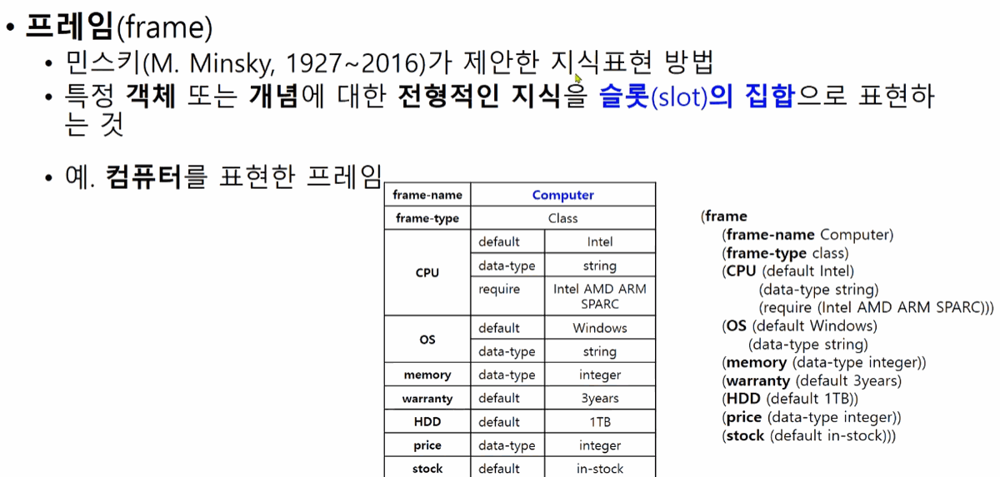

- **프레임**

    - 특정 **객체** 또는 **개념**에  대한 **전형적인 지식**을 **슬롯의 집합**으로 표현하는 것

        여기서 말하는 객체는, OOP에서 말하는 객체와 같다.

### 프레임의 구성요소

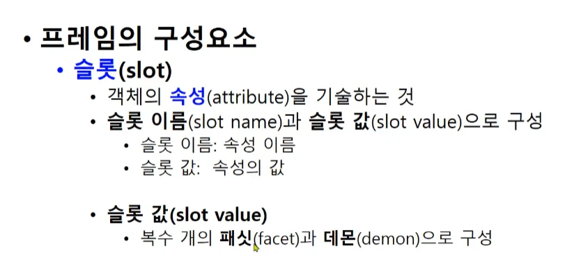

- **슬롯**(slot)

    - 객체의 속성(attribute)을 기술하는 것

    - **슬롯 이름**과 **슬롯 값**으로 구성

        - 슬롯 이름 : 속성의 이름
        - 슬롯 값 : 속성의 값

    - **슬롯 값**

        - 복수 개의 **패싯**(facet)과 **데몬**(demon)으로 구성

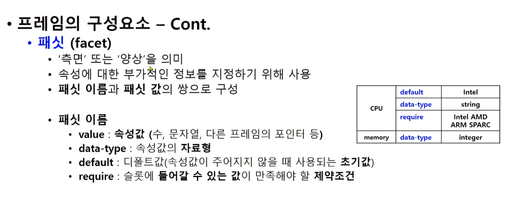

- **패싯**(facet)

    - ‘측면’ 또는 ‘양상’을 의미
    - 속성에 대한 부가적인 정보를 지정하기 위해 사용
    - **패싯 이름**과 **패싯 값**의 쌍으로 구성

    - 패싯 이름

        - **value** : 속성값
        - **data-type** : 속성값의 자료형(컴퓨터에서 표현되는 지식을 다루므로, 자료형 존재)
        - **default** : 디폴트값
        - **require** : 슬롯에 들어갈 수 있는 값이 만족해야 하는 제약 조건

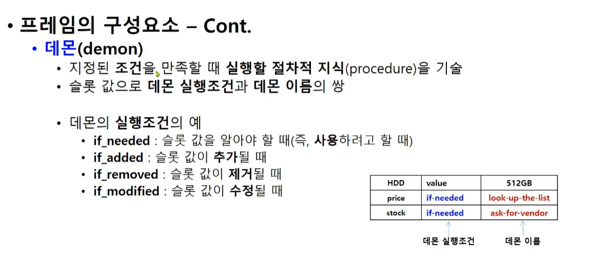

- **데몬**(demon) ⇒ 컴퓨터에서, 조건이 갖춰졌을 때 자동으로 실행되는 프로그램

    - 지정된 조건을 만족할 때 실행할 **절차적 지식**(procedure)을 기술
    - 슬롯 값으로 **데몬 실행조건**과 **데몬 이름의 쌍**을 표현 가능하다.

    - 데몬의 **실행조건**의 예

        - **if_needed** : 슬롯 값을 알아야 할 때(즉, 사용하려고 할 때)
        - **if_added** : 슬롯 값이 추가될 때
        - **if_removed** : 슬롯 값이 제거될 때

        - **if_modified** : 슬롯 값이 수정될 때

            ⇒ 프로그램으로 친다면, 데몬의 실행조건은 condition, 데몬 이름은 함수명이다.

### 프레임의 종류

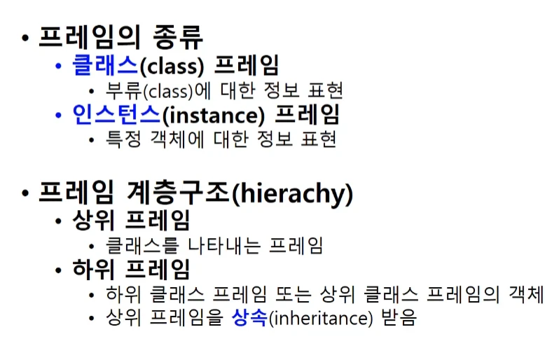

- 프레임의 종류

    - 클래스 프레임

        - 부류(class)에 대한 정보 표현   
            ⇒ 특정 지식이나 개념의 일반적 구조를 나타내는 프레임

    - 인스턴스 프레임

        - 특정 객체에 대한 정보 표현  
            ⇒ 클래스 프레임을 바탕으로 구체적인 수치나 내용 등을 표현한 프레임

- 프레임 계층구조(hierarchy)

    - 상위 프레임

        - 클래스를 나타내는 프레임

    - 하위 프레임

        - 하위 클래스 프레임 또는 상위 클래스 프레임의 객체

        - 상위 프레임을 **상속**(inheritance) 받음

            ⇒ 즉, 상위 프레임을 실체화 한 것 또는 상속받은 것.

> 프레임은 객체지향언어의 구조(프레임)와 똑같은 형태를 가진다.

### 프레임 표현의 예

> 컴퓨터를 클래스 프레임으로 나타낸 것.

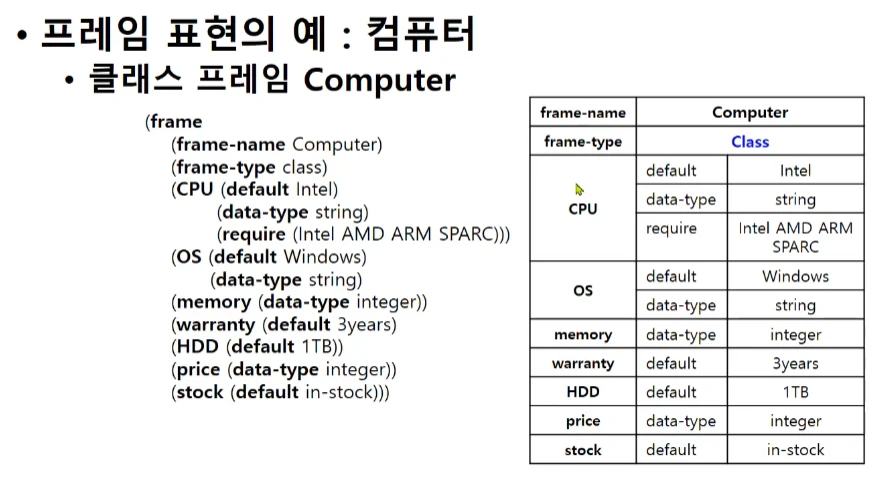

이 클래스 프레임에서, CPU의 기본 값은 Intel이다. data-type은 string이고, Intel, AMD, ARM, SPARC 중 하나의 값을 가져야만 한다는 제약조건을 갖는다.

- **이 클래스를 따르는 인스턴스는 어떻게 나타낼 것인가? (상위 프레임 → 하위 프레임)**

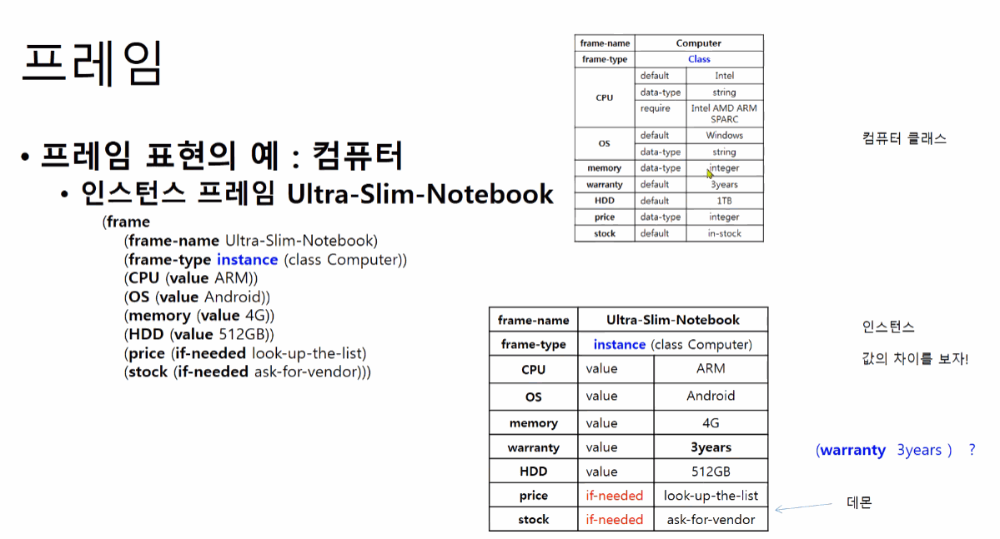

⇒ warranty의 경우, 값을 특별하게 추가하지 않았으므로, default value인 3 years를 상속받아서 사용하게 된다. 컴퓨터 클래스(클래스 프레임, 상위 프레임)은 형태이고, 인스턴스가 실제로 생성한, **값**이라고 할 수 있다.

> 이렇게 프레임(frame)을 이용하여 지식을 표현할 수도 있으며, 데이터에만 집중하지 않고 실제로 행동 가능한 것(demon)도 표현이 가능하다.

### 프레임 요약

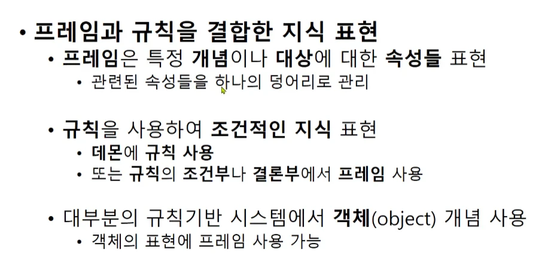

- 프레임은 특정 개념이나 대상에 대한 속성들을 표현

    - **slot**과 **facet**을 이용한다.
    - slot은 프레임의 속성인 Attribute를 기술하는 수단이다.
    - facet은 Attribute의 부가적인 정보를 지정하기 위해 사용한다.

- **규칙**을 사용하여 **조건적인 지식** 표현

    - 특정 조건이 만족될 때 실행하는 작업을 demon이라고 한다.

    - 따라서 **규칙의 조건부**나 **결론부**에서 **프레임을 사용할 수도 있다.**

        ⇒ 대부분의 규칙 기반 시스템에서 객체의 개념을 사용하고, 객체에 프레임을 사용한다.

### 프레임 vs 클래스(객체)

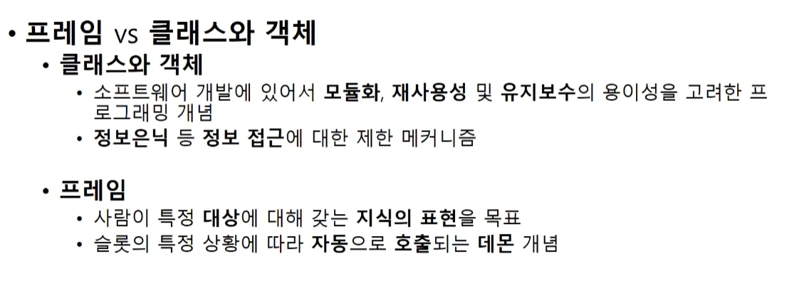

- **클래스**와 **객체**

    - S/W 개발에 있어서 모듈화, 재사용성 및 유지보수의 용이성을 고려한 프로그래밍 개념
    - 정보은닉 등 정보 접근에 대한 제한 매커니즘

- **프레임**

    - 사람이 특정 대상에 대해 갖는 지식의 표현을 목표
    - 슬롯의 특정 상황에 따라 자동으로 호출되는 데몬의 개념

> 클래스와 프레임은 어느정도 같은 개념으로 사용되고 있다.

---

## &lt;논리&gt;

### 논리란?

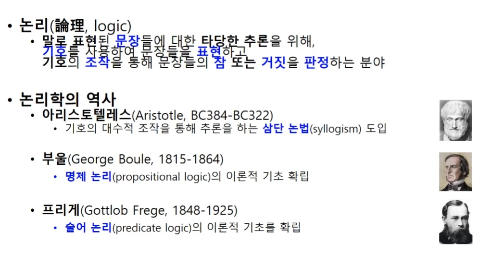

- **논리**

    - **말로 표현된 문장들**에 대한 **타당한 추론**을 위해 **기호**를 사용하여 **문장들을 표현**하고 **기호의 조작**을 통해 **문장들의 참 또는 거짓을 판정**하는 분야

- **논리학의 역사**

    - 아리스토텔레스 : 기호의 대수적 조작을 통해 추론을 하는 **삼단 논법** 도입
    - 부울 : **명제 논리**의 이론적 기초 확립
    - 프리게 : **술어 논리**의 이론적 기초를 확립

### 명제 논리

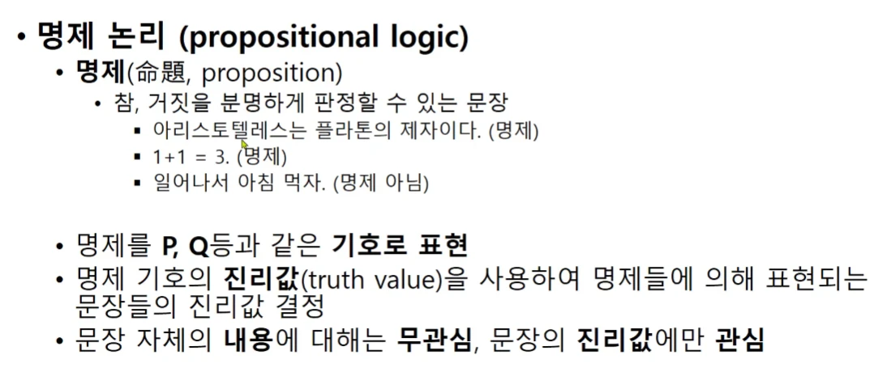

- **명제** : 참, 거짓을 분명하게 판정할 수 있는 문장
- 명제를 P, Q 등과 같은 기호로 표현한다.
- 명제 기호의 **진리값**(truth value)을 사용하여, 명제들에 의해 표현되는 **문장들의 진리값 결정**
- 문장 자체의 **내용**에 대해는 **무관심**, 문장의 **진리값**에만 **관심**

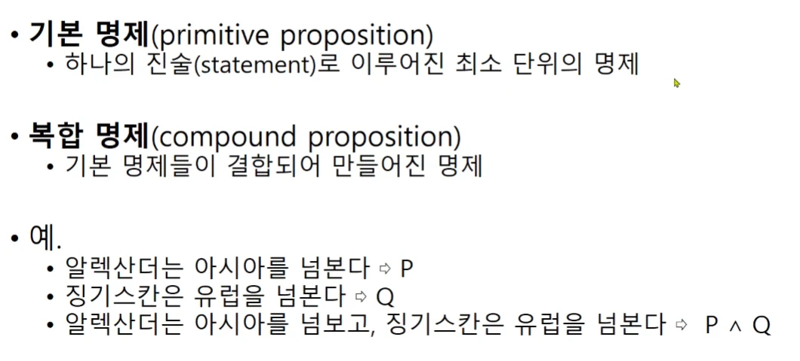

- 기본 명제

    - 하나의 진술로 이루어진 최소 단위의 명제

- 복합 명제

    - 기본 명제들이 결합되어 만들어진 명제

- ex.

    - 알렉산더는 아시아를 넘본다 ⇒ P (**기본 명제**)
    - 징기스칸은 유럽을 넘본다 ⇒ Q (**기본 명제**)
    - 알렉산더는 아시아를 넘보고, 징기스칸은 유럽을 넘본다 ⇒ P **∧** Q (**복합 명제**)

### 명제 논리의 구문

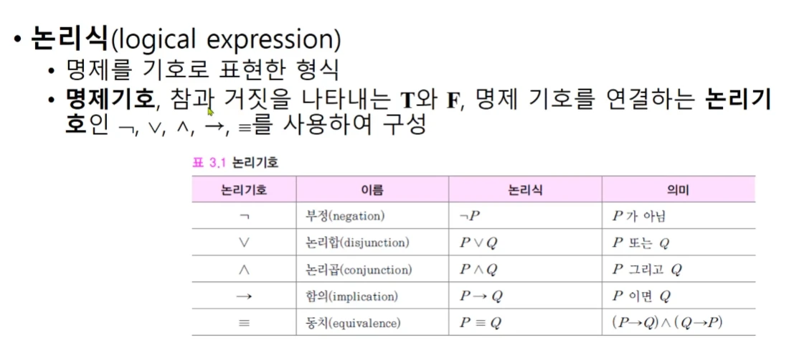

- **논리식**(logical expression)

    - 명제를 기호로 표현한 형식

    - 명제 기호, 참과 거짓을 나타내는 T와 F, 명제 기호를 연결하는 논리기호를 사용하여 구성

        - 부정
        - 논리합
        - 논리곱
        - 함의
        - 동치

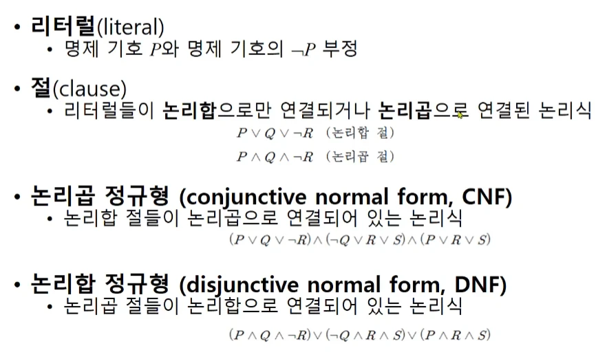

- **리터럴**(literal)

    - 명제 기호 P와 기호의 부정  
        ⇒ 명제와 그 명제의 부정을 의미.

- **절**(clause)

    - 리터럴들이 논리합으로만 연결되거나 논리곱으로 연결된 논리식  
        ⇒ literal을 AND 또는 OR로만 연결한 것. (NOT P는 literal이다.)

- **논리곱 정규형** (conjunctive normal form, CNF)

    - 논리합 절들이 논리곱으로 연결되어 있는 논리식

- **논리합 정규형** (disjunctive normal form, DNF)

    - 논리곱 절들이 논리합으로 연결되어 있는 논리식

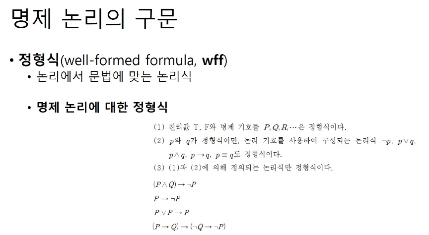

- **정형식**

    - 논리에서 **문법에 맞는 논리식**을 **정형식**이라고 한다.  
        

- **명제 논리에 대한 정형식**

    (1) 진리값 T, F와 명제 기호들 P, Q, R,… 은 정형식이다.

    (2) **p**와 **q**가 **정형식**이면, **논리 기호**를 사용하여 구성되는 **논리식**도 **정형식**이다.

    (3) (1), (2)에 의해 정의되는 논리식만 정형식이다.

### 명제 논리의 의미

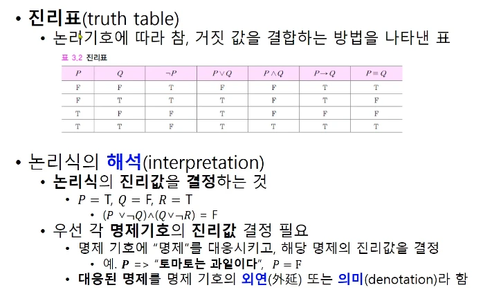

- **진리표**

    - 논리기호에 따라 참, 거짓 값을 결합하는 방법을 나타낸 표

- 논리식의 **해석**(interpretation)

    - 논리식의 진리값을 결정하는 것. 그 과정을 **해석**이라고 한다.

    - 우선 각 명제기호의 진리값 결정이 필요하다.

        - 명제 기호에 “명제”를 대응시키고, 해당 명제의 진리값을 결정한다.

        - ex. P ⇒ “토마토는 과일이다.” (명제 기호인 P에 명제를 대응시킨다.)

            그리고 해당 명제의 진리값을 결정한다. (해석)

    - 대응된 명제를 명제 기호의 **외연** 또는 **의미라고** 한다.

        - 위의 예시에서는 “토마토는 과일이다”를 외연, 의미라고 할 수 있다.

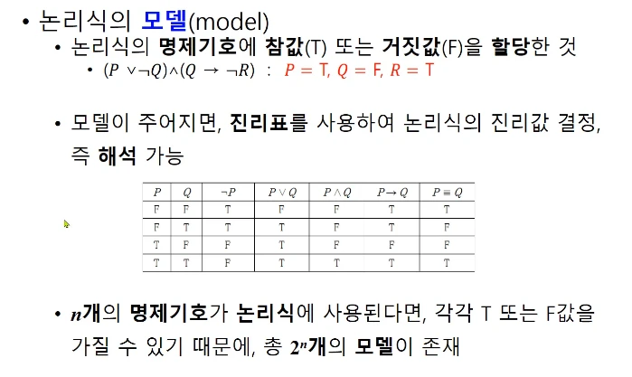

- 논리식의 **모델**(model)

    - 논리식의 명제 기호에 참값(T) 또는 거짓값(F)을 할당한 것

        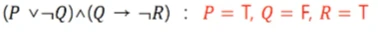

        빨간색 부분이 논리식의 모델

    - 모델이 주어지면, 진리표를 사용하여 논리식의 진리값 결정. 즉, **해석**이 가능하다.
    - n개의 명제기호가 논리식에 사용된다면, 각각 T 또는 F 값을 가질 수 있기 때문에, 총 2^n 개의 모델이 존재한다. ⇒ 한 개의 명제기호는 T 또는 F이기 때문.

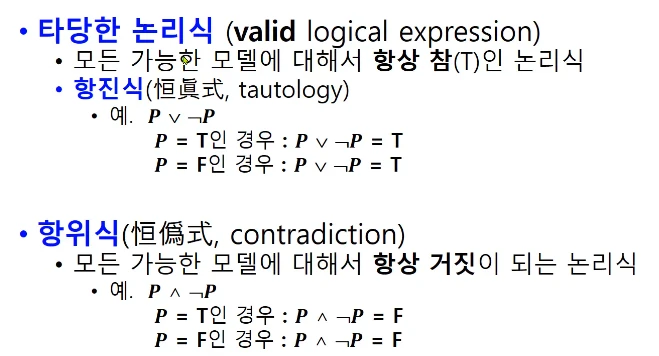

- **타당한 논리식** (valid logical expression)

    - 모든 가능한 모델에 대해서 항상 참(T)인 논리

    - **항진식**

        - 논리식에 포함된 명제기호의 값이 어떤 것이든지 논리식의 해석이 항상 T가 되는 것

    - **항위식**

        - 논리식에 포함된 명제기호의 값이 어떤 것이든지 논리식의 해석이 항상 F가 되는 것

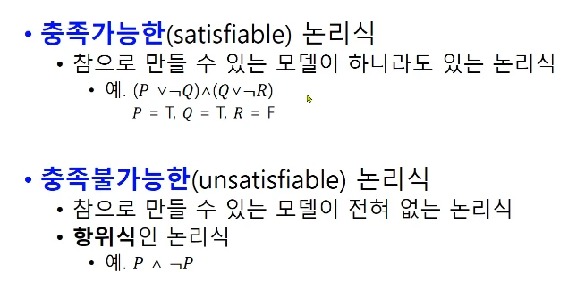

- **충족가능한**(satisfiable) 논리식

    - 참으로 만들 수 있는 모델이 하나라도 있는 논리식

        > 이때 모델이란, 주어진 논리식의 명제기호에 참값 또는 거짓값을 할당한 것.

- **충족불가능한**(unsatisfiable) 논리식

    - 참으로 만들 수 있는 모델이 전혀 없는 논리식

        - **항위식**인 논리식

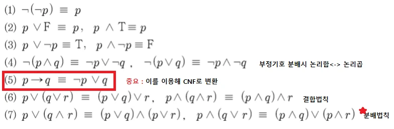

- **동치관계**

    - **어떠한 모델**에 대해서도 **같은 값**을 갖는 **두 논리식**
    - 모델이 어떠한 값을 갖든지 둘 다 항상 값이 같으므로, **100% 대체가 가능**하다.
    - <strong>(5)</strong>는 아주 자주 사용되는 흔한 식이다.

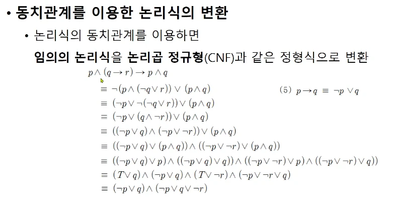

- **동치 관계를 이용한 논리식의 변환**

    - 논리식의 **동치관계**를 이용하면, 임의의 논리식을 **논리곱 정규형**(CNF)과 같은 정형식으로 변환할 수 있다.
    - 논리곱 정규형 : 곱으로 묶여있고, 그 안에는 합으로만 이루어진 것

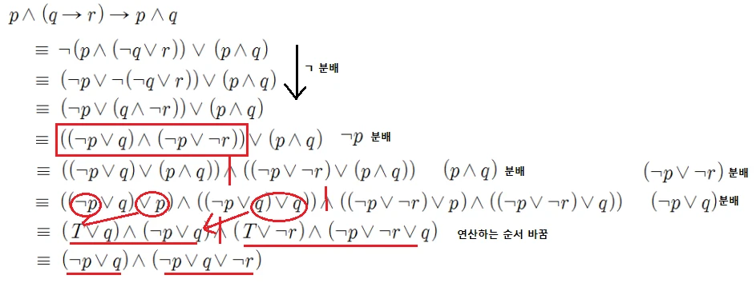

### 명제 논리의 추론

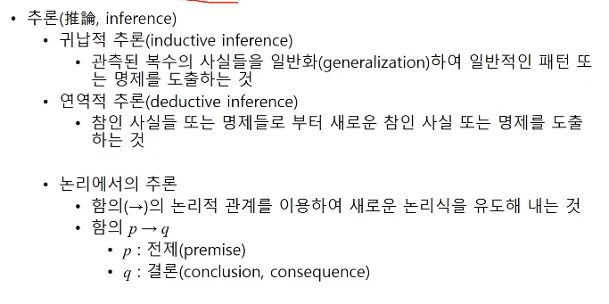

- **귀납적 추론**

    - 관측된 복수의 사실들을 **일반화**하여 **일반적인 패턴** 또는 **명제**를 도출하는 것

- **연역적 추론**

    - **참**인 **사실**들 또는 **명제**들로부터 **새로운**  **참**인 **사실** 또는 **명제**를 **도출**하는 것

- **논리에서의 추론**

    - **함의**(→)의 **논리적 관계**를 이용하여 **새로운 논리식**을 **유도**해 내는 것

    - 함의 p → q

        - p : 전제(premise)
        - q : 결론(conclusion, consequence)

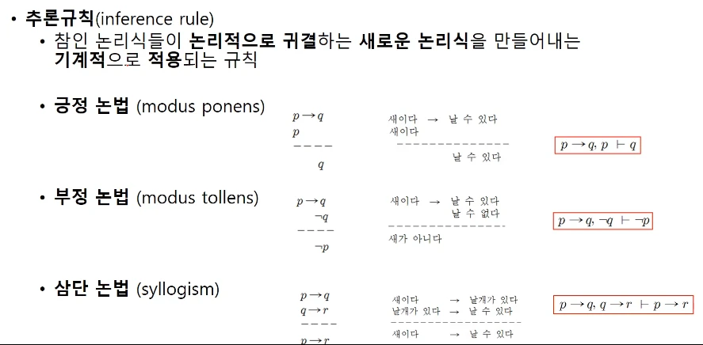

- **추론규칙**

    - 참인 논리식들이, 논리적으로 귀결하는 새로운 논리식을 만들어내는, 기계적으로 적용되는 규칙

    - 긍정 논법

        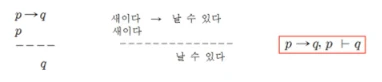

        p → q 라면, p이면 q다. 

        > (**⊢** 는 메타 언어의 기호. 앞에 있는 논리에서 뒤에 나오는 논리를 추론 가능하다는 뜻.)

    - 부정 논법

        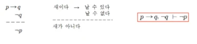

        p→q 라면, q가 아니라면, p가 아니다. (q는 적어도 새는 아니다.)

    - 삼단 논법

        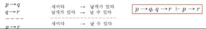

        p→q, q→r이라면, q→r이다.

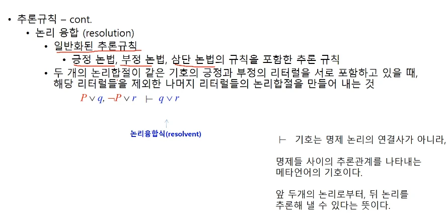

- 논리 융합 (resolution)

    - 일반화된 추론규칙

        - 긍정 논법, 부정 논법, 삼단 논법의 규칙을 포함한 추론 규칙

    - 두 개의 **논리합절**이 같은 기호의 **긍정**과 **부정**의 **리터럴**을 서로 **포함**하고 있을 때,  
        **해당 리터럴**들을 **제외**한 **나머지 리터럴**들의 **논리합절**을 만들어내는 것

        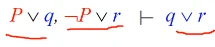

    - 이때 만들어지는 새로운 논리합절을 **논리융합식**(resolvent)라고 한다.

> ⊢ 기호는 명제 논리의 연결사가 아니라, 명제들 사이의 추론 관계를 나타내는 메타언어의 기호이다. 앞 두개의 논리로부터, 뒤 논리를 추론해 낼 수 있다는 뜻이다.

### 명제 논리의 지식표현

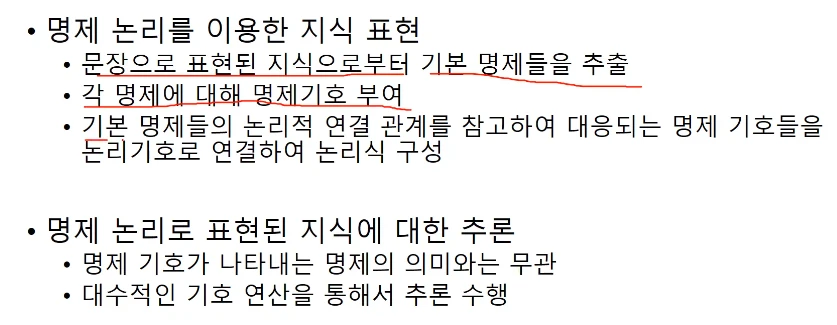

- **명제 논리를 이용한 지식 표현**

    - 문장으로 표현된 지식으로부터, 기본 명제들을 추출
    - 각 명제에 대해 명제 기호를 부여
    - 기본 명제들의 논리적 연결 관계를 참고하여, 대응되는 명제 기호들을 논리기호로 연결하여 논리식으로 구성

- **명제 논리로 표현된 지식에 대한 추론** (표현으로부터 추론하기)  
    ⇒ 사실 관계(참/거짓)가 있을때, 그것을 수학적 도메인으로 바꿔서 수행하는 것

    - 명제 기호가 나타내는 명제의 의미와는 무관
    - 대수적인 기호 연산을 통해서 추론 수행

---

## &lt;술어 논리&gt;

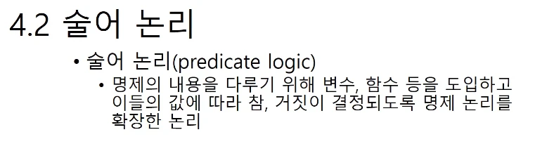

> 명제의 내용을 다루기 위해 변수, 함수 등을 도입하고 이들의 값에 따라 참, 거짓이 결정되도록 명제 논리를 확장한 논리

- **술어**

    - 문장의 ‘주어+서술어’ 형태에서 서술어에 해당
    - 대상의 속성이나 대상 간의 관계를 기술하는 기호
    - 참 또는 거짓 값을 갖는 함수

### 술어 논리의 구문

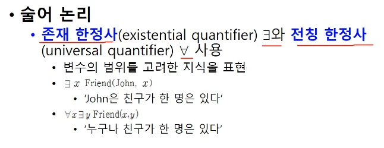

- **존재 한정사 (∃)**

    - Every(’어떤’의 뜻)
    - 변수의 범위를 고려한 지식 표현
    - ex. ∃ x Friend(John, x)  
        ⇒ John은 친구가 한 명은 있다.

- **전칭 한정사 (∀)**

    - All(’모든’의 뜻)
    - ex. ∀ x ∃ y, Friend(x, y)   
        ⇒ 누구나 친구가 적어도 한 명은 있다.

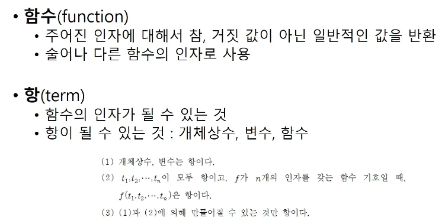

- **함수**(function)

    - 주어진 인자에 대해서 **참**, **거짓** 값이 아닌 **일반적인 값**을 **반환**
    - 술어나 다른 함수의 인자로 사용

- **항**(term)

    - **함수**의 **인자**가 될 수 있는 것

    - 항이 될 수 있는 것 : **개체상수**, **변수**, **함수**

        ⇒ ‘**함수**’도 ‘**항**’이다.

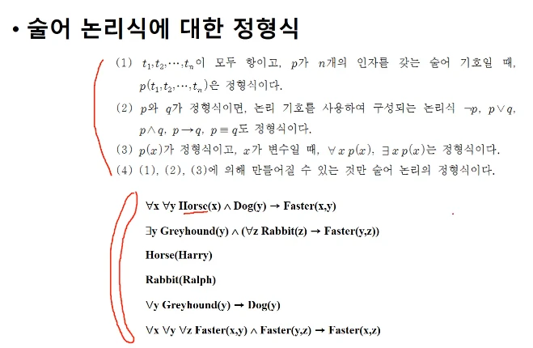

- **술어 논리식에 대한 정형식**

    (1) t1, t2, …, tn이 모두 항이고, p가 n개의 인자를 갖는 술어 기호일 때, p(t1, t2, …, tn)은 정형식.

    (2) p와 q가 정형식이면, 논리 기호를 사용하여 구성되는 논리식도 정형식이다.

    (3) p(x)가 정형식이고, x가 변수일 때, 존재 한정사와 전칭 한정사를 사용한 식도 정형식이다.

    (4) (1), (2), (3)에 의해 만들어질 수 있는 것만 **술어 논리**의 **정형식**이다.

### 술어 논리의 종류

- **일차 술어논리**(First-Order Predicate Logic, FOL)

    - **변수**에만 **전칭 한정사**와 **존재 한정사**를 쓸 수 있도록 한 **술어논리**

- **고차 술어논리**(High-Order Predicate Logic)

    - **변수**뿐만 아니라 **함수**, **술어기호** 등에 대해서 **전칭 한정사**와 **존재 한정사**를 쓸 수 있도록 한 **술어논리**

        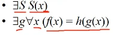

### 술어 논리의 지식표현

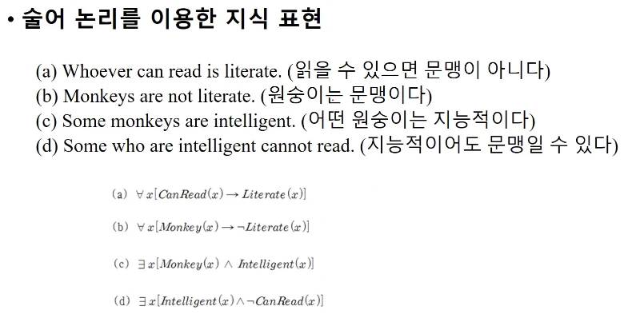

- 읽을 수 있으면 문맹이 아니다.

    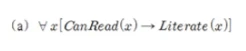

- 원숭이는 문맹이다.

    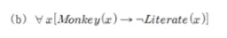

- 어떤 원숭이는 지능적이다.

    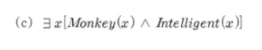

    - 어떤 원숭이가 존재하는데, 그 원숭이는 지능적이라는 뜻.

- 지능적이어도 문맹일 수 있다.

    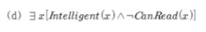

    - 어떤 것이 지능적이어도 문명이 아닐 수 있다. (문맹일 수 있다.)

### 논리 프로그래밍 언어

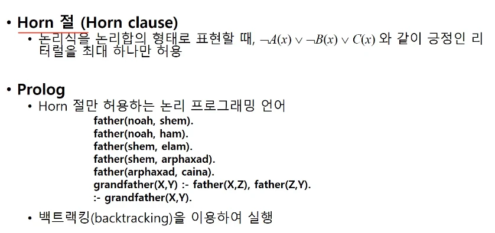

- **Horn**절 (Horn Clause)

    - 논리식을 논리합의 형태로 표현할 때, 긍정인 리터럴을 최대 하나만 허용하는 것.

- **Prolog**

    - 인공지능에서 논리를 표현하는 데에 있어서 선두주자.
    - Horn 절만 허용하는 논리 프로그래밍 언어.
    - 백트랙킹을 이용하여 실행 ⇒ 효율이 좋지 못함.
