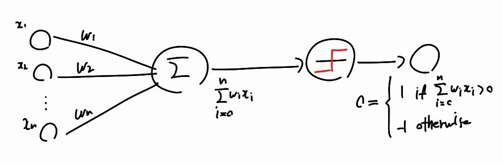

# 인공지능의 역사

작성일 2023-09-05 · 최종 수정일 2023-10-20
{ .post-date }

## [AI의 역사]

> 인공지능의 간단한 역사를 알아보고, 인공지능이란 무엇인지 알아본다.

---

### &lt;AI&gt;

> **Artificial Intelligence**란, 사람의 논리적/지적 행동이나 행위를 대신하는 기계적 시스템이다.  
> 즉, **Machine**으로 볼 수 있으며, Machine은 항상 H/W에 국한되는 것이 아니라 S/W, Device 등으로 구현될 수 있다.

#### 인공지능의 역할

- **Act like humans**

    - 인공지능은 인간의 지능을 모방하는 것이다.

- **Think like humans**

    - 인공지능이 일을 어떻게 하는지가 중요한 것이며, 맹목적이어서는 안된다.

- **Act rationally**

- **Think rationally**

    - 인공지능은 항상 이성적이고 합리적으로 판단하고 행동해야 한다.
    - 이렇게 만들기 위해서는, Rational한 판단을 내리거나 행동을 할 때 보상을 줌으로써 그 방향으로 더 잘 동작하게 만들어야 한다. (그래서 설계가 중요하다.)

---

### &lt;지능이란?&gt;

- 지능은 두 개의 카테고리로 나뉘어진다.

    - **Learning**

        - 사물을 이해하고 학습하는 능력

    - **Solving**

        - 어떤 문제가 주어졌을 때, 합리적으로 사고하여 문제를 해결하는 능력

> 각각의 과정을 원활하게 수행하고, 이를 유기적으로 연결하여 문제를 해결할 수 있을 때, 지능을 가졌다고 할 수 있다.

---

### &lt;인공지능의 시작과 발전&gt;

- 초기 인공지능은 Rule Based로 만들어져, **Rule**과 **Data**를 입력하면 **Answer**가 나오는 형태였다.
- 그러나 점차 신경망이라는 개념이 도입되면서, **Data**와 **Answer**를 넣으면, 그 안에서 **Rule**(Pattern)을 찾아내는 형태로 진보하게 되었다.

- 인공지능의 정보 처리를 위해서 인공지능 초기에 제안된 것은 코넬 대학교 항공 연구소에서 인지/심리를 연구하는 연구원(교수) Rosenblatt가 제안한 &lt;**Perceptron**&gt;이었다.

    

    단층 Perceptron의 구조

    - **Perceptron**은 입력을 1과 -1로 구분하는 간단한 머신이다.
    - 예를 들어, 사람이 비만인지 아닌지를 판단하는 Perceptron이 있다고 해보자. Perceptron에 입력(나이, 성별, 키, 몸무게, 근육량 등)을 넣으면, 해당 데이터를 바탕으로 몇 가지 가중치를 곱해서 1 또는 -1로 Output을 내는 형태이다.

    - 이후에는 **Single Perceptron**을 여러 단계로 쌓은 **Multi-layer Perceptron**을 만들었다.

        > 그런데, 이러한 Rule Based 방식은 확장성이 떨어진다는 단점이 있다. Multi-layer Perceptron이 등장하면서 새로운 데이터가 들어올 경우 해당 데이터에 맞춰 수많은 가중치 값을 바꾸는 과정이 필요했는데, 이 방법을 알지 못해서 인공지능의 발전이 어려움을 겪었다.

- 이후 **역전파**(Backpropagation)가 만들어지며, 인공지능이 데이터를 기반으로 parameter를 학습할 수 있게 되었다.

    - 현재 만들어진 모든 딥러닝 학습은 이 방법을 채택한다.

- 그러나 이러한 방법이 있음에도, H/W적인 한계, 그리고 데이터의 부족으로 인해 학습을 원활하게 진행할 수 없었다.

    - 데이터의 수 자체가 절대적으로 부족했음.
    - 또한 데이터가 있음에도 불구하고 H/W 성능이 떨어져 학습이 너무나도 오래 걸렸음.

- 그러나 H/W 성능이 비약적으로 발전하고, 수많은 머신들이 사회 전반에서 사용되면서 데이터의 수도 급증하게 되었으며, 이에 따라 인공지능의 한계가 점차 줄어들고 있다.
