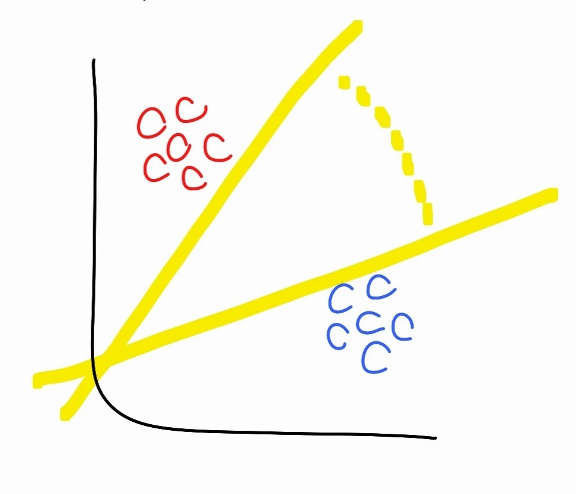
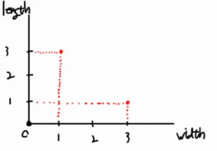
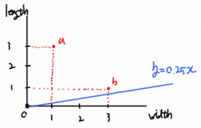
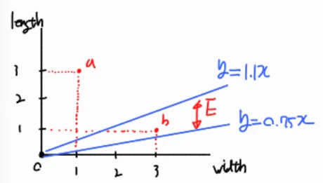
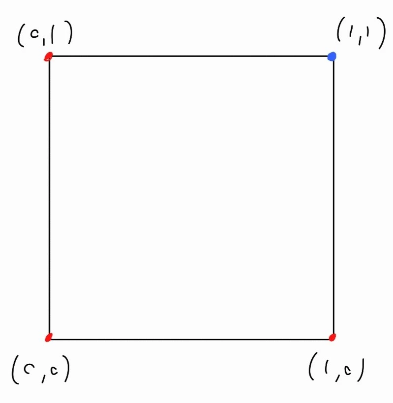
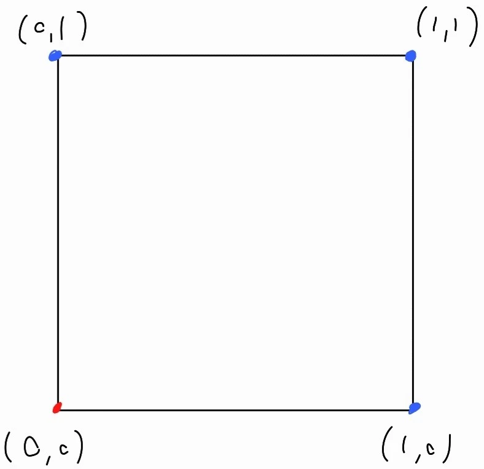
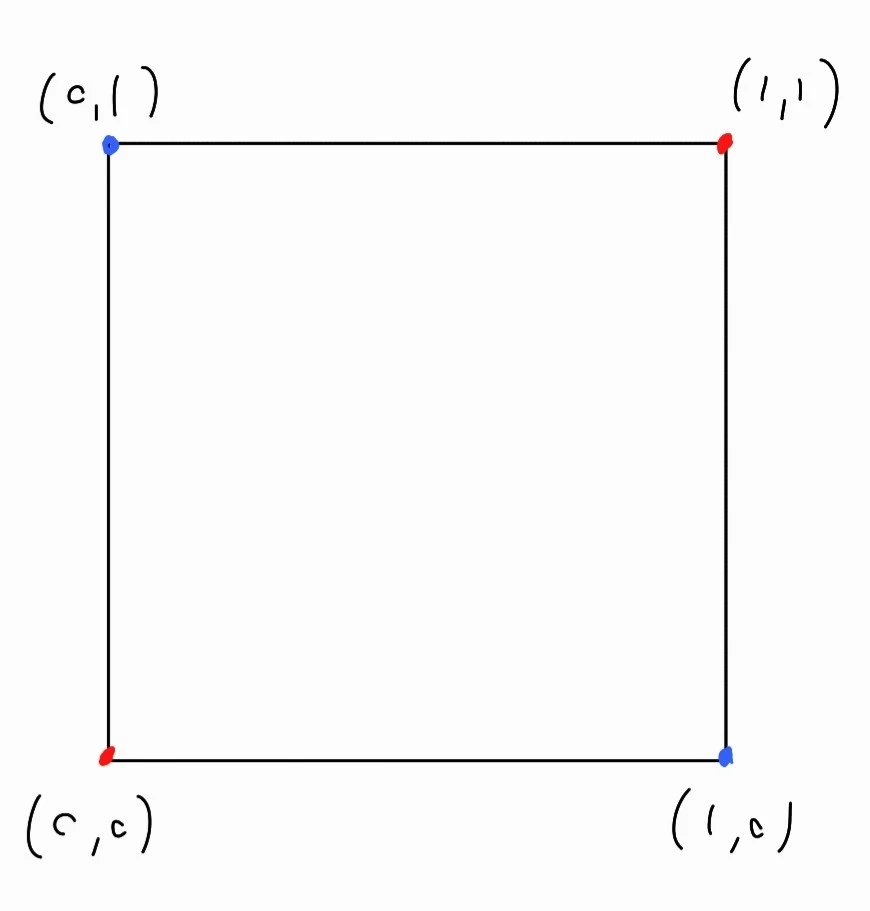

# 신경망과 예측자/분류자

## &lt;신경망&gt;

- **신경망의 접근법**

    - 규칙 기반(Rule Based)
    - 신경망 기반(Neural Network Based)

### 연산을 통한 가중치 갱신

> 컴퓨터는 하나의 계산기이다. 입력을 주고 연산을 시키면 결과가 나온다.  
> input → calculate → output

- km를 mile로 변환하는 방정식이 있다. 우리는 이 식의 방정식을 알고, Linear한 식이라는 것도 안다. 또한 방정식에 들어가는 c가 상수라는 것도 알지만, 실제 값은 모른다.  
    (c의 실제값=1.6)

    $$
    mile = km * c
    $$

    우리는 이 문제에 대해서 **정답**을 알고 있어서, **오차**를 알 수 있다고 해 보자.   
    (현재는 Linear한지 아닌지도 모르지만, 일단 Linear하다고 가정하고 변환을 시도해 보자.)

- **1) c = 0.5**

$$
100(km) * 0.5 = 50 (mile)
$$

만약 정답이 **62.137**이라고 한다면, 오차는 다음과 같다. 62.137 - 50 = **12.137** (오차)  
⇒ 아직까지 Linear한지 모르므로, 계속 접근을 시도해 보아야 한다. 오차가 +이므로, 내가 세팅한 값이 작다는 것이다. 따라서 상수 c의 값을 조금 키워야 하는데, **정보가 없으므로 근거가 없이 늘려보아야 한다.**

- **2) c = 0.6**

> **계산 상수 c를 조정해 가면서 근사시킨다.** 

$$
100(km) * 0.6 = 60(mile)
$$

62.137 - 60 = **2.137** (오차)  
⇒ 오차를 계속 증가시켜야 한다는 것은 판단 가능함.

- **3) c = 0.7**

62.137 - 70 = **-7.863** (오차)  
⇒ **오버슈팅**(overshooting)이 나타난다. 이럴 때는 0.7에서 감소시키거나, 0.6에서 증가시켜도 된다.

- **4) c = 0.61**

62.137 - 61 = **1.137** (오차)  
⇒ 이와 같이 오차의 크기를 보고 **Next Step**을 판단할 수 있다.   
(단, Linear/Non-linear 여부와, 방정식을 모르면 알기 힘듦.)

> 이것은 신경망의 **지도 학습 접근법**과 동일하다. 이 방식은 쉽게 상관관계를 얻기 힘든 경우나 선형적인 상황에 적용하기 쉽다.

### **분류**(Classifying)와 **예측**(Prediction)

> 이전에 했던 예측에서는, 단순한 **선형계산**에 의해 **목표치로 접근**해 갔었다.   
> 여기서도 **선형계산**(식)을 이용하여 결과를 얻을 수 있다.  
>   
> **직선의 방정식**을 만들고, **기울기**의 **값**이나 **y절편** 등을 조절하면서 구분 가능한 값을 찾는다.   
> (똑같이 오차를 찾아가면서 구분)

> 차근차근 값을 줄이거나 늘려가는 방법도 있고, 크게 변경했다가 사이값을 취하는 법도 있음. 이것이 신경망 학습의 iteration에 적용되는 다양한 방법론임.  
>   
> ⇒ 구분할 수 있는 데이터의 특성만 파악하고, 거기서 구분지으면 됨.

- **예측자**

    - **예측자**란, Input이 주어졌을 때, Output을 예측할 수 있게 하는 것을 말한다.

- **분류자**

    - 특정한 데이터를 명확하게 분류할 수 있는 기준을 제공하는 것을 말한다.
    - 예를 들어, 이차원 좌표평면 상에서 특정한 두 지점에 몰려있는 데이터가 있다고 할 때, 이 데이터를 직선으로 분류할 수 있으며, 이때 직선을 **분류자**라고 할 수 있다.

- **예측자** 또는 **분류자**에게 실제 값을 알려주는 역할을 수행하는 데이터를 **학습 데이터**(training data)라고 한다.

    > 숫자 또는 데이터 그 자체만 나타나 있을 때는 상호 관계를 파악하기 쉽지 않을 수 있기 때문에, 데이터의 시각화는 매우 중요하다.  
    >
    >
    > 현대의 AI 데이터는 **비정형 데이터**가 많다. 그걸 어떻게 시각화가 잘 되도록 만드는지 중요하다. (*즉,* ***비정형 데이터****를* ***인공지능****에* ***어떻게 넣고***  ***분류****하고* ***값****을 만들 것인가. 구체적이지 않은 추상적인 데이터를 어떻게 데이터로 나타낼 것인가. 그것이 꽤 중요하다. 이것 때문에* ***지식표현과 추론****이 중요함.*)

> 데이터를 보고 기울기를 바꾸거나 값을 정하는 과정 자체를 &lt;학습&gt;이라고 한다.

---

## &lt;예측자, 분류자, 학습데이터의 예시&gt;

> Mile-Km 예측과 같은 방식으로, 두 그룹을 체계적으로 분할해보자.  
> 이 예제는 두 마리의 벌레(a, b)가 있고, 두 벌레의 length와 width 정보가 있을 때 두 벌레의 종을 구분하는 예측자를 만드는 예제이다.

- **학습데이터**

    - 예측자, 분류자에게 실제 값을 알려주는 역할을 수행하는 데이터

### y = Ax (직선의 방정식)

- 분류를 위해 A값을 찾는다.

    - A = 0.25 (Random하게 Initial Value 설정)

        

    - 이렇게 만들어낸 직선의 방정식을 통해 오차를 찾아낸다.
    - 오차를 찾아내기 위해서는 반드시 정답을 알아야만 한다.

### a값의 업데이트

> 우리는 이차원 평면의 그래프를 삼차원에서 보고 있기 때문에, A값을 증가시켜야 a, b 점을 분류할 수 있다는 것을 안다. 하지만 평면의 기준에서 보면 A값을 어떻게 수정해야 할 지 알기 힘들다. 따라서 우리는 판단을 내려야 한다.

- 이전의 그림에서 <strong>b(3,1)</strong>를 기준으로 판단해보자.

    - y = 0.25*3 = 0.75
    - b의 y좌표는 1

    - 따라서 1 - 0.75 = 0.25 (오차)

        > 우리는 이 과정을 통해서 오차를 얻어낼 수 있다.  
        > 현재는 분류자를 직선으로 표현하기 때문에 오차를 얻기가 매우 간단하지만,  
        > 실제에서는 삼차원을 다루기 때문에 더 어렵다.

        > 이렇게 얻어낸 결과를 보면 오차가 양수이기 때문에, A값을 키워야 한다는 결론을 얻게 된다. 즉, 직선이 좀 더 위로 올라가야 한다.

### 목표값과 출력값의 비교

> 우리는 <strong>b(3, 1)</strong>을 위로 지나가는 직선을 원한다. 그러므로 직선이 <strong>(3, 1.1)</strong>을 지나가도록 해보자.  
> (*y = 1.1로 설정하지 않고 더 크거나 작은 값으로 설정해도 된다. 여기선 단순히 예시를 든 것.*)

- 오차 = 목표 값 - 실제 출력 값
- E = 1.1 - 0.75 = 0.35  
    (목표값과 실제 출력값의 차이는 0.35이다.)

> 신경망에서 가장 중요한 것은 &lt;Error&gt;를 만들어 내는 것이다. (그래야 학습이 가능하다.)  
> 그리고 Error를 최소화 시키는 것이다. (A값과 E의 관계이다.)  
> ⇒ 또한, 오차에 대한 Define 방법도 중요하다. (MSE, RMS, Cross Entropy 등)

### E와 A의 관계

> 어떻게 E 값을 이용해야 A 값을 정교화할 수 있을까?  
> 우리는 오차 E를 이용해 매개변수 A에 필요한 변화를 알고싶어 한다.  
> 그러기 위해서는 E와 A 간의 관계를 알아야만 한다.

- Error = 1.1 - 0.75 = 0.35

    - prev : y = Ax (출력값)

    - next : y = Bx = (A + ΔA)x

        > A의 초기값을 임의로 설정하면 우리는 잘못된 값을 얻게되며, 이를 통해 Error 값을 얻게 된다. (*이 예제에서 Error는 y 값의 차이로 나타낸다.*)  
        >   
        > 이 과정에서 A가 B를 찾아가는 과정을 잘 설정해야 하며,  
        > 우리는 E와 A값을 토대로 목표값 t에 도달하기 위해 **A**값을 **조금씩 조절**해 나가야 한다.

- **Error의 표현** (*목표 값을 t로 설정하고, 현재 값을 y라고 하자.*)

    > E = t - y  
    >    = (A + ΔA)x - Ax  
    >    = (Ax + ΔAx - Ax  
    >    = ΔAx  
    >   
    > 따라서, **Error**는 **ΔA**, **x**로 표현된다. (**단순한 선형적인 표현임.**)

### ΔA값을 바탕으로 한 A값의 업데이트

> 이제, ΔAx의 구체적인 값을 알아야 하며, 이 결과를 바탕으로 A를 업데이트한다.

- E = (ΔA)x

    - ΔA = E/x = 0.35 / 3 = **0.1167**

> 이를 통해 ΔA = 0.1167이라는 결과를 얻어냈으며, 이것은 기울기를 0.1167만큼 증가시켰을 때, 목표값인 t에 도달할 수 있다는 것을 의미한다.

---

## &lt;분류자 예시-2&gt;

> 이전과 똑같은 분류자 예시를 만들어보자.  
> 이번 데이터는 <strong>(1.0, 3.0)</strong>의 값을 가진다.

### 데이터 업데이트

- y = 0.3667 * x

    - 여기에 x = 1을 대입하면, **(1, 0.3667)** 이라는 결과를 얻는다.
    - 그런데, 실제로 우리가 원하는 값은 <strong>(1, 3)</strong>이다.
    - 두 값이 너무 다르므로, 새로운 목표를 정해야 한다.

    > 목표를 (1, 2.9)로 설정해서 오차를 구해보자.

- E = 2.9 - 0.3667 = 2.5333

    - ΔA = E/x = 2.533 / 1.0 = 2.5333

    > 이렇게 ΔA의 값을 구했고, 이 값을 통해 A값을 업데이트 하면 목표값에 도달하게 된다.  
    >   
    > 그런데, 문제가 하나 있다. 현재 분류자는 하나의 데이터만 학습했기 때문에, <strong>a(1,3)</strong>에 상당히 치우쳐져 있다. 이를 **편향**되었다고 한다.  
    > 이 문제를 해결하기 위해 분류자가 두 점의 중간쯤을 지나면 편향을 최소화할 수 있다.

### 편향의 최소화

> Target 데이터에 너무 근접하게 되면, 그 데이터에 대한 **편향**(Bias)이 생기게 된다.   
> 그러므로 한 번에 Target에 접근하지 말고, 조금씩 방향성만 맞춰서 업데이트를 해보도록 하자.

- **학습**

> 신경망에서 학습이란 데이터에 따라서 오차를 구하고, 그 오차를 바탕으로 값을 조금씩 바꿔나가면서 오차를 최소화하는 과정이다.  
> (값을 바꾸는 것은 parameter를 바꿔나가는 과정이다.)

### 학습률

> 오차를 바탕으로 값을 갱신하는 정도를 조절하는 수치.  
> 가중치값이 한 번에 너무 많이 바뀌는걸 방지해서 학습 결과로 생기는 **편향**(Bias)을 최소화한다.

---

## &lt;선형분류자&gt;

> 단순한 분류자나 예측자는 인공 신경망에 적용하기에는 충분하지 않다.

### 분류자(Classifier)의 역할과 한계

> 분류자를 이용해서 논리표현을 처리해 보자는 의미.  
> 진리표를 좌표 평면에 그려보자.

- AND 

| Input A | Input B | Logical AND |
|---|---|---|
| 0 | 0 | 0 |
| 0 | 1 | 0 |
| 1 | 0 | 0 |
| 1 | 1 | 1 |

⇒ 이걸 좌표 평면에 그려보았더니, 이전에 보았던 분류자처럼 기능할 수 있는 것으로 생각된다.

(1,1)을 찾을 수 있는 분할선은 수없이 많겠지만, 학습을 거치면 적절한 분류선을 충분히 찾아낼 수 있다. 직선으로 분류의 역할을 하는 것을 선형 분류자라고 한다.

즉, y = ax + b의 형태의 직선(선형함수, 선형분류자)을 찾아낼 수 있다.

- OR

⇒ OR도 선형분류자를 찾아낼 수 있다.

> 이전까지는 선형분류자를 찾아낼 수 있었지만, 찾아낼 수 없는 경우도 존재했다.

- XOR

⇒ 선형 분류자 하나로는 본 문제를 해결할 수 없었기 때문에 두 개의 직선을 사용하거나 곡선을 사용하게 된다. 수없이 많은 직선을 적분하면, 결국 특정 영역을 안과 밖으로 구분하는 원을 얻게 되는 것과도 같다. (**선형적 처리가 불가능할 수도 있다.**)

> 하나의 직선으로 해결이 불가능한 문제가 있다면 여러 개의 직선을 도입하고, 여러 개의 직선은 결국 곡선과 같다. 또한 그런 그래프를 한 축을 기준으로 해석하는 것이 편미분이다.  

### About Neuron

> 신경망은 생명체의 뉴런을 모방한 것이다.

**Content**

- 축삭

    - 다양한 말로 불리지만,  축삭의 ‘삭’은 비비꼬인, 이란 뜻이다.

- 뉴런의 종류

    - 감각뉴런(신호를 전달받음)
    - 연합뉴런(신호를 바탕으로 판단함)
    - 운동뉴런(신호를 전달하여 운동함)

### 뉴런의 동작원리

- 전기 입력을 받아 전기적 신호를 발생, 전달
- 실험적 결과에 따르면, 뉴런은 입력을 받았을 때 즉시 반응하지 않는다. (살짝 떨어져 있음)  
    즉, 물리적 간격이 있는 상태로 유지된다.

- **Threshold**

    - 뉴런은 특정 신호 이상이어야만 신호로 인식하고 받아들인다.

    - 인공 신경망에도 값을 무조건 받아서 넘기는게 아니라, Threshold를 적용하여 넘길 신호를 판단할 수 있다. (Linear한 관계가 아니다. y = ax + b가 적용되는 것이 아님.)

        - 대표적인 예가 물레방아 (물이 적당한 무게를 만들어야만 회전하게 된다.)

    - 이것을 다르게 해석해 보면, 뉴런은 미세한 잡음 신호에는 반응하지 않는다는 의미이다.

- **활성화 함수** (Step Function)

    - Threshold 이상의 값이 들어와야만 활성화되는 함수

        인공 뉴런은 뉴런을 그대로 모방하여, 여러 개의 입력, 한 개의 출력, 중간에 활성화 함수 등을 넣어서 구성시킬 수도 있다.

- **시그모이드 함수**  (Sigmoid Function, Logistic Function)

    $$
    y = \frac{1}{1+e^{-x}}
    $$

    - S자로 생긴 모든 함수를 Logistic Function이라고 부른다.
    - **실제로 사용하지는 않지만**, 미분했을 때 똑같이 생겼기 때문에 공부할 때는 사용하기 좋으므로 우리는 이를 사용한다.
    - 대표적인 모델은 인구 증가 모델

- 인공 뉴런의 모델링

    - 여러 개의 입력을 전달받아 더하고, 활성화 함수를 거쳐 처리한 다음 값을 출력한다.
    - 출력 값을 여러 뉴런을 거치도록 하여 최종 결과를 얻어낸다.
    - 이런 뉴런을 연결하여 Layer를 만들고, Layer와 Layer를 연결해서 모델을 만든다.
    - 이 과정에서 각 뉴런과 뉴런의 연결 강도를 가중치(Weight)라고 하고, 학습을 통해 Weight의 값이 수정되는 것이다. ⇒ 이 과정을 학습이라고 한다.
    - 학습을 하면서 에러가 특정 지점에 수렴하게 되면 학습이 완료된 것이라고 판단할 수 있다.

    - **뉴런과 뉴런 간의 연결**

        - 한 Layer에 존재하는 모든 Neuron과 다음 Layer에 존재하는 모든 Neuron을 연결하면 이것을 **Fully Connected**라고 한다.
        - 계속해서 학습을 하다보면 특정 가중치가 강해지거나 약해지는 경우가 생긴다. 딥러닝을 하다보면 이러한 문제가 생긴다.
