# 순전파와 오차의 역전파

작성일 2023-10-10 · 최종 수정일 2024-11-10
{ .post-date }

## [순전파(Forward Propagation)]

> 신경망에 Input을 넣고 Output을 출력하는 과정을 순전파라고 한다.

---

### &lt;Multi-layered Perceptron&gt;

> 다층 퍼셉트론 구조의 신경망을 바탕으로 순전파 과정을 살펴본다.

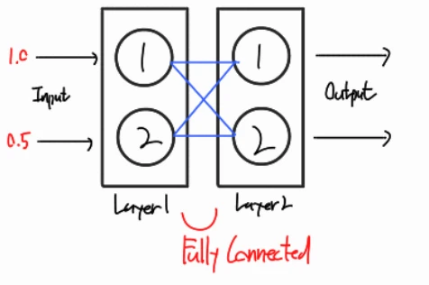

- 각각의 노드는 **입력값의 합**을 구하고, 거기에 **활성화 함수**를 적용하는 **퍼셉트론**이다.

- 또한, 각 **간선**(Edge)에 적용될 **가중치**(weight)가 필요하다.

    

    - w(1,1) = 0.9
    - w(2,1) = 0.3
    - w(1,2) = 0.2

    - w(2,2) = 0.8

        > 학습 과정을 거치면서 가중치의 값이 변화하게 된다.

#### Layer 1

> 입력(Input Layer)은 다음 Layer로 값을 밀어넣어주는 역할을 하기 때문에, 관습적으로 Layer로 취급하지 않는다.  
>   
> 따라서 위의 신경망에서 Layer1의 출력은 입력값인 1.0, 0.5가 그대로 나가게 되며, 활성화 함수를 적용하지 않는다. ⇒ 무조건 이렇게 해야하는 것은 아니며, 관습적인 것임.

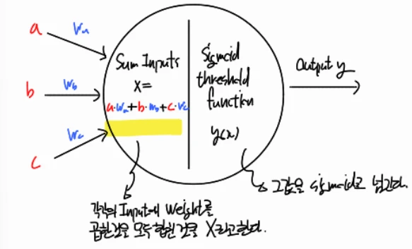

#### Layer 2

- Perceptron은 들어오는 Input에 가중치를 곱하고, 그 값들을 모두 더한 다음 활성화 함수를 적용하는 역할을 한다.

    - 위의 신경망에 대해서 직접 input을 계산해보자.

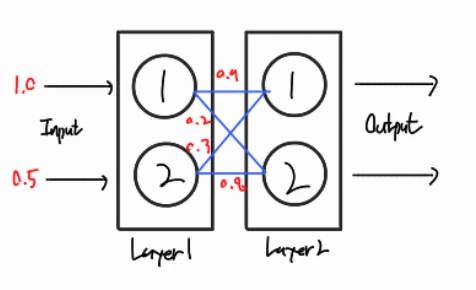

- Layer 2의 1번 노드

    - x1 = (1.0 * 0.9) + (0.5 * 0.3) = 0.9 + 0.15 = 1.05

- Layer 2의 2번 노드

    - x2 = 1.0 * 0.2 + 0.5 * 0.8 = 0.2 + 0.4 = 0.6

> 가중치가 없으면 값은 변화되지 않는다. 가중치는 다음 단계(Layer)로 값을 넘길 때, 그 값에 매기는 중요도와도 같다고 볼 수 있다.

- 가중치의 합을 모두 구했으므로, 활성화 함수를 통과시켜본다.

    - Layer 2의 1번 노드

        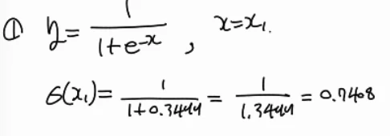

    - Layer 2의 2번 노드

        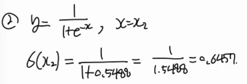

- **활성화 함수를 거친 결과(Output)**

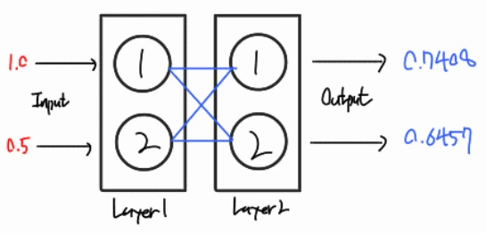

> 이와 같이, 입력값을 받고, 가중치를 곱한 값들의 합을 활성화 함수에 넣는 일련의 연산을 수행하는 단위를 **Perceptron**이라고 한다.  
>   
> 실제로는 양방향으로 연산이 이뤄지며, 각각   
> **추론**(Forward Propagation) →  
> **학습**(Backward Propagation) ←  
> 이라고 한다.

#### 행렬곱을 통한 퍼셉트론 연산

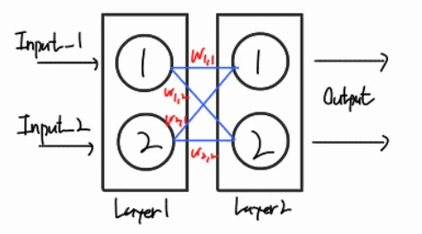

- 퍼셉트론의 Input에 가중치를 곱하는 연산을 하기 위해서 행렬곱을 진행할 수 있다.

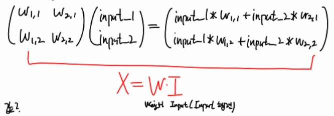

- 이렇게 표현하면 신경망의 크기가 얼마이건 계산이 같은 방식으로 이루어지게 할 수 있다.
- 이론적으로 모두 계산 가능하며, 무엇보다 수식이 크기에 관계없이 간단해진다.  
    ⇒ 간단한 연산을 병렬처리한다.
- 각 노드의 활성화 함수는 행렬곱을 필요로 하지 않는다.

#### 3계층 신경망

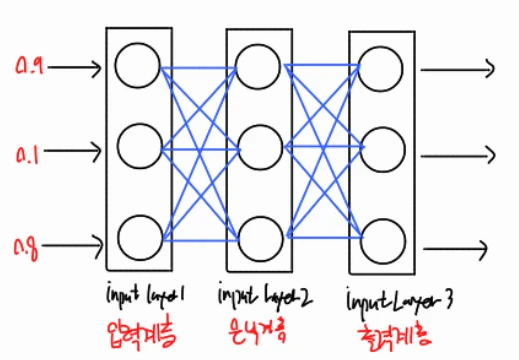

- 이와 같이 입력 계층, 은닉 계층, 출력 계층으로 이루어진 3계층 신경망이 있다고 해보자.

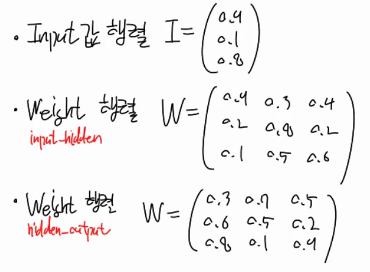

- 이때, Input 값과 Weight는 행렬로 표현할 수 있다.

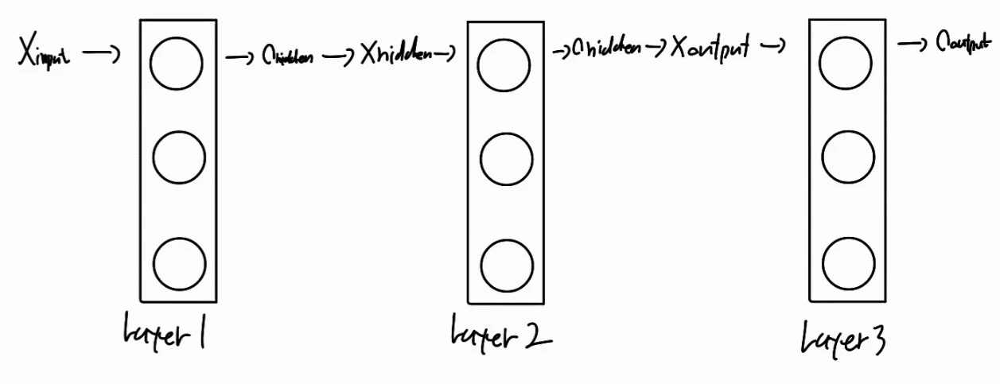

- Layer 1은 입력 계층으로, 값이 변하지 않고 X(input)값을 그대로 O(output)으로 내보낸다.

#### Hidden Layer에서의 행렬곱 연산

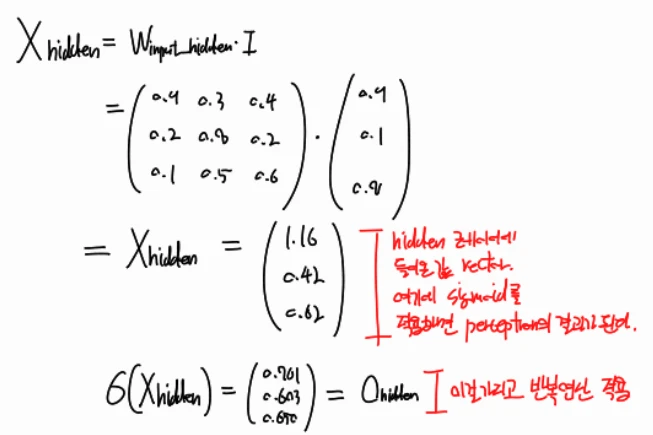

- **X**(hidden)

    - Layer 1을 거쳐서 전달된 **I**와 **W**(input_hidden)을 행렬곱 연산한다.
    - **X**(hidden)에 **활성화 함수**인 **sigmoid**를 적용한다.
    - 이렇게 구해진 **O**(hidden)을 **X**(output)으로 적용한다.

#### Output Layer에서의 행렬곱 연산

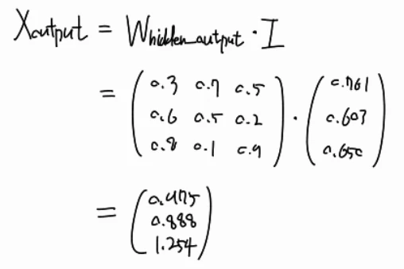

- **X**(output)

    - Layer 2를 거쳐서 전달된 **I**와 **W**(hidden_output)을 행렬곱 연산한다.

    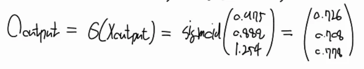

- **O**(output)

    - 이렇게 구해진 **X**(output)에 **sigmoid**를 적용하여 **O**(output)을 구한다.

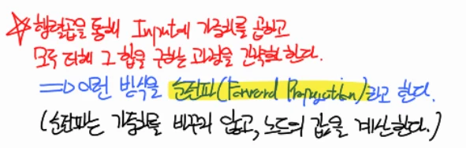

> 이후에는, Target 값을 바탕으로 Error 값을 구한다. 그리고 이를 통해 parameter 값을 update하는 과정을 진행하며, 이를 역전파(Backward Propagation)라고 한다.

---

## [오차의 역전파(Backward Propagation)]

> 역전파의 반대는 순전파(추론)이다. 이것은 오차를 통해 weight를 바꾸기 위해서 진행된다. 이것이 학습이다.

- 무엇을 **역전파** 해야 하는가?

    - 출력층은 오차가 있기 때문에 오차를 구할 수 있지만, 그 앞쪽은 오차를 구할 수 없다.
    - 그렇다면 어떻게 weight를 갱신할 수 있었는지 생각해보자.

---

### &lt;가중치를 학습시키기 위한 오차의 역전파&gt;

이전에 직선이 하나만 존재할 때는 업데이트 하기 쉬웠는데, 직선(가중치)이 여러 개 존재한다면?  
그리고 업데이트할 오차가 무엇인지 모른다면?

⇒ 이때는 업데이트를 어떻게 해야 하는가?

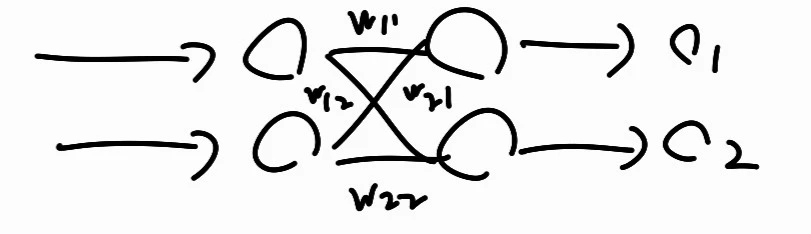

- 이전 노드로의 업데이트에는, 이전 계층의 모든 노드가 “지분”을 가지고 있다.

    - 즉, 그 **지분**, **공헌도**를 무시할 수는 없다.
    - 지분이 낮더라도 나중에는 중요한 역할을 하게 될 수도 있다.   
        (흐름이 항상 똑같지는 않고, 그렇기 때문에 무조건 비례해서 가중치를 갖게 되지는 않는다.)

> 어쨌든 오차는 이전 단계로 분배되어서 전달되어야 하고, 그것이 학습의 단계이다.  
> ⇒ 전달 자체가 학습은 아니고, **전달**을  통해 **값**이 **바뀌는 것**이 학습이다.

#### 역전파의 두 가지 방법

- 노드 개수만큼 단순하게 분배하기

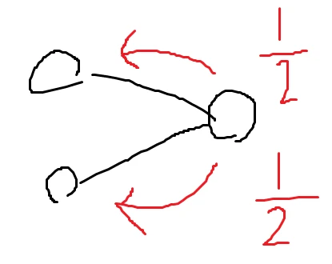

⇒ 이 방법이 무조건 안좋은 것은 아님.

- **노드 연결된 가중치에 따라 비례 분배하기**

    - 추론 과정에서 weight가 반영된 것은 사실이므로, 이것을 반영하여 오차를 분배하는 것.

> 이렇게 반대 방향으로 오차를 전달하고 값을 변화시키는 것을 **역전파**라고 한다.

- Layer 1과 Layer 2가 있을 때, Layer 1은 입력 계층이기 때문에 특별한 연산없이 값을 곧바로 hidden layer로 넘겨준다.

- 중간 노드에서는 target이 존재하지 않기 때문에, 오차를 구할 수 없다. (hidden layer) 그렇다면 어떻게 **에러**를 가지고 **앞단**에 **전달**해 줄 것인가? (이것도 비중으로 해결한다. 비율.)

    ⇒ 즉, 중간 오차는 우리가 정의해야 하는 것이다.

- Output node를 기준으로 전달되는 역전파는 빨간색을 통해 구하고, hidden layer의 node 하나가 받는 역전파는 파란색이다.

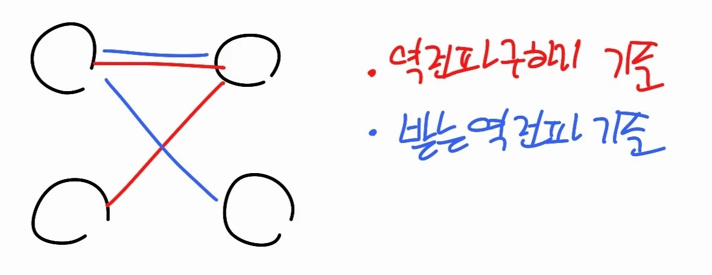

hidden layer는 원래는 target이 없는 것이지만, 뒷쪽의 layer에서 만들어진 오차에 비중을 두어 전달받아서 오차가 있는 것처럼 생각하자는 것이다.

이 과정을 계속 반복하면서 앞단으로 넘어가게 된다. (더 이상 갱신할게 없을 때까지)

만약 layer가 매우 많다면, 앞쪽으로 갈수록 오차는 점점 더 작아지게 된다. layer가 많을 수록 오차는 0에 수렴하게 된다. (왜냐면, 계속해서 분배하기 때문에 줄어들 수밖에 없다.)

그렇다면 입력단에 가까운 곳은 가중치가 바뀌지 않을 수도 있고, 이전 epoch에서 진행한 것과 이후의 epoch에서 진행한 것의 값이 비슷할 수 있다.

⇒ 이것은 입력단에 가까울수록 가중치가 바뀌지 않아서 학습이 안되는 것이기 때문에, 오차가 제대로 전달되지 않는다고 생각할 수 있다. (hidden layer가 깊을수록 학습이 잘 안된다.)

⇒ 이 과정을 거쳐서 target이 없지만 오차를 전달해 줄 수 있게 됨. 그런데, 여기까지 하면 끝인가? 아니다. 계산만 했을 뿐, 아직 값을 변경하지 않았으므로 학습이 되지 않았다.

- 이렇게 얻어진 오차를 바탕으로 가중치를 늘릴까, 줄일까? 혹은 얼마나 늘릴까, 얼마나 줄일까? ⇒ Gradient Descent, Learning Rate 등이 필요해진다.

---

### &lt;오차의 역전파 행렬곱&gt;

- GPU는 CPU의 아주 단순한 부분을 매우 많이 붙여놓은 H/W이며, 행렬곱 연산을 부분 부분 쪼개어서 매우 빠르게 연산할 수 있는 능력을 가졌다.

    - 병렬처리를 통해 연산속도를 극대화

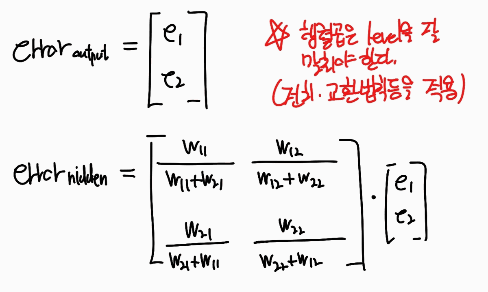

- 역전파 과정에서 분모를 만드는 것은, 에러를 전달하는 비율을 따지기 위해서이다. 그런데 잘 생각해보면, 우리는 비율을 따지기 위한것이지 크기 자체를 따지기 위한 것이 아니다.
- 그래서, 분모를 없애고 비율을 따지면 되는거 아닐까? 라는 생각을 할 수 있다. 굳이 나누기를 넣어서 계산을 늘일 필요가 없지 않을까? 라고 생각할 수 있다.
- 정확하게는 숫자가 달라지겠지만, 비율이니까 결국 크게 달라지지는 않을 것이다.  
    ⇒ 일종의 Heuristic. 모든 것을 다 계산하기에는 너무 어려우니까, 값은 조금 다르더라도 빠르게 접근하는 방법. 근거는 두되, Global하게 Optimal하지는 않을 수도 있지만 빠른 방법.

> 실제로 계산해봐도, 결과가 거의 똑같더라. 사칙연산 중에 가장 느린 것이 나누기라서 나누기를 하는게 굉장히 안좋다. 안할수록 좋음. (결과가 비슷하다는 전제 하에…)

이제, 이렇게 수식을 사용해 보자.

#### 수식 표현

- **Input**

    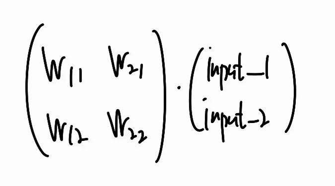

$$
X = W * I
$$

- **Back propagation**

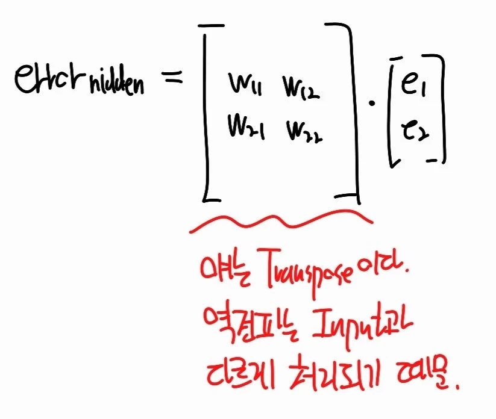

⇒ 역전파 과정에서는 가중치에 대해 Transpose가 발생한다.

> 여기까지 하면, 수식을 통해 hidden layer로 전달되는 error를 한번에 구해낼 수 있게 되었다.  
> 이제 구해낸 값을 통해서 실제로 값을 업데이트시켜보자.

#### Gradient Descent

> 이차함수 모양의 트랙에서 공을 떨어트리면, 그 공은 앞뒤로 왔다갔다 하다가 결국 최저점에 도달하게 될 것이다. (하지만, 이차함수 모양이 아닐 수도 있음.)  
>   
> 그런데 문제는, 우리가 진짜 물리적으로 옮겨줘야 하기 때문에, 얼마나 옮겨줘야 하는지 모른다는 것. 만약 너무 많이 가버리게 되면, 최저점을 찾지 못해서 Error가 발산할 수도 있다.  
> 즉, 빨리 가기 위해서 값을 많이 바꿔버리면 오히려 학습이 안될 수도 있기 때문에, 항상 Heuristic을 적용하게 된다.

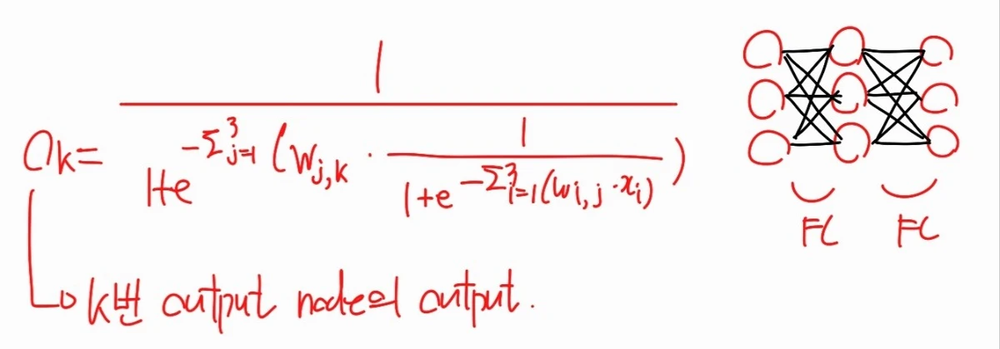

> 신경망의 학습은 가중치의 올바른 방향으로 이루어진다.  
> 올바른 변경은 올바른 방향으로 이루어져야 한다.  
> 올바른 방향은 오차(정답과 출력값의 차이)를 줄이는 방향으로 이루어 져야한다.  
> 오차를 구하기 위해서 필요한 **정답**(Target)은 주어지는 것이고, 출력값은 구해야 한다.  
> 이 오차를 다시 **역전파**시켜서 방향을 정해야 한다.

- 이런 관점에서 세 개의 노드와 세 개의 계층을 가지는 단순한 신경망의 출력값을 정확한 수식으로 살펴보자. (활성화 함수는 시그모이드 함수)

#### 그래서 어떻게 하자는 것인가?

- 학습은 가중치를 알맞게 바꾸는 과정이다. **가중치**를 바꾸는 것은 **오차**에 의해 **결정**되며, 오차를 최소화 시키는 가중치를 만들어 나가면 되는 것이다.

    - **학습**과 **추론**을 반복하다보면, 더 이상 **가중치**가 **업데이트** 되지 **않는** 순간에 도달하게 된다.
    - 이후에 **chain rule**을 사용하면, **똑같은 연산**을 **계속**하면서 **값**을 구할 수 있게 된다.

- 오차와 그래프의 관계만 잘 만들어내면 되고, **오차함수**를 가중치의 관점에서 최소화 시키는 방향을 찾아야 한다. (미분해서 학습률과 더해 빼기)

    > 오차함수 각각을 모든 가중치에 대해서 편미분하고, 각각의 값을 Chain Rule을 통해 구한다.

- 오차함수 → 가중치로 편미분 → 경사하강 → 학습률

- 컴퓨터에게 계산시키기 쉬운 방향으로 발전시켜 보자.

    - 복잡한 탐색은 하지 않겠다. ⇒ 그게 너무 오래 걸린다.

        - DFS, BFS 등의 복잡한 탐색을 하면서 원하는 값을 찾으려고 하면, 그 값을 찾는데까지 너무 오랜 시간이 걸린다. 그러므로 휴리스틱적 관점에서, 값을 조금씩 “대충” 변화시킴으로써 목적지에 점근으로 다가가는 것이다.

        - 인공지능은 인간의 사고 과정을 모방한 것.

            - 이런 방식으로 사람의 사고 과정처럼. 어떻게 보면 대충 하는 것을 휴리스틱 이라고 한다.

    - 대충해보고, 결과가 좋으면 OK. 그런데 만약 결과가 틀리다면, 다시 하면 된다.
    - 이렇게 **방향**만 맞춰놓고 다가가는 정도를 바꿔가며 찾아가는 방법을 택할 것이다.

> **경사하강법**  
>   
> 단순하게 생각해서, 현재 내가 위치한 곳에서 가장 낮은 곳으로 내려가고 싶을 때, 주변을 확인하면서 내려가는 방향으로 내려가는 방식. 내가 산 중턱에 위치할 때, 맨밑으로 내려가고자 한다면 언덕 쪽으로 가겠는가? 아니면 내리막길 쪽으로가겠는가? 당연하게도, 내리막길 쪽으로 계속해서 갈 것이다.  
>   
> 그렇게 갔을 때 더 이상 내려갈 곳이 없는 순간에 도달하면, 그곳을 최저점으로 판단하는 방식이다.

#### 경사하강법 예시

- **y = (x-1)^2 + 1**이라는 그래프가 있다고 할 때, 최저점은 (1, 1)이다.

    > 이 그래프가 의미하는 것은, 가중치가 변함에 따라 얻어지는 Loss이다.  
    > 현재는 이차원 함수이기 때문에 가중치가 하나인 상황이라고 가정해보자.  
    > ⇒ *실제로는 매우 복잡한 함수여서 변수가 매우 많을 것.*

    - 이 점에서 **최저점**을 찾는다는 것은, **Error**가 **가장 작아지는**  **가중치**를 찾는 것이다.

    - 그런데 실제로는 우리가 이 식을 알아내기는 어렵고, 최저점으로 조금씩 더듬더듬 찾아나가야 하는 것이다.

        - 현재 식은 쉽기 때문에 미분해서 0이 되는 지점을 찾을 수 있지만, 실제 학습 과정에서는 거의 불가능하다. 하지만, 미분이 불가능한 것은 아니라서, 특정 지점에서의 기울기는 구할 수 있다.

    - 이런 방식으로 **기울기**가 **0**이 되는 부분까지 나아간다.

    - 이때, 기울기에 따라서 가중치를 변화시키는 정도는 우리가 비율로 지정해 주어야 한다.

        > 가중치의 값을 변화시키는 정도는 지금도 연구되고 있는 부분임.   
        > 하지만 최근에는 이런거는 이 분야보다는, 모델 자체를 새롭게 만드는 추세이기는 함.

    - 우리가 특정 지점에서 구한 기울기의 절댓값이 크다는 것은, 최저점으로 가기 위해서는 값을 많이 이동시켜야 한다는 것으로 생각할 수 있다.

        > 최저점을 찾는다면, 최저점은 기울기가 완만하게 감소하는 부분일 것이다. 그렇기 때문에 기울기의 절댓값이 크다는 것은 가중치를 많이 변화시켜야 한다는 것으로 생각할 수 있다. ⇒ 이것도 **휴리스틱**하게 생각할 수 있는 부분이다. (**경험적, 추론적 근거**)

- 그런데 만약 **오차함수**가 **삼차원**이라고 해보자. 이때는 **여러 개**의 **낮은 지점**이 **존재**할 수 있다.

    - 오차함수가 삼차원이기 때문에, 가중치는 두 개가 존재할 것이다.
    - 따라서 **두 변수가 모두 내려가는 지점**이 최적의 방향이다.

    - 변수가 여러 개일 때는, 일단 하나씩만 정해서 구해보면 된다.

        - 모양을 그리지 못하는 100차의 그래프가 있어도, 이 방법은 적용이 가능하다.

> 이런 방식으로 어떤 그래프에서도 Error가 최소가 되는 지점을 찾아갈 수 있다. 그런데, **지역적 극소점**(Local Minimum)은 오차함수 상에서 여러 지점에 위치할 수 있으므로, 몇 번 찾아봤을 때 그 지점이 최저점이었다면, 그냥 거기가 최저점이라고 믿는 것이다.

- **최저점**과 **극소점** (Global Minimum, Local Minimum)

    - 계산하다 보면, **최저점**이 아닌 **극소점**을 만나게 될 수도 있다.

        - **최저점** : Global Minimum
        - **극소점** : Local Minimum

#### 오차함수의 정의

> 이전에는 **오차함수**를 <strong>(목표값-실제값)</strong>으로 구현했었다.   
> 이렇게만 하면 우연하게 결과가 0이 나올 수도 있다.  
> ⇒ 어떻게 해야 할까? 오차함수를 바꿔보자.

- 오차 함수를 단순히 (목표값-실제값)으로 설정하면, 오차의 합이 0이 되어서 가중치가 업데이트 되지 않는 경우가 발생할 수 있다는 문제가 있다. 그러므로, 오차의 부호를 제거하고 오차의 크기만 남기도록 해보자. 

- **|목표값-실제값|**  
    ⇒ 왜? 단순하게 빼버리면 오차가 양수가 될 수도 있고, 음수가 될 수도 있다. 

    - 미분불가능해지기 때문에 역전파가 안돼서 X

- **(목표값-실제값)^2**

    - 제곱을 사용하는 이유는? : 이전에 (목표값-실제값)에서 생기는 문제를 없애고자 절댓값을 취하고자 했고, 그렇게 했을 때 미분 불가능 해지는 문제가 발생하기 때문에 제곱으로 미분이 가능하도록 만든다.

        ⇒ N 평균제곱오차, 2 평균제곱오차, 교차엔트로피 오차 등등 기본적인 방법만으로도 무수히 많은게 있다.

참고로 **제곱오차**보다는 **평균제곱오차**를 쓰고, 오차가 커질때 값이 커서인지, 개수가 많아서인지 구분 못하므로, 평균으로 N을 쓰지 않고 2를 보통 쓴다.

> 이렇게 오차함수를 정의한 것은, 이것이 “**가중치**”에 얼마나 영향을 받는가 하는 것을 알기 위함이다. 수학적으로 쉽게 접근할 수 있도록 식을 구성해보자.

- **Error**가 **적어지는 방향**의 **가중치**를 찾는 것도 알았고, 그것이 **미분값**이니까 **변화량**이다.

    - 그러면 **변화량**을 어떻게 적용해줘야 지점을 찾아갈 수 있을까?

- **Error**를 **w**에 대해서 **변화량**을 구하며, 절대치가 줄어드는 방향으로 구한다.

$$
E = \Sigma_{n}(t_{n}-o_{n})^{2}
$$

⇒ *타겟값에서 실제값을 빼고 제곱한다.*

**제곱오차**를 이용한 수식이다. 여기에 보통 평균을 적용해서 **N**(Example의 개수)을 나누거나, 혹은 너무 숫자가 작아지는 것을 방지하기 위해 단순하게 나눈 수식을 사용하기도 한다. (2가 일반적)

⇒ *(또한, 원래는 Bias b가 있지만, 여기서는 개념적으로 접근하고자 b를 뺀다.)*

⇒ (여기서 원래대로 앞에 계수 1/2를 곱해도 나중에 미분하면 어차피 1이 된다. 하지만 수식 이해를 위해 상수는 뺀다.)

#### 오차함수의 편미분

> 오차함수를 <strong>W(j,k)</strong>에 대해 편미분한다. 오차는 최종적인 결과이고, 그 결과가 각 가중치에 영향을 미치는지 보자는 것이다.

$$
\frac{\partial E}{\partial W_{jk}} = \frac{\partial \Sigma(t_{n} - o_{n})^2}{\partial W_{jk}}
$$

그런데 이것은, 아래와 같이 표현해도 된다.

---

$$
\frac{\partial E}{\partial W_{jk}} = \frac{\partial (t_{k} - o_{k})^2}{\partial W_{jk}}
$$

⇒ 위의 식에서 **Sigma**를 빼줬다. 그 이유를 생각해보자.  

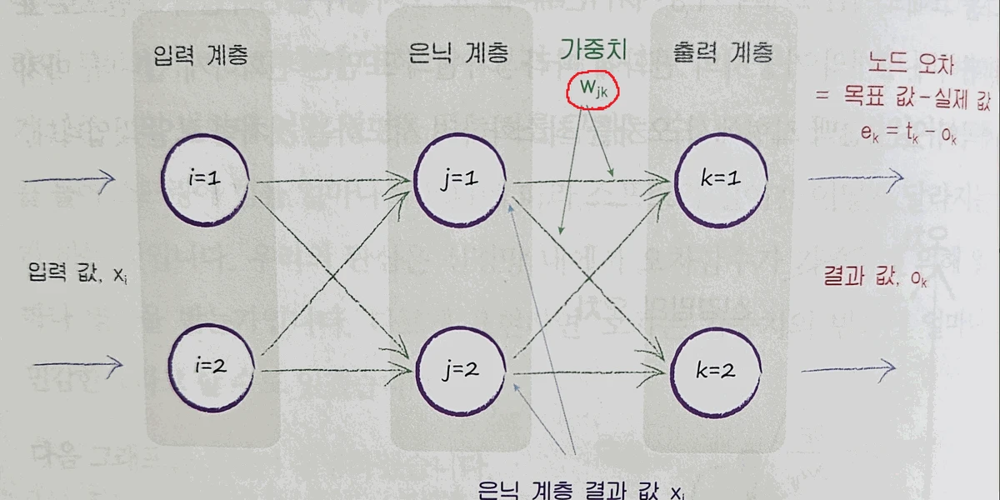

> 예를 들어 W(j,k)가 가중치를 전달하는 노드가 Output Layer의 첫 번째 노드라고 한다면, 이 가중치에 영향을 받는 것은 오직 노드 Ok 뿐이다. 따라서 Output Layer의 첫 번째 노드로 가중치를 전달하고 있는, “이 가중치”로 편미분을 한다고 하면, 실제로 영향을 받는 것은 오직 현재의 **W(j,k)** 항을 가지고 있는 것들 뿐이므로, 나머지는 제거해도 된다.  
>   
> 예를 들어보자. <strong>W(j=1, k=1)</strong>이라고 해보자. 그렇다면 이 가중치는 Hidden Layer의 첫 번째 노드에서 Output Layer의 첫 번째 노드로 전달되는 가중치에 대해서만 편미분 하는 것이므로, 미분할 때 다른 **오차함수**에서 <strong>W(j=1, k=1)</strong>을 제외한 다른 항들은 모두 제거할 수 있다.

---

$$
\frac{\partial E}{\partial W_{jk}} = \frac{\partial E}{\partial o_{k}} * \frac{\partial o_{k}}{\partial W_{jk}}
$$

⇒ 우리는 <strong>W(j,k)</strong>가 변함에 따라 오차함수가 얼마나 변하는지를 알아내고자 한다. 그러므로 위와 같이 미분하는데, **chain rule**을 사용하여 식을 위와 같이 변환할 수 있다.

---

$$
\frac{\partial E}{\partial W_{jk}} = -2*(t_{k} - o_{k}) * \frac{\partial o_{k}}{\partial W_{jk}}
$$

⇒ 이때, **ok**는 앞단의 **sigmoid summation**과 같다. (즉, Layer 1의 출력값) 부호로 -가 붙은 것은 합성 함수 미분을 한 번 해준 것이기 때문이다.

---

$$
\frac{\partial E}{\partial W_{jk}} = -2*(t_{k} - o_{k}) * \frac{\partial sigmoid(\Sigma_{j}W_{jk}o_{j})}{\partial W_{jk}}
$$

⇒ **sigmoid**를 미분하면 <strong>a(1-a)</strong>가 되므로, 이 값을 활용한다.

---

$$
\frac{\partial E}{\partial W_{jk}} = \\-2*(t_{k} - o_{k}) * sigmoid(\Sigma_{j}W_{jk}o_{j})(1-sigmoid(\Sigma_{j}W_{jk}o_{j}))*\frac{\partial \Sigma_{j} W_{jk}o_{j}}{\partial W_{jk}}
$$

⇒ 마지막 값의 미분은 **Oj**가 나온다. **Oj**가 남는 이유는, **Oj**가 앞단에서 넘어오는 값인데, 결국 **Summation**이니까 미분하면 <strong>W(j,k)</strong>는 다 사라지고 **Oj**만 남기 때문이다.  
  
(가중치 행렬은 첫번째 노드로 들어가는 가중치들을 행벡터로 넣고, 그걸 열로 나열한 형태이다…   
왜냐면, 그렇게 해야만 형태가 맞음.)

---

$$
\frac{\partial E}{\partial W_{jk}} = -2*(t_{k} - o_{k}) * sigmoid(\Sigma_{j}W_{jk}o_{j})(1-sigmoid(\Sigma_{j}W_{jk}o_{j}))*o_{j}
$$

⇒ 임특강이랑 다른 것은 **Loss Function**이 다른 것이다. 임특강에서는 **Cross Entropy**를 사용했음.

---

그런데, output layer 이전에는 **Error**가 없다. 그래서 오차의 역전파를 가중치 값에 따라 비율을 나눠 전해주었다. 그걸 통해서 각 layer의 node에 대해 오차의 비율을 기록해 두고, 이후에 역전파를 통해 구해낼 수 있다.

- 마지막으로, 각 노드에 대해서 구해낸 가중치는 **학습률**과 곱해서 빼주면 된다.

$$
w_{jk} = w_{jk} - \alpha \frac{\partial E}{\partial w_{jk}}
$$
