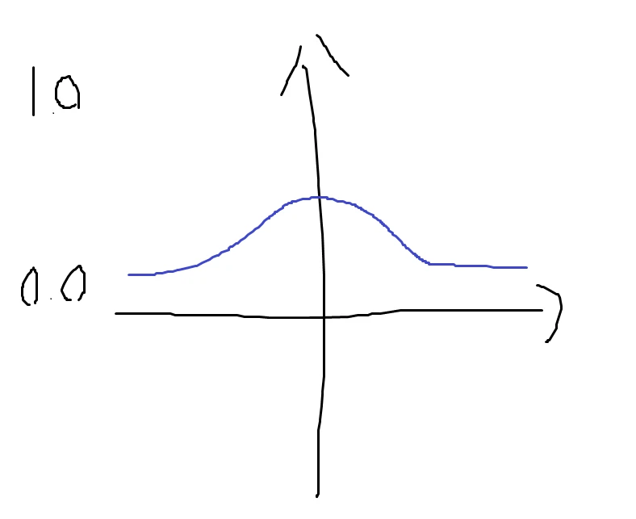
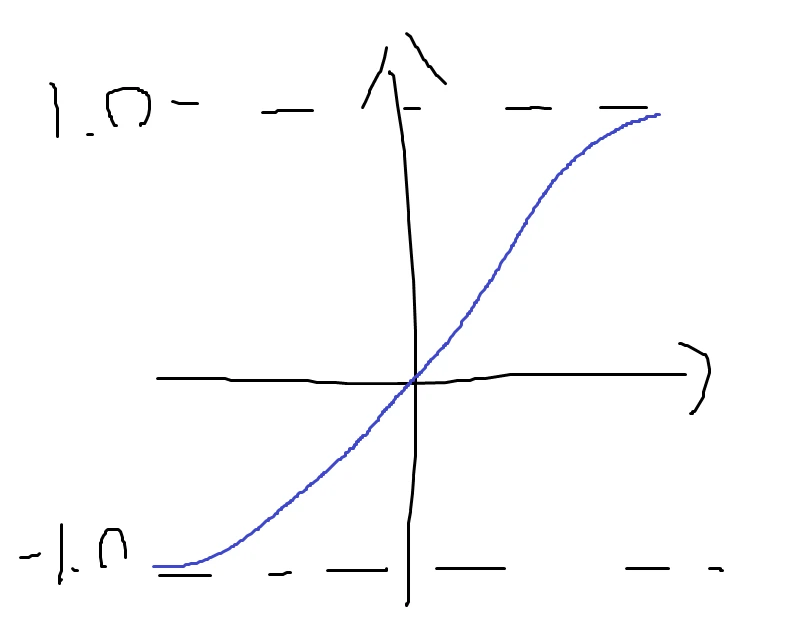
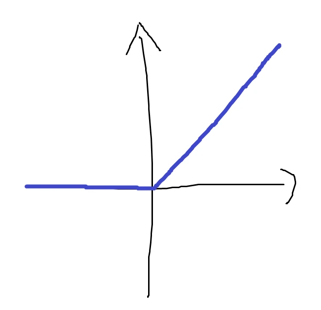
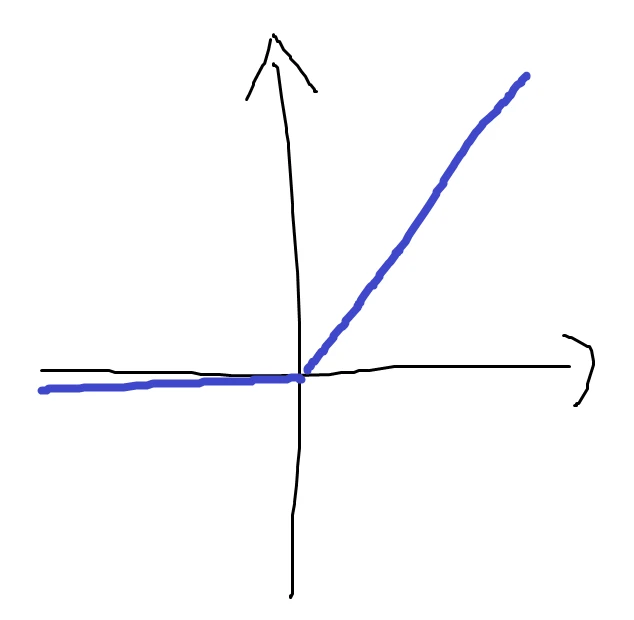
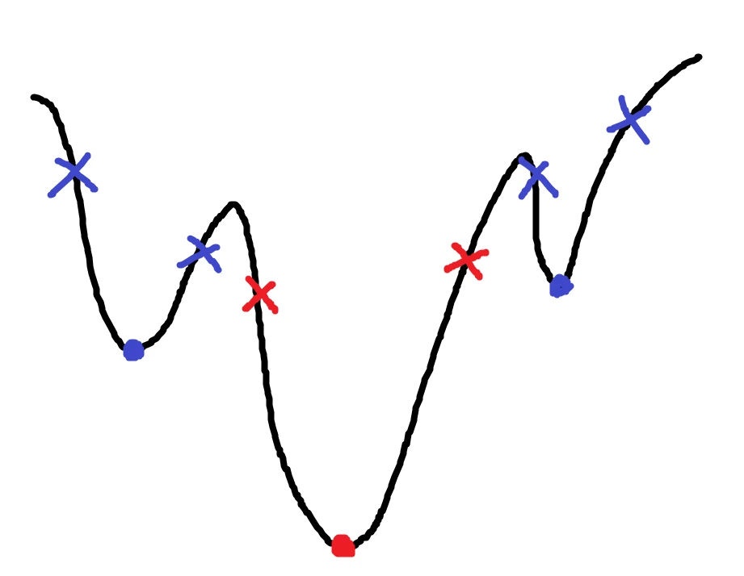
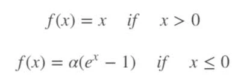
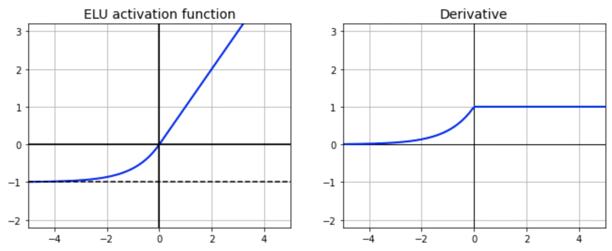

# 인공지능 - 신경망

작성일 2023-10-31 · 최종 수정일 2024-11-10
{ .post-date }

> 현재 인공지능의 방향은 Multi Modal로 나아가고 있다. (Winner Takes All)  
> 발전의 방향이 너무 빠르고 따라가기 힘든데, 이것은 중요 부분이 가려져 있기 때문이다.  
> 그러나 미래에는 이러한 것들이 모두 오픈될 것이다.  
>   
> 우리가 기성 세대가 될 때 쯤에는, 종합 인공지능이 만들어질 것이다.  
> 또한 30년 뒤 쯤, 우리가 은퇴할 때 쯤 되면 양자 컴퓨팅이 제대로 상용화가 될 것이다.  

---

- Layer와 Node의 개수가 많아지면 어떻게 될 것인가?

> 현재 OpenAI는 300B의 가중치를 다루고 있다. PC에서는 보통 7B, 13B까지밖에 다루지 못하고, A100 정도는 되어야 300B를 다룰 수 있다.

그런데, Weight의 개수가 많다고 해서 항상 좋은 값이 나오지는 않는다. 학습 과정에서 올바른 값을 갖도록 학습이 되어야 하기 때문이다. 이 값을 얼마나 많이 만들 것이냐? 초깃값을 어떻게 설정할 것이냐? 얼마나 반복하면서 안정화시킬 것이냐? 이런 것들을 결정하는 것은 쉬운 일이 아니다.

현재까지 우리는 Activation Function으로 Sigmoid를 사용했는데, 실제 모델에서는 Hidden Layer에서 Sigmoid를 Activation으로 사용하지는 않는다. 그 이유에 대해서 살펴본다.

- 가중치의 초깃값, 활성함수의 개선에 집중해서 살펴본다.

---

## &lt;심층 신경망이 부딪힌 한계 - Gradient Vanishing&gt;

- 다층 퍼셉트론의 학습이 가능해지고 나서, 사람들은 층을 깊이 쌓기만 하면 복잡한 기능을 할 수 있는 신경망 모델을 만들어낼 수 있을 것으로 기대하였다.

- 하지만, 층을 깊이 쌓을수록 신경망은 더 정교한 기능을 하는 것이 아니라, 학습을 하지 못하는 모델이 되어 버린다.

    - 즉, 기울기(Gradient)가 사라진다는 의미이다. (업데이트가 되지 않는다는 의미)

- **Vanishing Gradient**
- **Exploding Gradient**

⇒ Exploding Gradient는 RNN에서 많이 나타남.

### Vanishing Gradient의 해결법

- **Xavier Initialization**

> 기울기가 사라지는 원인은 활성화 함수/초기화 방법이라고 제시함.

### 1) Activation Function의 교체

Sigmoid를 미분하면, 값이 아무리 커봐야 최대가 0.2이고, 이후에는 급격하게 0에 수렴한다. 따라서, Sigmoid를 활성화 함수로 사용하면 Activation의 미분이 0이 될 가능성이 아주 높다는 것이다. 따라서, Layer가 깊어질수록 Activation(Sigmoid)의 Gradient가 많이 곱해지게 되므로, Weight의 Gradient와 bias의 Gradient가 0이 될 가능성이 높아진다는 것이다.

심층 신경망이 돼서 가중치가 많아졌고, 이러한 신경망을 잘 학습시키기 위해서는 Iteration을 많이 돌려야 한다. 하지만 Sigmoid를 사용하면, **Gradient Vanishing**이 발생하기 때문에 신경망이 학습되지 못한다는 것이다.

> 따라서, Sigmoid의 미분값이 위와 같이 나오기 때문에 미분값이 수렴하지 않는 활성화 함수를 찾아야 하며, 미분값이 너무 작지 않아야 한다는 것이다.

- **Alternative**

    - tanh

    

    Sigmoid보다 개선이 되기는 하지만, 극한으로 가면 미분값은 결국 0에 수렴하게 되므로, 완전한 개선은 불가능하다는 단점이 존재한다. ⇒ Gradient Vanishing이 사라지긴 하지만, 완전하게 없애는 것은 불가능하다.

    - ReLU(Rectified + Linear Unit : 고르게 하고 + 직선으로 처리한다)

    $$
    ReLU(z) = max(z, 0)
    $$

    

    이제 미분값의 수렴성을 없애기 위하여, ReLU라는 Activation Function을 도입한다.

    ReLU는 0보다 작거나 같으면 미분값을 0으로 만들고, 양수이면 미분값이 양수가 된다. 이렇게 하면 입력값이 아무리 커도 값이 수렴되지는 않는다.

    그러나, 가중치 초기값이 0이면 활성화 값이 0이 되어, 해당 노드는 활성화 되지 않는다. 또한, 초기 가중치가 음수였을 경우도 역시 0이 되어서 활성화가 되지 않는다.

    (그런데 실제로 대부분의 은닉층 노드는 0보다 크므로 거의 문제는 없다.)

    그래도 일단, 이론적으로는 문제가 되기는 하니까 이 문제를 해결하고자 한다.

    - Leaky ReLU

    $$
    ReLU(z) = max(z, 0.1z)
    $$

    

    이와 같이 음수 영역에서 아주 작은 기울기로 만들어서, Gradient가 0이 되지는 않도록 한다.

    하지만, 이렇게 하면 조건이 복잡해지고 계산이 복잡해지기 때문에, 실제로는 Leaky ReLU가 아닌, ReLU를 주로 사용한다.

### 2) Weight Initialization Method의 교체

- 초깃값이 잘못 설정된다면, 활성화 함수에 의해 Activation이 매우 작아져서 Gradient가 작아질 수도 있다.
- 따라서 초깃값을 잘 설정해야 한다.

> 일반적으로 사용되는 균일분포의 난수를 이용하여 연결강도를 정규화할 경우 각 계층의 노드 수가 달라지면 입력에서 출력으로 가는 순전파 신호와 출력에서 입력으로 내려오는 오차 역전파 신호의 분산이 왜곡되어 전달되므로 사라지는 경사 혹은 폭발하는 경사 문제가 발생함을 논문에서 나타내었다.

⇒ 이 문제를 피하기 위한 직접적인 해결책은 각 Hidden Layer의 노드 개수가 동일한 것이다. 하지만 모델 구조 상, 이것이 불가능할 수도 있기 때문에 대책을 찾아야 한다.

Global Minimum이 붉은색 점으로 표현되고, Local Minimum이 파란색 점으로 표현된다고 해보자. 

이러한 경우에서 만약 파란색 X 점에서 학습을 시작하면, Local Minimum으로 가게 된다. 반면, 빨간색 X 점에서 학습을 시작하면, Global Minimum으로 가게 된다.

> 그래서, 지금까지의 문제점은 Hidden Layer의 노드 개수가 모두 같으면 괜찮지만 다르면 문제가 되더라. 라는 것이다.

- **Xavier Initialization**

$$
u[-\frac{\sqrt{6}}{\sqrt{fan_{in} + fan_{out}}}, \frac{\sqrt{6}}{\sqrt{fan_{in} + fan_{out}}}]
$$

이와 같은 Uniform Distribution으로 Parameter를 Initialize하면 문제가 해결 되더라. 시그모이드 함수나 하이퍼볼릭탄젠트 함수를 사용할 때는 Xavier 초기화가 효율적이다.

- **LeCun Initialization**

$$
\sigma = \frac{1}{\sqrt{fan_{in}}}
$$

표준편차를 위와 같이 설정하는 방식. (Normal Distribution, Gauss Distribution) Xavier의 다른 방법으로 사용된다. 계산이 간단하다는 장점이 있다.

- **He Initialization**

Xavier와 LeCun의 장점을 종합적으로 사용하여 문제를 해결한 경우이다.

$$
\sigma = \frac{\sqrt{2}}{\sqrt{fan_{in}}}
$$

ReLU 계열에서 잘 사용된다.

- **RBM**(Restricted Boltzmann Machine)

입력값을 넣었을 때, 입력값이 그대로 Output으로 나오도록 하는 것이 Boltzmann Machine인데, 이걸 활용한 초기화 방식이 RBM이다. (Autoencoder/Decoder와 유사한 방식이다.)

ReLU는 다양한 Family들이 존재한다.

- **ELU**

음수 부분에서 값이, 점차 내가 정한 상수값(alpha)으로 수렴하게 되는 방식의 ReLU

> 그런데 생각보다 ReLU에서 문제가 생기지 않기 때문에, 대부분 ReLU를 사용한다.  
> 왜냐면, ReLU는 계산이 적어서 빠르다는 장점이 있는데, 그 외의 것들을 사용하면 Overhead가 매우 커져서 계산이 너무 오래걸린다는 단점이 존재한다.
