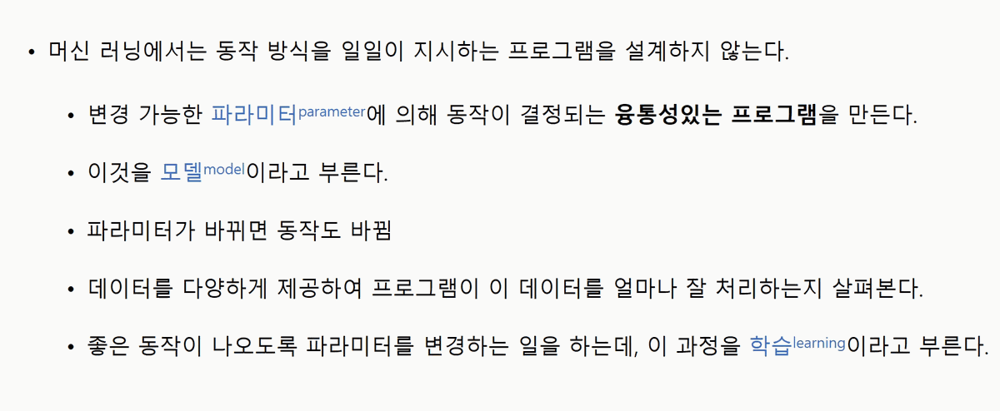
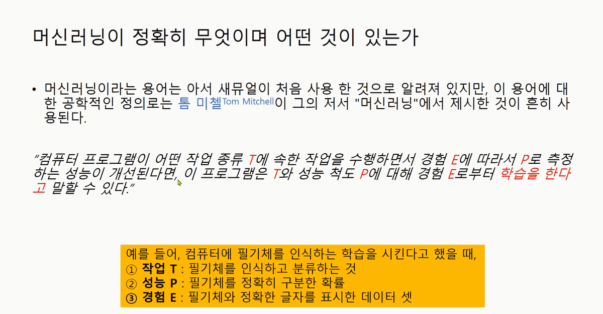
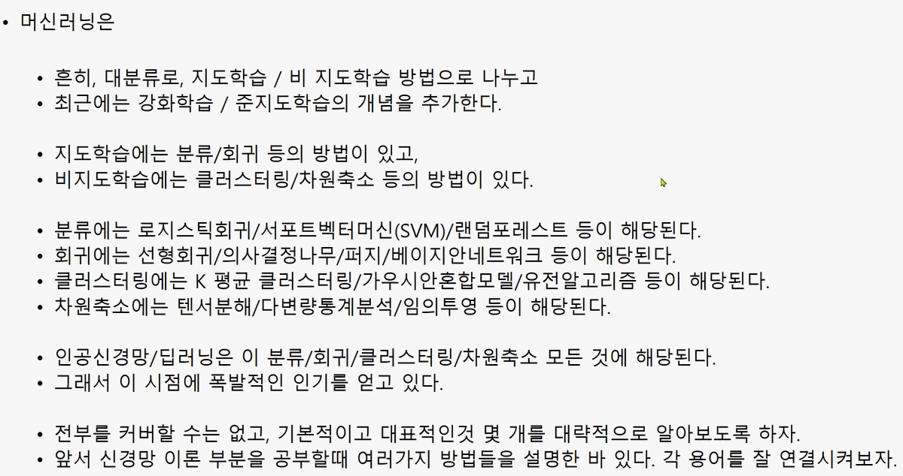
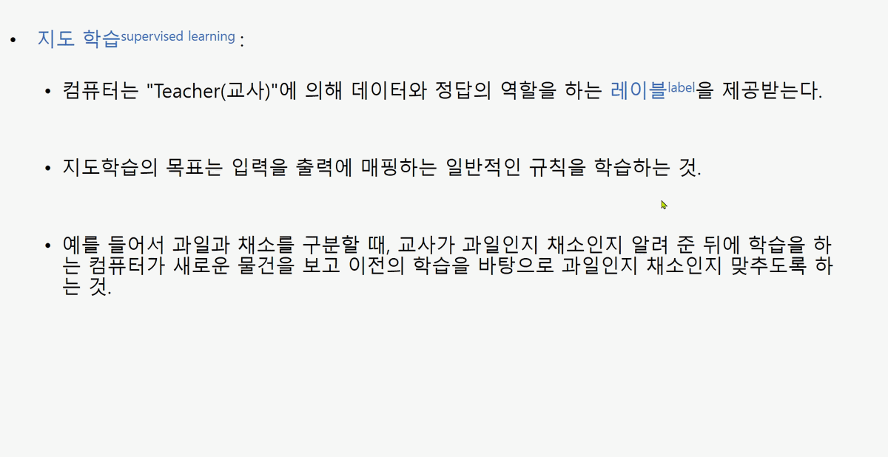
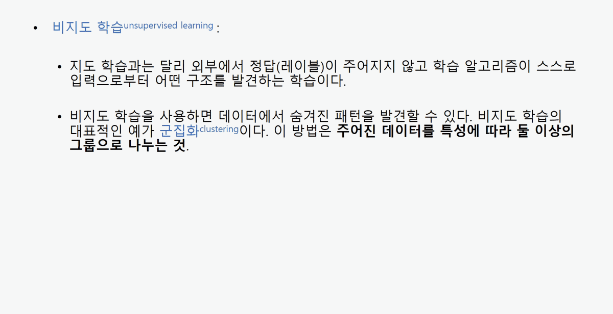
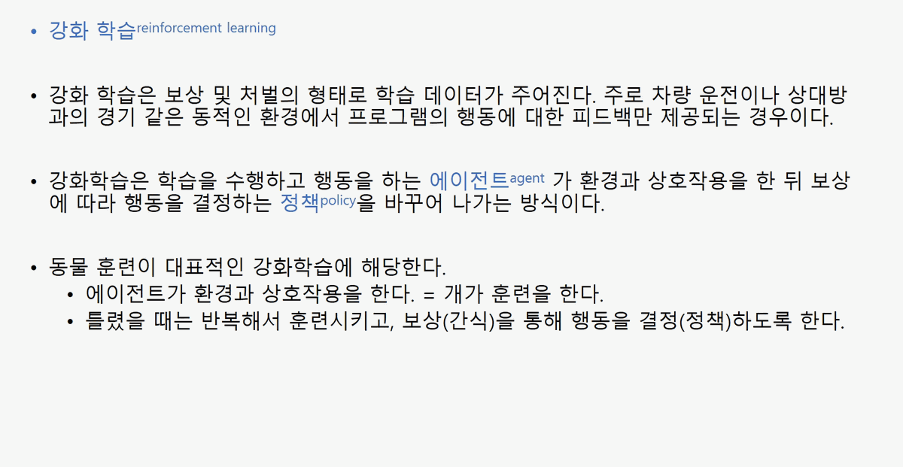
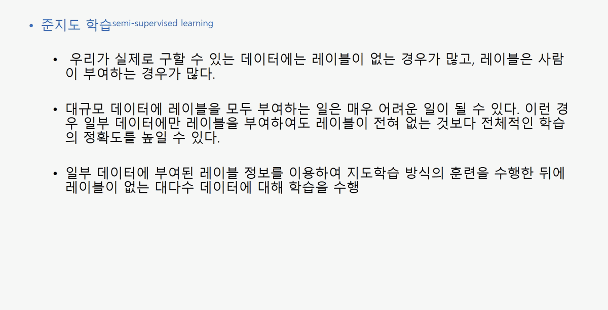
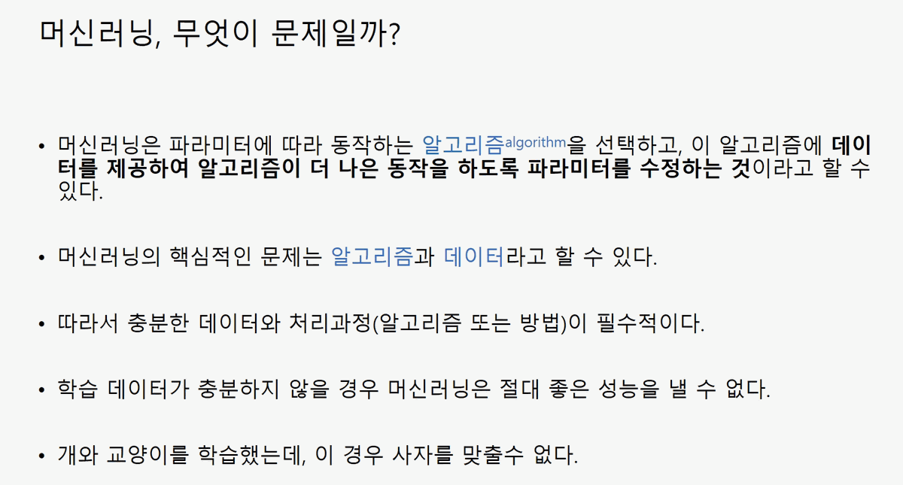
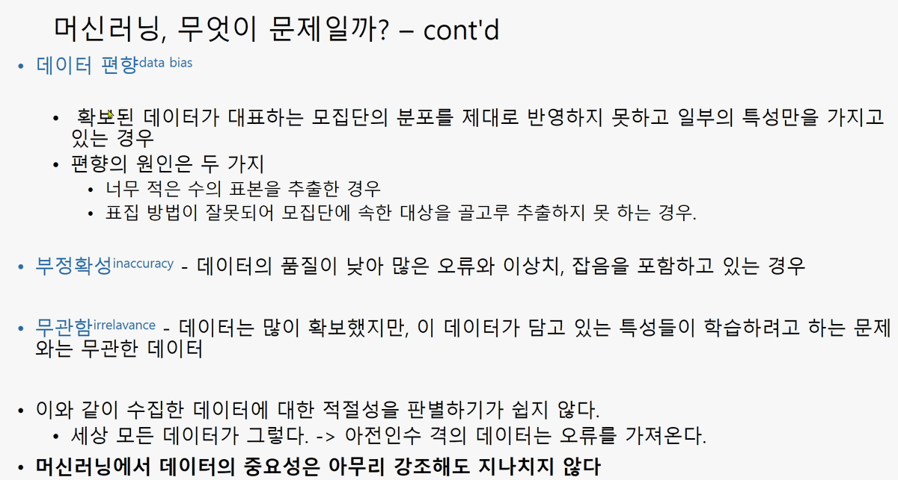

# 머신러닝이란?

## &lt;머신러닝이란?&gt;

- 문제를 해결하는 일반적인 방법을 제시하고, Parameter를 바꿔가면서 좋은 동작이 나오도록 학습시킨다. 이 프로그램을 Model이라고 한다.

- 컴퓨터 프로그램이 어떤 작업 T를 수행하면서 쌓인 경험 E에 따라서 성능이 P로 개선된다면, 이 프로그램은 T와 성능 척도 P에 대해 경험 E로부터 학습한다고 말할 수 있다.

### 머신러닝의 분류

- 머신러닝은 크게 지도학습/비지도학습으로 나뉜다.
- 최근에는 강화학습/준지도학습의 개념이 추가되었다.
- 분류
- 회귀
- 클러스터링
- 차원축소

### 지도학습

- 정답(Label)이 주어질 때, 입력을 출력에 매핑하는 일반적인 규칙을 학습하는 것

### 비지도학습

- 비지도학습의 대표적인 방법은 클러스터링이며, 주어진 데이터를 특성에 따라 둘 이상의 그룹으로 나누는 것이다.

### 강화학습

- 어떠한 행동을 하는 Agent에게 보상/처벌을 주면서 바람직한 행동을 하는 행동을 결정하는 Policy를 찾아가는 과정이다.

### 준지도학습

- 우리가 실제로 구할 수 있는 데이터에는 레이블이 없는 경우가 많고, 레이블은 사람이 부여하는 경우가 많다.
- 그리고 대규모 데이터에 레이블을 모두 부여하는 것이 사실 어려운 경우가 많으며, 일부 데이터에만 레이블을 부여하여도 레이블이 전혀 없는 것보다 전체적인 학습의 정확도를 높일 수 있다.
- 따라서 일부 데이터에 부여된 레이블 정보를 이용하여 지도학습 방식의 훈련을 수행한 뒤에 레이블이 없는 대다수 데이터에 대해 학습을 수행한다.

### 머신러닝에서의 문제점

- 머신러닝이란, 파라미터에 따라 동작하는 알고리즘을 선택하고, 알고리즘에 데이터를 제공하여 알고리즘이 더 나은 동작을 하도록 파라미터를 수정하는 과정이다.

- 그런데 만약 데이터가 잘못됐거나 부족하다면, 아무리 알고리즘이 올바르다고 하더라도 학습이 올바르게 진행되지 않을 수 있다.
