# 머신러닝 : 지도학습(회귀모델)

작성일 2023-12-09
{ .post-date }

## &lt;지도학습 : 회귀모델&gt;

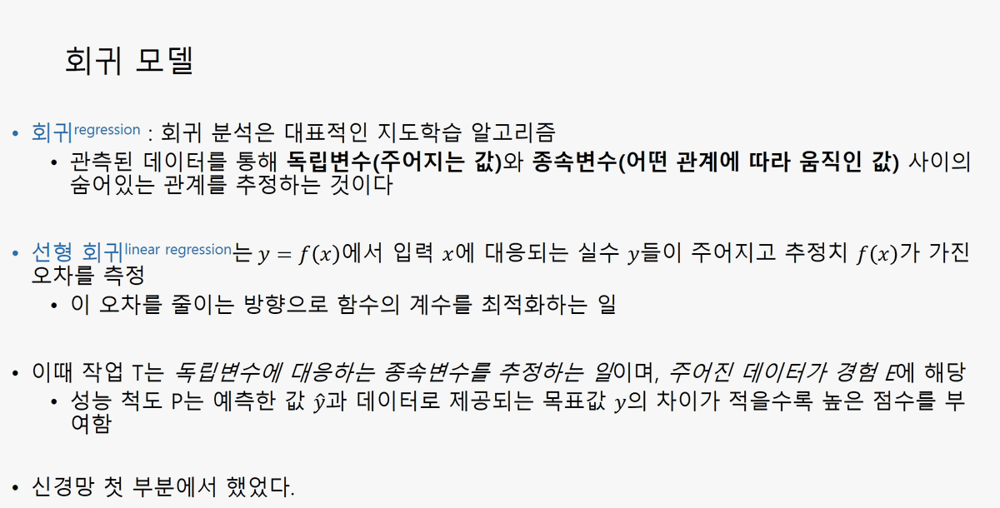

- **회귀** : 관측된 데이터를 통해 **독립변수**(주어지는 값)와 **종속변수**(어떤 관계에 따라 움직인 값) 사이의 숨어있는 관계를 추정하는 것이다.
- **선형 회귀** : y = f(x)와 같이 변수 간의 관계를 선형적으로 표현하는 것이다.

> 이때 작업 T는 독립변수에 대응하는 종속변수를 추정하는 일이다. 주어진 데이터가 경험 E에 해당하는 것이고, 성능 척도 P는 예측한 값 y(hat)과 데이터로 제공되는 목표값 y의 차이가 적을수록 높은 점수를 부여한다.

⇒ 이전까지 다뤘던 신경망 지도학습 내용과 동일하다.

### 가설과 오차

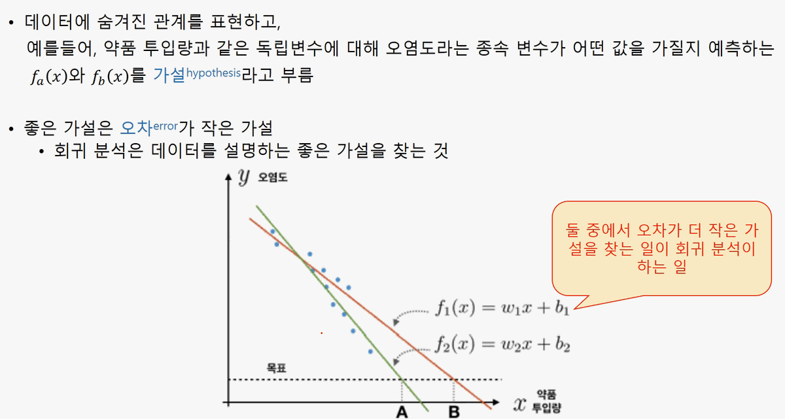

- 독립변수와 종속변수 간의 관계를 예측하는 것을 **가설**이라고 한다.
- 더 좋은 오차를 보이는 가설이 좋은 **가설**이다.
- 일반적인 회귀 분석은 데이터를 설명하는 좋은 가설을 찾는 것이고, 더 좋은 가설을 찾아나가는 과정이 바로 학습이다.

### Label

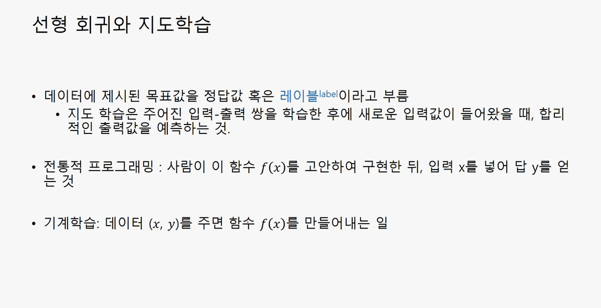

- 레이블 : 데이터 각각에 제시된 목표값 혹은 정답
- 전통적인 프로그래밍 : 함수 f(x)에 x를 넣으면 출력값 y를 얻는 것이다.
- 기계학습 : 데이터 (x, y)를 주면 함수 f(x)를 만들어 내는 일이다.

### 회귀

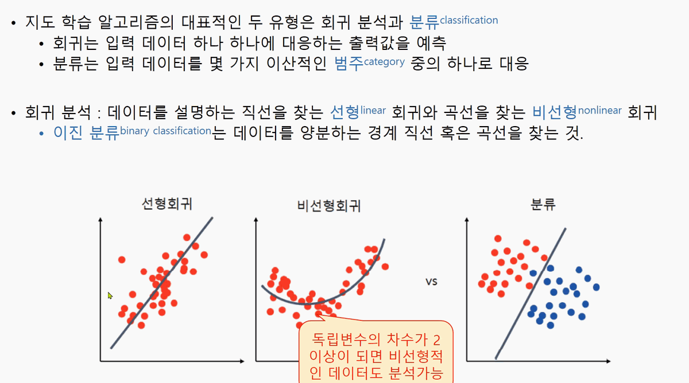

- **회귀** : 입력 데이터를 정해진 출력 값으로 대응하는 관계를 찾아내는 과정
- **분류** :  입력 데이터를 몇 가지 이산적인 범주 중의 하나로 대응하는 과정

- **회귀 분석** : 데이터를 설명하는 직선을 찾는 선형 회귀와 곡선을 찾는 비선형 회귀로 나뉜다.

    - 그 중에서도 **이진 분류**는 데이터를 양분하는 경계 직선 혹은 곡선을 찾는 것이다.

### 특징(Feature)

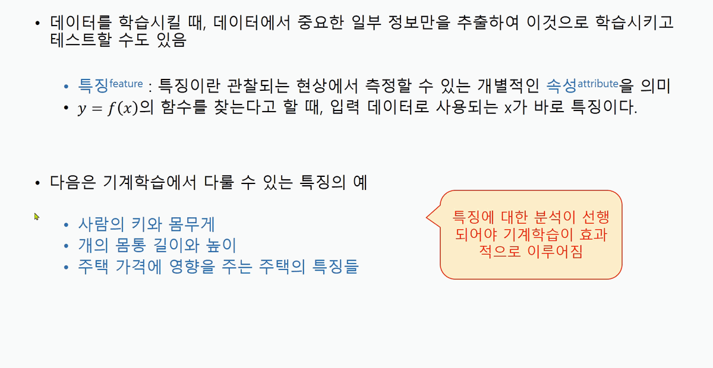

- 기계학습 과정에서 y = f(x)라는 가설을 학습하고자 할 때, x를 **특성**(Feature)이라고 한다.

### 좋은 가설과 모델의 오차란?

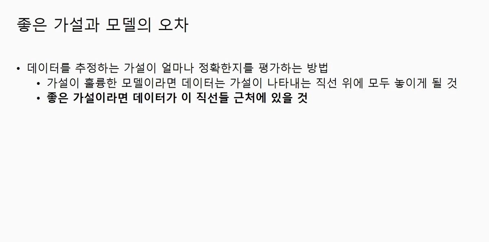

- 좋은 가설이라면 회귀 분석에서 데이터가 y = f(x) 가설(직선) 근처에 위치한다.

### MSE란?

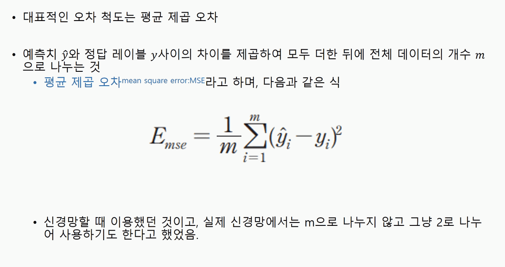

- 오차의 정도를 수치적으로 나타내는 방법에는 다양한 방법이 존재한다.
- 대표적인 것이 평균 제곱 오차(Mean Squared Error)라고 한다.

### MSE가 오차를 제곱하는 이유

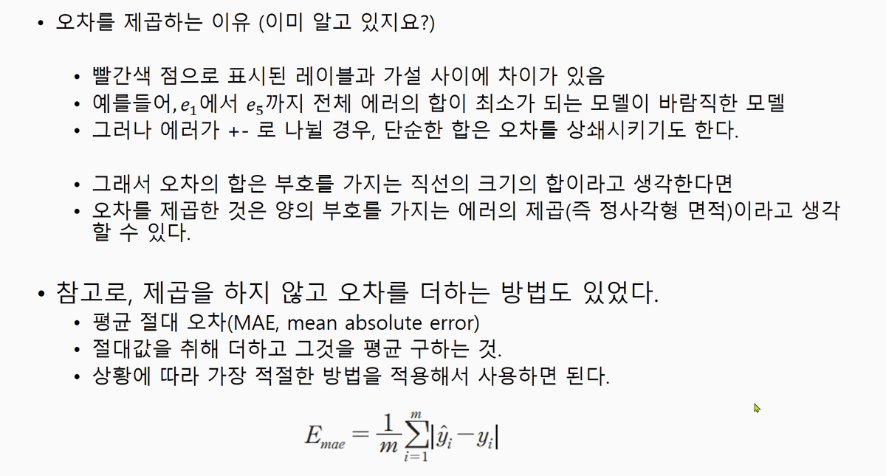

- 오차를 제곱하는 이유

    - 오차가 부호를 가지면, 각 오차들이 서로 상쇄되어 실제로 오차가 0이 아님에도 0으로 나타날 수 있다. ⇒ 이러면 학습이 불가능하다.
    - 그래서 부호를 제거하고자 절댓값을 씌우기만 하면, 미분 불가능한 지점이 생겨 Gradient를 구하지 못할 수도 있다.
    - 따라서 제곱합을 이용한다.

    ⇒ 따라서 오차를 제곱한 것은 양의 부호를 가지는 에러의 제곱이자, 정사각형의 면적이다.

### 오차의 의미

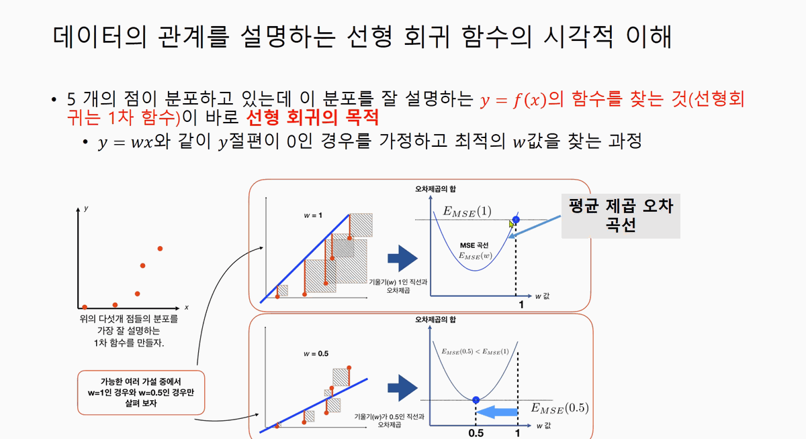

- 위의 다섯 개 점들의 분포를 가장 잘 설명하는 일차 함수 가설을 찾고자 한다.
- y = wx라고 한다면, 오차는 위와 같이 정사각형 면적들의 합이 될 것이다.
- 만약 w가 1이라면, 오차는 E_MSE(1)로 표현될 수 있다.

- 그런데 만약 w가 0.5라면, 오차는 더 작은 값을 갖는 E_MSE(0.5)로 표현될 수 있다.

    ⇒ 이것이 선형 회귀이다.

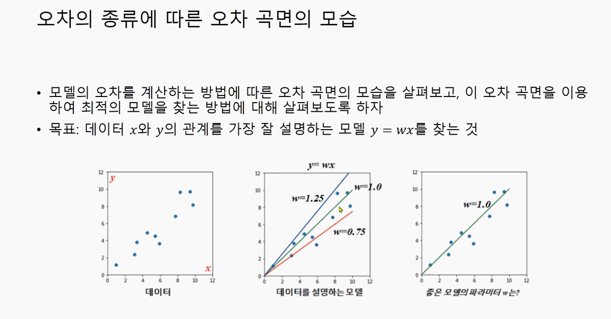

⇒ 즉 우리가 선형 회귀에서 하고자 하는 것은, 가장 오차가 작은 선형 가설을 찾아내는 것이다.

### 단순 오차

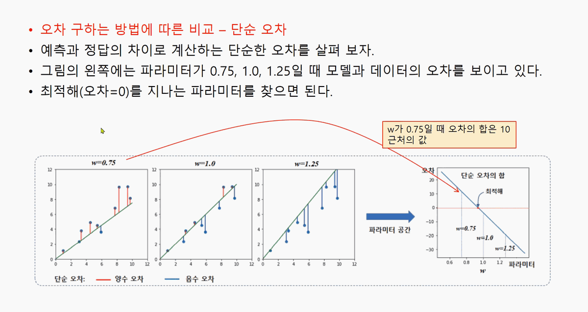

- w에 따라 오차를 이차원 평면 상에서 표현하고, 이걸 오차를 구하는 공식에 따라 w와 매핑하여 w/Error를 이차원평면상에서 parameter에 매핑하여 나타낼 수 있다. (**그것이 우측의 그래프이며, 파라미터 공간을 나타낸 것**)

### 평균 절대 오차 (MAE)

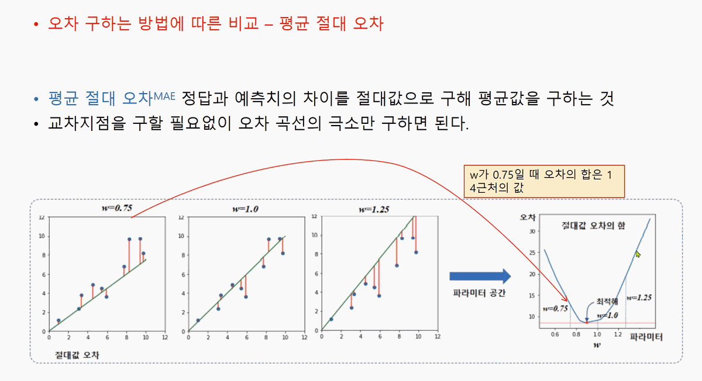

- MAE는 정답과 예측치의 차이를 절댓값으로 나타낸 것이다.
- 여기서 오차 함수가 최소가 되도록 극소점을 찾아가면 된다.

### 평균 제곱 오차 (MSE)

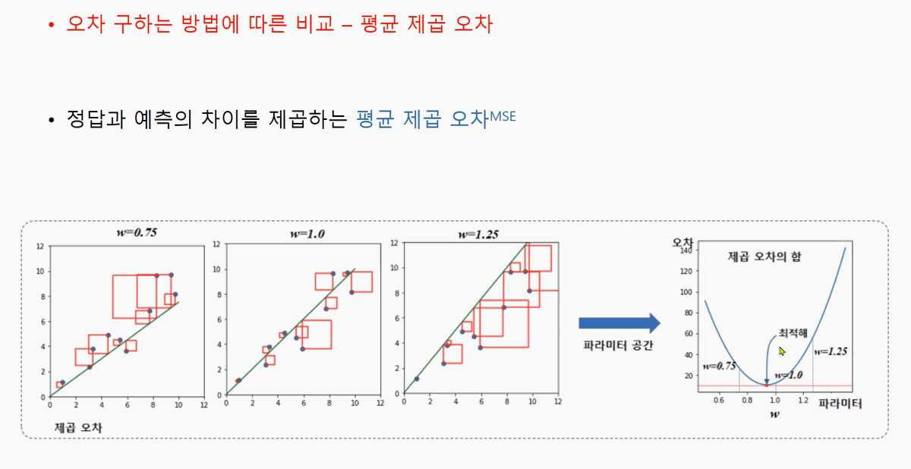

- MSE도 MAE와 마찬가지로 parameter에 따른 오차를 얻어내고, 이것에 매칭되는 오차함수의 극소점을 찾아가면 된다.

### 최소 제곱법(Least Squares Approximation)

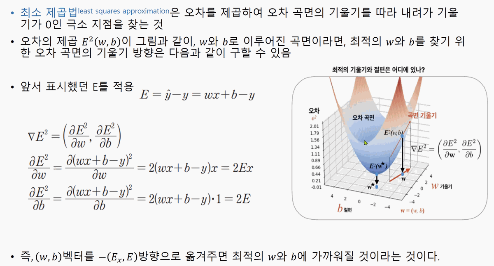

- 오차를 제곱하여 오차 곡면의 기울기를 따라 내려가면서 기울기가 0인 극소 지점을 찾아내는 방법이다. (*Gradient Descent에 해당하는 것으로 보인다.*)

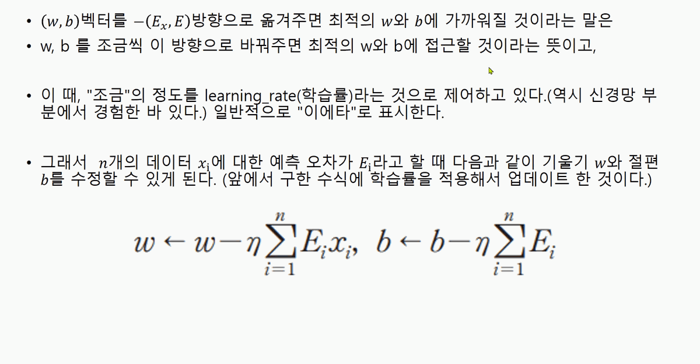
