# 머신러닝 : 지도학습/비지도학습

## &lt;분류&gt;

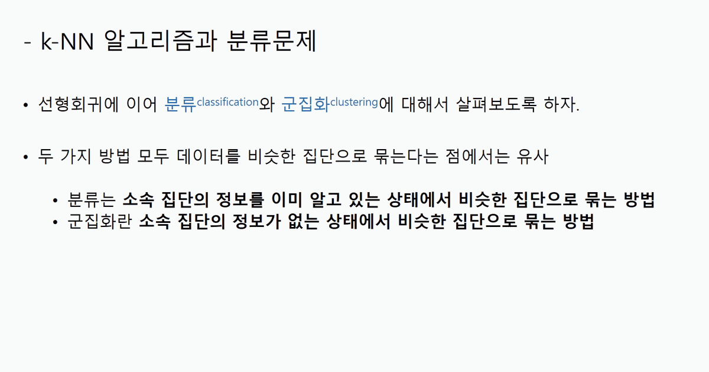

- Classification과 Clustering은 데이터를 비슷한 집단으로 묶는다는 점에서 유사하다.

    - Classification은 소속 집단의 정보를 이미 알고 있는 상태에서 비슷한 집단으로 묶는 것.
    - Clustering은 소속 집단의 정보가 없는 상태에서 비슷한 집단으로 묶는 방법

### k-NN 알고리즘

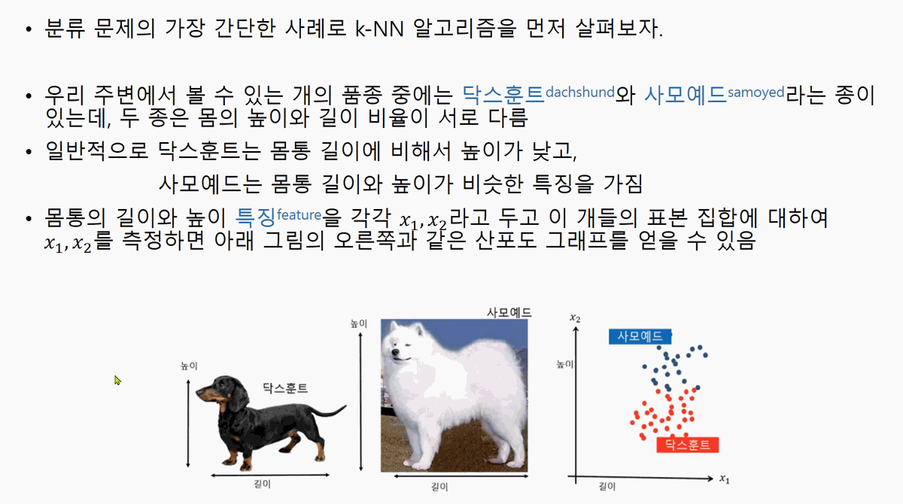

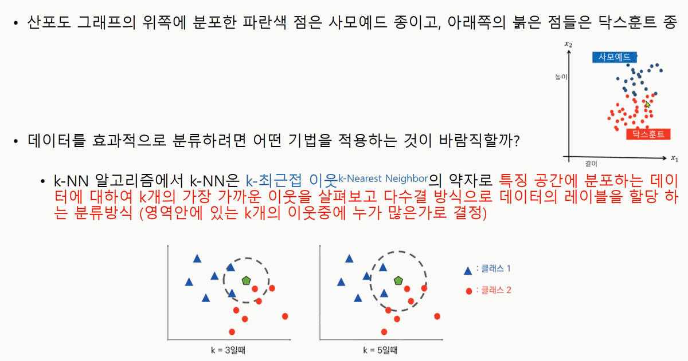

- 닥스훈트와 사모예드의 키와 길이를 측정하여 이차원 평면상에서 나타내어 분류하고자 한다.  
    ⇒ 데이터를 효과적으로 분류하려면 어떤 기법을 적용하는 것이 바람직할까?
- k-NN 알고리즘은 k-최근접 이웃(*k-Nearest Neighbor*)의 약자로, Feature Space에 분포하는 데이터에 대하여 k개의 가장 가까운 이웃을 살펴보고, 다수결 방식으로 데이터의 레이블을 할당하는 분류 방식이다.  
    ⇒ 즉, 한 데이터가 있으면, 그 데이터의 근처에 어떤 Class가 많은지로 Classification 하는 것이다.

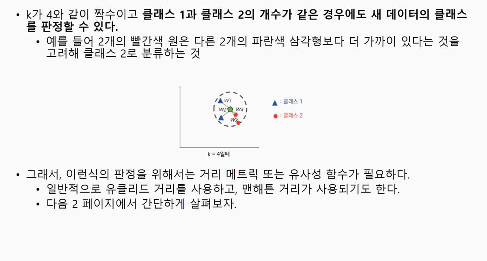

- 그런데, 두 개의 Class가 같은 수로 포함되어 있을 수도 있다. 이럴 때는 Euclidean Distance와 같은 Distance Metric(*혹은 유사성 함수*)을 고려해야 한다.

### Euclidean Distance

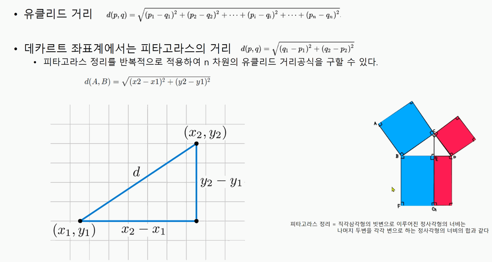

### Manhattan Distance

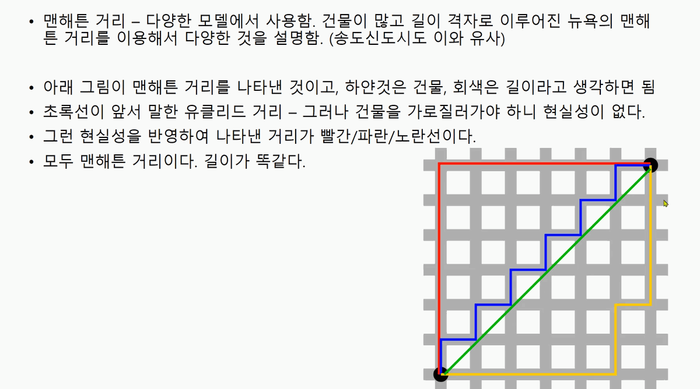

- Euclidean Distance는 맨해튼과 같이 중간에 장애물이 있는 상황에서는 적용이 불가능하다. 
- 이런 상황에 감안하여 만든 Path들이 있는데, 빨강, 파랑, 노랑 Path가 바로 Manhattan Distance이다. 각각의 길은 모두 거리가 같다.

### 앙상블

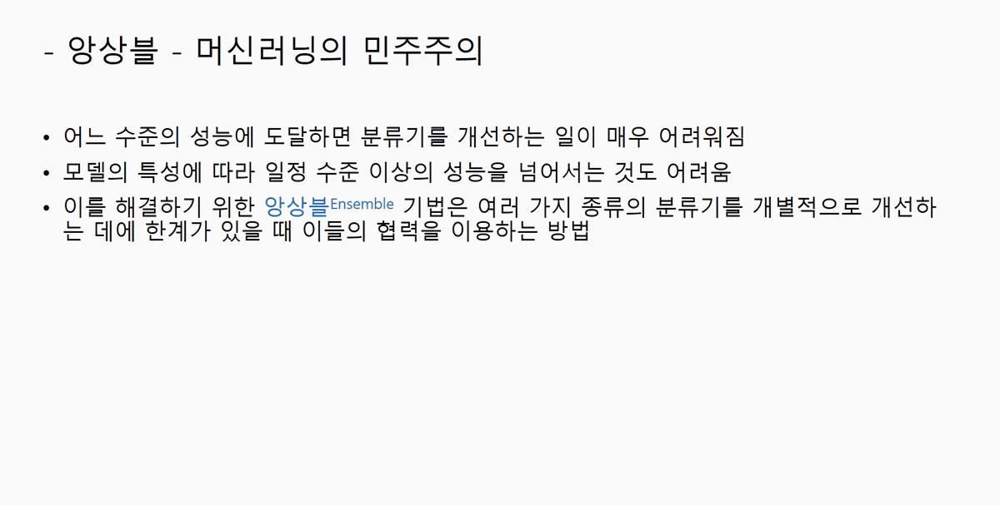

- 어느 수준의 성능에 도달하면 Classifier의 성능을 개선하는 것이 매우 어렵다.
- 모델의 특성에 따라, 일정 수준 이상의 성능을 넘어서기도 어려울 수 있다.
- 따라서 이를 해결하고자 **앙상블 기법**을 도입한다. 앙상블 기법은 여러 가지 종류의 Classifier를 개별적으로 개선하는 데에 한계가 있을 경우, 이들의 협력을 이용하는 방법이다.

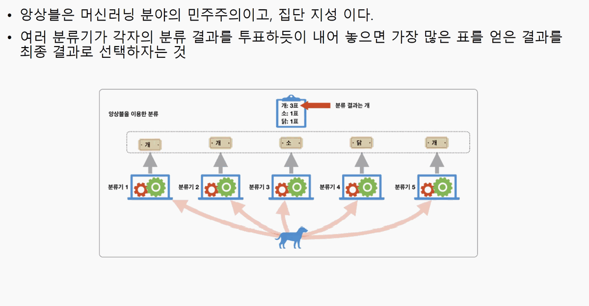

- 여러 Classifier를 써서 C분류를 실시하고, 그 결과를 바탕으로 복합적으로 정답을 계산한다.

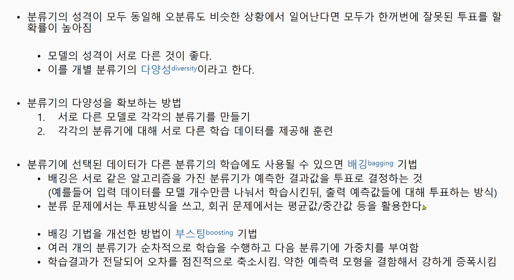

- 만약 모델의 분류 성격이 비슷하면 모두 잘못된 분류를 낼 수도 있으므로, 모델이 다양한 성격을 갖도록 하는 것이 좋다.
- 그렇게 하기 위해서는 모델의 알고리즘에 차별화를 두거나, 학습 데이터를 바꾸면 된다.

- **배깅**(Bagging)

    서로 같은 알고리즘을 가진 분류기가 예측한 결과값을 투표로 결정하는 것이다.  
    ⇒ 예를 들어, 입력 데이터를 모델 개수만큼 나눠서 학습시킨 뒤에 결과를 복합적으로 보는 것.

- **부스팅**(Boosting)

    Serial하게 학습하면서 이전 학습의 결과를 전달하여 오차를 점진적으로 감소시키는 방식이다.  
    즉, 약한 예측력 모형을 결합해서 결과를 강하게 증폭시키는 형태이다.

---

## &lt;Clustering&gt;

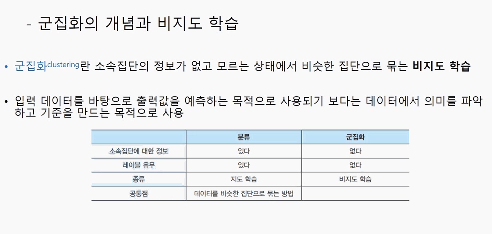

- 소속 집단의 정보가 없고 모르는 상태에서 비슷한 집단으로 묶는 비지도 학습이다.
- 입력값을 바탕으로 출력값을 예측하기 보다는, 데이터에서 의미를 파악하고 기준을 만드는 목적으로 주로 사용된다.

### 다항 회귀

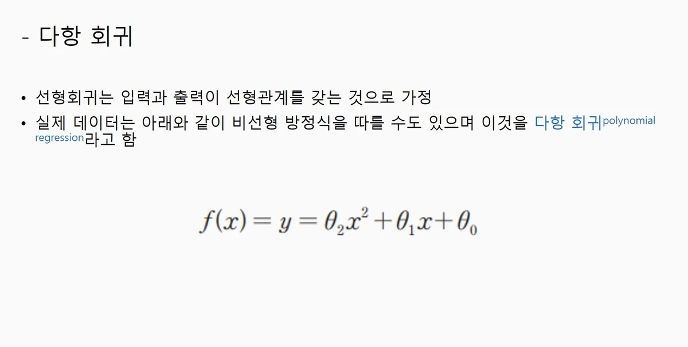

- **선형 회귀**는 입력과 출력이 선형 관계를 갖는 것으로 가정한다.
- 비선형 방정식을 따라 변수 간의 관계를 나타내는 ‘가설’을 추측하는 것을 **다항 회귀**라고 한다.

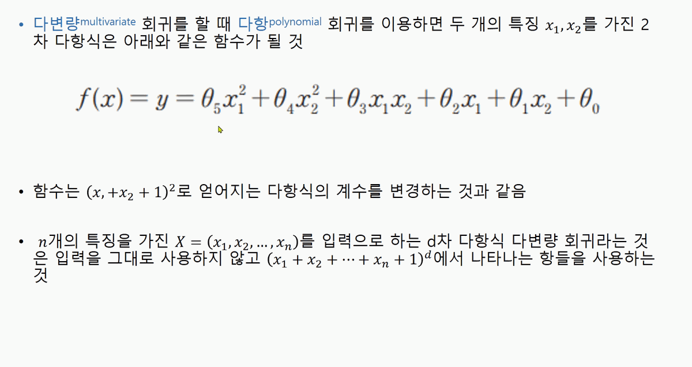

- **다변량 회귀**(여러 가지 특성을 입력받을 때)를 할 때, **다항 회귀**를 이용하면, 두 개의 특징 x1, x2를 가진 이차 다항식은 아래와 같은 함수가 될 수도 있다. (*예시임*)
- 즉, 위의 식을 예로 들자면 (ax + bx2+ c)^2으로 얻어지는 다항식의 계수 a, b, c를 변경하는 과정이 **다항 회귀**라고 볼 수 있는 것이다.

### 다항 회귀의 문제점

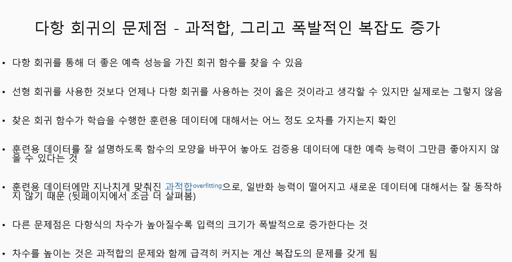

- 다항 회귀는 선형 회귀로 표현이 불가능한 데이터를 나타내거나, 더 복잡한 가설을 찾을 수 있다는 장점이 있다.
- 하지만 다항 회귀가 Train Dataset에 대해서는 좋은 성능을 나타낼 수 있지만, Validation Dataset에 대해서는 예측 능력이 그렇게 좋지 않을 수도 있다는 것이다.
- 이를 **Overfitting**이라고 한다.
- 또한, 차수가 높아질수록 계산복잡도가 매우 증가하게 되어 적절한 선을 찾아야만 한다.

### 과적합/과소적합

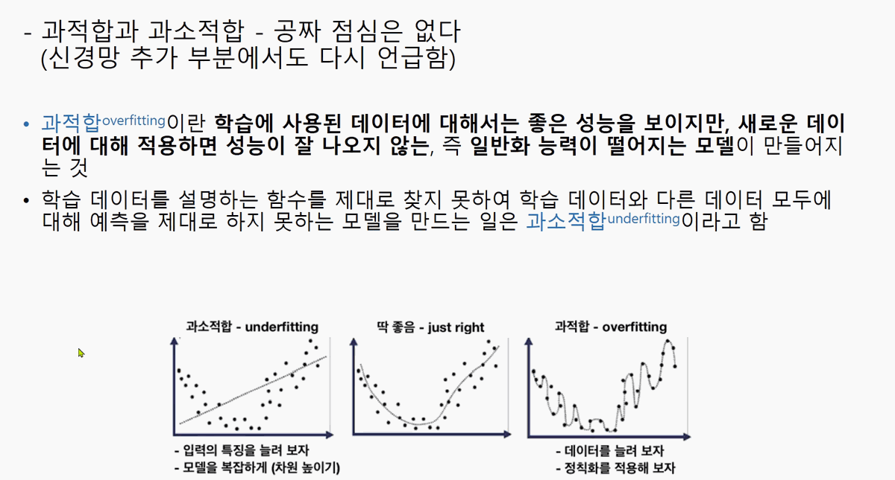

- **과적합** : 모델이 학습 데이터에 대해서는 좋은 성능을 보이지만, 새로운 데이터에 대해서는 좋은 성능을 보이지 못하는 상황.
- **과소적합** : 모델이 학습 데이터를 설명하는 함수를 제대로 찾지 못하여, 학습 데이터와 다른 데이터 모두에 대해서 예측을 제대로 수행하지 못하는 상황. 

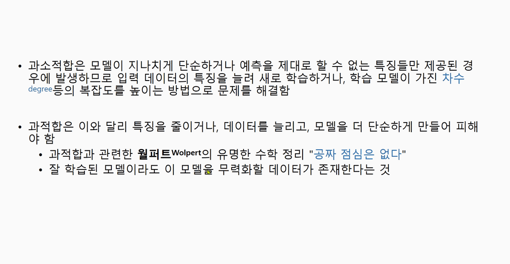

- 과소적합은 모델의 차수를 높이는 등, 복잡도를 높이는 방법으로 해결 가능
- 과적합은 특징을 줄이거나 데이터를 늘리고, 모델을 단순하게 만들어서 해결 가능  
    ⇒ 이를 **Regularization**이라고 한다.
- 혹은 과적합이 발생하면 학습 데이터가 부족해서 발생한 것일수도 있기 때문에, 학습 데이터를 증강시키는 것도 고려해야 한다.

### 결정 트리를 이용한 분류 (Decision Tree)

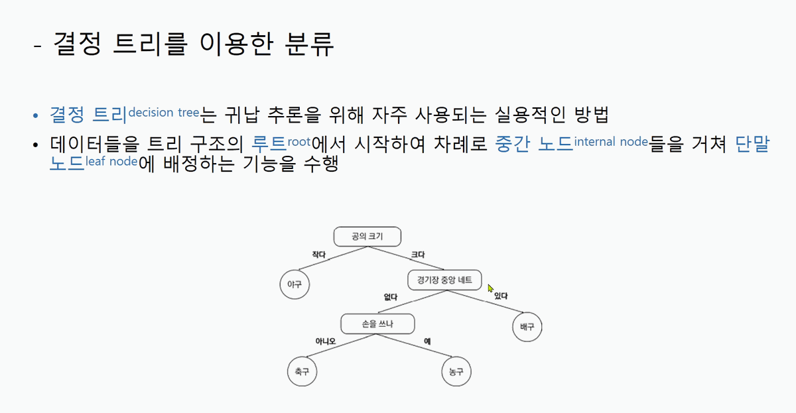

- 결정 트리는 귀납 추론을 위해 자주 사용되는 실용적인 방법이다.

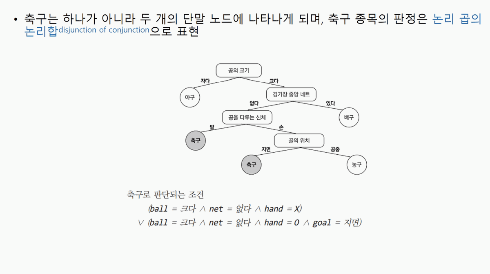

- 이것은 현재 스포츠가 축구인지 아닌지를 판단하는 **Decision Tree**이다.

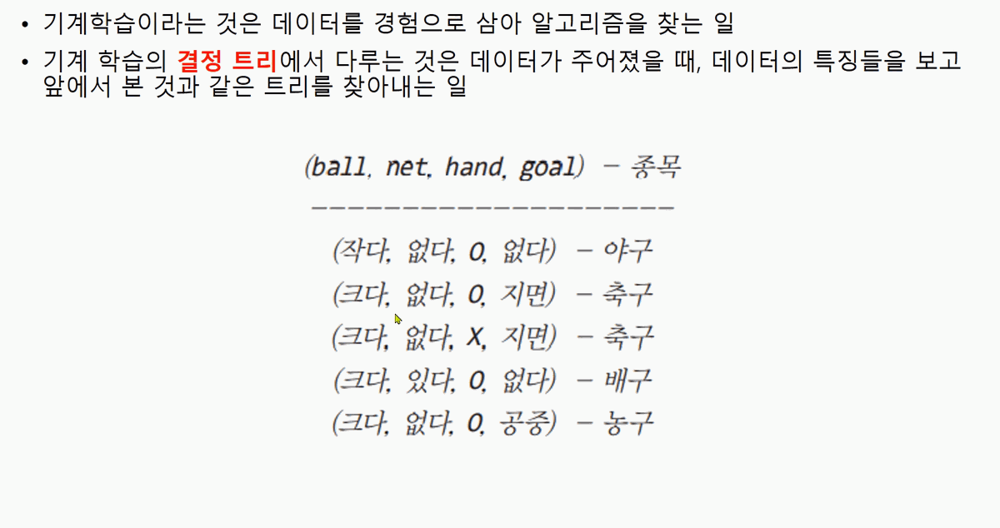

- 이 데이터가 주어지면, 이 데이터를 바탕으로 위의 결정 트리를 정하는 결정 트리를 생성할 수 있게 된다.

### 결정 트리 분할

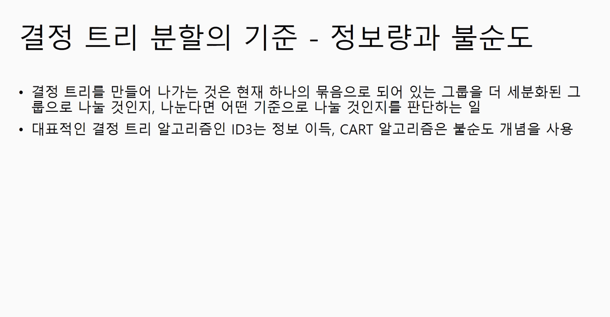

- 결정 트리를 만드는 것은, 현재 하나의 묶음으로 주어진 그룹을 (*위의 캡처본을 예시로 들면 &lt;작다, 없다, O, 없다&gt; 등으로 묘사될 수 있는 하나의 그룹*) 세분화하고 나누는 기준을 판단하는 과정이다.
- **ID3** : 정보 이득의 개념을 사용
- **CART** : 불순도 개념을 사용

### Entropy

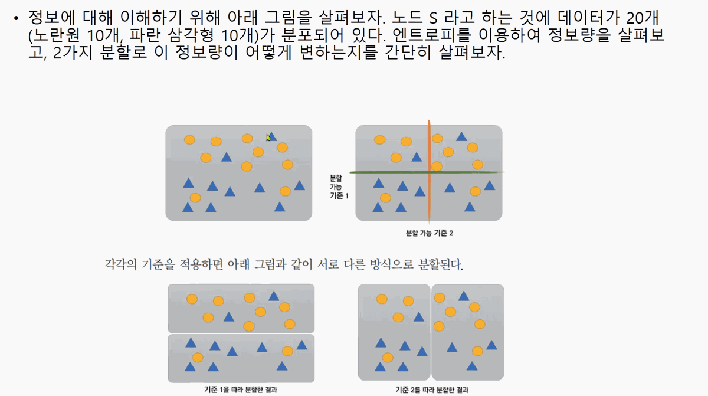

- **Entropy** : 정보량을 표현할 때 사용하는 지표이다.
- 노드 S에 데이터가 20개 분포되어 있는데, 엔트로피를 이용하여 노드의 정보량을 10개, 10개로 분할하는 **분할 가능 기준**을 만들어보자.

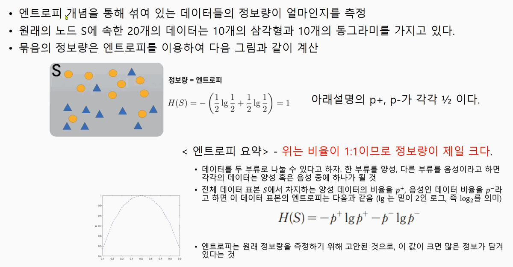

- 데이터를 두 부류로 나눈다고 하자. (*양성 혹은 음성*) 그러면 각각의 데이터는 양성 혹은 음성 중에 하나가 된다.
- 전체 데이터 표본 S에서 차지하는 양성 데이터의 비율을 p+, 음성인 데이터 비율을 p-라고 하면, 이 데이터 표본의 엔트로피는 다음과 같다.

$$
H(S) = -p^{+}log_{2}p^{+}-p^{-}log_{2}p^{-}
$$

- 엔트로피는 원래 정보량을 측정하기 위해 고안된 것으로, 이 값이 크면 많은 정보가 담긴 것이다.

> 두 개의 데이터의 비율이 같으면 정보량이 가장 크다. 한 쪽에 치우쳐 있으면 정보량이 적다.

- 위에서 노드 S에 삼각형과 원의 비율이 각각 1/2, 1/2로 똑같다. 따라서 p-, p+에 1/2, 1/2를 대입하면 결과는 1이 나오게 된다. ⇒ 위의 캡처본에서 하단 그래프 참고

### ID3 & CART (분할 방법)

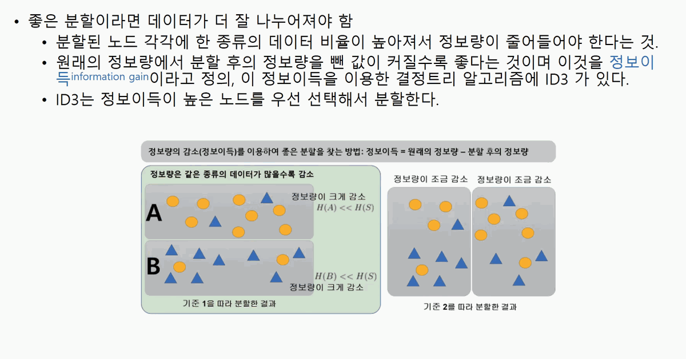

- 즉, 한 번 분할할 때마다 정보량이 많이 낮아질수록 좋은 분할이라는 것이다.

    - 이것이 Decision이 잘 된 것이다.

- 원래의 정보량에서 분할 후의 정보량을 뺀 값이 커질수록 좋은 것이며, 이 값을 **정보이득**이라고 한다.
- 이와 같이 엔트로피의 정보량으로 노드를 분할하는 것이 **ID3**이다.

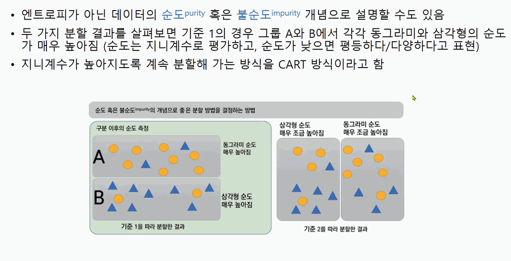

- **순도**와 **불순도**의 개념을 정의하여, 분할 이후 순도가 높아지는 노드를 결정하는 방법을 **CART** 방식이라고 한다.
- 이때, **지니계수**가 높아지는 노드가 **순도**가 **높은 노드**이다.

### SVM

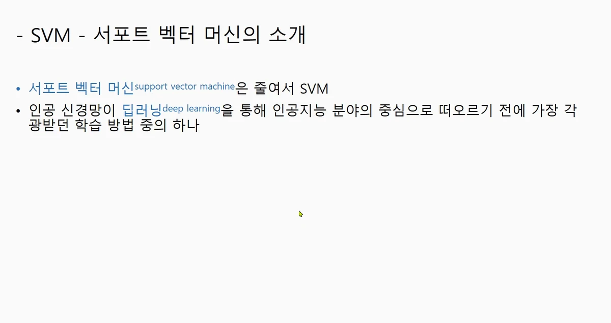

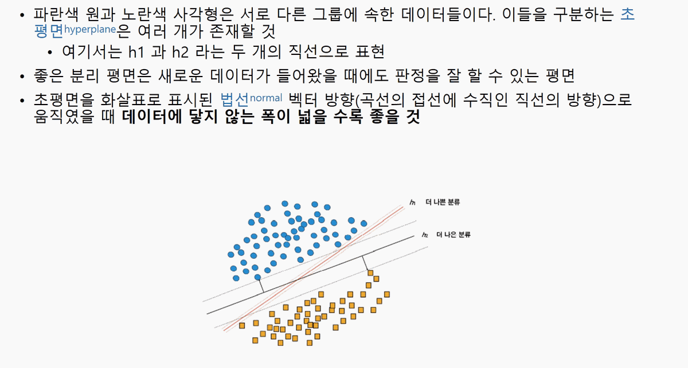

- 데이터를 분류할 수 있는 초평면(hyperplane)은 여러 개가 존재할 수 있다.
- 좋은 분리 평면은 새로운 데이터가 들어왔을 때에도 판정을 잘 할 수 있는 평면이다.

- 초평면을 법선 벡터 방향으로 움직였을 때, 데이터에 닿지 않는 폭이 넓을 수록 좋은 것이다.

    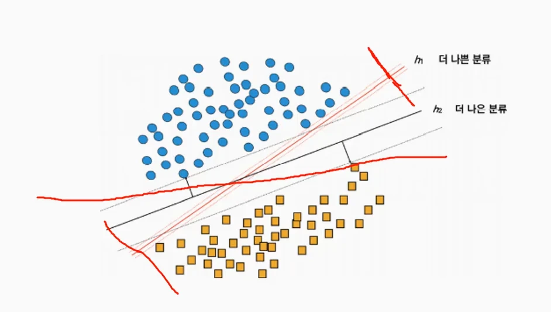

    ⇒ 이와 같이 법선 방향으로 움직일 때 데이터에 닿지 않는 것이 좋다.

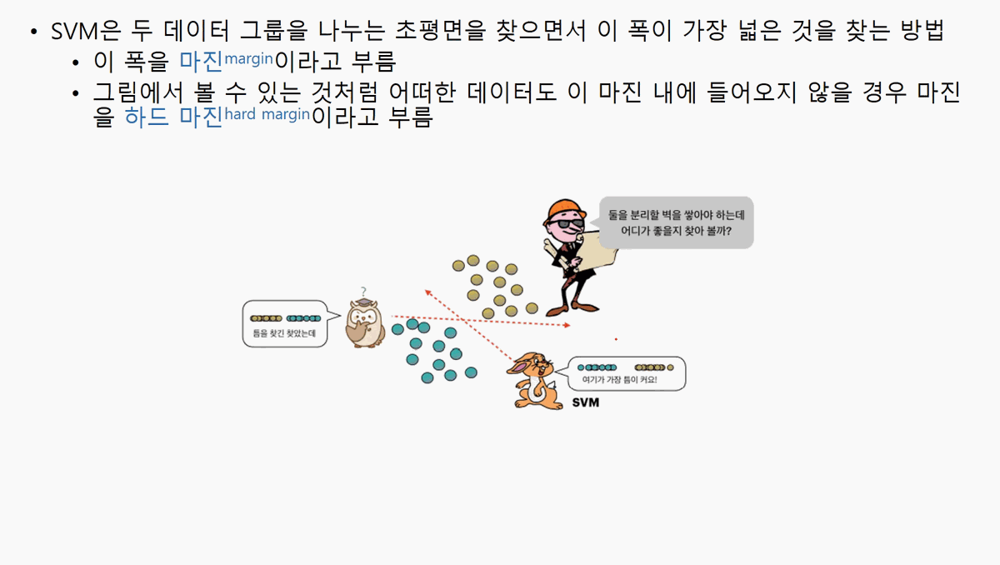

- 따라서 SVM은 두 데이터 그룹을 나누는 초평면을 찾으면서, 법선 방향으로 움직일 수 있는 폭을 의미하는 **마진**이 가장 넓은 초평면을 찾는 것이다.
- 어떠한 데이터도 마진 내에 들어오지 않을 경우, **하드 마진**이라고 한다.

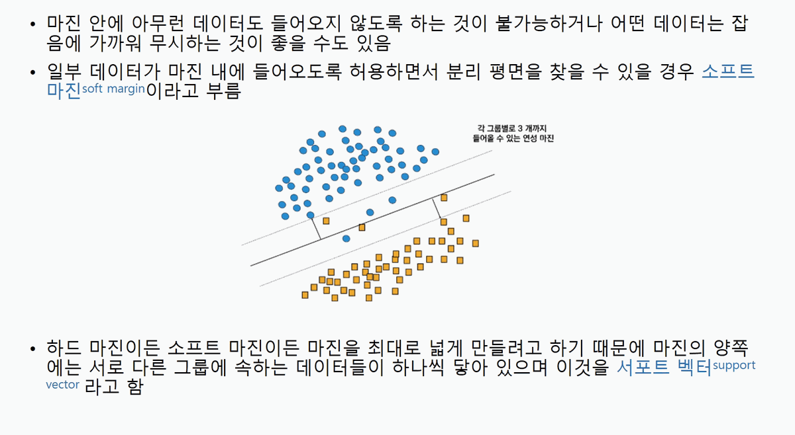

- 일부 데이터가 마진 내에 들어오는 것을 허용할 경우 분리 평면을 찾을 수 있다면, 그것을 소프트 마진이라고 한다.
- 그리고, 하드 마진이든 소프트 마진이든 마진을 최대로 넓게 만들기 위해서는 마진의 양쪽에는 서로 다른 그룹에 속하는 데이터들이 하나씩 닿아 있는데, 이를 **서포트 벡터**라고 한다.  
    ⇒ 아래 그림처럼, 일부 마진을 허용하면서 마진을 만들 수 있다고 해보자. (*녹색 영역*) 이 상황에서 마진에 맞닿는 데이터들, 그 Sample 자체를 **서포트 벡터**라고 한다.

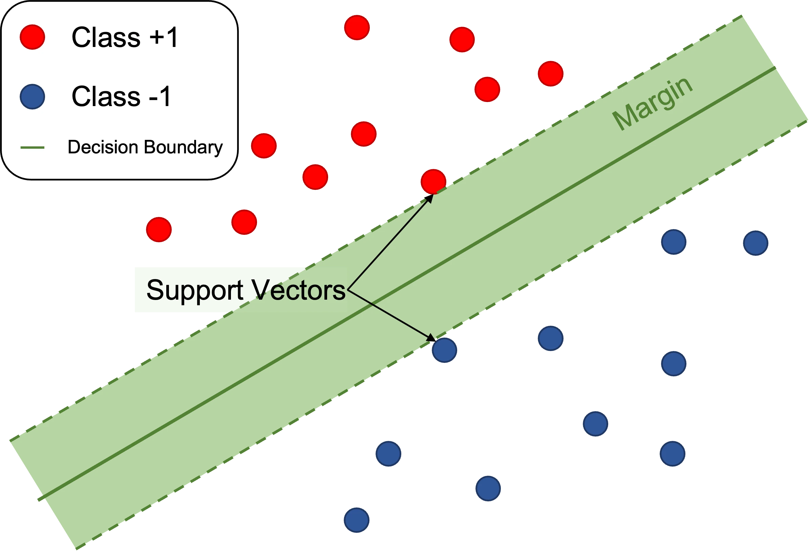

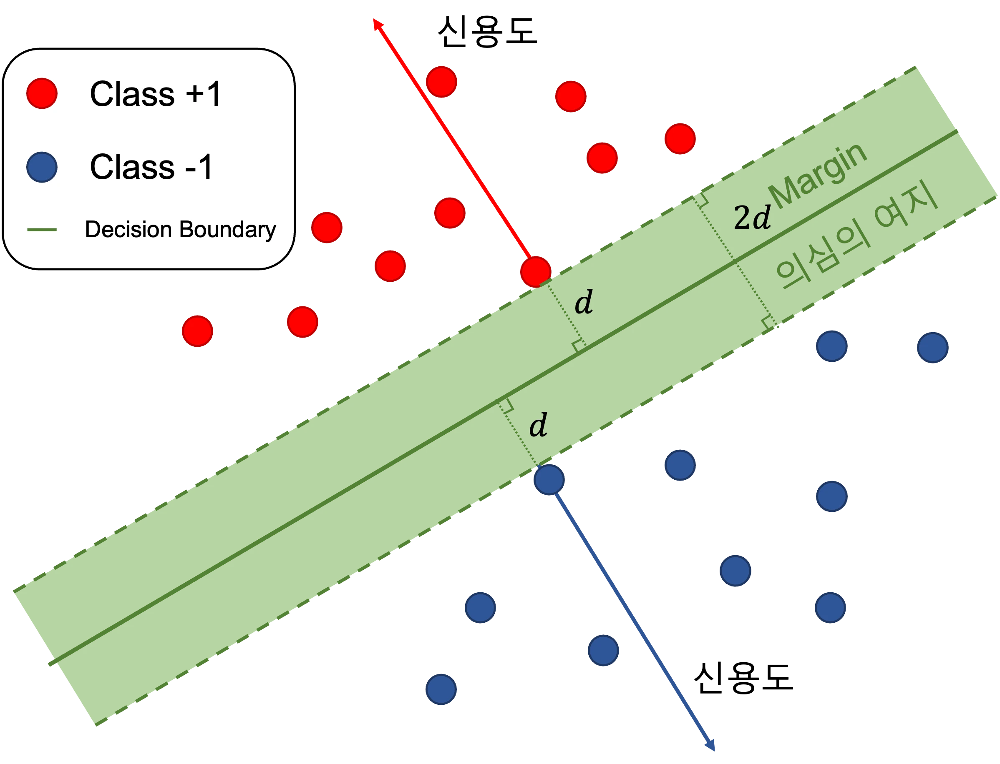

### 하드 마진과 소프트 마진

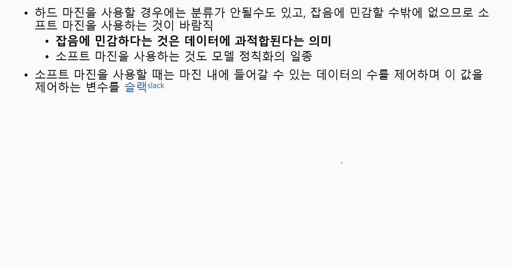

- 소프트 마진을 사용할 때 마진 내에 들어갈 수 있는 데이터의 수를 제어하는데, 이 값을 **슬랙**이라고 한다.
