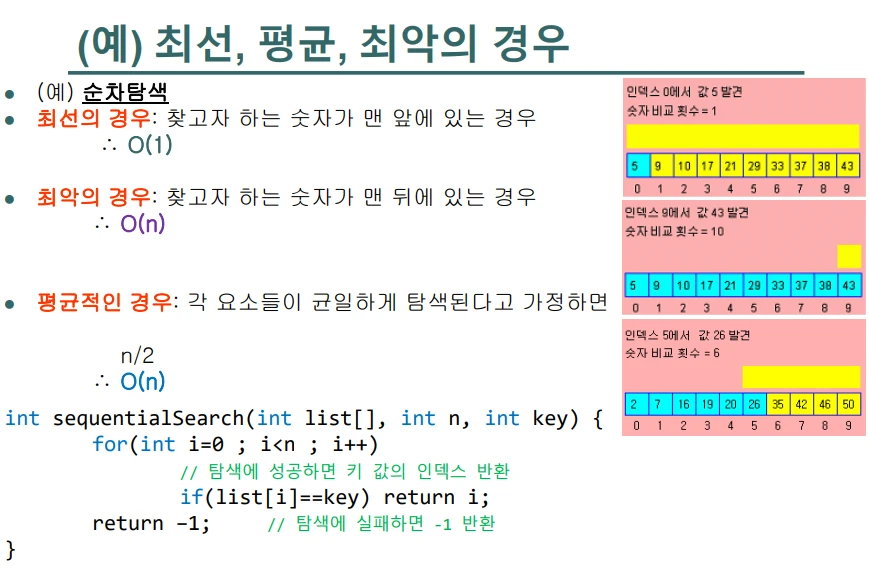

# 2주차(Recursion, Tree, Big-O)

## # `Recursion`

**`Recursion`**

- `Recursion`이란, 알고리즘이나 함수가 수행 도중에 자기 자신을 다시 호출하여 문제를 해결하는 기법이다. 한 문제를 점차 작은 문제로 만들어가면서 큰 문제를 해결할 수 있다.

```c
int factorial(int n) {
	if (n < 1) return 1;
	else return n*factorial(n-1);
}
```

- Recursion은 올바르게 종료되기 위해 반드시 Base Case를 찾아야 한다. (가장 마지막 조건)  
    따라서 새롭게 함수를 호출할 때 상태변화가 필요하며, 순환을 멈추는 부분. 즉, 탈출 조건을  
    설정하여 Base Case를 찾아야 한다.

    ⇒ 만약 순환 호출을 멈추는 Base Case가 없다면, 시스템 오류가 발생할 때까지 무한정 호출.

---

## # `Tree`

**`Tree`**

- Tree는 부모(Parent) - 자식(Child) 관계의 노드들로 이루어진다.

    `노드(node)` : 트리의 구성요소  
    `루트(root)` : 부모가 없는 노드, 가장 최상위 노드  
    `서브트리(subtree)` : 하나의 노드와 그 노드들의 자손들로 이루어진 트리  
    `단말노드(terminal node OR leaf node)` : 자식이 없는 노드  
    `비단말노드(non-terminal node)` : 적어도 하나의 자식을 가지는 노드

    `레벨(level)` : 트리의 각층의 번호  
    `깊이(depth)` : 루트에서 특정 노드까지의 간선 개수  
    `차수(degree)` : 노드가 가지고 있는 자식 노드의 개수

- `트리의 종류`

    1. `이진 트리`
    2. 일반 트리 → 안씀

- `이진 트리(binary tree)`

    모든 노드가 2개의 `서브 트리`를 가지고 있는 트리 (단, 서브 트리는 공집합일 수 있다.)  
    이진 트리의 노드에는 `최대 2개`까지의 `자식 노드`가 존재  
    모든 노드의 `차수`가 `2 이하`가 된다. → 구현이 간편하다.  
    이진 트리에는 서브 트리간의 순서가 존재한다.  

    이진 트리에서 `노드의 개수`가 `n개`이면, `간선의 개수`는 `n-1`이다.

- `이진 트리의 종류`

    1. `포화 이진 트리(full binary tree)`  
        트리의 각 레벨에 노드가 꽉 차있는 이진 트리를 의미한다.

    2. `완전 이진 트리(complete binary tree)`  
        레벨 1부터 k-1까지는 노드가 모두 채워져 있고, 마지막 레벨 k에서는  노드가 `순서대로` 채워져 있는 이진 트리를 의미한다.

    3. `기타 이진 트리`  
        그 외의 이진 트리를 의미한다.

---

## # `알고리즘`

**`알고리즘`**

- `알고리즘의 조건`

    1. 입력 : 0개 이상의 입력이 존재해야 한다.
    2. 출력 : 1개 이상의 출력이 존재해야 한다.
    3. 명백성 : 각 명령어의 의미는 모호하지 않고 명확해야 한다.
    4. 유한성 : 한정된 수의 단계 후에는 반드시 종료되어야 한다.
    5. 유효성 : 각 명령어들은 실행 가능한 연산이어야 한다.

- `알고리즘의 기술 방법`

    1. 흐름도 (flow-chart)
    2. 의사 코드(pseudo-code)
    3. 프로그래밍 언어

    <!-- -->

    - `자연어`로 표기된 알고리즘  
        인간이 읽기가 쉬우나, 단어들을 정확하게 정의하지 않으면 의미 전달이 모호해질 수 있다.
    - `흐름도(flow-chart)`로 표기된 알고리즘  
        직관적이고 이해하기 쉬우나, 복잡한 알고리즘의 경우 상당히 복잡해진다.
    - `유사코드(Pseudo-code)`로 표현된 알고리즘  
        알고리즘의 고수준 기술 방법으로, 자연어보다는 더 구조적인 표현 방법이기 때문에 알고리즘 기술에 많이 사용된다. 프로그램을 구현할 때의 여러 가지 문제들을 감출 수 있다. 즉,  
        알고리즘의 핵심적인 내용에만 집중할 수 있다.

    ```c
    ArrayMax(list, N):
    	largest <- list[0]
    	for i<-1 to N-1 do
    		if list[i] > largest
    			then largest<-list[i]
    	return largest
    ```

    - `특정 언어(ex. C)`로 표현된 알고리즘  
        알고리즘의 가장 정확한 기술이 가능하지만, 실제 구현 시 너무 구체적인 사항들로 인해   
        `핵심적인 내용`에 대한 이해를 방해할 수 있다.

- `추상 데이터 타입(Abstract Data Type)`

    - 데이터 타입을 추상적(수학적)으로 정의한 것
    - 데이터나 연산이 무엇(what)인가는 정의되지만, 데이터나 연산을 어떻게(how)  컴퓨터 상에서 구현할 것인지는 정의되지 않는다.

- `추상 데이터 타입의 유래`

    - `추상화(abstraction)`  
        → `정보 은닉 기법(information hiding)`  
        모든 객체지향 언어적 요소를 활용하여 객체에 대한 구체적인 정보를 노출시키지 않는 기법

        → `추상 자료형(ADT)`

    - `추상화` : 사용자에게 중요한 정보는 강조하고, 중요하지 않은 세부 사항은 제거하는 것이다.
    - `ADT`는 `객체`를 다루게 되며, `연산`을 통해 추상 데이터 타입과 외부를 연결한다.

---

## # `알고리즘의 성능 분석`

**`성능 분석`**

- `알고리즘의 성능 분석 기법`

    복잡도 분석  
    시간 복잡도는 알고리즘을 이루고 있는 연산들이 몇 번이나 수행되는지를 숫자로 표시  

    1. `시간 복잡도(time complexity)` : 함수의 상한을 표시한다.
    2. `공간 복잡도(space complexity)`

- `빅오(Big-O) 표기법`

    - 연산의 횟수를 `대략적(점근적)`으로 표기한 것
    - 차수가 가장 큰 항이 가장 영향을 크게 미치고, 다른 항들은 상대적으로 무시될 수 있음.
    - 두 개의 함수 `f(n)`과 `g(n)`이 주어졌을 때,  
        모든 `n ≥ n(0)` 에 대하여 `| f(n) | ≤ c * | g(n) |` 을 만족하는 2개의 상수 `c`와 `n(0)`가 존재하면, `f(n)` = `O(g(n))` 이다.

    - ex)   
        `n ≥ 5`,     `2n + 1` &lt; `10 * n` 이므로, `2n + 1` = `O(n)`

> 위의 식으로 `Big-O`를 계산하는 법은 유추와 비슷하다고 생각한다.  
> 예를 들자면, f(n) = 2n+1 일 때, g(n) = n^2 이라면, 당연하게도  
> n = 3 부터 f(n) ≤ c * g(n) 이 성립한다. 그렇게 되면, f(n) = O(n^2) 인가?  
> 맞다. 맞는데, 그것 보다도 더 작은 상한선을 구할 수 있다.  
>   
> 위의 예제처럼 g(n) = n이라고 해보자.  
> g(n)에 곱해지는 상수 c가 무조건 2 이상이어야 2n + 1 보다 특정 순간부터 커질 수 있다.  
> 따라서, c 를 3이라고 가정한다. 그렇게 되면,  
>   
> n ≥ 2  
> 2n + 1 ≤ 3 * n 이 성립한다. ( 실제로 같은 값은 나오지 않지만, 정의 상 ==도 포함)  
> 즉, f(n)의 `Big-O notation` 중, 가장 작은 상한선은 O(n)이 되기 때문에  
> f(n)의 `Big-O`는 O(n)이 된다.

- `빅오(Big-O) 표기법의 종류`

    1. `O(1)` : 상수형
    2. `O(logn)` : 로그형
    3. `O(n)` : 선형
    4. `O(nlogn)` : 선형로그형
    5. `O(n^2)` : 2차형
    6. `O(n^3)` : 3차형
    7. `O(n^k)` : k차형
    8. `O(2^n)` : 지수형
    9. `O(n!)` : 팩토리얼형

- `빅오(Big-O) 표기법의 종류`

    1. `1`
    2. `log log n`
    3. `log n`
    4. `n`
    5. `n log n`
    6. `n^2`
    7. `n^2 log n`
    8. `n^3`

    … $n^k$

    1. `2^n`
    2. `n!`
    3. `n^n`

- `The Anagram Detection Example`

    - What is an anagram?  
        anagram이란, “heart”, “earth”와 같이 같은 문자로 재배열된 관계의 문자열을 말한다.

    - `Our Problem`  
        Assume that we have two words of `equal length` and `all lower case`

        - Goal : 두 문자열이 anagram 인지 아닌지를 return하는 알고리즘을 구현한다.

<!-- -->

1. `Solution 1` : `Checking off`  
    두 문자열이 anagram이라면, 첫 번째 문자열의 각각의 문자에 대해서, 그에 대응하는 문자가 반드시 두 번째 문자열에 존재해야 한다.

    서로 대응되는 문자가 체크되면, 그 값에 특별한 값을 마킹해서 다음 번 탐색에서 배제한다.  
     → 이를 `checking off`라고 한다.

    문자열의 길이를 n이라고 할 때, 길이가 n인 두 번째 문자열을 탐색하게 될 것이며, 두 번째 문자열의 모든 문자는 모두 마킹되어야 한다.

    최악의 경우, 만약 문자열이 정확히 반대로 뒤집어진 상태라면, 매번 비교할 때마다 n번 씩 비교해야 한다.

    첫 번째 비교 n  
    두 번째 비교 n-1  
    세 번째 비교 n-2  
    …  
    마지막 비교 1

    이에 따라 `Big-O notation`은 다음과 같이 작성할 수 있다.

    1 + 2 + 3 + … + (n-1) + n ⇒ n(n-1)/2 = `O(n^2)`

1. `Solution 2` : `Brute Force`  
    할 수 있는 모든 경우를 시도해 보는 방법.  
    즉, 첫 번째 리스트의 구성요소를 이용하여 만들 수 있는 문자열을 만들어 시도해본다.

    이 경우, 간단하게 생각해보면 첫 번째 문자열의 길이가 n이므로, n개의 요소가 있을 때 이를 무작위로 뽑는 경우의 수를 따지면 된다.

    `n * (n-1) * … * 2 * 1` = `n!`

<!-- -->

- `빅 오메가 (Ω) 표기법`

    모든 `n ≥ n(0)` 에 대하여 `| f(n) | ≥ c * | g(n) |` 을 만족하는 2개의 상수 `c`와 `n(0)`가 존재하면 `f(n)` = `Ω(g(n))` 이다.  

    `빅 오메가`는 함수의 `하한(Best Case)`을 표시한다.  
    ex) `n ≥ 1` 이면, `2n+1 > n` 이므로, `n` = `Ω(n)`

> `Big-Ω`도 `Big-O`와 마찬가지로 과정을 정리해보겠다.  
>   
> f(n) = 2n + 1 이라고 하자. 이 때, 빅 오메가의 정의 상  
> |f(n)| ≥ c*|g(n)| 을 만족하는 n ≥ n(0) 가 존재해야 하기 때문에, g(n)은 반드시  
> f(n)보다 차수가 작거나 같아야 할 것이다. (왜냐면, 가장 큰 하한선을 구하기 때문이다.)  
>   
> g(n) = c (임의의 상수) 라고 가정해보자. 그렇게 되면,  
> 2n + 1 은 특정 순간 n ≥ n(0) 부터 항상 g(n)보다 커진다.  
> 이 경우도 Big-O와 마찬가지로, 맞다. 맞는데, 더 큰 하한선이 남아있다.  
> 점근적 표기법은 모두 점근적으로 결과를 구하기 때문에, 가장 가까운 결과를 구해야  
> 올바른 표기라고 할 수 있다.  
>   
> 다른 예로, g(n) = n^2 이라고 해보자.  
> 이 경우에, n = 1, n = 2 일 때는 2n + 1 ≥ n^2 이 성립하지만, n ≥ 3 일 때는 n^2이 더  
> 커진다. 즉, `Big-Ω` 를 구할 수 있는 정의에 맞지 않는다.  
>   
> 그렇기 때문에 구할 수 있는 가장 큰 하한선은 g(n) = n 으로부터 구할 수 있는 것이다.  
> g(n) = n 일 때, ( g(n)에 곱해지는 상수를 1 or 2 라고 가정하면)  
> f(n)은 모든 n에 대하여 g(n)보다 크게 되므로, `Big-Ω` of f(n) = `Ω(n)` 이다.

- `빅 세타 (θ) 표기법`

    모든 `n ≥ n(0)` 에 대하여 `c1 * | g(n) | ≤ | f(n) | ≤ c2 * | g(n) |` 을 만족하는 3개의 상수 `c1`, `c2`, `n(0)`가 존재하면 `f(n) = θ(g(n))` 이다.  
    → n이 아무리 커져도, f(n)이 상, 하한선의 사이에 존재한다.

    `빅 세타`는 함수의 `하한`인 동시에 `상한`을 표시한다.  

    `f(n)` = `O(g(n))` 이면서, `f(n)` = `Ω(g(n))` 이면 `f(n)` = `θ(n)` 이다.  
    ex) `n ≥ 1` 이면, `1 * n ≤ 2n+1 ≤ 3 * n` 이므로, `2n+1` = `θ(n)`

---


