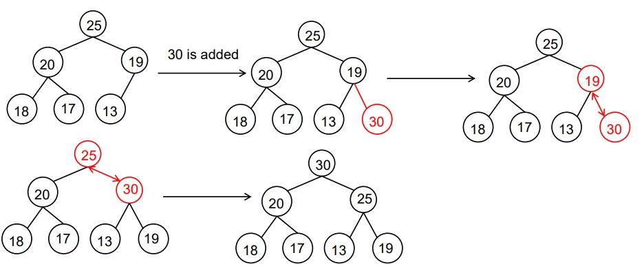
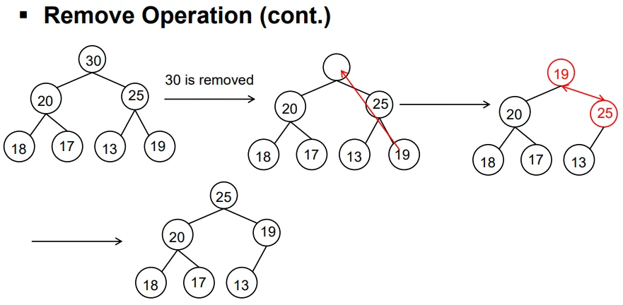

# 4주차(Merge, Quick, Heap)

## # `Merge Sort`

**`Merge Sort`**

- `Merge Sort` is a recursive algorithm that continually splits a list in half
- `Strategy`  
    Divide the list into two smaller lists of about equal sizes  
    Sort each smaller list `recursively`  
    Merge the two sorted lists to get one sorted list

- based on `divide and conquer strategy`  
    Recursively merge sort the first half and the second half  
    Merge the two sorted halves together

    → `divide and conquer` : 문제를 보다 작은 2개의 문제로 분리하고 각 문제를 해결한 다음,  
    결과를 모아서 원래의 문제를 해결하는 전략

- `병합 정렬 복잡도 분석`

    - `비교 횟수`  
        크기 n인 리스트를 1/2로 균등 분배하므로, `log(`$n$`)`개의 패스  
        각 패스에서 리스트의 모든 레코드 n개를 비교 → n번 비교 연산
    - `이동 횟수`  
        각 패스에서 2n번 이동 발생 →  전체 이동 : $2n*logn$

    > 각 패스에서 2n번 이동이 발생하는 이유는, `Merge Sort`는 정렬을 진행하기 위해 리스트의 크기와 같은 복사본을 저장하는 또 다른 리스트가 필요하다. 먼저 각각에 대해서 정렬을 진행하고 복사본에 순서를 맞춰서 저장해놓은 뒤, 원본에 다시 복사해 넣으므로 2n번 이동이 2n번 발생한다.

    - `시간 복잡도` = `O(`$nlogn$`)`  
        최적, 평균, 최악의 경우 큰 차이 없음.

- `분석` : 효율적인 알고리즘으로, 안정적이며 데이터의 초기 분산 순서에 영향을 덜 받음

---

## # `Quick Sort`

**`Quick Sort`**

- `Quick Sort`

    - 평균적으로 가장 빠른 정렬 방법
    - Divide and Conquer 사용
    - 리스트를 2개의 부분 리스트로 비균등 분할하고 각각의 부분 리스트를 다시 퀵 정렬함  
        → recursive

- 정렬의 기준이 되는 `Pivot` 존재

    - `Pivot`이 리스트의 값 중 작은 편에 속하거나 큰 편에 속한다면, 정렬 과정이 길어진다.
    - `Pivot`이 리스트의 값 중 중간값에 속한다면, 정렬이 매우 빠르게 이루어진다.

- `최선의 경우`

    - 거의 균등한 리스트로 분할되는 경우
    - 패스 수 : `log(`$n$`)`
    - 각 패스 안에서의 비교 횟수 : n (high, low를 이용하여 n개의 원소를 비교)
    - 총 비교횟수 $nlogn$
    - 총 이동횟수 : 비교 횟수에 비하여 적으므로 무시 가능

- `시간 복잡도` : `O(`$nlogn$`)`

- `최악의 경우`

    - 불균등 분할 : 이미 정렬된 리스트
    - 피벗의 선택이 중요 : `중간값`(medium) 등

→ 분할 과정이 항상 `unbalance` 하다.

 0      `n`  
 1     `n-1`  
 …      `…`  
n-1    `1`

The worst case running time of quick-sort is `O(`$n^2$`)`

---

## # `Heap Sort`

**`Heap Sort`**

- 이전에 Quick Sort는 Pivot 값을 선택해서 정렬했기 때문에 정렬 시간에 따라 Performance가 많이 나뉘었다. 반면 `Heap Sort`는 항상 `O(nlogn)`이므로, 안정적이다. Merge Sort와 Quick Sort는 recursive 이므로 메모리를 많이 차지하는데, Heap Sort는 recursive가 아니므로, Merge sort보다 메모리 관점에서 유리하다.
- `Max Heap` : root가 가장 크며, 부모 노드가 자식 노드보다 값이 큰 것
- `Min heap` : Max Heap의 반대로, root가 가장 작고, 부모 노드가 자식 노드보다 값이 작은 것

- `Heap의 성질`

    1. `Heapify` : Heap의 성질을 만족하도록 만드는 것. (ascending)
    2. `Balanced` : depth 0 부터 n-2 까지 2개의 children을 갖는 성질
    3. `Left-Justified` : 노드를 채울 때 왼쪽부터 채우는 성질

- `Add Operation`

    1. Add the node to the right of the rightmost node in the deepest level.
    2. If the deepest level is full, create a new level   
        and add the node in the left most place of the level.

- The add operation may destroy heap properties. (`Max Heap`)

- `Shift up`

    Max Heap Property가 만족될 때까지, 이 문제를 해결하기 위해 추가로 진행하는 Operation.  
    한 번 Shift up 했는데 Property가 만족되면 종료되고, 그게 아니라면 만족할 때까지 Root까지 진행한다.



- Heapify 과정 (Max Heap)

- `Remove Operation`

    1. Suppose we remove `Root node`
    2. After removing the root node, we should keep the properties of heap.
    3. Remove the rightmost leaf at the deepest level and use if for the new root  
        → but this may destroy heap properties.
    4. We use `Shift down` operation from root node until the tree structure holds heap properties



- `Shift down` the new added node until Heap satisfies the Heap Property.

- `Heap Sort` 복잡도 분석

    힙 트리의 전체 높이가 거의 `log2n` (완전 이진 트리)이므로 하나의 요소를 힙에 삽입하거나 삭제할 때 힙을 재정비하는 시간이 `log2n` 만큼 소요됨.  

    요소의 개수가 n개 이므로 전체적으로 `O(`$nlogn$`)`의 시간이 걸림.  

    복잡도: `O(`$nlogn$`)` → 복잡도가 항상 일정해서 정렬에 사용하기 좋다.

---

## # `Divide and Conquer`

**`Divide and Conquer`**

- `Divide and Conquer` : 주어진 문제의 입력을 분할하여 문제를 해결(정복)하는 알고리즘

    - 분할한 입력에 대하여 동일한 알고리즘을 적용하여 해를 계산
    - 이들의 해를 취합하여 원래 문제의 해를 얻음

- `부분 문제`와 `부분해`

    - 분할된 입력에 대한 문제를 `부분 문제`(Sub Problem)라고 한다.
    - 부분 문제의 해를 부분해라고 한다.
    - 부분 문제는 더 이상 분할할 수 없을 때까지 계속 분할한다.

- `정복 과정`

    문제의 입력을 단순히 분할만 해서는 답을 구할 수 없다.

    따라서 분할된 부분 문제들을 정복해야 한다.

    - 부분해를 찾아야 하며,
    - 정복하는 방법은 문제에 따라 다르다.
    - 일반적으로 부분 문제들의 해를 취합하여 보다 큰 문제의 해를 구한다.

- `분할 정복 알고리즘의 분류` : 문제가 a개로 분할되고, 부분 문제의 크기가 1/b로 감소

    - a=b=2인 경우 : 합병 정렬, 최근접 점의 쌍 찾기, 공제선 문제
    - a=3, b=2인 경우 : 큰 정수의 곱셈
    - a=4, b=2인 경우 : 큰 정수의 곱셈
    - a=7, b=2인 경우 : 스트라센(Strassen)의 행렬 곱셈 알고리즘

- `Merge Sort`

    입력이 2개의 부분문제로 분할되고, 부분 문제의 크기가 1/2로 감소하는 분할 정복 알고리즘

    1. n개의 숫자들을 n/2개씩 2개의 부분문제로 분할
    2. 각각의 부분문제들을 재귀적으로 합병 정렬
    3. 2개의 정렬된 부분을 합병하여 정렬(정복)

> MergeSort(A, p, q)  
> 입력 : A[p] ~ A[q]  
> 출력 : 정렬된 A[p] ~ A[q]  
>   
> 1. if ( p &lt; q ) {  
> 2. k = (p+q)/2     // k = 반으로 나누기 위한 중간 원소의 인덱스  
> 3. MergeSort(A, p, k)  
> 4. MergeSort(A, k+1, q)  
> 5. A[p] ~ A[k]와 A[k+1] ~ A[q]를 합병한다. do_merge function!  
> }

- `Quick Sort`

    퀵 정렬 또한 분할 정복을 사용하나, pivot이 존재하기 때문에 pivot의 선택에 따라서 performance가 크게 달라질 수 있다.

> QuickSort(A, left, right)  
> 입력 : 배열 A[left] ~ A[right]  
> 출력 : 정렬된 배열 A[left] ~ A[right]  
>   
> 1. if (left &lt; right) {  
>   
> 2. 피봇을 A[left] ~ A[right] 중에서 선택하고, 피봇을 A[left]와 자리를 바꾼 후, 피봇과 배열의 각 원소를 비교하여 피봇보다 작은 숫자들은 A[left] ~ A[p-1]로 옮기고, 피봇보다 큰 숫자들은 A[p+1] ~ A[right]로 옮기며, 피봇은 A[p]에 놓는다.  
>   
> 3. QuickSort(A, left, p-1) // 피봇보다 작은 그룹  
>   
> 4. QuickSort(A, p+1, right) // 피봇보다 작은 그룹  
>   
> }

- `피봇 선정 방법`

    세 숫자의 중앙값으로 선정하는 방법  
    가장 왼쪽, 중간, 가장 오른쪽 숫자 중에서 중앙 값으로 피봇을 정한다.

- `퀵 정렬`은 입력의 크기가 작을 때에는 `삽입 정렬`보다 빠르지 않다.  
    → 퀵 정렬은 `재귀호출`로 수행되기 때문  
    → 퀵 정렬은 커다란 크기의 입력에 대해서 가장 좋은 성능을 보이는 정렬 알고리즘이다.

---

## # `선택(Selection) 문제`

**`선택(Selection) 문제`**

- 선택 문제는 n개의 숫자들 중에서 k번째로 작은 숫자를 찾는 문제

- 선택 문제를 해결하기 위한 간단한 방법

    1. 최소 숫자를 k번 찾는다.단, 최소 숫자를 찾은 뒤에는 입력에서 최소 숫자를 제거한다.
    2. 숫자들을 정렬한 후, k번째 숫자를 찾는다.

    <!-- -->

    - 위의 알고리즘들은 각각 최악의 경우 `O(`$kn$`)`과 `O(`$nlogn$`)`의 수행 시간이 걸린다.

> 아이디어 : 이진 탐색  
> → 이진 탐색의 아이디어 : 절반씩 버리면서 searching space를 줄여나가는 것  
>   
> 선택 문제 : 입력이 정렬되어 있지 않으므로, 입력 숫자들 중에서 (퀵 정렬에서와 같이)  
> 피봇을 선택하여 small group과 large group을 나눈다.  
>   
> 이렇게 분할했을 때 알아야 할 것은 각 그룹의 크기, 즉 숫자의 개수  
> → 각 그룹의 크기를 알면,  
> → k 번째 작은 숫자가 어느 그룹에 있는지를 알 수 있고,  
> → 그 다음에는 그 그룹에서 몇 번째로 작은 숫자를 찾아야 하는지를 알 수 있다.

- `선택 문제 알고리즘`

> Selection(A, left, right, k)  
> 입력: A[left] ~ A[right]와 k, 단, 1≤k≤|A|, |A|=right-left+1  
> 출력: A[left] ~ A[right]에서 k 번째 작은 원소  
>   
> 1. 피봇을 A[left]~A[right]에서 랜덤하게 선택하고, 피봇과 A[left]의 자리를 바꾼 후,  
> 피봇과 배열의 각 원소를 비교하여 피봇보다 작은 숫자는 A[left] ~ A[p-1]로 옮기고,  
> 피봇보다 큰 숫자는 A[p+1] ~ A[p-1]로 옮기며, 피봇은 A[p]에 놓는다.  
>   
> 2. S = (p-1)-left+1   
> // S = Small group의 크기  
>   
> 3. if ( k ≤ S ) Selection(A, left, p-1, k)  
> // Small group에서 찾기  
>   
> 4. else if (k = S + 1 ) return A[p]  
> // 피봇 = k번째 작은 숫자  
>   
> 5. else Selection(A, p+1, right, k-S-1)  
> // large group에서 찾기

- `Good/Bad 분할`

    분할된 두 그룹 중의 하나의 크기가 입력 크기의 3/4과 같거나, 그보다 크게 분할하면 `나쁜(bad)` 분할이라고 정의하자. `좋은(good)` 분할은 그 반대의 경우이다.

- `선택 알고리즘`은 `이진 탐색`과 매우 유사한 성격을 가진다.

    - 이진 탐색은 분할 과정을 진행하면서 범위를 1/2씩 좁혀가며 찾고자 하는 숫자를 탐색
    - 선택 알고리즘은 `피봇`으로 분할하여 범위를 좁혀간다

- 이 알고리즘들은 `부분 문제`들을 `취합`하는 과정이 별도로 필요 없다는 공통점을 가진다.

---

## # `최근접 점의 쌍 찾기`

**`최근접 점의 쌍 찾기`**

- 이차원 평면에서 점의 좌표를 저장하는 배열이 있을 때, 두 점 사이의 거리가 가장 가까운 점을 찾아내는 알고리즘이다.
- `Brute-Force` : N개의 점이 배열 속에서 x 좌표를 기준으로 정렬되어 있으므로, 각각의 점과 다른 모든 점의 거리를 Brute-Force로 계산할 수도 있다.

```c
for (int i = 0; i < N-1; i++) {
	...
	for (int j = i + 1; j < N; j++) {
	...
	}
}

// 이와 같이 for 문을 설정하여, 거리를 중복으로 구하지 않도록 한다.
```

- 간편하지만, 시간 복잡도가 `O(`$n^2$`)`이므로, 다른 방법을 사용한다.

> `ClosestPair(S)`  
> 입력 : x-좌표의 오름차순으로 정렬된 배열 S에 있는 i개의 점 (단, 각 점은 (x,y)로 표현된다.)  
> 출력 : S에 있는 점들 중 최근접 점 쌍의 거리  
>   
> 1. if (i ≤ 3) return (2 or 3개의 점들 사이의 최근접 쌍)  
>   
> 2. 정렬된 S를 같은 크기의 S(L)와 S(R)로 분할한다. |S|가 홀수이면, |S(L)| = |S(R)|+1이  
> 되도록 분할한다.  
>   
> 3. CP(L) = ClosestPair(S(L))  
> 4. CP(R) = ClosestPair(S(R))  
> // 이 과정에서 recursive하게 최근접 점의 쌍 CP(L)과 CP(R)을 찾는다.  
>   
> 5. d = min{dist(CP(L)), dist(CP(R))} 일 때, 둘 중 더 작은 거리를 d로 설정하고, 중간 점을  
> 기준으로 중간점 - d, 중간점 + d 내에 속하는 점들 사이의 거리 중 가장 짧은 거리를  
> CP(C)라고 하자.  
>   
> 6. return (CP(L), CP(R), CP(C) 중에서 거리가 가장 짧은 쌍을 return 한다.

## # `분할 정복 적용에 있어 주의할 점`

**`분할 정복 적용에 있어 주의할 점`**

- `분할 정복`이 부적절한 경우

    - 입력이 분할될 때마다 분할된 부분 문제의 입력 크기의 합이 분할되기 전의 입력 크기보다 매우 커지는 경우이다.

ex) `피보나치 수열`

- 주어진 문제를 분할 정복 알고리즘으로 해결하려고 할 때에 주의해야 하는 또 하나의 요소는    `취합(정복)` 과정이다. 입력을 분할만 한다고 해서 효율적인 알고리즘이 만들어지는 것이 아니다.
