# 6주차: 가중치 그래프, Greedy, Kruskal

## # `Weighted Graph`

**`Weighted Graph`**

- 간선에 가중치가 할당된 그래프

    - 비용(cost)
    - 가중치(weight)
    - 길이(length)

→ 실질적으로 더 많이 사용된다.

- 가중치 표현 방법(인접 행렬을 이용한 그래프의 표현)

    1. 가중치를 위한 추가적인 배열 사용
    2. 인접 행렬 M[i][j]를 가중치를 위해 사용

- 가중치가 없는 Vertex는 그 값을 무한대로 둔다.

    Vertex의 값이 무한대라는 것은, 가중치가 없다는 뜻이다.

> non-direction graph이기 때문에 대칭이며, 가운데는 모두 0이다.

- `신장 트리(Spanning Tree)` : 기본적인 요소

    - 그래프 내의 모든 정점을 포함하는 트리 (일종의 sub tree)
    - `n`개의 정점을 가지는 그래프의 신장트리는 `n-1`개의 간선을 가진다.
    - 사이클이 존재하지 않는다. `(사이클이 있으면, MST가 아니다!)` (isolation은 없고, cycle X)

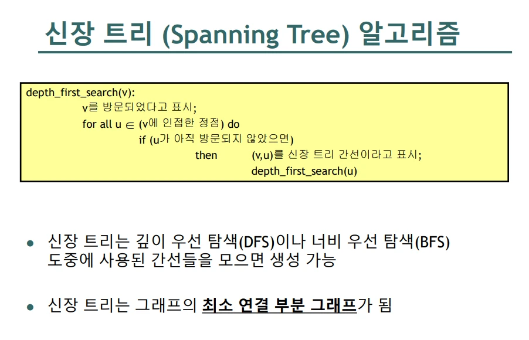

- 신장 트리는 연결성을 가지고 Sub Graph를 만드는 것이라고 볼 수 있다.  
    → Complete Graph에서 Sub Graph를 구성하기
- 신장 트리는 DFS를 통해서 발견될 수 있다.

- `최소 신장 트리(Minimum Spanning Tree)`

    네트워크에 있는 모든 정점들을 가장 적은 수의 간선과 비용으로 연결하는 방법  
    주어진 가중치 그래프에서 사이클이 없이 모든 점들을 연결시킨 트리들 중 선분들의 가중치 합이 최소인 트리.

- `MST`를 이용하는 방법의 예시

     communication range( ex. 30m, 100m, 200m …) 가 다른 node가 있으면 최소 비용을 이용해서 특정 area를 완벽히 채우는 방법에 활용할 수 있다.

    Objective (최적화 문제)

    > Minimize  
    > \# of numbers  
    > such that  
    > given area  
    > is covered  
    > completely

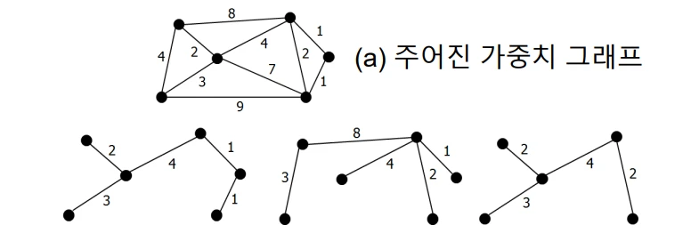

→ 가중치 그래프는 세 개중 왼쪽(a)

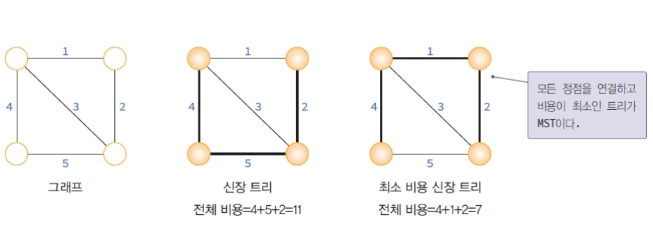

→ 두 개의 Spanning Tree가 있지만, minimum weight은 아닐 수도 있다.

→ 대표적인 알고리즘인 Kruskal이다.

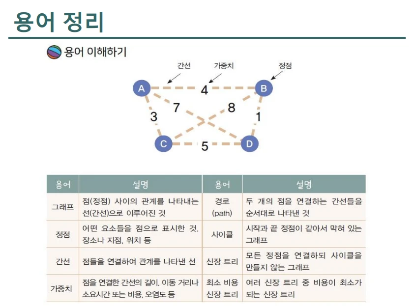

## # `Greedy Algorithm`

**`Greedy Algorithm`**

- `탐욕 알고리즘(Greedy method)`

    - 주요 알고리즘 설계 기법으로, 각 단계에서 최선의 답을 선택하는 과정을 반복함으로써 최종적인 해답에 도달하는 방법.
    - 각 단계 별로 나름대로의 최선의 방법을 채택하여 확인해 나가면서 최종 단계에 도달한다.

    → 현재의 Solution이 현재로서 가장 최적의 방법인지 확인하는 과정이 반드시 필요하다. 즉, 반드시 Optimal Solution이 도출되지 않을 수 있다.

    - Greedy는 데이터 간의 관계를 고려하지 않고 수행 과정에서 ‘욕심내어’ 최소값 또는 최대값을 가진 데이터를 선택 → 근시안적인 선택이라고도 말함.  
        한번 선택을 하면, back-tracking 없이 바로 진행함.

- NP : 어떤 어려운 문제가 있는데, 알고리즘을 디자인 했을 때 다항시간 안에 실행이 되는지 안되는지 조차도 알 지 못하는 문제를 NP문제라고 한다.

- Greedy Method 적용 예 - CoinChange 문제

    동전 거스름돈 문제의 최소 동전수를 찾는 Greedy Algorithm.

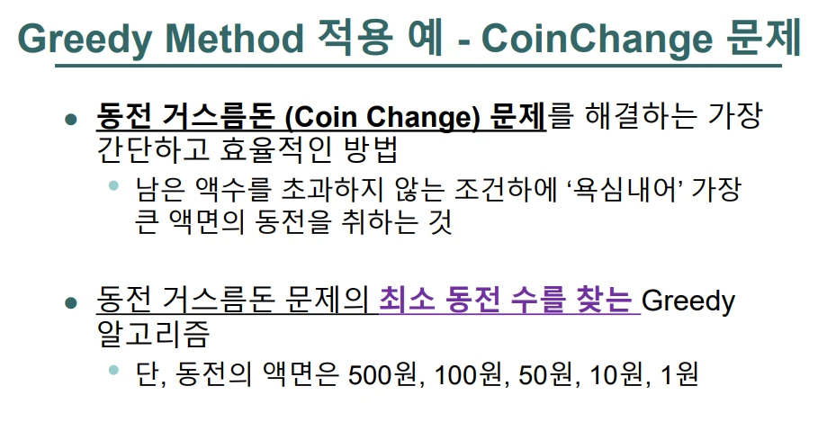

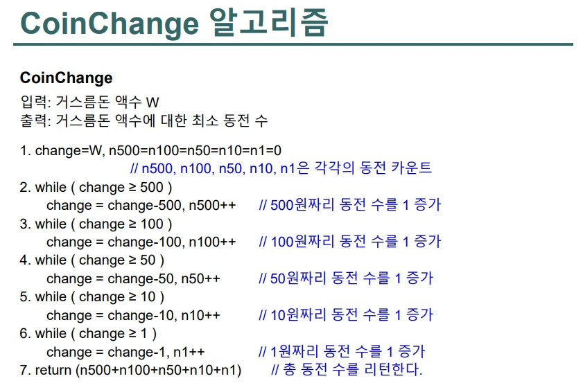

- 1원부터 하는게 아니라, 가장 큰 액수인 500원을 먼저 적용시켜서 액수를 감소시키는 것이 Greedy Algorithm이 적용되는 과정이다. 
- 만약 거스름돈이 700원일 때, 500원을 1개 얻으면 남은 돈은 200원이고 500원은 더 이상 들어갈 수 없으므로 100원으로 넘어간다. 그 상황에서 100원짜리 동전 2개를 사용하면 된다.
- Greedy는 실행하기 쉽지만, Optimal Solution이 존재한다고 하면, 아무리 못해도 어떤 선택을 하던 Optimal Solution의 50%의 성능은 guarantee 된다.

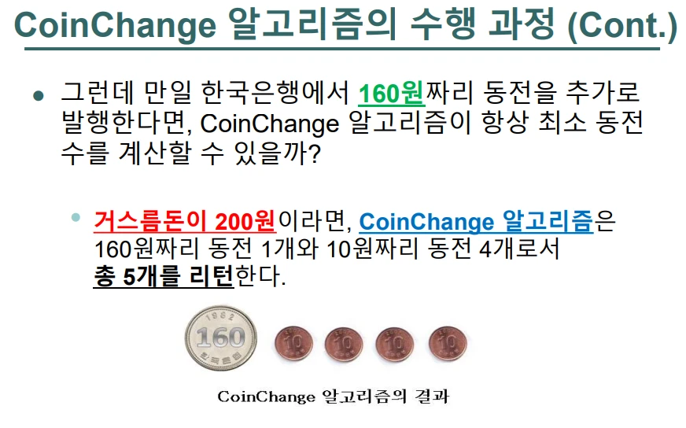

## # `Kruskal Algorithm`

**`Kruskal Algorithm`**

- `Kruskal Algorithm`

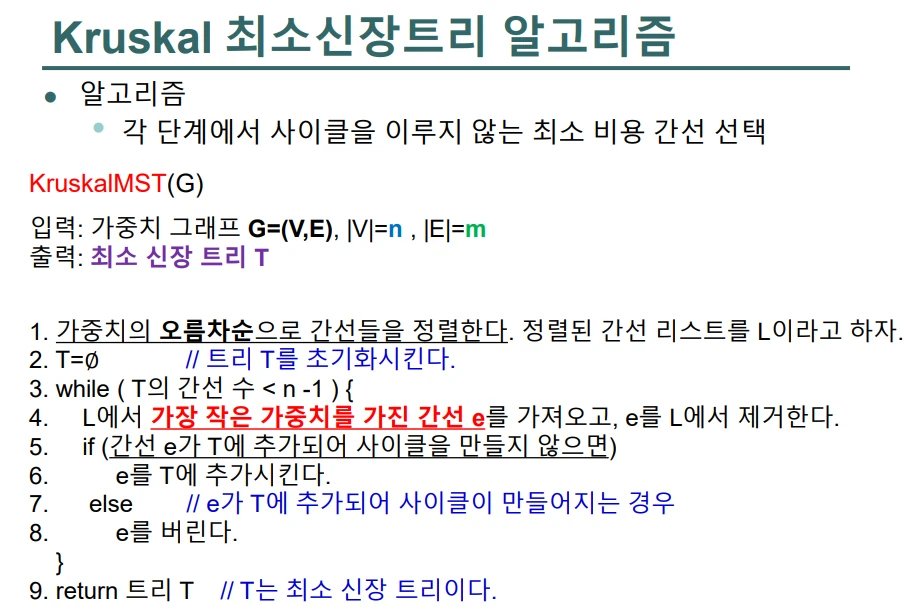

→ Edge의 개수가 더 중요하다. 결론부터 말하면, 시간 복잡도는 $mlogm$ 정렬의 시간이 가장 많이 걸리므로, 정렬 알고리즘의 복잡도를 갖게 된다.

1. 가중치의 오름차순으로 간선들을 정렬한다.
2. : edge의 개수가 n-1이 될 때까지 while을 반복한다.

3. ~&gt; 8. : L에서 가장 작은 가중치를 가진 간선 e를 가져오고, e를 L에서 제거한다.

    이를 Greedy Algorithm으로 볼 수 있고, 간선 e가 T에 추가되어 사이클을 만들지 않으면 e

ex)

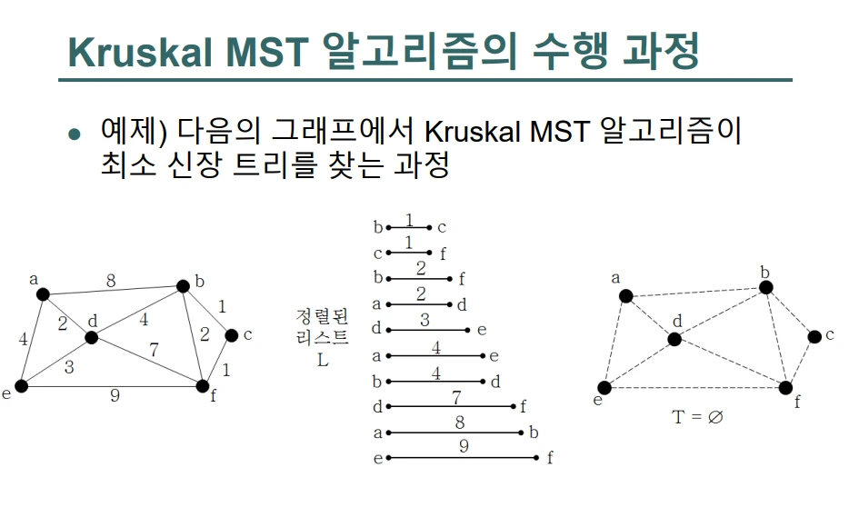

Line 1 ~ 2

While Loop

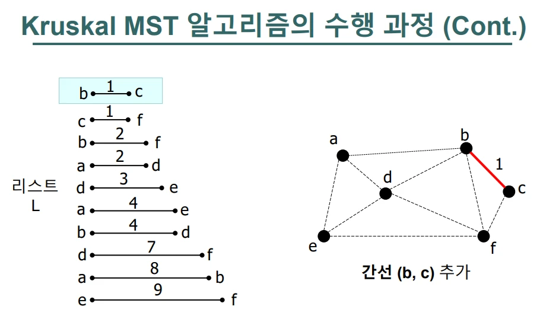

→ 이와 같은 과정을 반복… Cycle이 생성되는지 체크하면서 5개의 edge를 택한다. (알파벳 순)

Final Solution

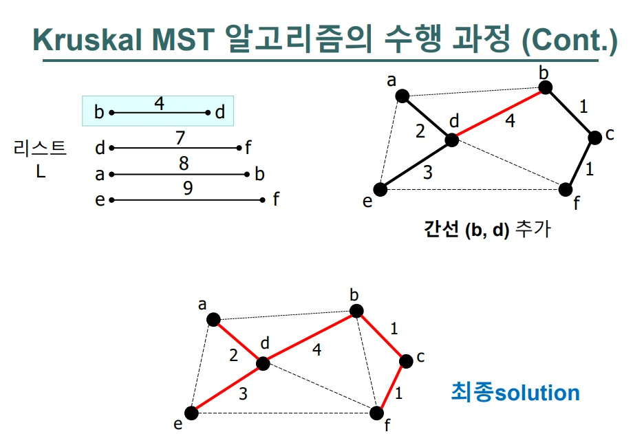

ex2)

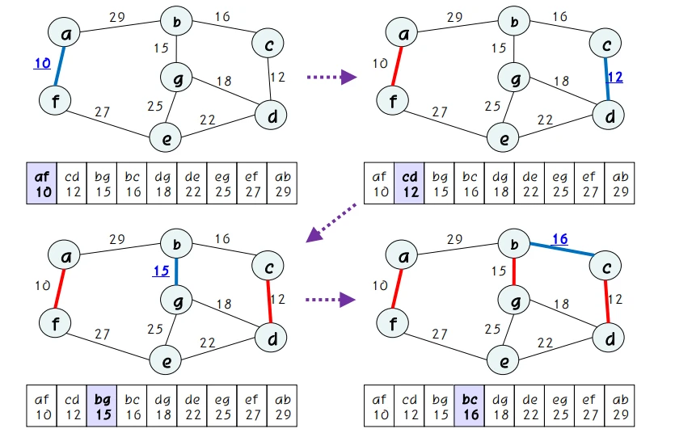

1. 오름차순으로 정렬한다.
2. 가중치가 작은 것부터 택하되, Cycle이 형성되면 버리고, n-1개의 edge를 택한다.

Final Solution

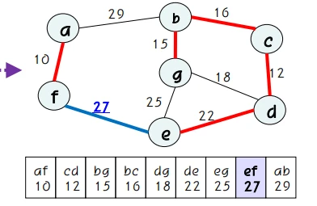

- Cycle의 생성을 검사하는 방법 : Union-Find Algorithm

    - Find(x) : 원소 x가 어떤 집합에 속하는지 알아낸다

    - Union(x, y) : 원소 x와 y가 속해있는 집합을 입력으로 받아 두 집합들의 합집합 생성

        → 독립적인 것을 합치는 기능.

- Kruskal Algorithm의 Big-O

    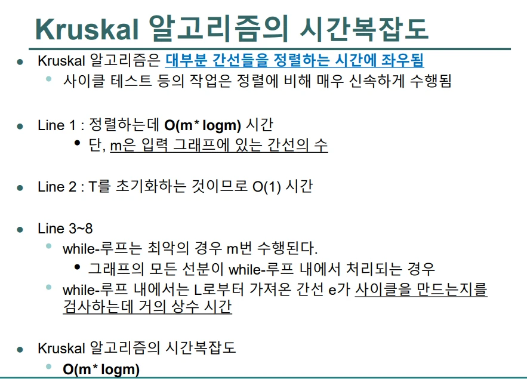

    → Line 3~8 은 $O(m)$ 이므로, 결국 $O(mlogm)$ 으로 흘러간다.

- `DFS` : 한 방향으로 갈 수 있을 때까지 가다가 더 이상 갈수 없게 되면 가장 가까운 갈림길로 돌아와서 이곳으로부터 다른 방향으로 다시 탐색 진행.

- 되돌아가기 위해서는 스택 필요

    - 순환(Recursive)함수 호출로 묵시적인 스택 이용

```text
depthFirstSearch(v)
    v를 방문되었다고 표시;
    for all u ㅌ (v에 인접한 정점) do
        if (u가 아직 방문되지 않았으면)
            then depthFirstSearch(u)
```
