# 10주차: Dijkstra, Floyd

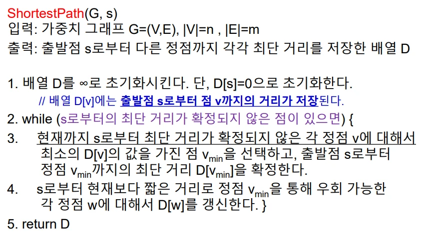

- 배열 D : 시작 정점으로부터 각 정점까지의 최단 거리 (return)
- Floyd Algorithm : All pairs 문제
- Dijkstra도 All pairs 문제를 해결하도록 활용할 수 있는데, 이건 Floyd Algorithm과 마찬가지로 $O(n^3)$이 된다.

<!-- -->

1. 배열 D를 inf로 초기화. 자기 자신의 거리는 0이다.
2. 시작 정점에서 모든 노드까지의 최단 거리가 찾아지지 않았다면, while 동작
3. ~ 4. 가장 최근에 선택된 점을 기준으로 거리가 가장 짧은 정점을 선택한 뒤, 거리를 갱신할 수 있다면 갱신한다.

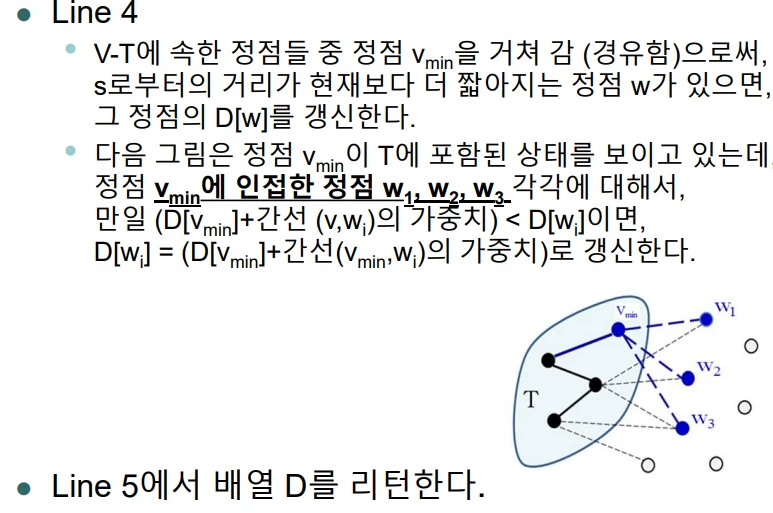

Vmin을 통한 것과 Vmin을 통하지 않는 것 중 어떤 것이 더 나은지 비교하여 D[] 배열을 갱신한다.

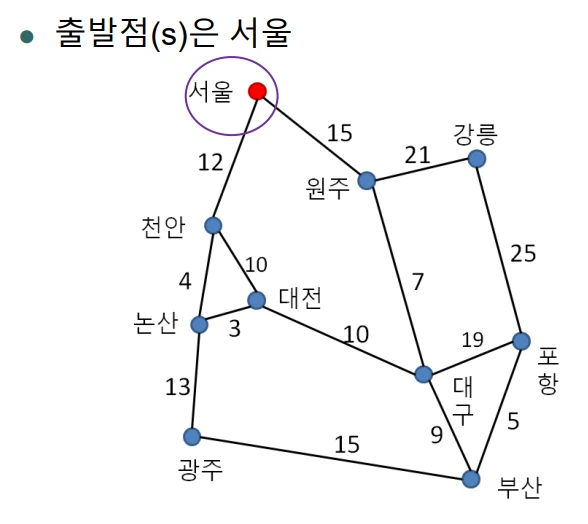

> 만약 최단 거리가 같은 정점들만 있으면, 특정한 기준점이 주어지므로 이를 따르면 된다. ex) 알파벳 순, 이전에 고려된 것부터

- Dijkstra는 간단하지만, 정말 유명한 알고리즘이다. Graph에서는 정말 유명하며 큰 영향을 주었다.

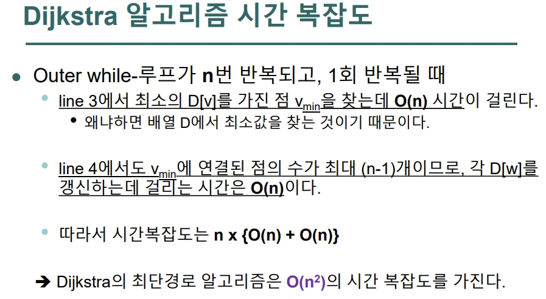

- Dijkstra는 네 개의 categories에서 두 번째이다. Floyd는 네 번째 category인데, 모든 노드에서 다른 노드까지 가는 최단거리를 전부 찾는 알고리즘이다.

---

- 맵 매칭 알고리즘

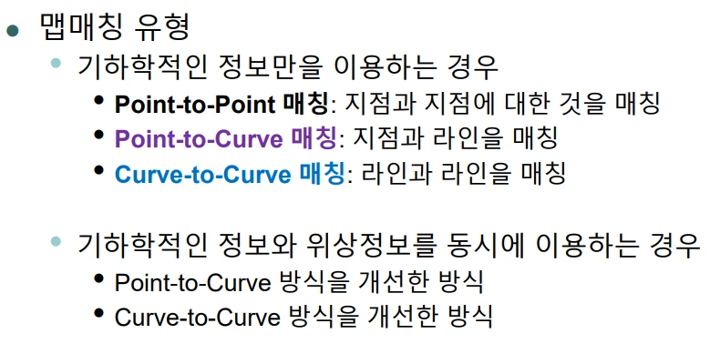

GPS를 사용할 시, 실제 위치와 측정된 위치에 오차가 존재할 수 있기 때문에 다양한 방법을 도입하여 맵에 매칭시켜준다.

기하학적인 정보만을 이용하는 방법에 중점을 둔다.

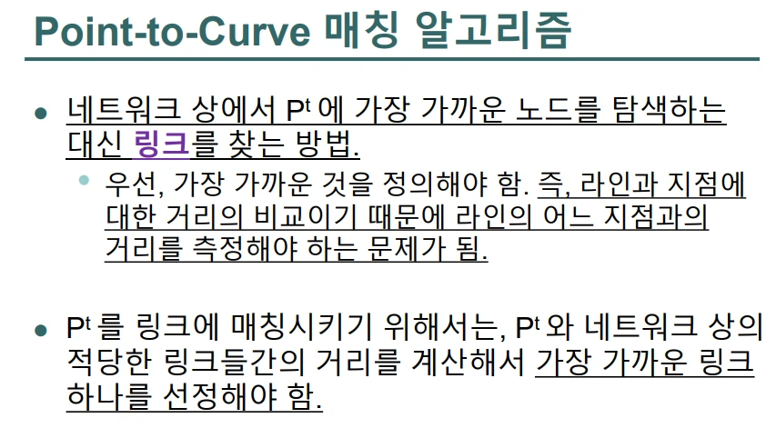

$P^t$ → 특정 시각에 측정된 위치(지점, time t)

- Point-to-Curve

$P^t$에 가장 가까운 노드를 탐색하는 대신, `링크`를 찾는 방법.

- Clustering 문제

    다른 방법으로 풀 수도 있는데, 많은 경우에 Space가 너무 클 경우, potential position을 선정하거나 생성한다.    
    → 대장을 특정 지점에 위치 시킨다. 또는, Grid로 Potential Position을 만들어서 그 위에 존재하는 것으로 대장을 선정한다.

    이와 비슷하게 Point-to-Curve 문제에서도, Link(Line)에서 특정 지점을 선택하도록 만들 수 있다. 

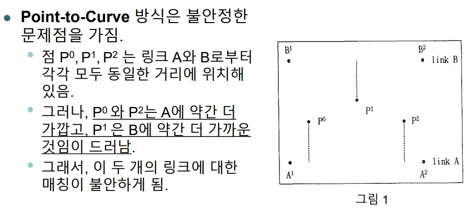

$B^1$ → $B^2$

$A^1$ → $A^2$

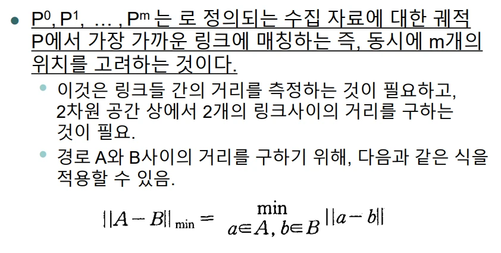

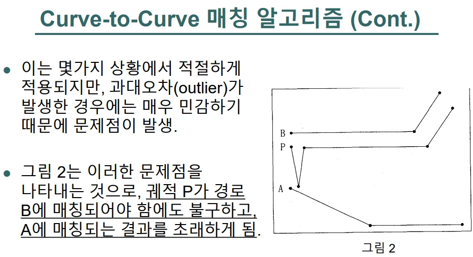

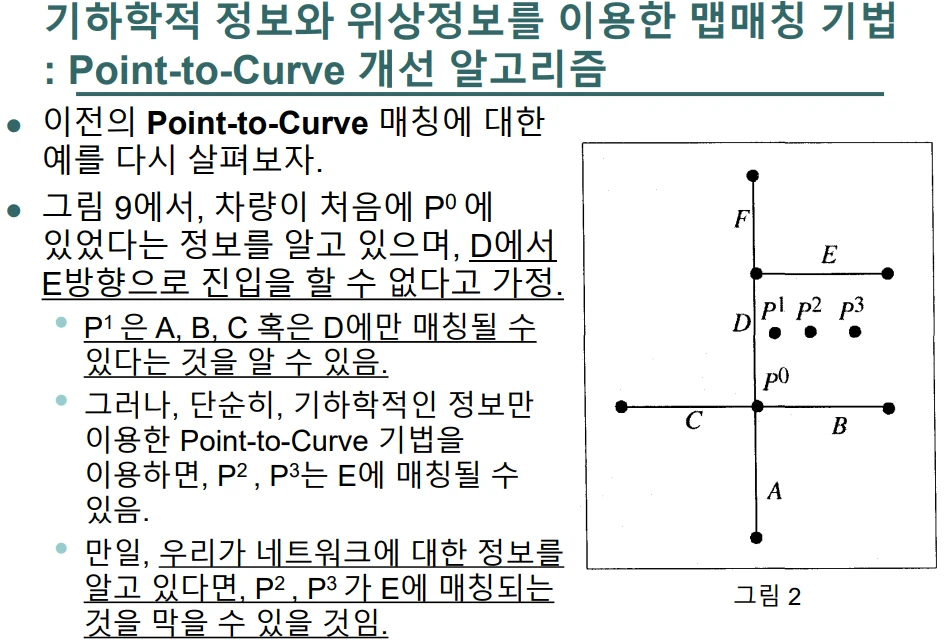

- 차량이 처음에 $P^0$에 존재한다. 실제로 E는 막혀있어서 차가 갈 수 없다고 하자.

    즉, A, B, C, D에만 매칭될 수 있다. 만약 GPS 측정 상의 오류가 발생해서 자동차의 경로가 $P^1 P^2 P^3$와 같이 측정되었다고 할 때, Point-to-Curve 매칭을 사용하면 $P^2 P^3$는 E에 매칭되는 오류가 발생할 수 있음.

---

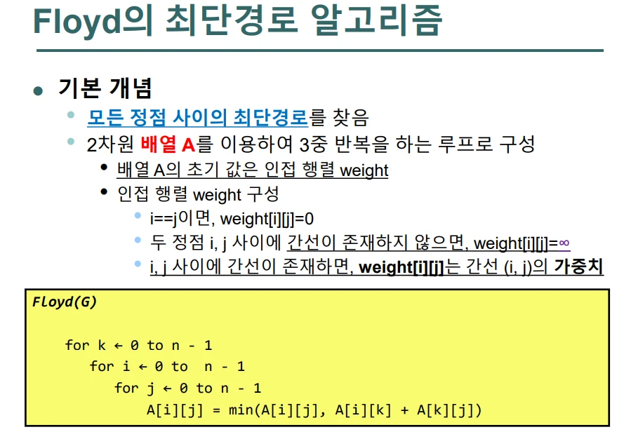

- for문에서 k는 A[k]를 구하려고 하는 것이다.  (이후에 설명)

- A[i][j] = min(A[i][j], A[i][k] + A[k][j])

    바로 가는 것과 경유해서 가는 것 중 뭐가 더 짧은지 판단

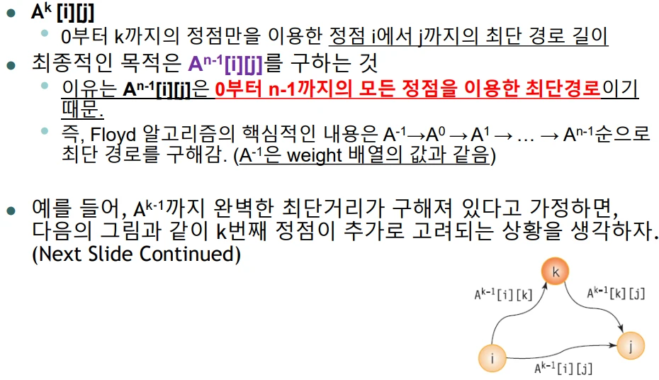

- $A^k[i][j]$ : 0부터 k까지의 노드를 이용했을 때에 구할 수 있는 A[i][j].

    $A,(-1)$  : 초기 가중치 그래프의 가중치와 같음.

    i도 모든 노드가 될 수 있고, j도 모든 노드가 될 수 있다. 그런데,  $A[i][j]$ $A[i][k] + A[k][j]$ 를 비교해서 더 짧은 것을 추가하면 된다.

- A^-1

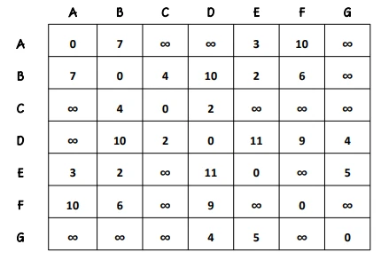

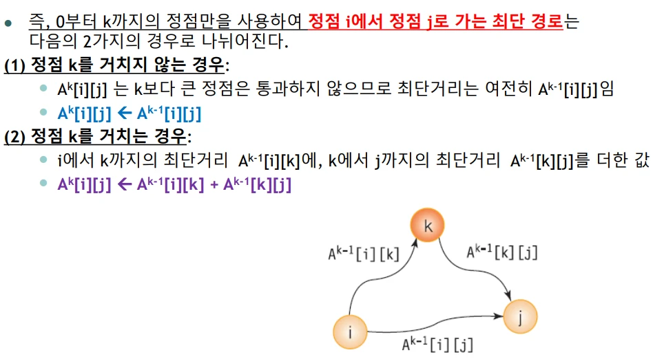

정점 i → 정점 j로 가는 최단 경로는 두 가지를 판단한다. (i, j는 모든 정점이 될 수 있음.)

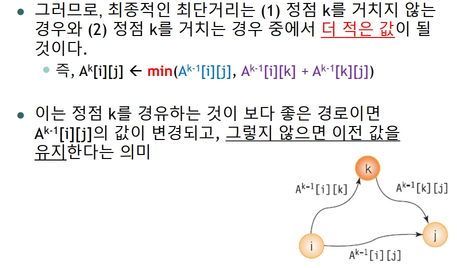

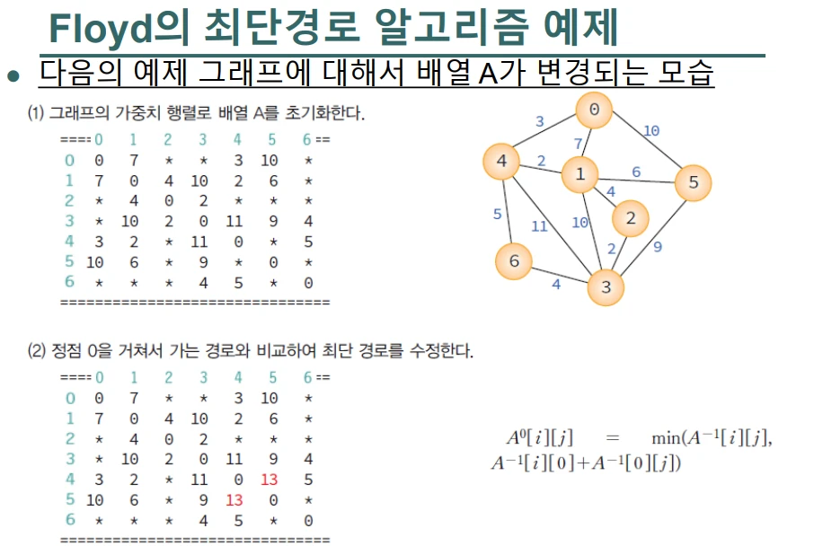

(1) : A^-1

vertex 0을 open하면, -1에서부터 0번 노드를 이용할 수 있게 되었다. 이전에는 4번 노드 → 5번 노드가 inf였지만, 0번 노드가 오픈되어 이용할 수 있게 되어서 거리가 업데이트 되었다.   
( * → 13)

