# 11주차: 맵 매칭, Dynamic Programming, Knapsack

작성일 2022-11-10 · 최종 수정일 2024-11-15
{ .post-date }

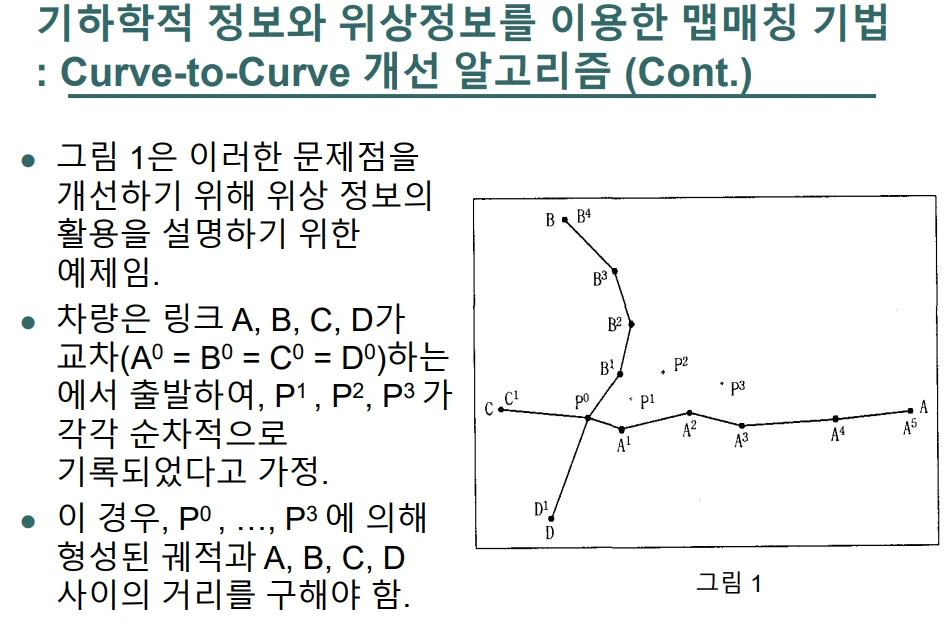

- 실제로 우리가 고려하는 경로는 교차점에서 P1 → P2 → P3 라고 하자. 그러면 이걸 어느 곳에 매칭 시킬 것인가? 

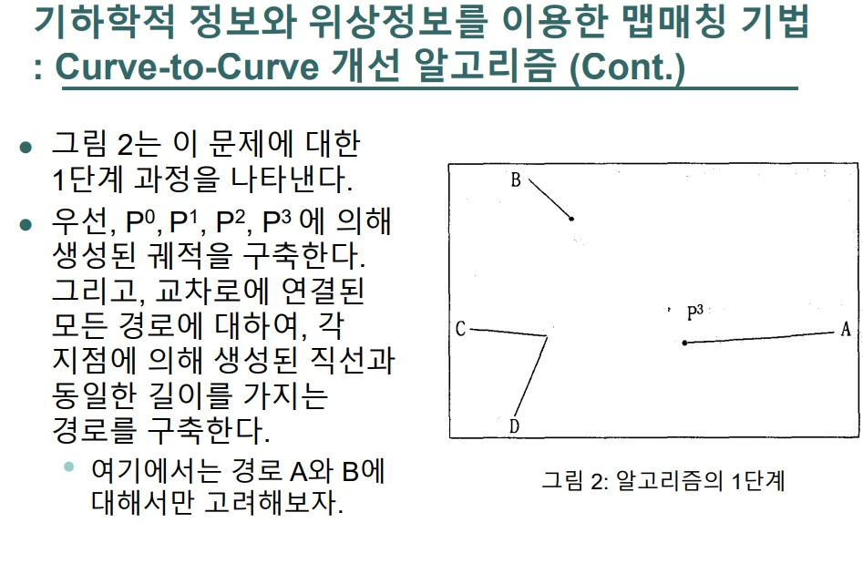

그렇다면, 교차로에 연결된 모든 경로 A, B, C, D 중 어느 곳에 매칭을 시켜야될까?

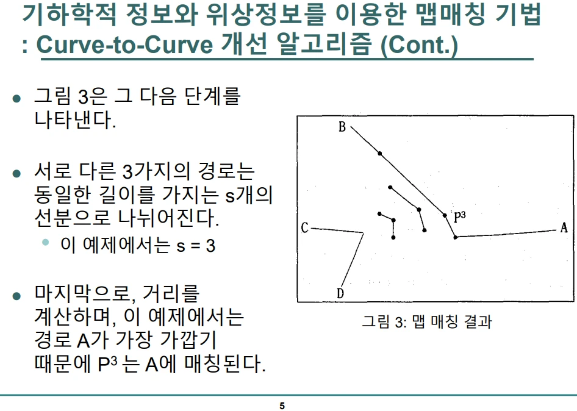

→ 그림의 일부가 빠졌는데, 꺾인 경로의 가운데 점이 Pn 이다.

이 예제에서는, 위상 정보를 이용하면 P0, P1, P2, P3는 경로 A와의 거리가 가장 짧으므로 A에 매칭될 수 있다. 

맵 매칭에는 point to point, point to curve, curve to curve가 있다.

---

## 동적 계획 알고리즘(Dynamic Programming)

큰 문제를 쪼개서 가장 작은 문제부터 해결하는 것인데, 이는 divide and conquer와 유사하다고 할 수 있다. 그러나, 다른 점이 존재한다.

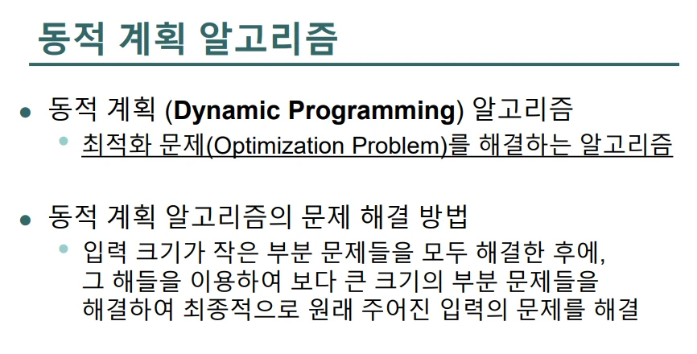

dynamic programming은 최적화 문제를 해결하는 방법이라고 생각할 수 있다. 입력 크기가 작은 걸로 최대한 쪼개고 작은 부분 문제들을 해결한 후에, 그 해들을 이용하여 큰 크기의 부분 문제들을 해결하여 최종적으로 원래 주어진 입력의 문제를 해결하는 방법이다.

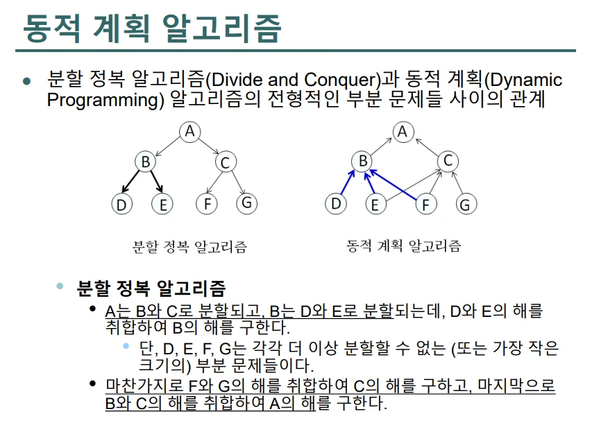

큰 문제가 A이며, 분할 정복 알고리즘의 경우 D, E의 해를 이용하여 B를 구하고 F, G의 해를 이용하여 C를 구한 뒤, B, C의 해를 이용하여 A를 구한다.

DP는 이와 다르게, 다른 곳의 해를 끌어올 수 있는 것이다. 예를 들어, B의 해를 구할 때 D, E 뿐만 아니라 F, 혹은 G 까지도 끌어와서 사용해 부분해를 구할 수 있는 것이다. (DP는 Subproblem간에 Dependency(의존성)가 있다.)

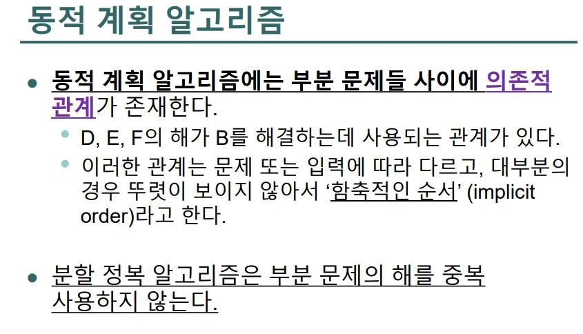

Dynamic Programming은 의존적인 관계가 존재하고 이는 드러나지 않을 수 있다. 분할 정복 알고리즘은 부분 문제의 해를 중복 사용하지 않지만, 동적 계획은 의존적이기 때문에, 이전에 나왔던 sub solution을 끌어다가 중복해서 사용할 수 있다.

---

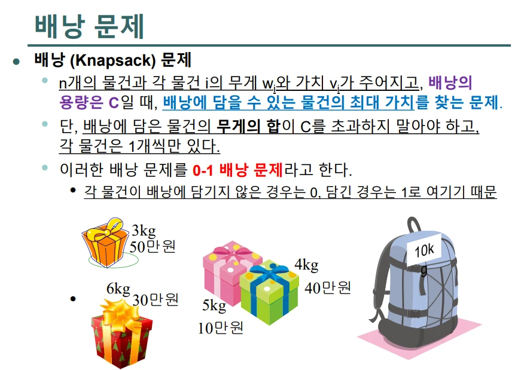

- Knapsack 문제는 DP를 이용해 해결 가능한 가장 대표적인 문제이다.

i : 물건의 index

w : 물건[i]의 weight(무게)

v : 물건[i]의 value(가치)

knapsack의 용량이 Capacity(C)로 주어지며, 배낭에 담을 수 있는 최대 가치를 찾는 문제이다. 그런데, 각 물건은 고유하며 한 개만 존재한다. 여러 개가 있는 경우도 있겠지만, 여기서는 zero-one (넣거나 안넣거나) 만 고려한다.

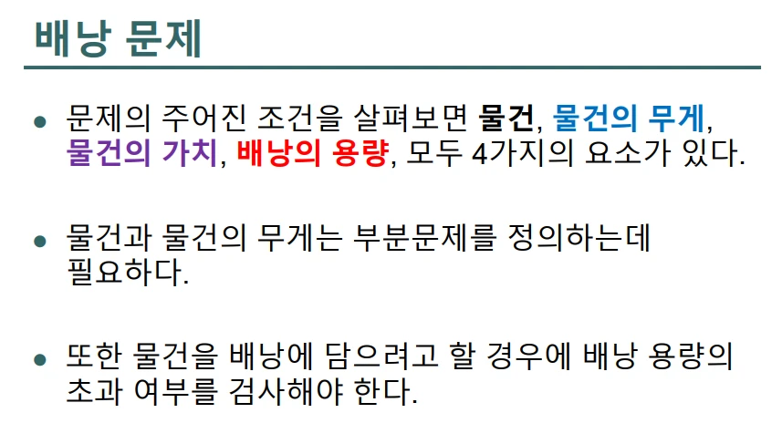

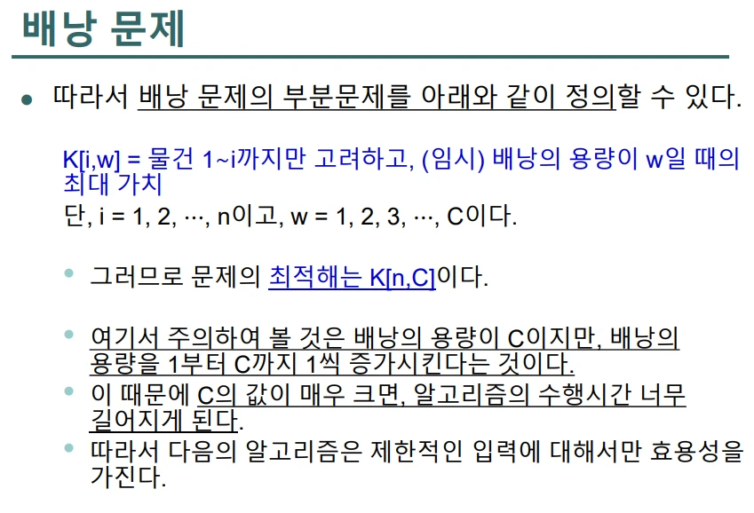

- 물건을 1개만 고려할 때, 물건을 2개만 고려할 때 … 이런 식으로 점점 추가적으로 물건을 고려해가면서 부분 문제를 만들어낸다.

    K[i, w]는 물건을 1~i 까지 고려하고, 용량을 w로 고려했을 때에 얻을 수 있는 최대 가치를 의미한다. 그러므로 우리가 얻고자 하는 것은, 최적해 K[n, C]이다.

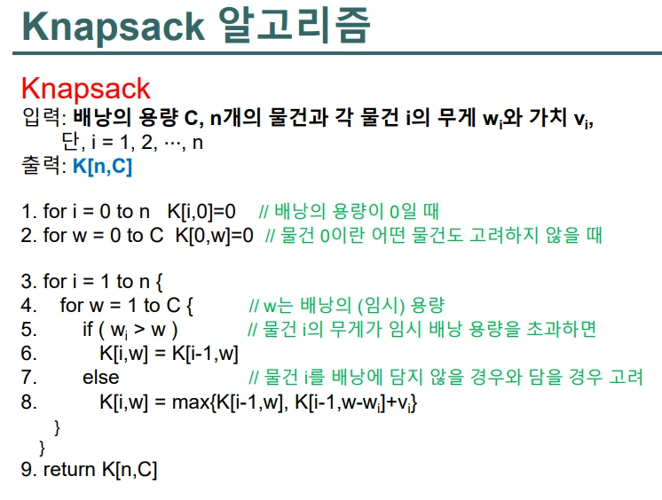

main line은 3~8이다. 

line 5-6 : 현재 고려되는 물건의 무게가 임시 배낭 용량(w)보다 크다면, 물건을 담지 못하므로, 그냥 이전의 K[i, w]를 최대 가치(solution)로 고려한다.

line 7-8 : 

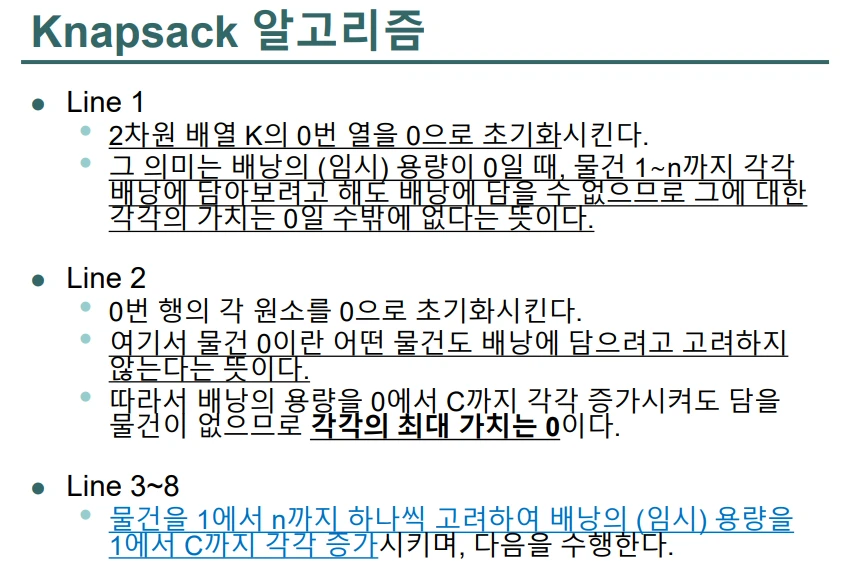

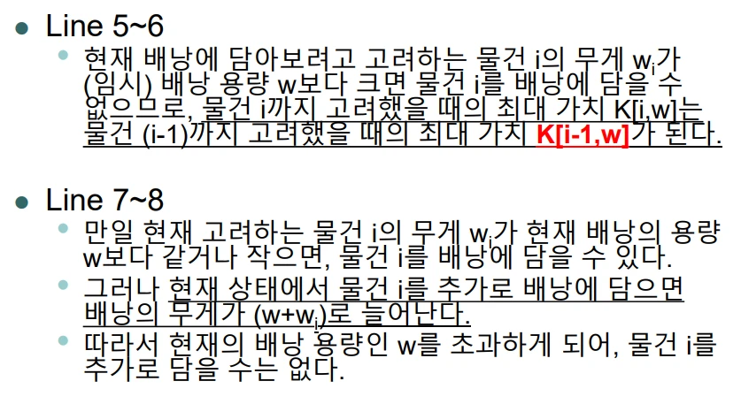

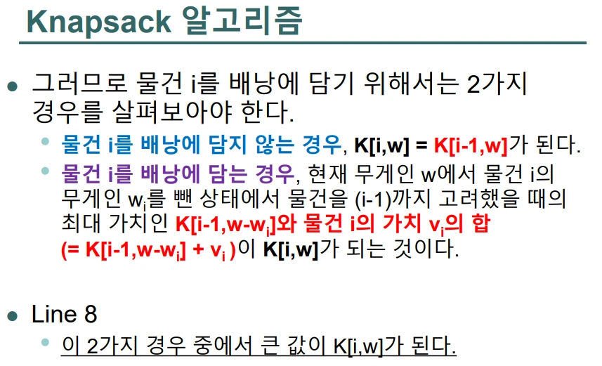

결국, K[i, w]를 구하려고 하는 것이다. 물건 i를 배낭에 담지 않는 경우, 이전의 K를 고려한다. 물건 i를 배낭에 담을 수 있는 경우, 이전 물건까지 K를 고려할 때의 경우가 현재의 경우와 비교했을 때, 가치가 더 큰 것을 K[i, w]로 만든다.

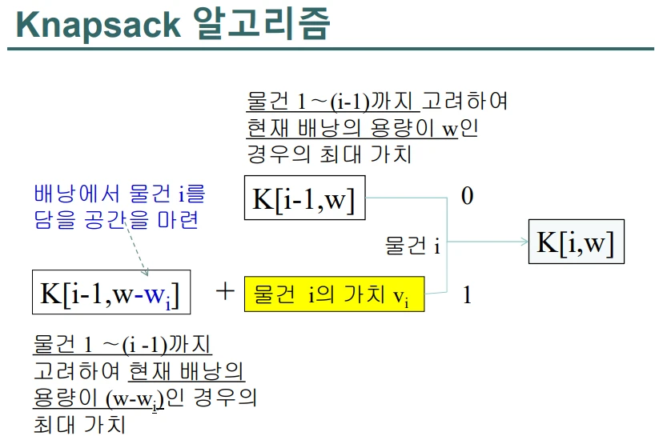

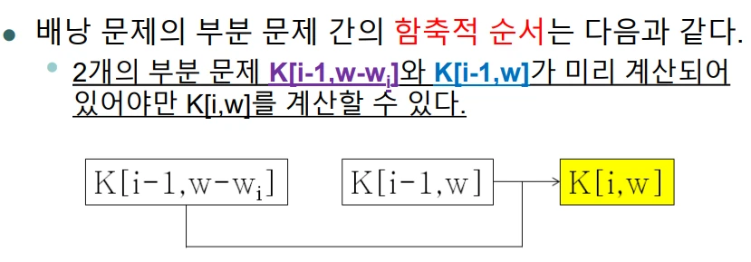

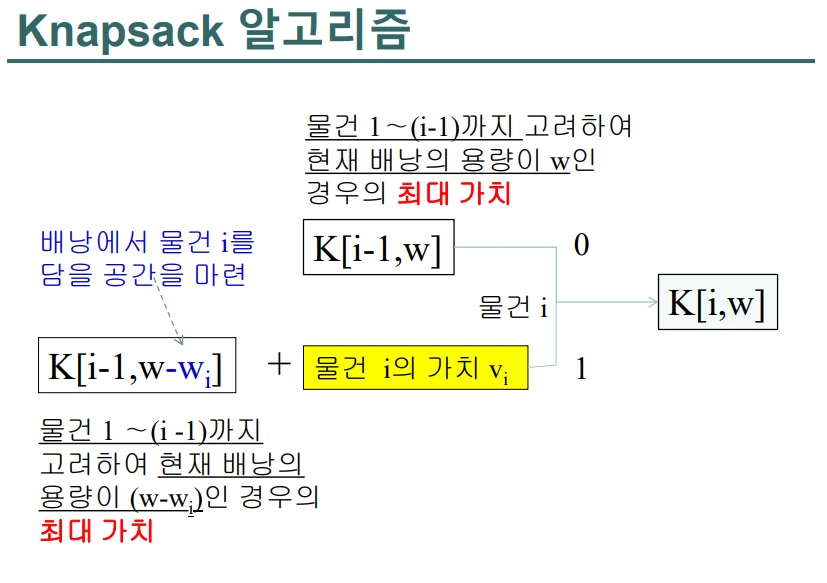

- 이 슬라이드를 봤을 때, 만약 물건을 넣을 수 있는 경우에는 K[i-1, w-wi]과 현재 물건 i의 가치 vi를 더한 것이, 이전의 물건까지 고려했을 때 현재 용량일 경우와 비교하여 가치가 더 큰 것을 K[i, w]로 만들어준다. 

    K[i-1, w-wi]는 현재 물건의 용량을 빼서 물건 i를 담을 공간을 마련한 것이다. 이 때의 가치에 현재 물건 i의 가치를 더한 것을 K[i-1, w]와 비교해야 물건을 새롭게 넣은 것의 가치와 이전의 가치를 비교할 수 있게 된다.

---

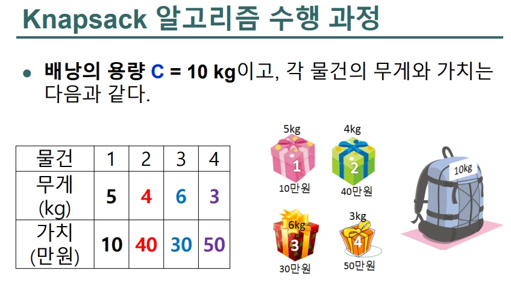

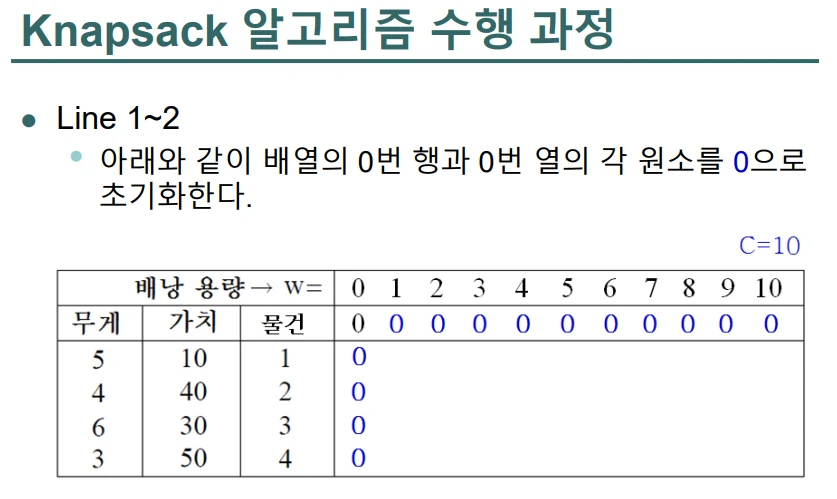

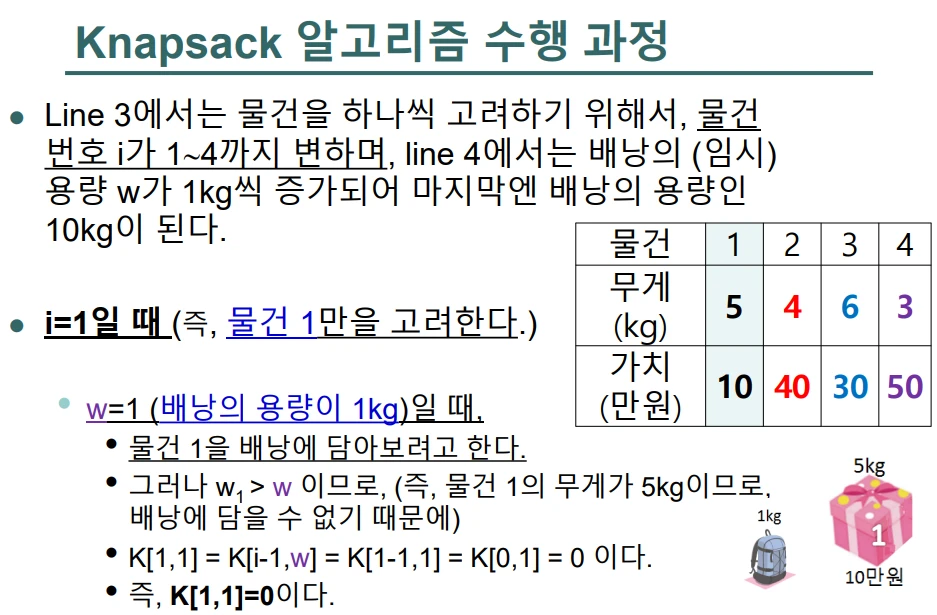

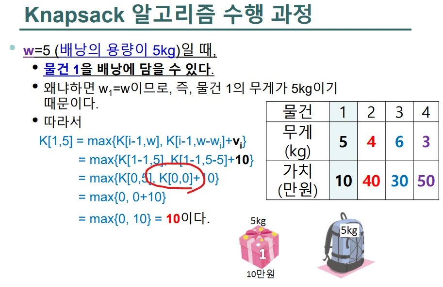

→ DP가 이전의 sub solution을 끌어오는 것을 보여준다.

---

> 분할 정복은 각각의 sub problem의 solution이 dependency를 가지지 않지만, 동적 계획은 각각의 sub problem의 solution이 dependency를 가져서 sub solution이 다른 sub solution에 중복되어 사용될 수도 있다. (0-1 problem)
