# 14주차 (1): 허프만 압축

- 허프만 압축

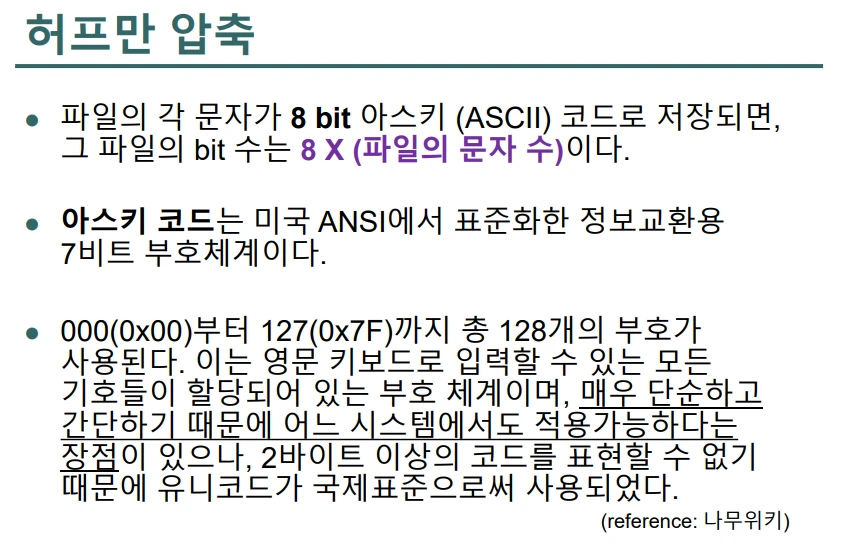

- 파일을 압축할 때, 파일의 각 문자가 8 bit의 ASCII 코드로 저장되면, 그 파일의 bit 수는  
    8 * (file의 문자 수)
- ASCII는 0x00 - 0x7F까지 총 128개의 부호를 사용한다.

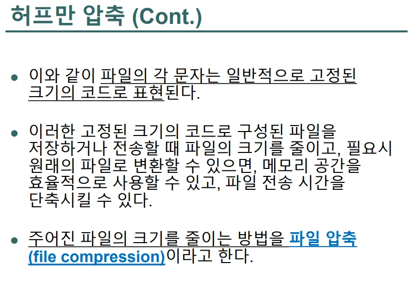

- 이처럼 파일의 각 문자는 일반적으로 고정된 크기의 코드로 표현된다. 그런데, 고정된 크기의 코드로 구성된 파일을 저장하거나 전송할 때는 파일의 크기를 줄이고 필요할 때 원래의 파일로 변환할 수 있으면, 메모리 공간을 효율적으로 사용하고 파일 전송 시간을 단축시킬 수 있다.
- 주어진 파일의 크기를 줄이는 방법을 파일 압축이라고 한다.

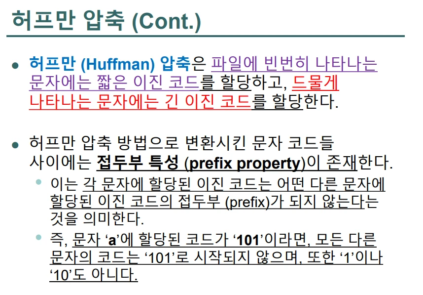

- 허프만 압축의 아이디어

파일 안에 여러가지 문자가 나타날 수 있는데, 현재 파일 안에 빈번히 나타나는 문자열은 짧은 binary 코드를 할당하고, 드물게 나타나는 문자에는 긴 이진 코드를 할당하는 방식이다.

- 허프만 압축 방법으로 변환시킨 문자 코드들 사이에는 Prefix Property(접두부 특성)가 존재한다.

<!-- -->

1. 각 문자에 할당된 이진 코드는 어떤 다른 문자에 할당된 이진 코드의 접두부(prefix)가 되지 않는 것을 의미한다.
2. 즉, 문자 ‘a’에 할당된 코드가 ‘101’이라면 모든 다른 문자의 코드는 ‘101’로 시작되지 않으며, 또한 ‘1’이나 ‘10’도 아니라는 것이다.

트리를 이용한다.

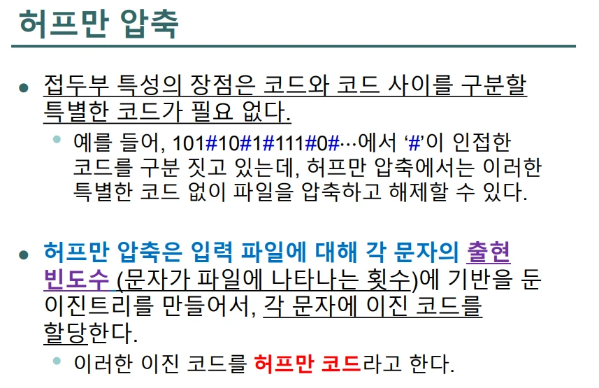

- Prefix Property를 이용하면, 코드와 코드 사이를 특별히 구분할 코드가 필요 없다는 것이다. 위의 예제에서는 #을 이용해서 각각의 문자를 구분하고 있는데, 허프만 압축에서는 이러한 구분자가 필요없이 파일을 압축하고 해제할 수 있다.
- 허프만 압축을 입력 파일에 대해 각 문자의 출현 빈도수 (문자가 파일에 나타나는 횟수)에 기반을 둔 이진트리를 만들어서, 각 문자에 이진 코드를 할당한다.  
    ⇒ 이러한 이진 코드를 `허프만 코드` 라고 한다.
- 허프만 코드의 Pseudo code

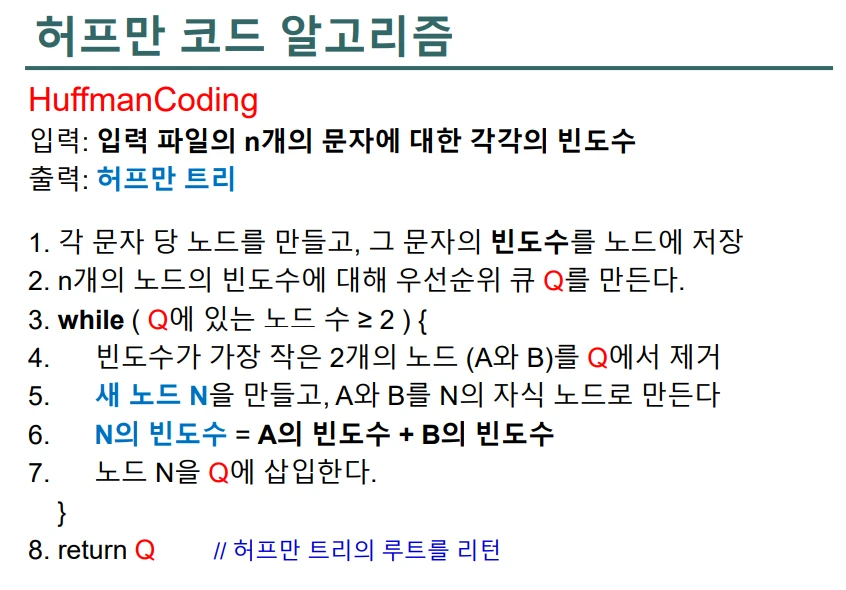

- n 개의 문자가 있는데, 예를 들어 A는 빈도수가 50이고, B는 70이라고 가정한다면, 이를 나타내는 빈도수를 입력으로 넣어준다. 출력으로는 빈도수를 바탕으로 만들어진 허프만 트리를 내보낸다.

<!-- -->

1. 각 문자당 노드를 만들고, 그 문자의 빈도수를 노드에 저장한다.
2. n개의 노드의 빈도 수에 대해서 우선순위 큐 Q를 만든다. (Heap 구조를 고려할 수 있음.)
3. while ( Q에 있는 노드 수 ≥ 2 ) { 우선 순위 큐 안의 노드 수가 2개 이상인 경우 진행 가능.
4. 빈도 수가 가장 작은 2 개의 노드를 Q에서 제거  
    ⇒ 여기서는 A 50, B 70으로 빈도수가 가장 작아서 제거했다고 가정해보자.
5. 새 노드 N을 만들고, Q에서 빼낸 A, B를 N의 자식 노드로 만든다.
6. N의 빈도수 = A의 빈도수 + B의 빈도수. 즉, N의 빈도수는 50 + 70 = 120이 될 것이다.

7. 노드 N을 Q에 삽입한다.

    }

8. return Q // 허프만 트리의 루트를 리턴한다.

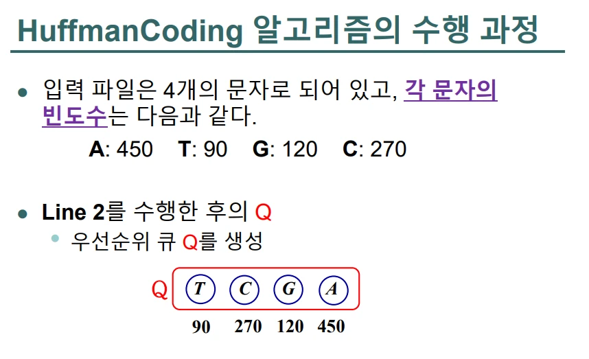

- 예제로, A T G C를 고려한다고 하자. 빈도수는 위와 같다.
- 우선순위 큐 Q를 생성하고, 빈도수 정보를 대입한다.
- 이제 while loop을 실행한다.

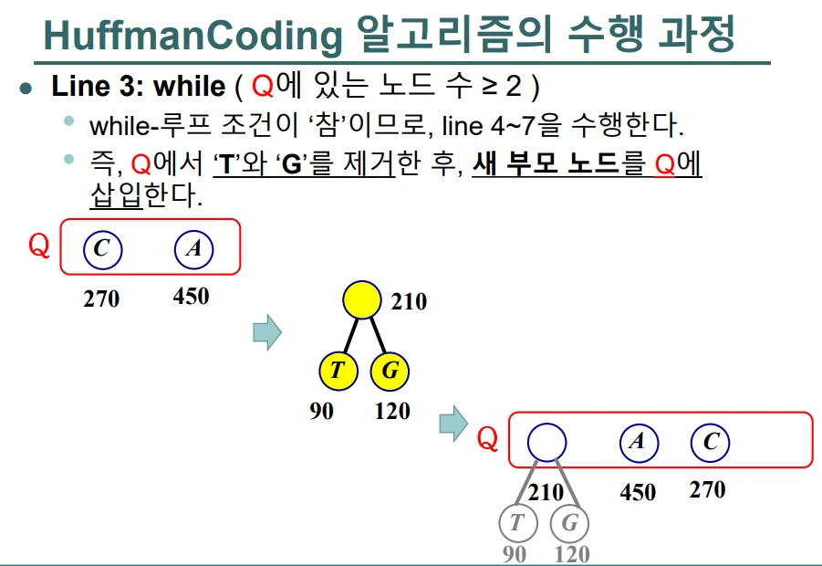

- Q안의 노드가 네 개 있으므로, while loop을 실행할 수 있다.
- 가장 빈도수가 작은 두 개를 제거해서 새로운 노드 N으로 만들어야 하므로, 빈도수가 가장 작은 T와 G를 Q에서 빼낸다. 
- 새로운 노드 N을 만들고, T와 G를 N의 자식 노드로 만든다.
- N을 Q에 추가한다.

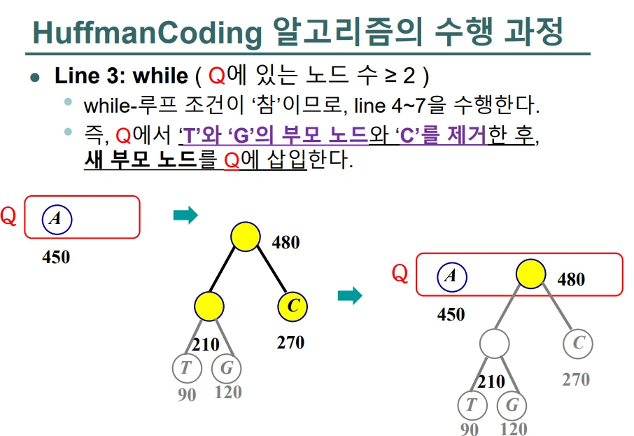

- 현재 한 번의 iteration을 돌았는데, Q에 있는 노드의 수가 3이므로 iteration을 더 돌 수 있다.
- 다시 빈도수가 가장 작은 두 개를 빼낸다.
- 다시 새로운 노드 N2를 만들어서 빼낸 노드 N(210)과 C(270)을 자식 노드로 추가한다.
- 그 뒤, N2를 Q에 추가한다.

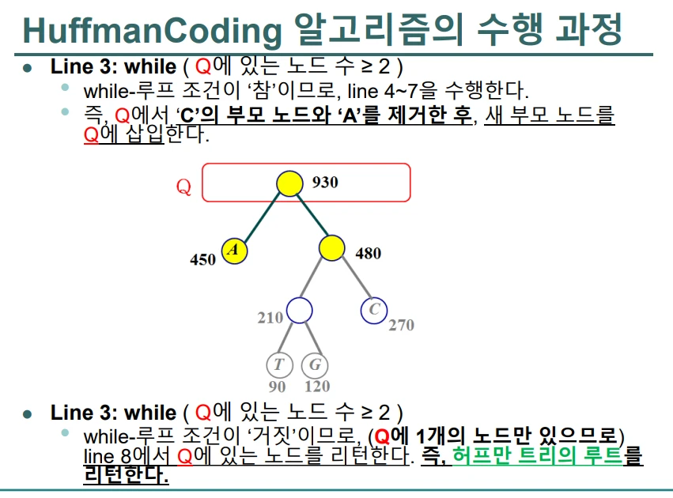

- 현재 Q에는 두 개의 노드가 있으므로, iteration을 더 돌 수 있다.
- 다시 한번 루프를 돌면, 위와 같은 결과가 나온다.
- 이제 N3 노드만 남았으므로, while loop가 종료된다. N3(930)
- 이제 허프만 트리의 루트 Q를 return한다.

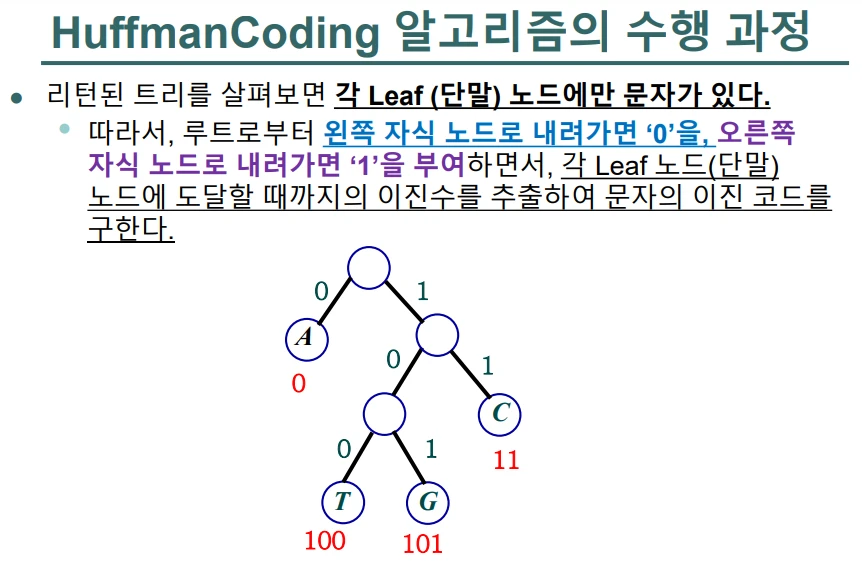

- 리턴된 트리를 보면, Leaf 노드에만 문자가 있다.
- A : 0
- T : 100
- G : 101
- C : 11
- 제일 빈도수가 많은 것을 짧은 코드로 할당하는 것이 유리하므로, 빈도수가 가장 높은 A(450)이 가장 짧은 코드인 0으로 할당된 것을 볼 수 있다.

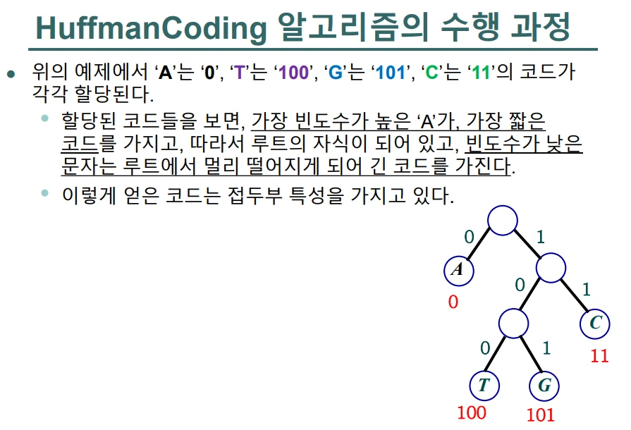

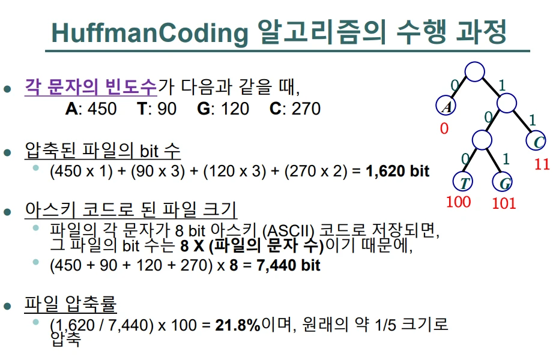

- 압축된 파일의 bit 수는, 문자의 빈도수 * 이진코드의 길이  
    따라서, 450\*1 + 90\*3 + 120\*3 + 270\*2 = 1,620 bit이다. (0, 100, 101, 11)
- ASCII 코드로 된 파일의 크기는, 파일의 각 문자가 8bit 아스키 코드로 저장되기 때문에 압축된 파일의 bit 수 * 8을 하면, 1,620 * 8 = 7,440 bit이다.
- 이렇게 되면, 파일의 압축률은 (1,620 / 7,440) * 100 = 21.8% 이다. 원래 파일의 약 1/5 크기로 압축되는 것을 확인할 수 있다.

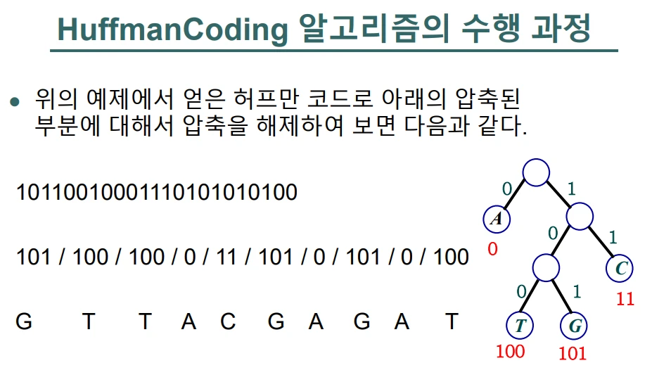

10110010001110101010100  
101/100/100/0/11/101/0/101/0/100

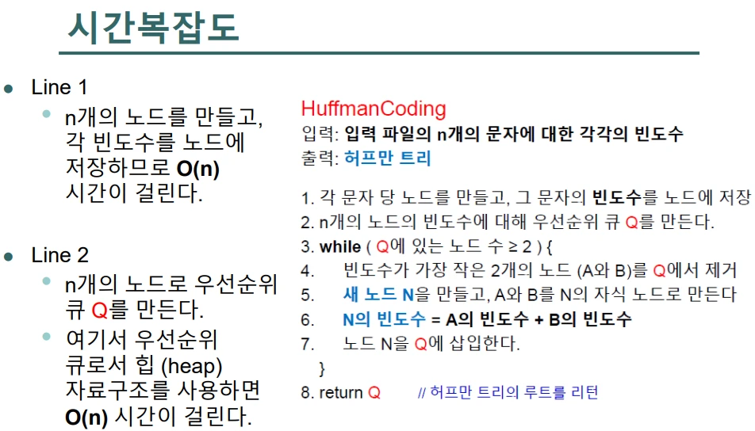

$O(n)$

$O(n)$

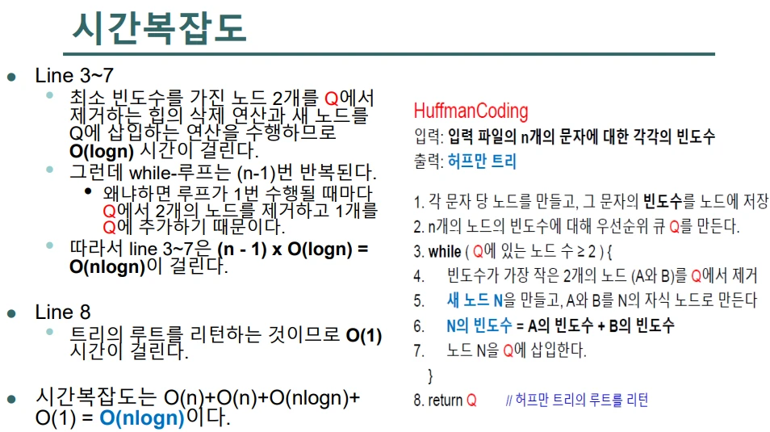

$O(nlogn)$

$O(1)$

모든 시간 복잡도를 더하면, 결국 $O(nlogn)$이 된다.

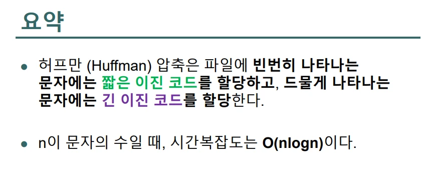
