# Approximation Algorithm

## 통 채우기 문제

n개의 물건이 주어지고 통(bin)의 용량이 C일 때, 모든 물건을 가장 적은 수의 통에 채우는 문제. 단, 각 물건의 크기는 C보다 크지 않다.

- Greedy Algorithm을 사용한다.

<!-- -->

1. 최초 (처음) 적합, `First Fit`  
    -&gt; 첫 번째 통부터 차례로 살펴보며, 가장 먼저 여유가 있는 통에 새 물건을 넣는다.
2. 다음 적합, `Next fit`  
    → 직전에 물건을 넣은 통에 여유가 있으면 새 물건을 넣는다.
3. 최선 적합, `Best Fit`  
    -&gt; 기존의 통 중에서 새 물건이 들어가면 남는 부분이 가장 작은 통에 새 물건을 넣는다.
4. 최악 적합, `Worst Fit`  
    → 기존의 통 중에서 새 물건이 들어가면 남는 부분이 가장 큰 통에 새 물건을 넣는다.

⇒ 이 방법 중 하나로 새 물건을 기존의 통에 넣을 수 없으면, 새로운 통에 새 물건을 넣는다.

> 통의 용량 C = 10, 물건의 크기가 각각 [ 7, 5, 6, 4, 2, 3, 7, 5 ]라고 할 때, First Fit, Next Fit, Best Fit, Worst Fit을 적용해본다.

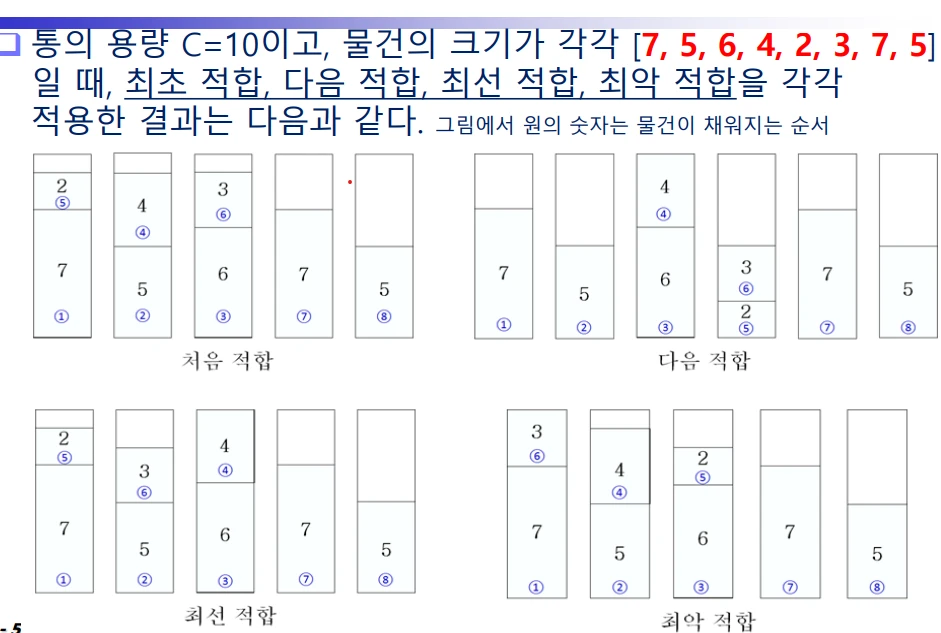

- 시간 복잡도 : `Next Fit`을 제외한 다른 세 가지 방법은 새 물건을 넣을 때마다 기존의 통을 살펴보아야 한다. n개의 물건을 넣을 때 n개의 통을 살펴보아야 하므로, 최악의 경우 `O(n)`이다.  
    `Next Fit`은 새 물건에 대해 직전에 사용된 통만 살펴보면 되므로, n개의 물건에 대하여 동작할 때 최악의 경우 수행시간은 `O(n)`이다.
- `Next Fit`을 제외한 세 가지 방법은, 논리적으로 모든 물건을 넣었을 때 `두 개` 이상의 통이 `1/2`  `이하`로 차 있을 수 없다.
- 만일 `두 개`의 통이 각각 `1/2`  `이하`로 차 있다면, 각 방법은 `새 통`을 사용하지 않고, 이 두 개의 통에 있는 물건을 `한 통`으로 합친다.

> Greedy Algorithm을 사용하므로, 최적해의 성능에서 2배를 넘지 않는다.

## 작업 스케쥴링 문제

- n개의 작업
- 각 작업의 수행 시간 ti, i = 1, 2, 3, …, n
- 그리고 m개의 동일한 기계가 주어질 때, 모든 작업이 가장 빨리 종료되도록 작업을 기계에 배정하는 문제이다.

⇒ 단, 한 작업은 배정된 기계에서 연속적으로 수행되어야 한다.  
⇒ 또한, 기계는 한 번에 하나의 작업만을 수행한다.

> Greedy Algorithm을 사용해서 최적해의 수행 시간의 2배가 넘지 않도록 한다.  
> ⇒ 현재까지 배정된 작업에 대해서 가장 빨리 끝나는 기계에 새 작업을 배치한다.

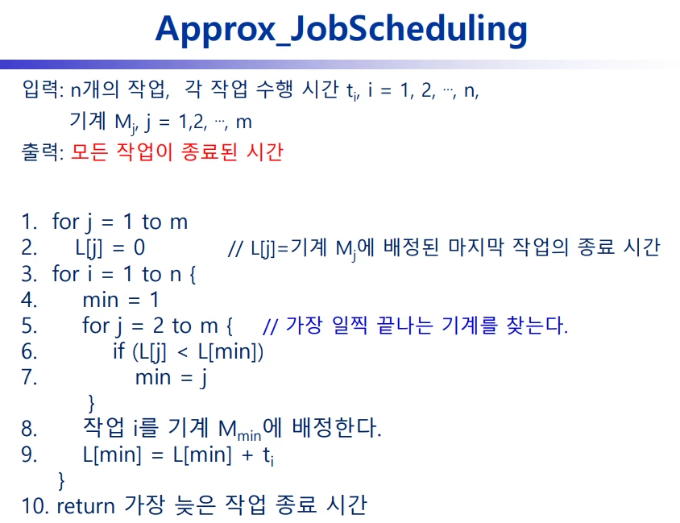

- 입력 : n개의 작업, 각 작업 수행 시간 ti, i = 1, 2, …, n
- 기계 Mj, j = 1, 2, …, m
- 출력 L, : 각 기계의 수행 시간 중 가장 긴 시간. 즉, 모든 작업이 종료된 시간

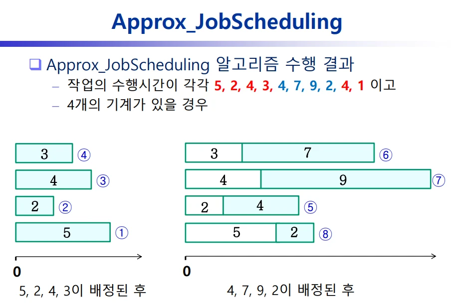

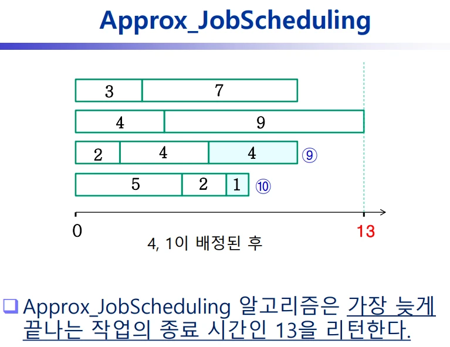

L[0] = 8

L[1] = 10

L[2] = 13

L[3] = 10

이 중에서 가장 큰 값을 return하므로, return L[2]; ⇒ 13

- 시간 복잡도 : n개의 작업을 하나씩 가장 빨리 끝나는 기계에 배정한다. 하나의 작업을 기계에 배정하는 것은 $O(1)$로 무시할 수 있음. 이러한 기계를 찾기 위해 for loop를 m-1번 수행하므로, 한 작업을 배정하기 위해 모든 기계의 마지막 작업 종료 시간인 L[j]를 살펴보아야 하므로, $O(m)$이 소요된다.  
    이러한 작업을 n개의 작업에 대해서 적용하므로, $n * O(m)$ 이 소요되며, 작업이 끝나면 가장 소요시간이 긴 작업의 시간을 탐색해야하므로 $O(m)$ 이 추가로 소요된다. 따라서, 이 둘을 더하면 $n*O(m) + O(m) = O(nm)$ 이다.

## 클러스터링 문제

- 입력으로 주어진 n개의 점을 k개의 그룹으로 나누고 각 그룹의 중심이 되는 k개의 점을 선택하는 문제이다.
- 단, 가장 큰 반경을 가진 그룹의 직경이 최소가 되도록 k개의 점이 선택되어야 한다.

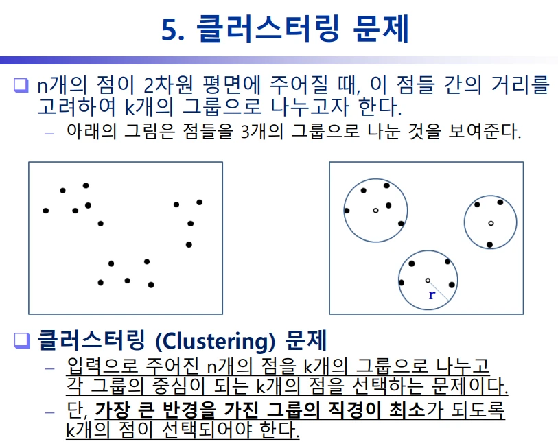

- 각 클러스터 내에서 비어있는 점은 head(center)이다.

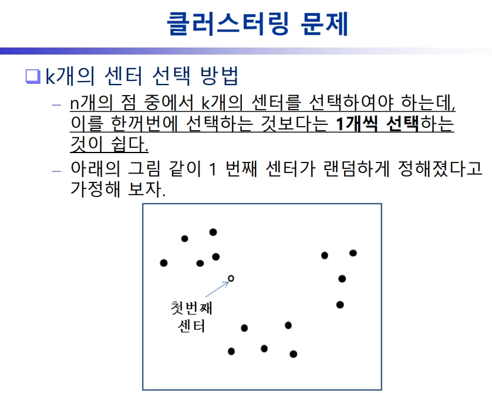

- 첫 번째 센터를 random하게 선택한다. 그 후, 두 번째 센터를 선택하는 방법은 현재 선택된 센터에서 먼 점을 선택하는 방법을 채택하도록 한다.

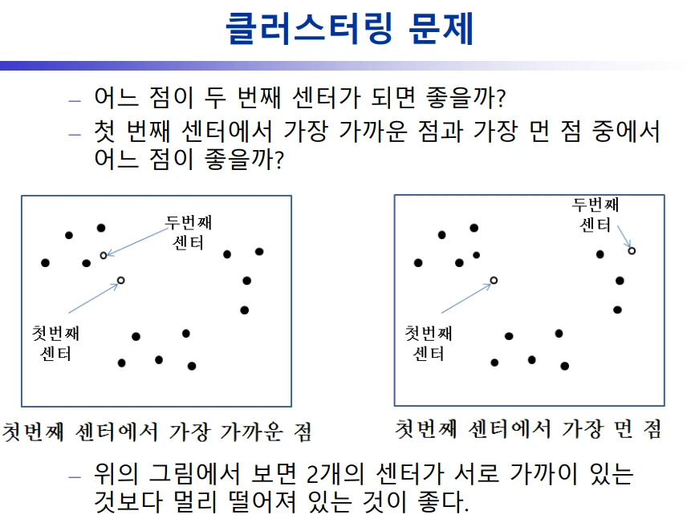

> 이 방식도 일종의 Greedy Algorithm이다. 그러므로 Approximation ratio가 2보다는 작다.

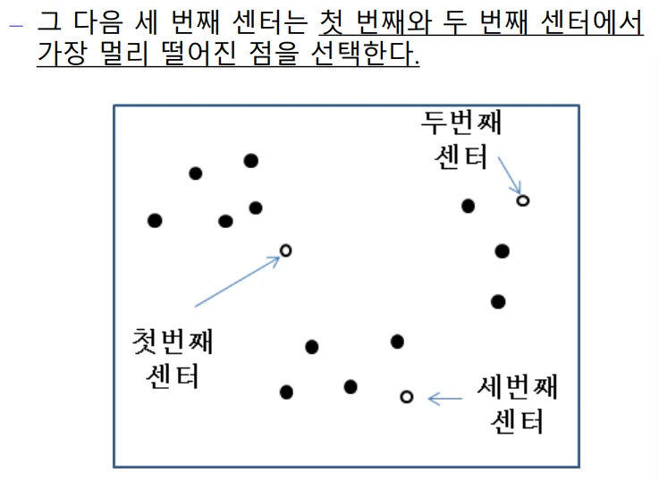

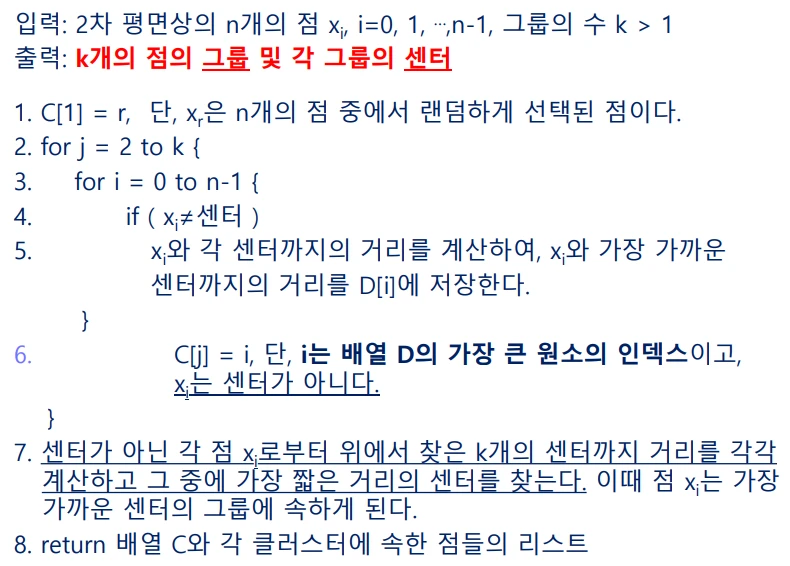

- 랜덤으로 하나의 점`(센터)`을 고르고, 그 점을 기준으로 나머지 모든 점과의 거리를 계산한다.
- 계산된 거리 D[i]중에서 거리가 가장 큰 것을 골라 다음 센터로 만든다. (단, 센터가 아니어야 함)
- for loop을 나오게 되면, 센터가 아닌 각 점 xi를 체크한다. 현재 선택된 센터들 중, xi와의 거리가 가장 가까운 센터에 xi가 포함되어 클러스터를 구성하게 된다.

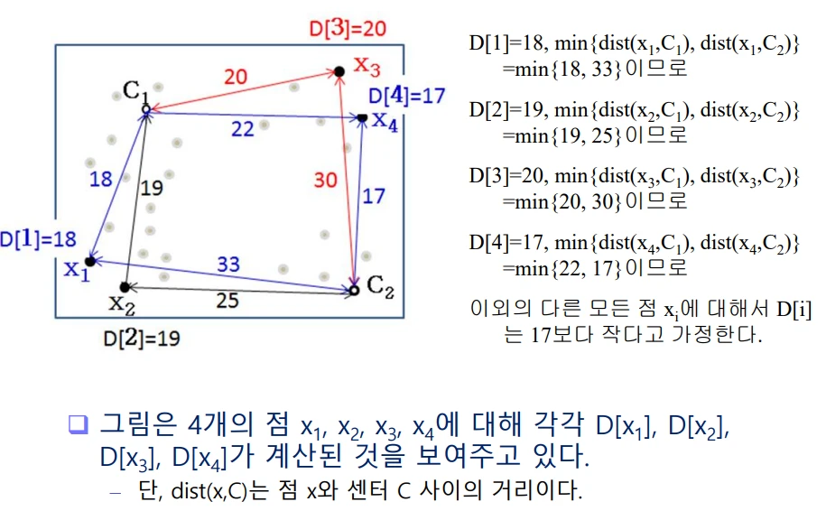

- xi와 각 센터 사이의 거리를 구하고, 센터와의 거리에서 작은 값이 가장 큰 xi를 다음 센터로 지정한다. 위의 예에서는 각 점 xi와 센터와의 거리를 D[i]라고 할 때, min(D[i])의 값이 가장 큰 점인 x3가 다음 센터로 지정된다.

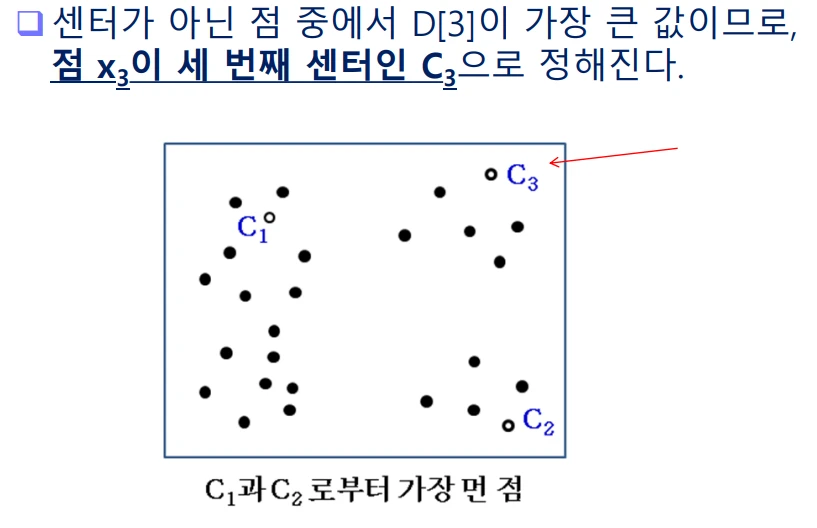

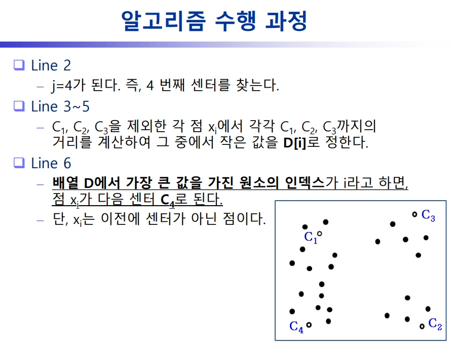

- 이전과 같은 방식으로 센터 C4를 결정한다.

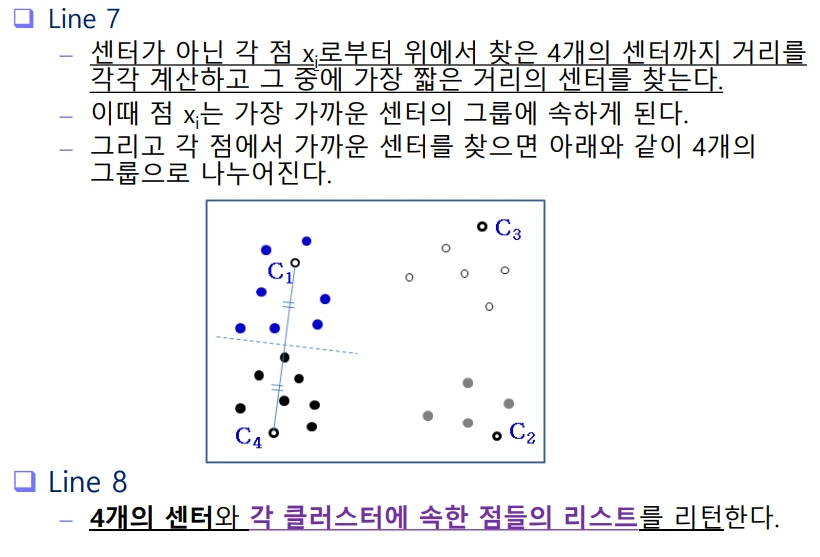

- 위 그림과 같이, 센터가 아닌 점 xi와 각 센터들과의 거리를 구해서, 거리가 짧은 센터에 각 점 xi가 귀속된다. 이렇게 되면 k개의 클러스터를 리턴할 수 있게 된다.

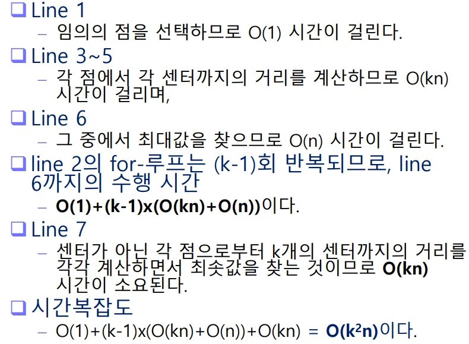

- 시간 복잡도 

<!-- -->

1. 임의의 점을 선택하므로, $O(1)$이 소요된다.
2. 각 점에서 각 센터까지의 거리를 계산하므로, $O(kn)$이 소요된다.
3. 그 중에서 최대값을 찾으므로 $O(n)$시간이 걸린다.
4. 2~3의 for loop는 (k-1)회 반복되므로, $O(1) + (k-1)*(O(kn) + O(n))$이다. 
5. 센터가 아닌 각 점으로부터 k개의 센터까지의 거리를 각각 계산하면서, 최솟값을 찾는 것이므로 $O(kn)$ 시간이 소요된다.

⇒ $O(1) + (k-1)*(o(kn)+O(n)) + O(kn)$ = $O(k^2n)$

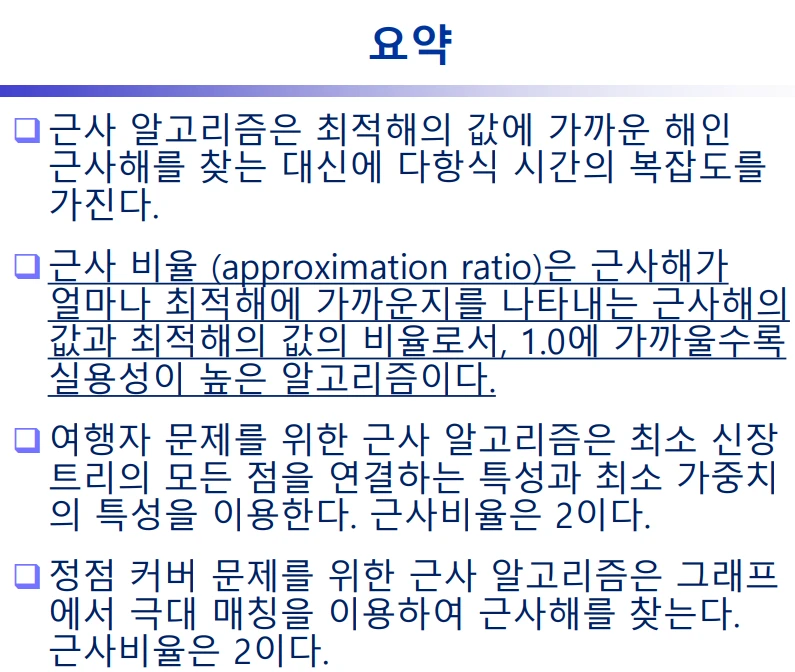

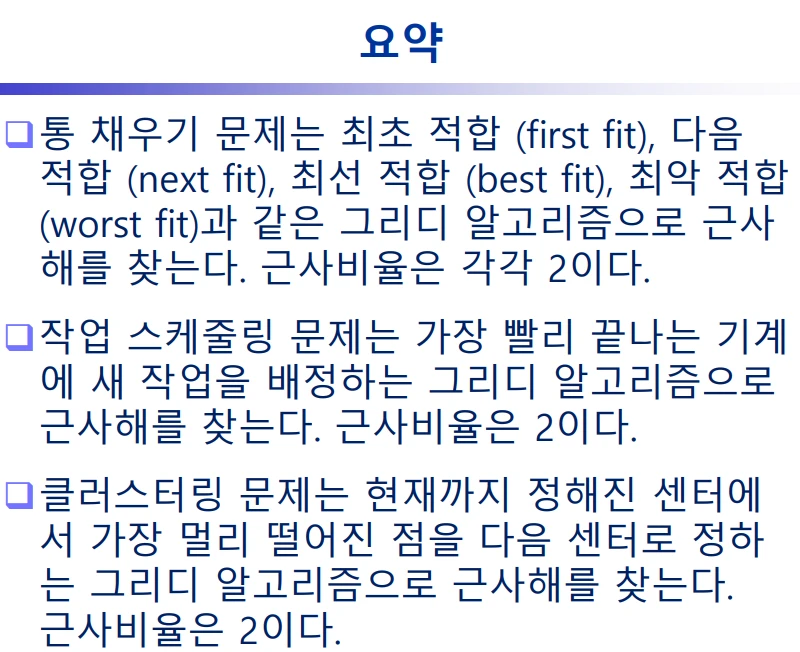
