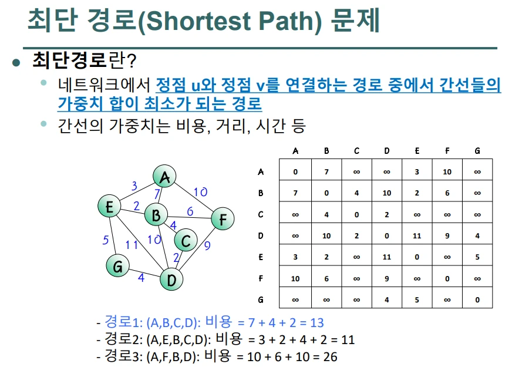
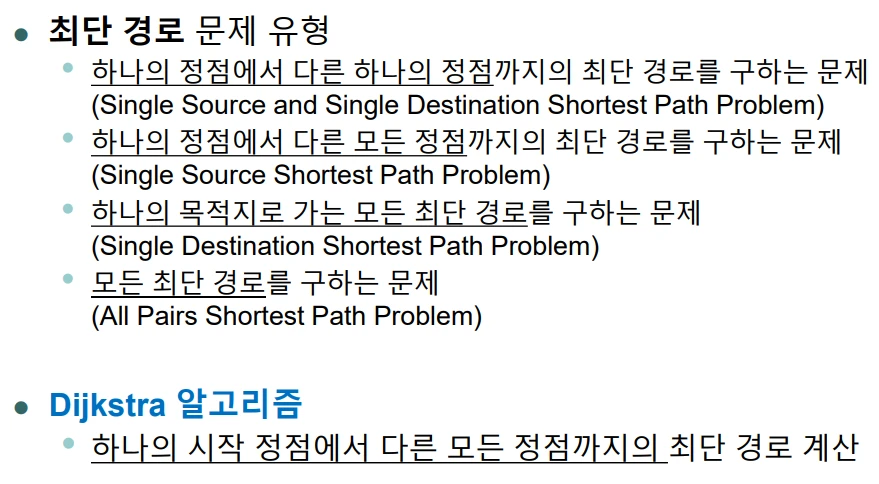
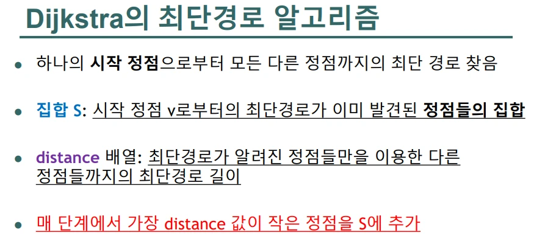

# Dijkstra

작성일 2022-12-04
{ .post-date }

- 최단 경로란? : 그래프에서 한 정점u와 정점 v를 연결하는 경로 중에서 간선들의 가중치의 합이 최소가 되는 경로

- 큰 카테고리는 최단 경로를 찾는 것이고, 네 개의 sub problem이 있다.

<!-- -->

1. 하나의 정점에서 다른 하나의 정점까지의 최단 경로
2. 하나의 정점에서 다른 모든 정점까지의 최단 경로
3. 하나의 목적지로 가는 모든 최단 경로를 구하는 문제
4. 모든 최단 경로를 구하는 문제

→ 모든 노드에 대해서, 각 노드에서 다른 노드로 가는 모든 최단 경로를 찾는 문제

Dijkstra는 sub problem에서 2번 문제에 대해 다루는 내용이다.

매 iteration마다 새롭게 열리는 노드를 바탕으로 집합 S를 업데이트한다. 집합 S는 시작 정점 v로부터의 최단 경로가 이미 발견된 정점들의 집합이며, 여기서 가장 distance값이 작은 노드를 집합 S에 추가하면서 distance 배열을 업데이트한다.

- 시간 복잡도

<!-- -->

1. Outer while loop이 `n`번 반복되고, 1회 반복될 때마다 배열 `distance`, `D`에서 최소의 점을 찾아 집합 S에 추가하게 되므로, $O(n)$의 시간이 걸린다. 
2. 이후, 새로운 점이 S에 추가됨에 따라 새로운 점을 거쳐서 다른 n-1개의 노드까지 가는 거리가 이전의 거리보다 짧다면, 갱신한다. 이 과정은 $O(n)$의 시간이 소요된다.
3. 따라서, $n * (O(n) + O(n))$ = $O(n^2)$
