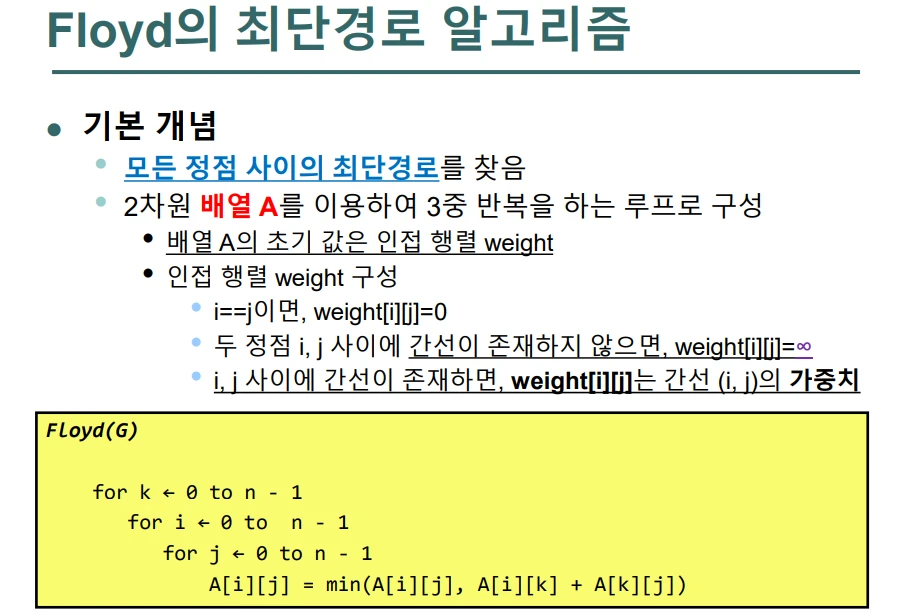
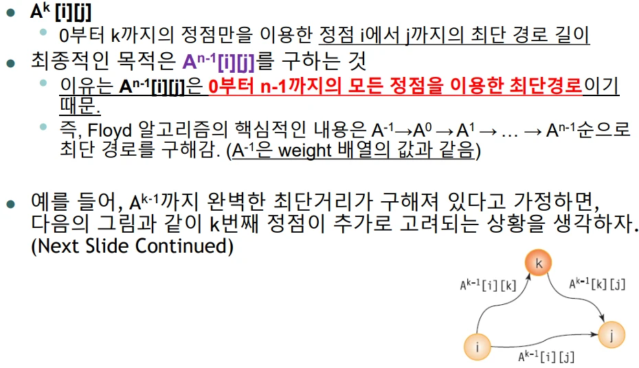
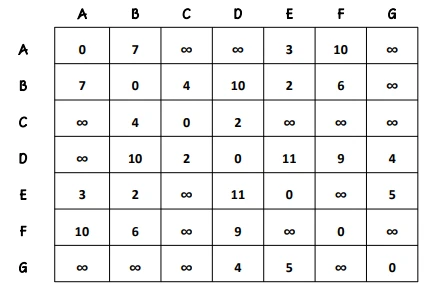
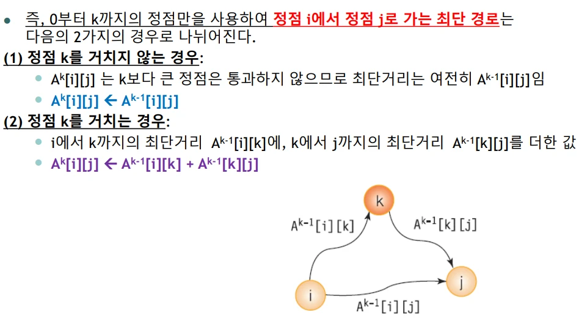

# Floyd

작성일 2022-12-04 · 최종 수정일 2022-12-05
{ .post-date }

- 기본 개념 : `모든 정점` 사이의 `최단 경로`를 찾는다.
- 2차원 배열 `A`를 이용하여 `3중 반복`을 하는 루프로 구성된다.
- `배열 A`의 `초기 값`은 인접 행렬 `weight`

- $A^k[i][j]$ : 0부터 k까지의 노드를 이용했을 때에 구할 수 있는 A[i][j].

    i도 모든 노드가 될 수 있고, j도 모든 노드가 될 수 있다. 그런데,  $A[i][j]$ $> A[i][k] + A[k][j]$ $A[i][k] + A[k][j]$ 를 비교해서 더 짧은 것을 추가하면 된다.

- A^-1

A, (-1)은 그냥, weighted graph의 인접 행렬과 똑같다.

- 정점 i에서 j로 가는 최단 경로는 둘 중 하나의 경우로 나뉜다.

<!-- -->

1. 정점 k를 거치지 않는 경우 : k를 거치지 않는다면 여전히 이전의 거리가 최단 거리가 된다.
2. 정점 k를 거치는 경우 : i에서 k까지의 최단 거리는 경유한 거리가 된다.

<!-- -->

- `시간 복잡도` : 네트워크에 n개의 정점이 있다면, Floyd 최단 경로 알고리즘은 `3중 반복문`을 실행한다. 그러므로 시간 복잡도는 $O(n^3)$
- `Dijkstra 알고리즘`을 n번 반복해도 `Floyd 알고리즘`처럼 동작하지만, Floyd의 알고리즘은 보다 `간결한 반복구문`을 사용한다.
