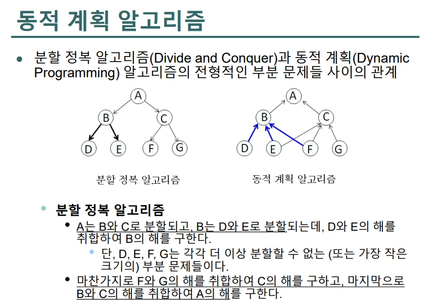
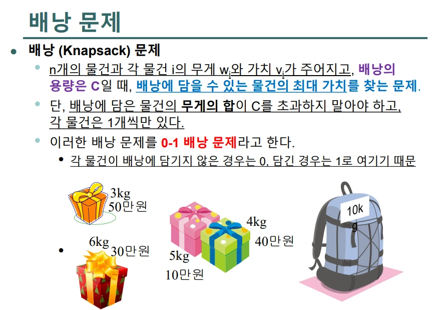
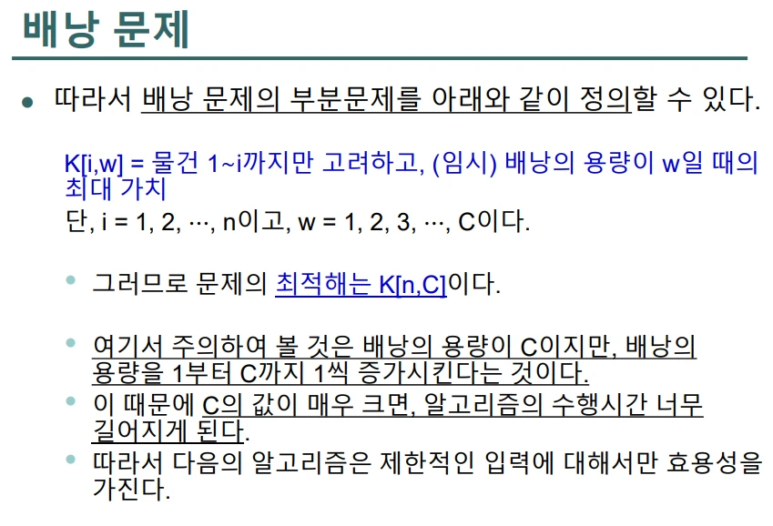
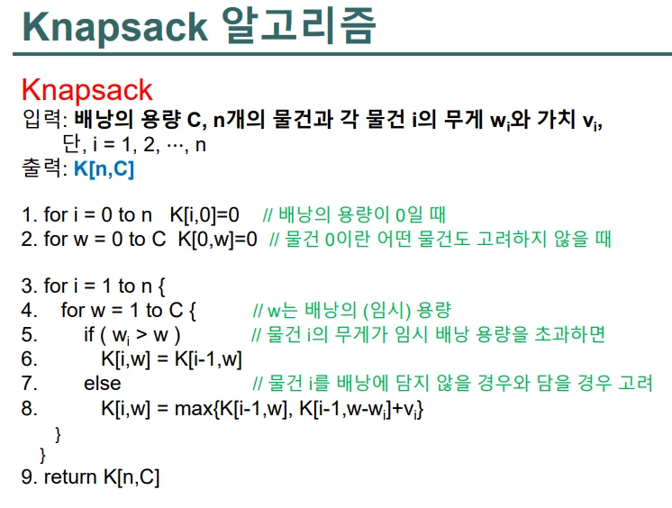

# Dynamic Programming

- Dynamic Programming : 최적화 문제를 해결하는 방법으로써, 입력 크기가 작은 걸로 최대한 쪼개고 작은 부분 문제들을 해결한 후에, 그 해들을 이용하여 큰 크기의 부분 문제들을 해결하여 최종적으로 원래 주어진 입력의 문제를 해결하는 방법이다.

큰 문제가 A이며, `분할 정복 알고리즘(Divide and Conquer)`의 경우 D, E의 해를 이용하여 B를 구하고 F, G의 해를 이용하여 C를 구한 뒤, B, C의 해를 이용하여 A를 구한다.

DP는 이와 다르게, 다른 곳의 해를 끌어올 수 있는 것이다. 예를 들어, B의 해를 구할 때 D, E 뿐만 아니라 F, 혹은 G 까지도 끌어와서 사용해 부분해를 구할 수 있는 것이다. (DP는 Subproblem간에 Dependency(의존성)가 있다.)

## Knapsack 문제

- 용량이 C인 배낭이 있고, 물건이 i개가 있을 때 각 물건의 무게를 wi라고 하고 가치를 vi라고 한다. 이 상황에서 용량 C를 넘기지 않고 담을 수 있는 물건의 최대 가치를 구하는 문제를 배낭 문제라고 한다.
- 여기서는 0-1 배낭 문제를 고려하는데, 물건을 넣거나 안넣거나 둘 중 하나의 상태만 있는 것을 말한다.

배낭 문제의 부분 문제는 이와 같이 정의할 수 있다.

- K[i, w] = 물건 1 ~ i 까지만 고려하고, 임시 배낭의 용량이 w일 때, (배낭의 용량을 점차 늘려간다.) 물건의 최대 가치
- 그러므로 문제의 최적해는 `K[n, C]`이다.
- 여기서 주의할 것은, 배낭의 용량은 C이지만, 배낭의 용량은 1부터 C까지 1씩 증가하기 때문에 C의 값이 매우 크면 알고리즘의 수행시간이 매우 길어지기 때문에 DP를 이용한 Knapsack 문제는 제한적인 입력에 대해서만 효용성을 가진다.
- Knapsack 알고리즘

- 입력 : 배낭의 용량 C, n개의 물건과 각 물건 i의 무게 Wi, 가치 Vi
- 출력 K[n, C] : n개의 물건을 고려하고, 용량 C를 고려했을 때 얻을 수 있는 가치

## Algorithm Flow

- 배낭 문제는 0-1을 고려한다.

배낭 문제의 시작은 K[0, 0]부터이다. 이것은 현재 물건을 아무것도 고려하지 않는 상황이고, 배낭의 무게를 0으로 고려하는 상황이다.

이 상태에서, 물건 i = 1, w를 1씩 늘려나간다. 그렇게 되면 물건 i = 1이 들어갈 수 있는 w가 되는 경우가 생기는데, 이 경우부터 K[n, C]를 기록해나간다.

이후에 물건 i = 2를 고려하게 되면, i = 1과 겹쳐서 물건을 고려하게 되는 경우가 생길 것이다. 예를 들어, 물건 1은 5kg, 10만원이고 물건 2는 4kg 40만원 이라고 하자. 이 경우에, w = 5라고 한다면, 두 개의 가치를 비교해야 되는 상황에 놓이게 된다. 이렇게 되면 다음 수식을 활용한다.

$max(k[i-1, w], k[i-1, w-wi] + vi)$ : 이 수식을 통해서 어떤 것이 더 가치가 높은지 확인한다.

이렇게 해서 만약, 새로운 물건을 집어넣는 것이 더 가치가 높다면 새로운 물건을 집어넣게 된다. 이 수식을 활용해서 물건 i = 1, w = 1 … C, i = 2, w = 1 … C, …, i = i, w = 1 … C 까지 모든 과정을 확인하게 되면 결과를 얻을 수 있게 된다.
