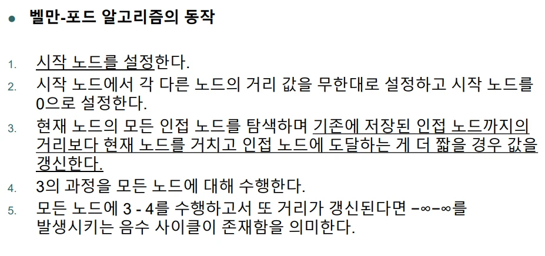

# Bellman-Ford Algorithm

작성일 2022-12-04
{ .post-date }

- `다익스트라` 알고리즘이 모든 `가중치`가 `양수`인 경우에만 사용할 수 있는 반면에, `벨만-포드` 알고리즘은 노드 간의 간선 `가중치`가 `음수`인 경우에도 사용할 수 있다. 다만 `시간 복잡도`는   
    `벨만-포드`가 더 크기 때문에, 가중치가 모두 양수라면 굳이 벨만-포드를 사용하지 않는다.

1. 시작 노드를 설정하고, 일단 모든 다른 노드까지의 거리를 INF로 초기화한 뒤, 시작 노드의 거리는 0으로 설정한다.
2. 현재 노드를 기준으로 모든 `인접 노드`를 `탐색`하며 기존에 저장된 인접 노드까지의 거리보다 현재 노드를 거치고 인접 노드에 도달하는게 더 짧을 경우 값을 갱신한다.
3. 이전의 과정을 모든 노드에 대해 수행한다.
4. 모든 노드에 대해서 위의 과정을 수행하고도 거리가 갱신된다면 - 사이클이 존재함을 의미한다.

<!-- -->

- 벨만-포드 알고리즘은 한 번 모든 노드를 탐색한 이후에 다시 한 번 모든 노드를 탐색하게 된다. 이 때, 특정 그래프의 경우에는 음수 가중치에 의해서 계속해서 최단 경로가 업데이트되는 경우가 생긴다.
- 이를 방지하기 위해서, 벨만-포드 알고리즘은 음수 사이클을 체크할 수 있는 장치를 만든다.
- 모든 정점을 V-1번 방문하면, 각 정점별 최단 경로가 확정된다. 그러므로, 모든 정점을 V번 방문했을 때도 최단 경로가 갱신된다면, 음수 사이클이 존재한다고 볼 수 있는 것이다.
- 시간 복잡도 : 각 정점 별로 `V`번 방문하고, 정점에 붙어있는 `간선`들을 방문하므로, 총 시간 복잡도는 $O(VE)$이다.   
    ⇒ `V-1`번 탐색하고, 현재 노드와 연결된 노드를 찾기 위해 매번 간선 `E`개를 탐색하기 때문이다. 그런데, 만약 dense graph라면, E가 $V^2$에 근사해지므로, $O(V^3)$이 된다. 따라서, 벨만-포드 알고리즘은 간선의 가중치에 음수가 존재할 경우에 채택하는 것이 유리하다.
