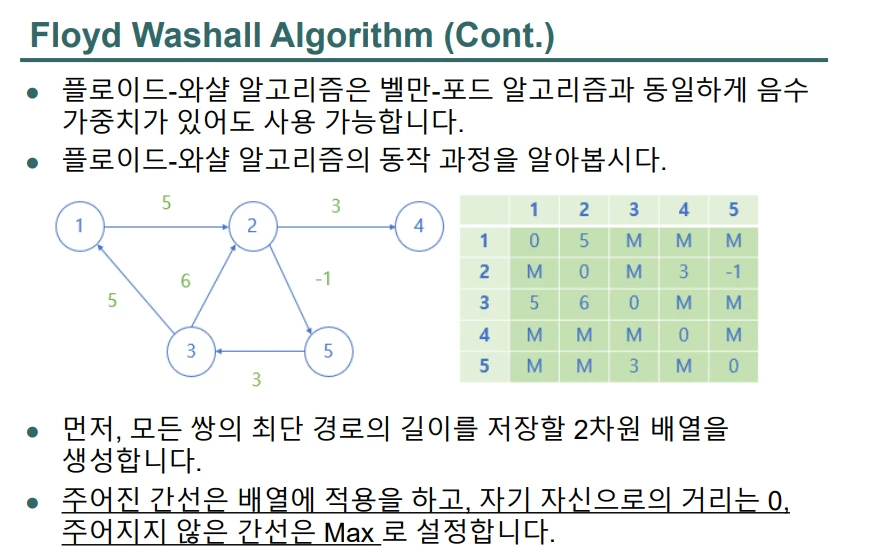

# Floyd-Warshall Algorithm

- 다익스트라와 벨만-포드 알고리즘은 시작점이 정해져있어서 모든 쌍에 대한 최단 경로를 알아낼 수 없었다. 물론, 단일 시작점 알고리즘을 여러번 돌린다면 모든 쌍에 대한 최단 경로를 찾아낼 수는 있지만, 시간 복잡도와 알고리즘 구현 측면에서 한 번만 실행해도 되는 플로이드-와샬 알고리즘이 더 적합한 선택일 수 있다.

    ⇒ 음수 가중치가 있어도 사용 가능한 플로이드 알고리즘

    

- 플로이드-와샬 알고리즘은 음수 가중치가 있어도 사용 가능한 플로이드 알고리즘이다.
- 먼저, 모든 쌍의 최단 경로의 길이를 저장할 2차원 배열을 생성한다.
- 주어진 간선을 배열에 적용한다.

> 플로이드-와샬도 플로이드 알고리즘과 마찬가지로, 정점이 0번부터 뚫릴 때, 그 점을 경유해서 지나는 것이 현재의 최단 거리보다 짧다면 최단 거리를 갱신한다.

- 위의 예제에서 5번의 경유점 설정이 지나고 나서, 모든 정점 쌍에 대한 최단 경로를 갱신했다면 알고리즘이 종료된다. 만약, 자기 자신으로 가는 최단 경로의 길이가 음수인 정점이 생겼다면 그래프 내에 음수 사이클이 존재한다는 증거이다.  
    ⇒ 위의 예제에서, 만약 3→2의 가중치가 -4라고 한다면, 2 → 2의 가중치는 음수가 나온다. 이렇게 되면 음수 사이클이 발생한다는 것이다.
- 시간 복잡도 : V에 대한 3중 for문을 사용하므로, 플로이드-와샬 알고리즘의 시간 복잡도는   
    $O(V^3)$이다.
